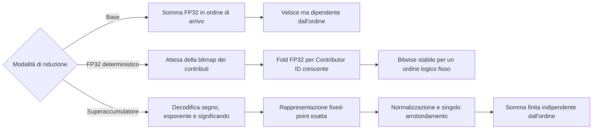

# Riproducibilità in virgola mobile

La riproducibilità in virgola mobile è una proprietà di correttezza
dell'offload delle operazioni collettive, non soltanto un dettaglio di analisi
numerica. In una collettiva in-network, l'ordine effettivo di riduzione può
dipendere dal tempo di arrivo dei pacchetti, dall'arbitraggio delle VOQ, dalla
backpressure, dallo scheduling egress, dalla forma dell'albero e dal
posizionamento dei rank sulle porte. Questo è un problema per l'addizione in
virgola mobile in stile IEEE: ogni operazione viene arrotondata e l'addizione non
è quindi associativa.

PRISM studia il problema al confine con l'elaborazione dei pacchetti.
L'obiettivo non è rendere deterministica, da solo, un'intera applicazione
distribuita. Computazione locale, partizionamento dei tensori, scelte del
compilatore, kernel GPU e frammenti di riduzione lato host possono ancora
introdurre non determinismo prima che i pacchetti raggiungano lo switch. La
domanda più circoscritta è:

!!! question "Domanda sulla riproducibilità di PRISM"

    Data la stessa identità di Collective Operation con lo stesso descrittore
    aritmetico, gli stessi contributi dei rank e la stessa politica per le eccezioni, può un datapath
    RTL simile a quello di uno switch produrre lo stesso pattern di bit finale
    in virgola mobile indipendentemente dal timing dei pacchetti e dall'ordine
    di arbitraggio?

La proprietà è rilevante per debugging, regression test, validazione numerica e
checkpoint/restart: lo stesso job può conservare rank e input ma attraversare
nodi, porte leaf o alberi di aggregazione differenti.

## Strategie candidate

PRISM tratta la riproducibilità come uno spazio di progetto, non come
un'unica scelta aritmetica codificata rigidamente.

| Strategia | Idea per il datapath | Garanzia di riproducibilità | Costo principale |
|---|---|---|---|
| **Accumulazione FP32 di base** | Accumula gli operandi nell'ordine di arrivo dei pacchetti. | Nessuna oltre la singola esecuzione. | Stato minimo e datapath più semplice. |
| **Scheduling FP32 deterministico** | Attende i contributori previsti per il chunk e li somma per Contributor ID locale crescente. | Riproducibilità bitwise per gli stessi contributi e lo stesso ordine. | Buffering, bitmap dei contributi e head-of-line blocking. |
| **Percorso in stile Kulisch / superaccumulatore** | Mappa ogni input finito in una rappresentazione fixed-point esatta, combina i contributi con aritmetica intera e arrotonda una sola volta alla fine. | Somma finita esatta e indipendente dall'ordine prima dell'arrotondamento finale. | Stato dell'accumulatore ampio, banking, gestione dei riporti, normalizzazione finale e politica delle eccezioni. |

La distinzione fondamentale è che **lo scheduling deterministico fissa
l'ordine**, mentre un **superaccumulatore elimina l'ordine come variabile
numerica**. Il primo approccio è più economico e costituisce un riferimento
utile. Il secondo è più costoso, ma corrisponde meglio alla semantica attesa da
una riduzione collettiva indipendente dall'ordine.

!!! warning "Esattezza locale e globale"

    La garanzia vale per gli operandi combinati da un singolo accumulatore. In
    un albero multi-livello, serializzare un parziale esatto in FP32 arrotonda a
    quell'hop. L'esattezza globale indipendente dall'albero richiede una
    rappresentazione lossless dello stato parziale. Protocol 1.0 riserva una
    capability per i parziali esatti, ma non ne definisce ancora il formato.

## Perché sperimentare ora con i superaccumulatori?

Tre sviluppi rendono oggi significativa questa domanda:

- **INC nei sistemi reali.** SHARP ha portato l'offload delle collettive nei
  fabric HPC e AI di produzione[^sharp-overview][^sharp-blog]; SwitchML ha
  mostrato il beneficio dell'aggregazione in-network per l'addestramento
  distribuito[^switchml].
- **Precisione mista.** Formati ridotti quali FP8 E4M3 ed E5M2 riducono traffico
  e costo computazionale, ma richiedono spesso un'accumulazione più ampia o più
  stabile[^nvidia-fp8]. La semantica dell'accumulatore diventa quindi parte
  dell'accuratezza del sistema.
- **Limiti dei datapath programmabili.** Le pipeline nate per il packet
  processing non offrono naturalmente aritmetica floating-point applicativa;
  FPISA documenta il costo dei workaround necessari[^fpisa]. Un prototipo FPGA
  dedicato permette invece di misurare direttamente questa funzione.

La domanda hardware è dunque quantitativa: quale frontiera di Pareto emerge tra
un percorso FP32 deterministico e un superaccumulatore, considerando area,
BRAM/URAM, banking, riporti, initiation interval, Fmax, backpressure e latenza
dell'arrotondamento finale?

## Semantica del superaccumulatore

Per un input binario finito in virgola mobile, il riduttore decodifica:

\[
x = (-1)^s M 2^{e-(p-1)}
\]

dove \(p\) è la precisione del significando, incluso il bit implicito, \(M\) è
il significando intero ed \(e\) è l'esponente unbiased. Anche i valori
subnormali sono multipli esatti della più piccola unità subnormale:

\[
2^{E_{\min}-(p-1)}.
\]

Un accumulatore per somme scalari in stile Kulisch sceglie questa unità come bit
fixed-point meno significativo. Ogni operando viene allineato alla posizione
corrispondente; la rappresentazione intermedia intera rende la somma associativa
e commutativa entro la capacità dell'accumulatore. Il risultato floating-point
si ottiene normalizzando la somma esatta e arrotondandola una sola volta.

Si ottiene così una separazione netta tra timing di rete e semantica aritmetica:

\[
\text{ordine dei pacchetti} \;\not\Rightarrow\; \text{ordine delle operazioni floating-point}.
\]

I valori speciali devono essere gestiti fuori dal datapath fixed-point. NaN,
infiniti, zeri con segno, operazioni non valide e overflow del formato finale
devono essere tracciati mediante flag sideband deterministici e una politica di
canonicalizzazione documentata. Il superaccumulatore finito deve ricevere
soltanto contributi numerici finiti.

## Dimensionamento dell'accumulatore per riduzioni scalari { #accumulator-sizing-for-scalar-reductions }

La larghezza dell'accumulatore dipende dall'operazione. Per le riduzioni scalari
di PRISM,

\[
\sum_{i=1}^{R} x_i,
\]

il bound rilevante **non** è quello del prodotto scalare. Siano:

- \(R\) il numero massimo di partecipanti che contribuiscono a un elemento di riduzione;
- \(p\) la precisione del significando, incluso il bit implicito;
- \(E_{\min}\) l'esponente minimo dei numeri normalizzati;
- \(E_{\max}\) l'esponente massimo dei numeri normalizzati.

Per una somma scalare finita esatta che include i subnormali:

\[
W_{\mathrm{mag}} = E_{\max} - E_{\min} + p
\]

e la larghezza dell'accumulatore con segno in complemento a due è:

\[
W_{\mathrm{signed}} =
W_{\mathrm{mag}} + \lceil \log_2 R \rceil + 1.
\]

Il termine \(+\lceil \log_2 R\rceil\) è il margine per il riporto necessario a
sommare \(R\) operandi dello stesso segno e di magnitudine massima. Il \(+1\)
finale è il bit di segno.

| Formato di input | \(p\) | \(E_{\min}\) | \(E_{\max}\) | Bit esatti della magnitudine scalare | Accumulatore con segno per \(R\) partecipanti |
|---|---:|---:|---:|---:|---:|
| FP8 E4M3FN | 4 | -6 | 8 | 18 | \(19+\lceil\log_2 R\rceil\) |
| FP8 E4M3FNUZ | 4 | -7 | 7 | 18 | \(19+\lceil\log_2 R\rceil\) |
| FP8 E5M2 | 3 | -14 | 15 | 32 | \(33+\lceil\log_2 R\rceil\) |
| FP8 E5M2FNUZ | 3 | -15 | 15 | 33 | \(34+\lceil\log_2 R\rceil\) |
| IEEE FP16 / binary16 | 11 | -14 | 15 | 40 | \(41+\lceil\log_2 R\rceil\) |
| BF16 | 8 | -126 | 127 | 261 | \(262+\lceil\log_2 R\rceil\) |
| IEEE FP32 / binary32 | 24 | -126 | 127 | 277 | \(278+\lceil\log_2 R\rceil\) |

Le righe FP8 estendono l'analisi di dimensionamento, ma non implicano il loro
supporto sul wire in Protocol 1.0.

Pertanto, un singolo accumulatore per riduzioni scalari che copra FP8, FP16,
BF16 e FP32 è dominato dall'intervallo degli esponenti FP32/BF16:

\[
\boxed{
W_{\mathrm{FP32\ scalar\ reduce}} =
278+\lceil\log_2 R\rceil
}
\]

Per esempio, con \(R=256\) rank, un accumulatore esatto con segno per somme scalari
FP32 richiede:

\[
278+\lceil\log_2 256\rceil = 286
\]

bit per lane di riduzione, prima di aggiungere metadati implementativi come bit
di validità, flag di eccezione, tag dell'operazione, bitmap dei contributi o stato di
selezione delle banche.

!!! warning "Riduzione scalare, non prodotto scalare"

    PRISM somma valori floating-point già calcolati. Il bound più ampio di un
    accumulatore Kulisch per \(\sum_i a_i b_i\), che deve rappresentare
    esattamente anche i prodotti, riguarda un motore MAC ed è fuori ambito.

## Perché non preservare soltanto l'ordine FP32?

Un riduttore FP32 deterministico arrotonda dopo ogni addizione: rende il
risultato ripetibile, ma incorpora nell'algoritmo l'ordine scelto. Variazioni nel
numero di rank, nel chunking o nelle somme parziali possono ancora cambiare il
risultato. Il superaccumulatore, invece, deposita esattamente gli operandi finiti
e arrotonda una sola volta.

PRISM confronta quindi **due datapath aritmetici**: FP32 deterministico, come
riferimento a minore area, e accumulazione esatta, indipendente dall'ordine. La
condizione di completamento — tutti i contributori attesi per il chunk — è un
requisito di controllo comune; non costituisce una terza modalità aritmetica.

## Risultato atteso

Il contributo atteso è una misura implementativa del compromesso:

\[
\text{riproducibilità} \quad \leftrightarrow \quad
\text{area} + \text{stato} + \text{latenza} + \text{pressione sul timing}.
\]

La domanda non è quindi se il superaccumulatore sia sempre preferibile, ma a
quali condizioni possa essere integrato senza compromettere il funzionamento a
line rate.

[^sharp-overview]: Documentazione NVIDIA, *Scalable Hierarchical Aggregation and
    Reduction Protocol (SHARP)*. SHARP viene descritto come offload delle
    operazioni collettive MPI e di machine learning da CPU e GPU alla rete.
    https://docs.nvidia.com/networking/display/sharpv300

[^sharp-blog]: NVIDIA Developer Blog, *Advancing Performance with NVIDIA SHARP
    In-Network Computing*. L'articolo descrive SHARP come in-network computing
    negli ASIC degli switch per la comunicazione collettiva.
    https://developer.nvidia.com/blog/advancing-performance-with-nvidia-sharp-in-network-computing/

[^switchml]: Sapio et al., *Scaling Distributed Machine Learning with In-Network
    Aggregation*, NSDI 2021.
    https://www.usenix.org/conference/nsdi21/presentation/sapio

[^nvidia-fp8]: Documentazione NVIDIA Transformer Engine, *Using FP8 and FP4 with
    Transformer Engine*.
    https://docs.nvidia.com/deeplearning/transformer-engine/user-guide/examples/fp8_primer.html

[^fpisa]: Yuan et al., *Unlocking the Power of Inline Floating-Point Operations
    on Programmable Switches*, NSDI 2022.
    https://www.usenix.org/system/files/nsdi22-paper-yuan.pdf
