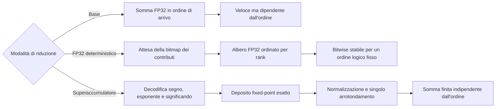

# Riproducibilità in virgola mobile

La riproducibilità in virgola mobile è una proprietà di correttezza
dell'offload delle operazioni collettive, non soltanto un dettaglio di analisi
numerica. In una collettiva in-network, l'ordine effettivo di riduzione può
dipendere dal tempo di arrivo dei pacchetti, dall'arbitraggio delle VOQ, dalla
backpressure, dallo scheduling egress, dalla forma dell'albero e dal
posizionamento dei rank sulle porte. Questo è un problema per l'addizione in
virgola mobile in stile IEEE: ogni operazione viene arrotondata e l'addizione non
è quindi associativa.

PRISM studia il problema al confine con l'elaborazione dei pacchetti.
L'obiettivo non è rendere deterministica, da solo, un'intera applicazione
distribuita. Computazione locale, partizionamento dei tensori, scelte del
compilatore, kernel GPU e frammenti di riduzione lato host possono ancora
introdurre non determinismo prima che i pacchetti raggiungano lo switch. La
domanda più circoscritta è:

!!! question "Domanda sulla riproducibilità di PRISM"

    Dati la stessa epoca logica di riduzione, gli stessi contributi dei rank, lo
    stesso tipo di dato e la stessa politica per le eccezioni, può un datapath
    RTL simile a quello di uno switch produrre lo stesso pattern di bit finale
    in virgola mobile indipendentemente dal timing dei pacchetti e dall'ordine
    di arbitraggio?

La proprietà è importante per debugging, regression test, validazione numerica,
workflow di checkpoint/restart e carichi scientifici o safety-critical, nei
quali differenze a livello di bit rendono difficile riprodurre un errore. È
importante anche dal punto di vista operativo: in un cluster reale, lo stesso
job può essere avviato con lo stesso numero di rank ma mappato su nodi, porte
leaf o percorsi di aggregazione differenti.

## Strategie candidate

PRISM tratta la riproducibilità come uno spazio di progetto, non come
un'unica scelta aritmetica codificata rigidamente.

| Strategia | Idea per il datapath | Garanzia di riproducibilità | Costo principale |
|---|---|---|---|
| **Accumulazione FP32 di base** | Accumula gli operandi nell'ordine di arrivo dei pacchetti. | Nessuna oltre la singola esecuzione. | Stato minimo e datapath più semplice. |
| **Scheduling FP32 deterministico** | Attende tutti i rank previsti per un'epoca/lane, quindi li somma secondo un ordine logico dei rank o un albero prefissato. | Riproducibilità bitwise per lo stesso insieme di rank e lo stesso ordine logico. | Comportamento simile a una barriera, buffering, bitmap dei contributi e head-of-line blocking. |
| **Percorso in stile Kulisch / superaccumulatore** | Converte ogni input finito in un deposito fixed-point esatto, combina i depositi con aritmetica intera e arrotonda una sola volta alla fine. | Somma finita esatta e indipendente dall'ordine prima dell'arrotondamento finale. | Stato dell'accumulatore ampio, banking, gestione dei riporti, normalizzazione finale e politica delle eccezioni. |

La distinzione fondamentale è che **lo scheduling deterministico fissa
l'ordine**, mentre un **superaccumulatore elimina l'ordine come variabile
numerica**. Il primo approccio è più economico e costituisce un riferimento
utile. Il secondo è più costoso, ma corrisponde meglio alla semantica attesa da
una riduzione collettiva indipendente dall'ordine.

## Perché sperimentare ora con i superaccumulatori?

La motivazione è oggi più forte di quanto sarebbe stata dieci anni fa.

In primo luogo, l'offload in-network delle operazioni collettive non è più
un'idea esotica. NVIDIA/Mellanox SHARP[^sharp-overview] ha portato nodi di
aggregazione, alberi di aggregazione e offload delle collettive nel vocabolario
dei fabric HPC e AI di produzione. SHARP[^sharp-blog] dimostra che spostare il
lavoro di riduzione nella rete può ridurre il traffico ridondante agli endpoint
e liberare risorse CPU/GPU dall'elaborazione della comunicazione.

In secondo luogo, i carichi distribuiti AI e HPC operano sempre più spesso a
scale nelle quali la comunicazione collettiva è un limite prestazionale di primo
ordine. Sistemi come SwitchML[^switchml] hanno mostrato che aggregare gli
aggiornamenti dei modelli nella rete può migliorare le prestazioni end-to-end
dell'addestramento distribuito, riducendo i dati scambiati ed evitando parte
dell'overhead di comunicazione lato host.

In terzo luogo, gli acceleratori moderni utilizzano già precisione mista. I
formati FP8 in stile NVIDIA H100[^nvidia-fp8] comprendono E4M3 ed E5M2: in
genere E4M3 viene scelto per i valori forward più sensibili alla precisione ed
E5M2 per gradienti con maggiore range dinamico. Questo rende la semantica
dell'accumulazione più importante, non meno: payload a bassa precisione sono
spesso accettabili soltanto perché l'accumulazione avviene in un formato più
ampio o più stabile.

In quarto luogo, i datapath degli switch programmabili convenzionali sono stati
progettati principalmente per elaborare pacchetti, non per eseguire aritmetica
in virgola mobile a livello applicativo. Il lavoro su FPISA[^fpisa] identifica
esplicitamente i dati floating-point nell'addestramento distribuito e nel query
processing come casi nei quali l'hardware di switching esistente richiede
workaround costosi o supporto architetturale. PRISM si colloca quindi come
strumento di ricerca RTL: invece di emulare la virgola mobile in una pipeline
P4/RMT vincolata, studia il costo di un datapath FPGA dedicato.

Infine, l'accumulazione esatta o riproducibile si traduce naturalmente in
domande di ricerca hardware: larghezza dell'accumulatore, organizzazione
carry-save rispetto a carry-propagate, file di accumulatori bancati, pressione
su BRAM/URAM, initiation interval, Fmax, comportamento della backpressure e
latenza dell'arrotondamento finale. Sono precisamente i compromessi che un
prototipo RTL compatto può mettere in evidenza.

!!! note "Obiettivo progettuale"

    PRISM non assume che un superaccumulatore sia sempre la scelta
    ingegneristica migliore. L'obiettivo è misurare la frontiera di Pareto tra un
    percorso FP32 deterministico economico e un percorso di accumulazione esatta
    più ampio, rispettando vincoli simili a quelli di uno switch: ingresso dei
    pacchetti a line rate, stato on-chip limitato, tracciamento delle epoche e
    scheduling a livello di pacchetto.

## Semantica del superaccumulatore

Per un input binario finito in virgola mobile, il riduttore decodifica:

\[
x = (-1)^s M 2^{e-(p-1)}
\]

dove (p) è la precisione del significando, incluso il bit implicito, (M) è
il significando intero ed (e) è l'esponente unbiased. Anche i valori subnormal
sono multipli esatti della più piccola unità subnormal:

\[
2^{E_{\min}-(p-1)}.
\]

Un accumulatore per somme scalari in stile Kulisch sceglie questa unità minima
come bit meno significativo fixed-point. Ogni operando floating-point in
ingresso viene depositato nella posizione fixed-point corrispondente. Poiché la
rappresentazione intermedia è uno stato intero esatto, la somma di due depositi
è associativa e commutativa entro la capacità dell'accumulatore. Il risultato
floating-point finale viene prodotto normalizzando la somma intera esatta e
arrotondandola una sola volta secondo la modalità selezionata.

Si ottiene così una separazione netta tra timing di rete e semantica aritmetica:

\[
\text{ordine dei pacchetti} \;\not\Rightarrow\; \text{ordine delle operazioni floating-point}.
\]

I valori speciali devono essere gestiti fuori dal datapath fixed-point. NaN,
infiniti, zeri con segno, operazioni non valide e overflow del formato finale
devono essere tracciati mediante flag sideband deterministici e una politica di
canonicalizzazione documentata. Il superaccumulatore finito deve ricevere
soltanto depositi numerici finiti.

## Dimensionamento dell'accumulatore per riduzioni scalari { #accumulator-sizing-for-scalar-reductions }

La larghezza dell'accumulatore dipende dall'operazione. Per le riduzioni scalari
di PRISM,

\[
\sum_{i=1}^{R} x_i,
\]

il bound rilevante **non** è quello del prodotto scalare. Siano:

- (R) il numero massimo di partecipanti che contribuiscono a un elemento di riduzione;
- (p) la precisione del significando, incluso il bit implicito;
- (E_{\min}) l'esponente normal minimo;
- (E_{\max}) l'esponente normal massimo.

Per una somma scalare finita esatta che include i subnormal:

\[
W_{\mathrm{mag}} = E_{\max} - E_{\min} + p
\]

e la larghezza dell'accumulatore signed in complemento a due è:

\[
W_{\mathrm{signed}} =
W_{\mathrm{mag}} + \lceil \log_2 R \rceil + 1.
\]

Il termine (+\lceil \log_2 R\rceil) è il margine per il riporto necessario a
sommare (R) operandi dello stesso segno e di magnitudine massima. Il (+1)
finale è il bit di segno.

| Formato di input | (p) | (E_{\min}) | (E_{\max}) | Bit esatti della magnitudine scalare | Accumulatore signed per (R) partecipanti |
|---|---:|---:|---:|---:|---:|
| FP8 E4M3FN | 4 | -6 | 8 | 18 | (19+\lceil\log_2 R\rceil\) |
| FP8 E4M3FNUZ | 4 | -7 | 7 | 18 | (19+\lceil\log_2 R\rceil\) |
| FP8 E5M2 | 3 | -14 | 15 | 32 | (33+\lceil\log_2 R\rceil\) |
| FP8 E5M2FNUZ | 3 | -15 | 15 | 33 | (34+\lceil\log_2 R\rceil\) |
| IEEE FP16 / binary16 | 11 | -14 | 15 | 40 | (41+\lceil\log_2 R\rceil\) |
| BF16 | 8 | -126 | 127 | 261 | (262+\lceil\log_2 R\rceil\) |
| IEEE FP32 / binary32 | 24 | -126 | 127 | 277 | (278+\lceil\log_2 R\rceil\) |

Pertanto, un singolo accumulatore per riduzioni scalari che copra FP8, FP16,
BF16 e FP32 è dominato dal range degli esponenti FP32/BF16:

\[
\boxed{
W_{\mathrm{FP32\ scalar\ reduce}} =
278+\lceil\log_2 R\rceil
}
\]

Per esempio, con (R=256) rank, un accumulatore signed esatto per somme scalari
FP32 richiede:

\[
278+\lceil\log_2 256\rceil = 286
\]

bit per lane di riduzione, prima di aggiungere metadati implementativi come bit
di validità, flag di eccezione, tag di epoca, bitmap dei contributi o stato di
selezione delle banche.

!!! warning "Non confondere riduzione scalare e prodotto scalare"

    Il bound più ampio del prodotto scalare di Kulisch si applica a:

    \[
    \sum_{i=1}^{N} a_i b_i,
    \]

    non a una normale somma collettiva di valori floating-point già calcolati.
    Per un prodotto scalare, il range esatto del prodotto raddoppia
    approssimativamente l'intervallo degli esponenti:

    \[
    W_{\mathrm{dot\ mag}} =
    2(E_{\max}-E_{\min}) + 2p,
    \]

    e:

    \[
    W_{\mathrm{dot\ signed}} =
    W_{\mathrm{dot\ mag}}+\lceil\log_2 N\rceil+1.
    \]

    Per l'accumulazione di un prodotto scalare FP32 si ottengono
    (555+\lceil\log_2 N\rceil) bit signed. Questo valore è appropriato per un
    motore MAC esatto, non per una somma scalare in stile `ALLREDUCE`.

## Perché non preservare soltanto l'ordine FP32?

Preservare un ordine floating-point rigoroso è un riferimento valido, ma non
equivale all'accumulazione esatta.

Un riduttore FP32 deterministico arrotonda comunque dopo ogni addizione. Può
rendere ripetibile il risultato, ma l'ordine selezionato diventa parte
dell'algoritmo numerico. Un numero di rank, un chunking o somme parziali locali
differenti possono ancora cambiare il risultato. Un accumulatore finito esatto,
al contrario, rende la riduzione indipendente dall'ordine nel quale vengono
depositati gli operandi finiti; rimane soltanto l'arrotondamento finale.

Preservare l'ordine può inoltre contrastare lo scopo dell'in-network computing.
Se la riproducibilità viene ottenuta raccogliendo gli operandi su una root,
serializzando la riduzione o inoltrando accumulatori FP32 intermedi tra gli
endpoint, il progetto può reintrodurre l'overhead di comunicazione e
sincronizzazione che INC intende evitare. Un superaccumulatore locale è
interessante perché mantiene il costo della riproducibilità nel nodo di
aggregazione senza ampliare il formato del payload sul wire.

PRISM confronta quindi entrambi i percorsi:

1. **Modalità FP32 deterministica**, utile come riferimento a bassa area e per studiare il determinismo dello scheduling.
2. **Modalità superaccumulatore**, utile per studiare la somma finita indipendente dall'ordine e il costo hardware dell'accumulazione esatta.
3. **Modalità wait-all per epoca**, utile come politica di controllo per impedire emissioni anticipate e dipendenza dall'ordine di arrivo, ma non sufficiente da sola come soluzione aritmetica.

## Risultato atteso

Il contributo atteso non è affermare che i superaccumulatori siano sempre
migliori. È una misura a livello implementativo del compromesso:

\[
\text{riproducibilità} \quad \leftrightarrow \quad
\text{area} + \text{stato} + \text{latenza} + \text{pressione sul timing}.
\]

Questo è il punto di ricerca centrale di PRISM: se un datapath simile a uno
switch contiene già stato del parser, VOQ, memoria condivisa per i pacchetti,
arbitraggio, backpressure e slot di aggregazione, la domanda aperta è se
l'accumulazione floating-point esatta o quasi esatta possa essere integrata
senza compromettere il funzionamento a line rate.

[^sharp-overview]: Documentazione NVIDIA, *Scalable Hierarchical Aggregation and
    Reduction Protocol (SHARP)*. SHARP viene descritto come offload delle
    operazioni collettive MPI e di machine learning da CPU e GPU alla rete.
    https://docs.nvidia.com/networking/display/sharpv300

[^sharp-blog]: NVIDIA Developer Blog, *Advancing Performance with NVIDIA SHARP
    In-Network Computing*. L'articolo descrive SHARP come in-network computing
    negli ASIC degli switch per la comunicazione collettiva.
    https://developer.nvidia.com/blog/advancing-performance-with-nvidia-sharp-in-network-computing/

[^switchml]: Sapio et al., *Scaling Distributed Machine Learning with In-Network
    Aggregation*, NSDI 2021.
    https://www.usenix.org/conference/nsdi21/presentation/sapio

[^nvidia-fp8]: Documentazione NVIDIA Transformer Engine, *Using FP8 and FP4 with
    Transformer Engine*.
    https://docs.nvidia.com/deeplearning/transformer-engine/user-guide/examples/fp8_primer.html

[^fpisa]: Yuan et al., *Unlocking the Power of Inline Floating-Point Operations
    on Programmable Switches*, NSDI 2022.
    https://www.usenix.org/system/files/nsdi22-paper-yuan.pdf
