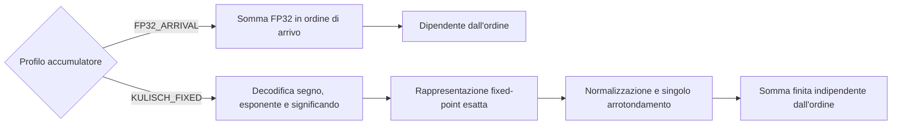

# Riproducibilità in virgola mobile

La riproducibilità in virgola mobile è una proprietà di correttezza
dell'offload delle operazioni collettive, non soltanto un dettaglio di analisi
numerica. In una collettiva in-network, l'ordine effettivo di riduzione può
dipendere dal tempo di arrivo dei pacchetti, dall'arbitraggio delle VOQ, dalla
backpressure, dallo scheduling egress, dalla forma dell'albero e dal
posizionamento dei rank sulle porte. Questo è un problema per l'addizione in
virgola mobile in stile IEEE: ogni operazione viene arrotondata e l'addizione non
è quindi associativa.

PRISM studia il problema al confine con l'elaborazione dei pacchetti.
L'obiettivo non è rendere deterministica, da solo, un'intera applicazione
distribuita. Computazione locale, partizionamento dei tensori, scelte del
compilatore, kernel GPU e frammenti di riduzione lato host possono ancora
introdurre non determinismo prima che i pacchetti raggiungano lo switch. La
domanda più circoscritta è:

!!! question "Domanda sulla riproducibilità di PRISM"

    Data la stessa identità di Collective Operation con lo stesso descrittore
    aritmetico, gli stessi contributi dei rank e la stessa politica per le eccezioni, può un datapath
    RTL simile a quello di uno switch produrre lo stesso pattern di bit finale
    in virgola mobile indipendentemente dal timing dei pacchetti e dall'ordine
    di arbitraggio?

La proprietà è rilevante per debugging, regression test, validazione numerica e
checkpoint/restart: lo stesso job può conservare rank e input ma attraversare
nodi, porte leaf o alberi di aggregazione differenti.

## Strategie candidate

PRISM tratta la riproducibilità come uno spazio di progetto, non come
un'unica scelta aritmetica codificata rigidamente.

| Strategia | Idea per il datapath | Garanzia di riproducibilità | Costo principale |
|---|---|---|---|
| **FP32_ARRIVAL** | Accumula gli operandi ammissibili in ordine di arrivo. | Nessuna oltre un determinato ordine di esecuzione. | Stato minimo e scheduling più semplice. |
| **KULISCH_FIXED** | Mappa ogni input finito in una rappresentazione fixed-point esatta nell'accumulatore configurato e arrotonda una sola volta alla fine. | Somma finita esatta e indipendente dall'ordine prima dell'arrotondamento finale quando la larghezza configurata è sufficiente. | Stato dell'accumulatore ampio, banking, gestione dei riporti, normalizzazione finale e politica delle eccezioni. |

`AUTO` è una scelta distinta per il trasporto: codifica senza perdita un
valore già prodotto dalla policy aritmetica.

L'accumulo FP32 arrotonda ogni addizione nell'ordine di ammissione; un
**superaccumulatore elimina l'ordine come variabile numerica** per le somme
finite entro il bound configurato.

!!! warning "Esattezza locale e globale"

    La garanzia vale per gli operandi combinati da un singolo accumulatore. In
    un albero multi-livello, serializzare un parziale esatto in FP32 arrotonda a
    quell'hop. L'esattezza globale indipendente dall'albero richiede una
    rappresentazione lossless dello stato parziale. PRISM può trasportare un
    parziale in formato Kulisch senza perdita quando le policy aritmetiche e
    di trasporto configurate lo consentono.

## Perché sperimentare ora con i superaccumulatori?

L'offload delle collettive in rete è usato in produzione. SHARP ha portato gli
alberi di aggregazione nei fabric HPC e AI[^sharp-overview][^sharp-blog], e
SwitchML ha mostrato il beneficio dell'aggregazione in-network per
l'addestramento distribuito[^switchml].

Gli acceleratori usano la precisione mista. Formati ridotti quali FP8 E4M3 ed
E5M2 riducono traffico e costo computazionale, ma richiedono spesso
un'accumulazione più ampia o più stabile[^nvidia-fp8]. La semantica
dell'accumulatore diventa quindi parte dell'accuratezza del sistema.

Le pipeline programmabili degli switch sono nate per il packet processing e non
offrono naturalmente aritmetica floating-point applicativa; FPISA documenta il
costo dei workaround necessari[^fpisa]. Un datapath FPGA dedicato permette
invece di misurare direttamente questa funzione.

La domanda hardware è dunque quantitativa: quale frontiera di Pareto emerge tra
un percorso `FP32_ARRIVAL` e un superaccumulatore, considerando area,
BRAM/URAM, banking, riporti, initiation interval, Fmax, backpressure e latenza
dell'arrotondamento finale?

## Semantica del superaccumulatore

Per un input binario finito in virgola mobile, il riduttore decodifica:

\[
x = (-1)^s M 2^{e-(p-1)}
\]

dove \(p\) è la precisione del significando, incluso il bit implicito, \(M\) è
il significando intero ed \(e\) è l'esponente unbiased. Anche i valori
subnormali sono multipli esatti della più piccola unità subnormale:

\[
2^{E_{\min}-(p-1)}.
\]

Un accumulatore per somme scalari in stile Kulisch sceglie questa unità come bit
fixed-point meno significativo. Ogni operando viene allineato alla posizione
corrispondente; la rappresentazione intermedia intera rende la somma associativa
e commutativa entro la capacità dell'accumulatore. Il risultato floating-point
si ottiene normalizzando la somma esatta e arrotondandola una sola volta.

Si ottiene così una separazione netta tra timing di rete e semantica aritmetica:

\[
\text{ordine dei pacchetti} \;\not\Rightarrow\; \text{ordine delle operazioni floating-point}.
\]

I valori speciali devono essere gestiti fuori dal datapath fixed-point. NaN,
infiniti, zeri con segno, operazioni non valide e overflow del formato finale
devono essere tracciati mediante flag sideband deterministici e una politica di
canonicalizzazione documentata. Il superaccumulatore finito deve ricevere
soltanto contributi numerici finiti.

## Dimensionamento dell'accumulatore per riduzioni scalari { #accumulator-sizing-for-scalar-reductions }

La larghezza dell'accumulatore dipende dall'operazione. Per le riduzioni scalari
di PRISM,

\[
\sum_{i=1}^{R} x_i,
\]

il bound rilevante **non** è quello del prodotto scalare. Siano:

- \(R\) il numero massimo di partecipanti che contribuiscono a un elemento di riduzione;
- \(p\) la precisione del significando, incluso il bit implicito;
- \(E_{\min}\) l'esponente minimo dei numeri normalizzati;
- \(E_{\max}\) l'esponente massimo dei numeri normalizzati.

Per una somma scalare finita esatta che include i subnormali:

\[
W_{\mathrm{mag}} = E_{\max} - E_{\min} + p
\]

e la larghezza dell'accumulatore con segno in complemento a due è:

\[
W_{\mathrm{signed}} =
W_{\mathrm{mag}} + \lceil \log_2 R \rceil + 1.
\]

Il termine \(+\lceil \log_2 R\rceil\) è il margine per il riporto necessario a
sommare \(R\) operandi dello stesso segno e di magnitudine massima. Il \(+1\)
finale è il bit di segno.

| Formato di input | \(p\) | \(E_{\min}\) | \(E_{\max}\) | Bit esatti della magnitudine scalare | Accumulatore con segno per \(R\) partecipanti |
|---|---:|---:|---:|---:|---:|
| FP8 E4M3FN | 4 | -6 | 8 | 18 | \(19+\lceil\log_2 R\rceil\) |
| FP8 E4M3FNUZ | 4 | -7 | 7 | 18 | \(19+\lceil\log_2 R\rceil\) |
| FP8 E5M2 | 3 | -14 | 15 | 32 | \(33+\lceil\log_2 R\rceil\) |
| FP8 E5M2FNUZ | 3 | -15 | 15 | 33 | \(34+\lceil\log_2 R\rceil\) |
| IEEE FP16 / binary16 | 11 | -14 | 15 | 40 | \(41+\lceil\log_2 R\rceil\) |
| BF16 | 8 | -126 | 127 | 261 | \(262+\lceil\log_2 R\rceil\) |
| IEEE FP32 / binary32 | 24 | -126 | 127 | 277 | \(278+\lceil\log_2 R\rceil\) |

Le righe FP8 estendono l'analisi di dimensionamento, ma non implicano il loro
supporto sul wire di PRISM.

Pertanto, un singolo accumulatore per riduzioni scalari che copra FP8, FP16,
BF16 e FP32 è dominato dall'intervallo degli esponenti FP32/BF16:

\[
\boxed{
W_{\mathrm{FP32\ scalar\ reduce}} =
278+\lceil\log_2 R\rceil
}
\]

Per esempio, con \(R=256\) rank, un accumulatore esatto con segno per somme scalari
FP32 richiede:

\[
278+\lceil\log_2 256\rceil = 286
\]

bit per lane di riduzione, prima di aggiungere metadati implementativi come bit
di validità, flag di eccezione, tag dell'operazione, bitmap dei contributi o stato di
selezione delle banche.

!!! warning "Riduzione scalare, non prodotto scalare"

    PRISM somma valori floating-point già calcolati. Il bound più ampio di un
    accumulatore Kulisch per \(\sum_i a_i b_i\), che deve rappresentare
    esattamente anche i prodotti, riguarda un motore MAC ed è fuori ambito.

## Parallelismo e line rate

Con \(b_d\) bit per elemento, \(L_d\) lane, frequenza \(f\) e initiation
interval \(II_d\):

\[
T_d=\frac{L_db_df}{II_d}, \qquad
L_{min}=\left\lceil\frac{T_{goal}II_d}{b_df}\right\rceil.
\]

A 250 MHz e \(II=1\), FP32 richiede 13 lane per 100 Gbit/s, FP16/BF16 ne
richiedono 25 e INT8 50. Il core corrente mantiene `TILE_ELEMENTS=16` e forma
un issue group con 1, 2 o 4 tile. Accetta quindi 16 FP32, 32 FP16/BF16 o 64 INT8
per ciclo, pari a 128 Gbit/s in tutti i casi. Anche la conversione in uscita può
limitare il sistema: 64 input INT8 convertiti in FP32 producono 2048 bit per
ciclo.

## Perché non preservare soltanto l'ordine FP32?

Un riduttore FP32 deterministico arrotonda dopo ogni addizione: rende il
risultato ripetibile, ma incorpora nell'algoritmo l'ordine scelto. Variazioni nel
numero di rank, nel chunking o nelle somme parziali possono ancora cambiare il
risultato. Il superaccumulatore, invece, deposita esattamente gli operandi finiti
e arrotonda una sola volta.

PRISM confronta quindi `FP32_ARRIVAL`, che accumula in ordine di ammissione,
e `KULISCH_FIXED`,
che conserva la somma finita esatta. `AUTO` può scegliere un formato lossless
per un parziale già calcolato. Ogni policy aritmetica definisce la rappresentazione
aritmetica e la regola di aggiornamento.

La policy esatta usa la larghezza Kulisch configurata per
l'operazione. L'ammissione deriva la larghezza richiesta dal dominio degli
input e dal numero massimo di termini originali; una larghezza insufficiente
non può essere ammessa come esatta. Un futuro prodotto scalare richiede il
bound più ampio dei prodotti, non quello della somma scalare.

## Risultato atteso

Il contributo atteso è una misura implementativa del compromesso:

\[
\text{riproducibilità} \quad \leftrightarrow \quad
\text{area} + \text{stato} + \text{latenza} + \text{pressione sul timing}.
\]

La domanda non è quindi se il superaccumulatore sia sempre preferibile, ma a
quali condizioni possa essere integrato senza compromettere il funzionamento a
line rate.

[^sharp-overview]: Documentazione NVIDIA, *Scalable Hierarchical Aggregation and
    Reduction Protocol (SHARP)*. SHARP viene descritto come offload delle
    operazioni collettive MPI e di machine learning da CPU e GPU alla rete.
    https://docs.nvidia.com/networking/display/sharpv300

[^sharp-blog]: NVIDIA Developer Blog, *Advancing Performance with NVIDIA SHARP
    In-Network Computing*. L'articolo descrive SHARP come in-network computing
    negli ASIC degli switch per la comunicazione collettiva.
    https://developer.nvidia.com/blog/advancing-performance-with-nvidia-sharp-in-network-computing/

[^switchml]: Sapio et al., *Scaling Distributed Machine Learning with In-Network
    Aggregation*, NSDI 2021.
    https://www.usenix.org/conference/nsdi21/presentation/sapio

[^nvidia-fp8]: Documentazione NVIDIA Transformer Engine, *Using FP8 and FP4 with
    Transformer Engine*.
    https://docs.nvidia.com/deeplearning/transformer-engine/user-guide/examples/fp8_primer.html

[^fpisa]: Yuan et al., *Unlocking the Power of Inline Floating-Point Operations
    on Programmable Switches*, NSDI 2022.
    https://www.usenix.org/system/files/nsdi22-paper-yuan.pdf
