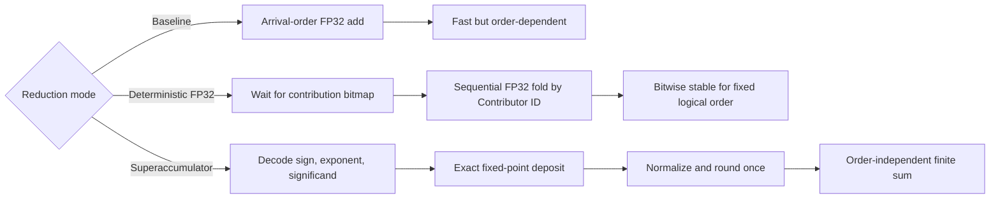

# Floating-Point Reproducibility

Floating-point reproducibility is a correctness property of the collective offload, not only a numerical-analysis detail. In an in-network collective, the effective reduction order can be affected by packet arrival time, VOQ arbitration, backpressure, egress scheduling, tree shape, and rank-to-port placement. This is a problem for IEEE-style floating-point addition: floating-point addition is rounded after each operation and is therefore not associative.

PRISM studies this problem at the packet-processing boundary. The goal is not to make a whole distributed application deterministic by itself. Local computation, tensor partitioning, compiler choices, GPU kernels, and host-side reduction fragments may still introduce nondeterminism before packets reach the switch. The narrower question is:

!!! question "PRISM reproducibility question"

    Given the same Collective Operation identity and arithmetic descriptor, the same rank contributions, and the same exception policy, can a switch-like RTL datapath produce the same final floating-point bit pattern independently of packet timing and arbitration order?

This matters for debugging, regression testing, numerical validation, checkpoint/restart workflows, and scientific or safety-critical workloads where bitwise differences make failures hard to reproduce. It also matters operationally: in a real cluster, the same job may be launched with the same number of ranks but mapped onto different nodes, leaf ports, or aggregation paths.

## Candidate strategies

PRISM exposes reproducibility as a design space rather than as a single hard-coded arithmetic choice.

| Strategy | Datapath idea | Reproducibility guarantee | Main cost |
|---|---|---|---|
| **Baseline FP32 accumulation** | Accumulate operands as packets arrive. | None beyond a particular run. | Lowest state and simplest datapath. |
| **Deterministic FP32 scheduling** | Wait for all contributors expected by one chunk, then add them in ascending local Contributor ID order. | Bitwise reproducible for the same contributions and logical order. | Buffering, contribution bitmaps, head-of-line blocking. |
| **Kulisch-style / superaccumulator path** | Convert each finite input into an exact fixed-point deposit; merge deposits with integer arithmetic; round once at the end. | Order-independent exact finite summation before final rounding. | Wide accumulator state, banking, carry management, final normalization, exception policy. |

The important distinction is that **deterministic scheduling fixes the order**, while a **superaccumulator removes the order as a numerical variable**. The first approach is cheaper and useful as a baseline. The second is more expensive, but it better matches the semantics expected from an order-independent collective reduction.

!!! warning "Node-local versus global exactness"

    This guarantee applies to the operands merged by one accumulator. In a
    multi-level tree, serializing an exact local partial to FP32 rounds at that
    hop. Global, tree-independent exactness requires a lossless partial-state
    representation. Protocol 1.0 reserves an exact-partial capability but does
    not yet define that representation.

## Why try superaccumulators now?

The motivation is stronger now than it would have been a decade ago.

First, in-network collective offload is no longer an exotic idea. NVIDIA/Mellanox SHARP[^sharp-overview] has made aggregation nodes, aggregation trees, and collective offload part of the vocabulary of production HPC and AI fabrics. SHARP[^sharp-blog] demonstrates that moving reduction work into the network can reduce redundant endpoint traffic and free CPU/GPU resources from communication processing.

Second, distributed AI and HPC workloads increasingly operate at scales where collective communication is a first-order performance limit. Systems such as SwitchML[^switchml] showed that aggregating model updates in the network can improve end-to-end distributed training performance by reducing exchanged data and bypassing some host-side communication overheads.

Third, modern accelerators already rely on mixed precision. NVIDIA H100-style FP8[^nvidia-fp8] uses distinct E4M3 and E5M2 formats, typically choosing E4M3 for precision-sensitive forward values and E5M2 for higher-dynamic-range gradients. This makes accumulation semantics more important, not less: low-precision payloads are often acceptable only because accumulation is performed in a wider or more stable format.

Fourth, conventional programmable-switch datapaths were designed primarily for packet processing, not for application-level floating-point arithmetic. Work on FPISA[^fpisa] explicitly identifies floating-point data in distributed training and query processing as a case where existing switch hardware needs expensive workarounds or architectural support. PRISM is therefore positioned as an RTL research vehicle: instead of emulating floating point inside a restricted P4/RMT pipeline, it studies what a purpose-built FPGA datapath would cost.

Finally, exact or reproducible accumulation maps naturally to hardware research questions: accumulator width, carry-save versus carry-propagate organization, banked accumulator files, BRAM/URAM pressure, initiation interval, Fmax, backpressure behavior, and final rounding latency. These are precisely the trade-offs that a compact RTL prototype can expose.

!!! note "Design intent"

    PRISM does not assume that a superaccumulator is always the best engineering choice. The point is to measure the Pareto frontier between a cheap deterministic FP32 path and a wider exact-accumulation path under switch-like constraints: line-rate packet ingress, bounded on-chip state, operation tracking, and packet-level scheduling.

## Superaccumulator semantics

For a finite binary floating-point input, the reducer decodes:

\[
x = (-1)^s M 2^{e-(p-1)}
\]

where \(p\) is the significand precision including the hidden bit, \(M\) is the integer significand, and \(e\) is the unbiased exponent. Subnormal values are also exact multiples of the smallest subnormal unit:

\[
2^{E_{\min}-(p-1)}.
\]

A Kulisch-style scalar-sum accumulator chooses this smallest unit as its fixed-point least significant bit. Each incoming floating-point operand is deposited into the corresponding fixed-point position. Since the intermediate representation is exact integer state, adding two deposits is associative and commutative up to the capacity of the accumulator. The final floating-point result is produced by normalizing the exact integer sum and rounding once according to the selected rounding mode.

This gives a clean separation between network timing and arithmetic semantics:

\[
\text{packet order} \;\not\Rightarrow\; \text{floating-point operation order}.
\]

Special values must be handled outside the fixed-point datapath. NaNs, infinities, signed zeros, invalid operations, and overflow of the final target format should be tracked with deterministic sideband flags and a documented canonicalization policy. The finite superaccumulator should only receive finite numeric deposits.

## Accumulator sizing for scalar reductions { #accumulator-sizing-for-scalar-reductions }

The accumulator width depends on the operation. For PRISM scalar reductions,

\[
\sum_{i=1}^{R} x_i,
\]

the relevant bound is **not** the dot-product bound. Let:

- \(R\) be the maximum number of participants contributing to one reduction element;
- \(p\) be the significand precision including the hidden bit;
- \(E_{\min}\) be the minimum normal exponent;
- \(E_{\max}\) be the maximum normal exponent.

For exact finite scalar summation including subnormals:

\[
W_{\mathrm{mag}} = E_{\max} - E_{\min} + p
\]

and the signed two's-complement accumulator width is:

\[
W_{\mathrm{signed}} =
W_{\mathrm{mag}} + \lceil \log_2 R \rceil + 1.
\]

The \(+\lceil \log_2 R\rceil\) term is the carry headroom for summing \(R\) same-sign maximum-magnitude operands. The final \(+1\) is the sign bit.

| Input format | \(p\) | \(E_{\min}\) | \(E_{\max}\) | Exact scalar magnitude bits | Signed accumulator for \(R\) participants |
|---|---:|---:|---:|---:|---:|
| FP8 E4M3FN | 4 | -6 | 8 | 18 | \(19+\lceil\log_2 R\rceil\) |
| FP8 E4M3FNUZ | 4 | -7 | 7 | 18 | \(19+\lceil\log_2 R\rceil\) |
| FP8 E5M2 | 3 | -14 | 15 | 32 | \(33+\lceil\log_2 R\rceil\) |
| FP8 E5M2FNUZ | 3 | -15 | 15 | 33 | \(34+\lceil\log_2 R\rceil\) |
| IEEE FP16 / binary16 | 11 | -14 | 15 | 40 | \(41+\lceil\log_2 R\rceil\) |
| BF16 | 8 | -126 | 127 | 261 | \(262+\lceil\log_2 R\rceil\) |
| IEEE FP32 / binary32 | 24 | -126 | 127 | 277 | \(278+\lceil\log_2 R\rceil\) |

Therefore, a single scalar-reduction accumulator covering FP8, FP16, BF16, and FP32 is dominated by FP32/BF16 exponent range:

\[
\boxed{
W_{\mathrm{FP32\ scalar\ reduce}} =
278+\lceil\log_2 R\rceil
}
\]

For example, with \(R=256\) ranks, an exact signed FP32 scalar-sum accumulator requires:

\[
278+\lceil\log_2 256\rceil = 286
\]

bits per reduction lane, before adding implementation metadata such as valid bits, exception flags, operation tags, contribution bitmaps, or bank-selection state.

!!! warning "Do not confuse scalar reduction with dot product"

    The wider Kulisch dot-product bound applies to:

    \[
    \sum_{i=1}^{N} a_i b_i,
    \]

    not to a normal collective sum of already-computed floating-point values. For a dot product, the exact product range roughly doubles the exponent span, giving:

    \[
    W_{\mathrm{dot\ mag}} =
    2(E_{\max}-E_{\min}) + 2p,
    \]

    and:

    \[
    W_{\mathrm{dot\ signed}} =
    W_{\mathrm{dot\ mag}}+\lceil\log_2 N\rceil+1.
    \]

    For FP32 dot-product accumulation this gives \(555+\lceil\log_2 N\rceil\) signed bits. That number is appropriate for an exact MAC engine, not for a scalar `ALLREDUCE`-style sum.

## Why not only preserve the FP32 order?

Preserving a strict floating-point order is a valid baseline, but it is not equivalent to exact accumulation.

A deterministic FP32 reducer still rounds after every addition. It can make the result repeatable, but the selected order becomes part of the numerical algorithm. A different rank count, different chunking, or different local partial sums can still change the result. In contrast, an exact finite accumulator makes the reduction independent of the order in which finite operands are deposited; only the final rounding step remains.

Preserving order can also fight the purpose of in-network computing. If reproducibility is achieved by gathering operands to a root, serializing the reduction, or forwarding intermediate FP32 accumulators across endpoints, the design may reintroduce communication and synchronization overhead that INC was meant to avoid. A local superaccumulator is attractive because it keeps the reproducibility cost inside the aggregation node rather than increasing the payload format on the wire.

PRISM therefore compares both paths:

1. **Deterministic FP32 mode**, useful as a lower-area baseline and for studying scheduling determinism.
2. **Superaccumulator mode**, useful for studying order-independent finite summation and the hardware cost of exact accumulation.
3. **Wait-all operation mode**, useful as a control policy to prevent early emission and arrival-order dependence, but not an arithmetic solution by itself.

## Expected outcome

The expected contribution is not the claim that superaccumulators are universally better. The expected contribution is an implementation-level measurement of the trade-off:

\[
\text{reproducibility} \quad \leftrightarrow \quad
\text{area} + \text{state} + \text{latency} + \text{timing pressure}.
\]

For PRISM, this is the central research point: if a switch-like datapath already contains parser state, VOQs, shared packet memory, arbitration, backpressure, and aggregation slots, then the open question is whether exact or near-exact floating-point accumulation can be integrated without destroying line-rate behavior.

[^sharp-overview]: NVIDIA, *Scalable Hierarchical Aggregation and Reduction Protocol (SHARP)* documentation. SHARP is described as offloading MPI and machine-learning collective operations from CPUs and GPUs to the network. https://docs.nvidia.com/networking/display/sharpv300

[^sharp-blog]: NVIDIA Developer Blog, *Advancing Performance with NVIDIA SHARP In-Network Computing*. The post describes SHARP as switch-ASIC in-network computing for collective communication. https://developer.nvidia.com/blog/advancing-performance-with-nvidia-sharp-in-network-computing/

[^switchml]: Sapio et al., *Scaling Distributed Machine Learning with In-Network Aggregation*, NSDI 2021. https://www.usenix.org/conference/nsdi21/presentation/sapio

[^nvidia-fp8]: NVIDIA Transformer Engine documentation, *Using FP8 and FP4 with Transformer Engine*. https://docs.nvidia.com/deeplearning/transformer-engine/user-guide/examples/fp8_primer.html

[^fpisa]: Yuan et al., *Unlocking the Power of Inline Floating-Point Operations on Programmable Switches*, NSDI 2022. https://www.usenix.org/system/files/nsdi22-paper-yuan.pdf
