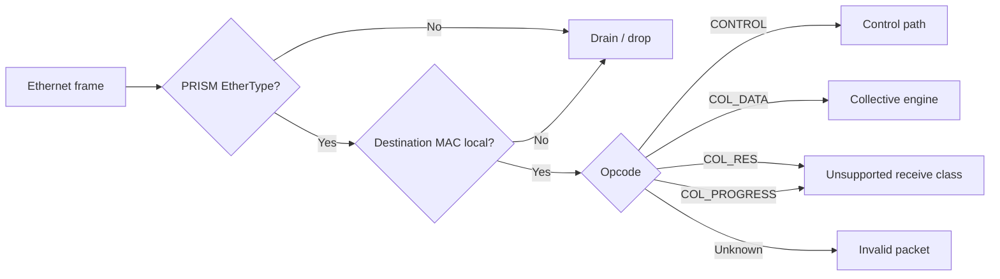
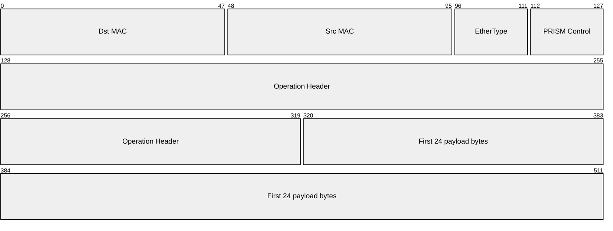
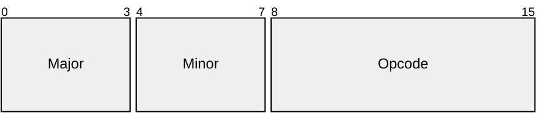
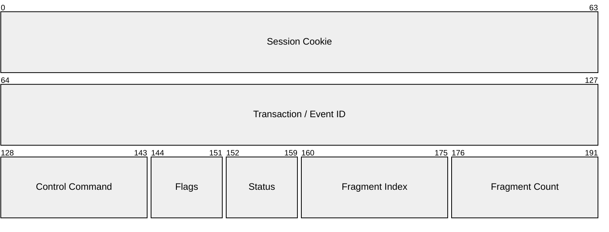
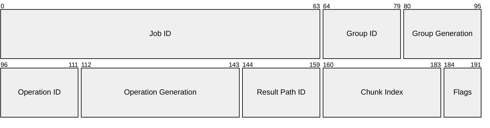
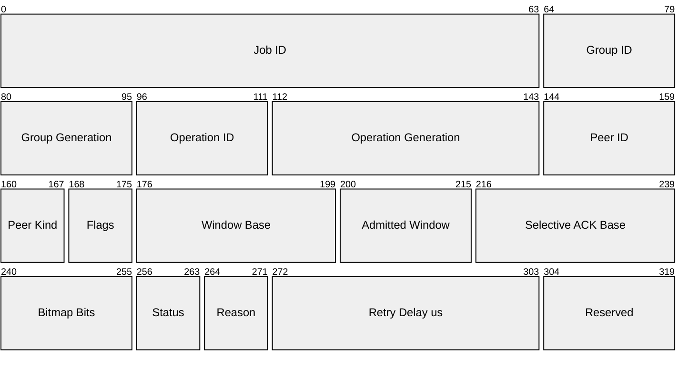

# Protocol

PRISM is a Layer-2 protocol for FPGA-based System Area Networks (SANs), carrying
collective operations directly over Ethernet frames. The current RTL terminates
locally addressed PRISM traffic in one `SINGLE` collective node. It does not
forward ordinary Ethernet traffic or implement hop-by-hop replay.

The implemented node supports two MPI-style semantics:

- `REDUCE`: several ranks contribute, but one selected rank receives the sum;
- `ALLREDUCE`: the same sum is returned to every participating rank.

A **rank** is one participating process or accelerator endpoint. In a reduction
tree, leaf switches receive rank contributions, optional internal switches
combine partial sums, and one aggregation root produces the final result.

The implemented packet flow has three locally processed classes: in-band
CONTROL, endpoint contributions in DATA, and generated results in RES. The
registry also assigns PROGRESS for a later hop-reliability extension; assigning
an opcode does not imply that an RTL receive path exists for it.

PRISM is a research FPGA datapath, not a complete production Ethernet switch.
The protocol therefore prioritizes a clear packet model, reproducible tests,
and implementable RTL over a broad management or security stack.

!!! abstract "Protocol goal"

    The first packet beat contains enough information for the parser to select
    CONTROL, DATA, RES, PROGRESS, or drain/drop handling before the numeric
    payload reaches the collective engine.

This page introduces frame ownership, identity, chunking, and setup before
presenting the packet layouts. The final sections collect the exact Protocol
1.0 registries and validation rules shared by RTL and host software.

---

## Frame ownership

PRISM classification proceeds from the outer Ethernet frame inward:

1. Parse destination MAC, source MAC, and EtherType.
2. If EtherType is not `0x88B5`, drain the frame without changing PRISM state.
3. If the frame is PRISM but its destination MAC is not local, drain it.
4. Decode the PRISM opcode only for a locally addressed PRISM frame.

The destination MAC and opcode answer different questions:

- the MAC determines whether this node owns the frame;
- the opcode selects what that owner does with the packet.

---

## Common frame format

The PRISM header is carried directly inside an Ethernet frame. The Ethernet
header selects the next destination; the PRISM header identifies the packet
class and the collective operation. The normative byte-order rule is stated
with the packet layouts below.

For a standard `PM_OP_COL_DATA` or `PM_OP_COL_RES` frame, the first 512-bit
AXI4-Stream beat is:

| Field | Size | Meaning |
|---|---:|---|
| `Dst MAC` | 48b | Ethernet destination for the next direct link |
| `Src MAC` | 48b | MAC of the sender on that link |
| `EtherType` | 16b | `0x88B5`, the PRISM experimental EtherType[^ethertype] |
| `PRISM Control` | 16b | Version and packet-class opcode |
| `Operation Header` | 192b | Job, group, operation, contributor/path, and chunk identity |
| `First payload bytes` | 192b | First 24 bytes of the vector chunk |

Subsequent full beats can contain up to 64 bytes (512 bits) of numeric data.

`TKEEP` identifies valid bytes in the final beat and `TLAST` marks the physical
end of the frame. They validate the packet boundary; the operation configuration
still determines the exact logical vector length.

The common 16-bit control word is:

Protocol 1.0 uses `Major=1` and `Minor=0`. A different major version is
incompatible. The opcode tells the local parser how to interpret the following
header. The host request and `StartGrant` are API events outside this wire ABI,
so the host-controlled startup model does not change the Protocol 1.0 layout.
This pre-release Protocol 1.0 document defines the current wire layout.

---

## Collective identifiers

- **Job / AM session**: key `(Job ID:64, switch-local Session Cookie:64)`;
  owns configuration and provides the recovery domain.
- **Collective group**: key `(Job ID:64, Group ID:16, Group Generation:16)`;
  identifies one reusable contributor tree.
- **Collective operation**: key `(group key, Operation ID:16, Operation
  Generation:32)`; identifies one execution of that collective.
- **Contributor**: key `(operation key, Contributor ID:16)`; identifies one
  rank at a leaf or one child subtree at an internal/root node.
- **Result path**: key `(operation key, Result Path ID:16)`; identifies one
  result replica on the current direct link.
- **Chunk**: key `(direct stream, Chunk Index:24)`; identifies one DATA or RES
  packet position using that stream's wire format.
- **Result-range route**: key `(operation key, chunk range)`; maps a disjoint
  output range to one Replication Group ID.
- **Replication group / result destination set**: key `(group key,
  Replication Group ID:16)`; collects one or more direct result destinations.
- **Result destination**: key `(replication-group key, Result Path ID:16)`;
  selects one egress port, destination MAC, and next-hop type.

!!! note "Why associate a generation with an ID?"

    Numeric IDs have finite width and are therefore reused. The **generation**
    distinguishes the different instances that occupied the same ID: if a
    packet from an old instance arrives late, its generation does not match the
    current one and the switch can discard it. A Group ID is reusable only after
    `GROUP_DESTROY` has been acknowledged everywhere; an Operation ID is
    reusable only after `OP_RELEASE_RESPONSE`. Every reuse increments its
    generation.

- **Contributor binding**: Contributor IDs are dense and bound to an expected
  ingress port and source MAC; each switch stores only its local group records.

### Node roles and the single-switch case

- **`LEAF`**: directly attached ranks; reduces local contributions and emits
  one partial DATA stream to its required parent.
- **`INTERNAL`**: child subtrees; reduces their partials and emits one new
  partial DATA stream to its required parent.
- **`ROOT`**: child subtrees and no parent; completes reduction and starts
  result distribution.
- **`SINGLE`**: directly attached ranks and no parent; completes reduction
  locally and starts result distribution.

Node Role belongs to the logical collective tree; it does not alter ordinary
Ethernet forwarding.

---

## Chunking model

A PRISM **chunk** is one maximally packed, whole-element DATA or RES packet.
Chunk Index is local to a direct packet stream rather than a universal element
interval shared by every stage of the tree. Endpoint DATA, switch partial DATA,
and RES therefore derive independent geometries from the same Element Count.

The standard Ethernet payload is 1500 bytes. The 2-byte PRISM control word and
24-byte DATA/RES header leave:

\[
\boxed{\mathrm{PM\_CHUNK\_PAYLOAD\_BYTES}=1500-2-24=1474}.
\]

For a wire format `f` with a positive integral byte width:

\[
\mathrm{elements\_per\_chunk}(f)=
\left\lfloor\frac{1474}{\mathrm{bytes\_per\_element}(f)}\right\rfloor,
\]

\[
\mathrm{first\_element}(i,f)=i\,\mathrm{elements\_per\_chunk}(f),
\]

\[
\mathrm{elements\_in\_chunk}(i,f)=
\min(\mathrm{elements\_per\_chunk}(f),
\mathrm{element\_count}-\mathrm{first\_element}(i,f)),
\]

and

\[
\mathrm{chunk\_count}(f)=
\left\lceil\frac{\mathrm{element\_count}}
{\mathrm{elements\_per\_chunk}(f)}\right\rceil,
\qquad 0<\mathrm{chunk\_count}(f)\le 2^{24}.
\]

No element is split across packets. All chunks except the final one contain the
maximum whole-element count for their wire format. The payload length is
`elements_in_chunk(i,f) × bytes_per_element(f)`; the unused one to three bytes
that can remain after whole-element packing are not vector data.

DATA and RES carry no per-packet format tag. Their geometry and encoding are
selected by the installed Operation descriptor:

- endpoint-to-leaf DATA uses Input Wire Format;
- switch-to-switch DATA uses Partial Wire Format;
- RES uses Output Wire Format.

For example, a 1000-element BF16 input stream contains chunks of 737 and 263
elements. An FP32 partial or result stream for the same operation contains 368,
368, and 264 elements. The switch maps both streams to the same global element
positions; it does not preserve their numeric Chunk Index across conversion.
If a future 288-bit (36-byte) Kulisch wire format is assigned, the same rule
packs `floor(1474/36) = 40` whole elements per non-final packet.
Protocol 1.0 requires one tree-wide arithmetic configuration so every receiver can
derive the correct geometry from its configured role and Contributor binding.

Chunks may arrive in a different order inside the admitted receive window. The
tuple `(packet class, peer, Chunk Index)` identifies the direct transfer, while
the derived First Element selects format-independent accumulator state.

---

## In-band setup

The **Host Coordinator** gathers ranks and their request; the **Aggregation
Manager** (AM) converts it into per-switch configuration using topology,
capabilities, and available resources. AM commands are *in band*: they use
`PM_OP_CONTROL` Ethernet packets on the collective ports, then follow a separate
control path and never enter the numeric accumulator.

### Host-controlled start

Ranks wait at a host-side barrier until every target switch reports `ACTIVE`.
The AM then returns a `StartGrant`; the runtime's reliable host channel delivers
it to every rank and later reports `DONE` or `ERROR`.

Each rank's grant contains:

- `Job ID`, Group and Operation ID/Generation, and local Contributor ID;
- destination leaf MAC and result destination MAC;
- Element Count, wire formats, Maximum PRISM Payload Bytes, and the leaf's
  admitted receive window.

Ranks derive chunk geometry using the protocol formula. A `REDUCE` request also
names its destination rank. If any target rejects prepare or commit, the AM
releases partial state and every waiting rank receives the same failure without
a grant.

The Host Coordinator and `StartGrant` are runtime concepts, not PRISM opcodes.
They may be co-located with the AM or a participating rank; the storyboard puts
the coordinator in `rank0`, which still contributes normally.

### Target-specific delivery

The AM sends each target its own `PM_OP_CONTROL` transaction containing only
that switch's records; a transaction may span several frames. A root consumes
locally addressed commands and forwards commands for other switches unchanged; it
never derives or rewrites their configuration.

### From discovery to active operation

Protocol 1.0 separates reusable topology from one invocation:

| Phase | Main commands | Effect |
|---|---|---|
| Discover | `CAPS_QUERY`, `RESOURCE_QUERY` | Read supported features and current availability |
| Own | `SESSION_OPEN` | Establish Job ownership and a renewable switch-local cookie |
| Install topology | `GROUP_STAGE`, then `GROUP_COMMIT` | Validate and atomically install contributors, parent action, and result next hops |
| Start invocation | `OP_PREPARE`, then `OP_COMMIT` | Reserve operation state and atomically enable DATA acceptance |

- Snapshots are advisory; only `GROUP_STAGE` and `OP_PREPARE` reserve resources.
- Any partial multi-switch prepare is aborted and released on failure.
- Every group must report `INSTALLED`, and every operation `ACTIVE`, before a
  grant is returned.
- The AM validates one connected acyclic tree, one root, one parent per
  non-root node, a common semantic/operator/geometry/result format, compatible
  edge formats, and complete `REDUCE` or `ALLREDUCE` result routes.
- Commands are idempotent; conflicting Transaction-ID reuse returns
  `TXN_CONFLICT`.

### Failure, cancellation, and recovery

- A reset creates a new Device Boot ID and clears that switch's volatile PRISM
  state; a changed Boot ID, unreachable target, or AM restart fails the whole
  collective.
- The AM best-effort aborts/releases surviving state and closes the session;
  leases reclaim unreachable state. Later PRISM use installs a fresh complete
  tree rather than resuming a partial one.
- The runtime may restart from the original inputs with another algorithm, such
  as a ring. Partial PRISM output is never successful output.

### Security scope

The implementation assumes a trusted host control plane (Host Coordinator and
AM) and uses the explicit laboratory profile. Authentication and cryptographic
key management are outside the current scope; the numeric registry at the end
of this page reserves profiles for a protected deployment.

---

## Packet layouts

The four opcodes are not four variants of the same operation. `CONTROL`
configures and queries switches; `COL_DATA` carries contributions toward the
root; `COL_RES` distributes results; and `COL_PROGRESS` returns acknowledgments
and flow information to the adjacent sender. The common control word selects
one of these headers. The diagrams show the encoding; the following tables
explain the function of each field.

Unless a field says otherwise:

- fields appear in transmission order;
- Ethernet fields, PRISM headers, identifiers, lengths, flags, TLV headers, and
  scalar TLV integers use network byte order: the most significant byte is
  transmitted first;
- numeric DATA and RES elements use the operation's wire format and are little
  endian: the least significant byte of each encoded element is transmitted
  first;
- reserved fields and unused flag bits are transmitted as zero and rejected
  when received non-zero;
- widths are in bits and offsets are in bytes from the start of the containing
  header or TLV value.

| Value | Packet class | Purpose |
|---:|---|---|
| `0x00` | `PM_OP_INVALID` | Internal invalid classification; not a normal transmitted packet |
| `0x01` | `PM_OP_CONTROL` | In-band setup, management responses, and events |
| `0x02` | `PM_OP_COL_DATA` | Contributions and partial sums moving toward the aggregation root |
| `0x03` | `PM_OP_COL_RES` | Completed results moving toward destination ranks |
| `0x04` | `PM_OP_COL_PROGRESS` | ACK, retry, and receive-window feedback for one direct transfer |

An **ACK** is an acknowledgment: it tells the previous sender that a packet was
accepted safely. A **direct transfer**, also called one network hop, is one link
between two neighboring nodes; for example `rank0 -> L0` or `L0 -> S0`.

### `PM_OP_CONTROL`

`PM_OP_CONTROL` has this fixed 24-byte header after the common control word:

`CONTROL` is the envelope of the in-band management protocol. The AM uses it to
open sessions, install groups, prepare operations, and query state or resources;
switches use it for responses and events. The header identifies the exchange
and makes it reassemblable, while the TLV payload carries command-specific
parameters.

| Field | What it does | Why it is needed |
|---|---|---|
| Session Cookie | Selects the AM session local to the switch | Prevents commands from different sessions from sharing ownership and resources; it is zero only before session opening or for explicitly permitted queries |
| Transaction / Event ID | Identifies a request and its response, or one event | Enables correlation, deduplication, and reassembly while multiple exchanges are active |
| Control Command | Selects the management action and determines the permitted TLVs | Lets one envelope carry setup, query, commit, release, and event messages |
| Flags | Distinguish a request, response, or event and qualify the envelope | The meaning of the ID and Status field depends on the message role |
| Status | Reports the request outcome or the condition associated with an event | Separates the general outcome from structured or diagnostic details in TLVs; it is zero in requests |
| Fragment Index / Count | Positions this fragment and declares the total fragment count | A configuration command may exceed one Ethernet frame and must be reconstructed atomically before state changes |

!!! example "Reading one CONTROL transaction"

    A `GROUP_STAGE` sent in three frames keeps the same Session Cookie,
    Transaction ID, command, flags, status, and Fragment Count. Only Fragment
    Index changes (`0`, `1`, `2`). The switch reassembles all three payloads,
    validates the TLVs, and only then attempts to install group state.

Control flags, TLVs, and fragmentation rules

`SESSION_OPEN` and an unauthenticated static `CAPS_QUERY` use cookie zero.
Requests use a Transaction ID; events use an Event ID. Control flags are:

| Value | Flag |
|---:|---|
| `0x01` | `REQUEST` |
| `0x02` | `RESPONSE` |
| `0x04` | `EVENT` |
| `0x08` | `ACK_REQUIRED` |
| `0x10` | `AUTH_PRESENT` |

The control payload is a sequence of 64-bit-aligned Type-Length-Value records:

Value Length counts only value bytes. Zero alignment padding extends each whole
record to a multiple of 8 bytes. The only assigned TLV flag is
`MANDATORY=0x0001`. An unknown mandatory TLV rejects the transaction; an
unknown optional TLV is skipped. A non-repeatable TLV must not appear twice.

Fragment Count is positive and Fragment Index is smaller than it. Every
fragment of one `(Session Cookie, Transaction ID)` has the same command, flags,
status, and count. Reassembly completes before TLV parsing or state mutation.
Conflicting, inconsistent, timed-out, or over-capacity reassembly is discarded.

`PROTOCOL_VERSION_RANGE` is 8 bytes: minimum major, minimum minor, maximum
major, and maximum minor (8 bits each), followed by 32 zero bits. Scalar
identity, lease, profile, feature, and state TLVs contain one unsigned 64-bit
value. `PAYLOAD_DIGEST` is 32-byte SHA-256, `ERROR_DETAIL` is UTF-8, and
`AUTH_DATA` contains profile-defined opaque bytes.

`DATA`, `RES`, and `PROGRESS` belong to one already-configured operation. The
first two carry numeric elements; `PROGRESS` carries no vector data and instead
controls reliability on one direct link. Job, Group, and Operation fields occur
in all three so that a valid packet cannot be applied to the wrong context.

| Shared identity | Function |
|---|---|
| Job ID | Selects the AM ownership domain |
| Group ID + Group Generation | Selects the precise instance of the logical tree |
| Operation ID + Operation Generation | Selects the precise active execution on that tree |

### `PM_OP_COL_DATA`

The 24-byte DATA header is followed by numeric vector elements in **Little Endian** format:

The Contributor ID names a direct local source. At a leaf it normally names a
rank; at an internal node it names a child subtree. When a switch sends its
partial upward, it preserves the Job, Group, and Operation identity, replaces
Contributor ID with the installed `parent_contributor_id`, uses its local PRISM
egress MAC as source, and uses the Parent MAC from the upstream action as
destination. It generates the outgoing Chunk Index from the Partial Wire Format
geometry. Therefore a format conversion may combine input packet ranges or
split them across several partial DATA packets; it does not blindly copy the
incoming Chunk Index.

| Specific field | Function |
|---|---|
| Contributor ID | Selects the expected contributor on the current link and allows duplicate or wrong-source contributions to be detected |
| Chunk Index | Identifies the packet position in the sender's endpoint-input or switch-partial DATA stream; together with that stream's wire format it derives the global First Element |
| Flags | Mark retransmission, ACK request, and the last chunk |
| Payload | Contains Input Wire Format elements when the sender is an endpoint, or Partial Wire Format elements when the sender is a child switch |

### `PM_OP_COL_RES`

The 24-byte result header is followed by little-endian result elements:

The Result Path ID identifies one configured result replica on the current
direct path. It is replaced with the locally configured ID when another switch
replicates the result. Each replica preserves the Job, Group, Operation, and
Chunk Index because every RES hop uses the same Output Wire Format. It uses the
local PRISM egress MAC as source and takes its destination MAC from the selected
replication-group entry.

| Specific field | Function |
|---|---|
| Result Path ID | Selects the expected result replica or destination on the current link; it is hop-local and may change when a switch replicates the result |
| Chunk Index | Identifies the packet position in the Output Wire Format RES stream and therefore the result's global element interval |
| Flags | Mark retransmission, ACK request, and the last chunk |
| Payload | Contains final elements for the chunk, not another contribution to reduce |

!!! info "Shared DATA/RES flags and payload validation"

    A **peer** is the neighboring sender or receiver on one direct link. DATA
    and RES use the same flag assignments:

    | Value | Flag | Meaning |
    |---:|---|---|
    | `0x01` | `RETRANSMIT` | This packet is a retransmission |
    | `0x02` | `ACK_REQUIRED` | The direct peer must acknowledge safe acceptance |
    | `0x04` | `LAST_CHUNK` | This is the last Chunk Index in this direct stream's wire-format geometry |

    The exact payload length is derived from the chunking model above and the
    packet wire format. Ethernet padding is not vector data.

### `PM_OP_COL_PROGRESS`

`PM_OP_COL_PROGRESS` has this fixed 40-byte header, followed by an optional
selective-ACK bitmap:

`PROGRESS` travels in the opposite direction from the `DATA` or `RES` packet it
controls. It does not mean that the whole collective has started or completed:
it reports what the adjacent receiver accepted and how much more traffic it can
receive. It is never the tree-wide start signal; that signal comes from the Host
Coordinator only after the AM has observed every switch as `ACTIVE`. Each direct
link can therefore retransmit missing chunks locally without restarting the
end-to-end operation. An ACK terminates at the immediately previous sender; it
is never forwarded through the tree as the same ACK.

| Field | What it does | Why it is needed |
|---|---|---|
| Job, Group, Operation | Select the operation to which the feedback belongs | An ACK for an earlier generation must be ignored |
| Peer ID | Identifies the contributor, result path, or endpoint to which the feedback applies | A switch may manage multiple direct streams for the same operation |
| Peer Kind | Defines the namespace in which Peer ID is interpreted | The same numeric value can name different entity types; for a result ACK, Peer ID is a Result Path ID |
| Flags | Mark duplicate reception, bitmap presence, window update, result path, or fatal error | Allow unused parts to be omitted and qualify the meaning of other fields |
| Window Base | Gives the first Chunk Index in the named peer's direct DATA or RES stream receive window | Distinguishes packets that remain admissible from packets that are old or too far ahead |
| Admitted Window | Gives the number of consecutive chunks, starting at Window Base, that the receiver is prepared to admit | Provides flow control and prevents overrunning available bitmap, accumulator-range, or replay-buffer resources |
| Selective ACK Base | Maps the first bitmap bit to a Chunk Index in that same direct stream | Lets the bitmap describe an arbitrary portion of the stream without one bit per operation-wide element range |
| Bitmap Bits | Declares how many bitmap bits are meaningful | Supports variable-length selective ACKs and exact payload validation |
| Status / Reason | Report the general outcome and the specific cause of the feedback | Distinguish, for example, a harmless duplicate from an exhausted window, malformed payload, or unrecoverable error |
| Retry Delay us | Suggests how long to wait before retransmission | Avoids immediate retries when rejection is due to temporary resource pressure; zero means not applicable |
| Reserved | Space for compatible extensions, transmitted as zero | Keeps the header aligned without assigning future semantics today |

!!! example "Reading a selective ACK"

    With `Selective ACK Base = 40`, `Bitmap Bits = 4`, and bitmap `1011`, the
    receiver acknowledges chunks 40, 42, and 43; chunk 41 remains unacknowledged
    and may be retransmitted. If it also advertises `Window Base = 40` and
    `Admitted Window = 8`, it is prepared to admit chunks 40 through 47.

Selective-ACK encoding and PROGRESS flags

The bitmap payload is exactly `ceil(Bitmap Bits/8)` bytes. Bit `j`,
most-significant bit first within each byte, acknowledges
`Selective ACK Base + j` for the named peer. Unused low bits in the final byte
are zero. A single-chunk ACK uses one bit; a pure window update may use zero.

Progress flags are:

| Value | Flag | Meaning |
|---:|---|---|
| `0x01` | `DUPLICATE` | The receiver had already accepted the item |
| `0x02` | `SELECTIVE_ACK` | A selective-ACK bitmap is present |
| `0x04` | `WINDOW_UPDATE` | Window Base or Admitted Window is authoritative |
| `0x08` | `RESULT_PATH` | The peer identifies a result path |
| `0x10` | `FATAL` | The operation cannot recover by retry |

---

## Single-node collective flow

The implemented topology contains one `SINGLE` node with two directly attached
endpoint ports. Both ports can carry CONTROL and DATA frames, and either port
can receive generated RES frames according to the installed result routes.

### 1. Configure the node

The control plane opens a session, stages and commits one group, prepares an
operation, and commits it. Contributor bindings associate each endpoint with an
ingress port and source MAC. Result routes select the egress port, destination
MAC, and Result Path ID used by the packetizer.

The node accepts DATA only after the operation reaches `ACTIVE`. CONTROL
fragments may arrive out of order, but the reassembler and stager publish one
complete typed request before any table changes state.

### 2. Submit endpoint contributions

Each endpoint sends DATA chunks using its configured Contributor ID. The ingress
pipeline validates the Ethernet and PRISM headers, source binding, operation
generation, chunk geometry, payload length, flags, and final `tkeep` before the
DATA depacketizer emits arithmetic tiles.

Contributor IDs are local to the node. A duplicate contribution for the same
operation and global element range does not update the accumulator twice.

### 3. Reduce each range

The shared arithmetic path converts input elements, schedules independent
ranges, and waits for every expected contributor in each range. It then applies
the selected FP32_ARRIVAL, FP32_ORDERED, or Kulisch-family accumulation policy and
converts the completed lanes to the configured output format.

Ranges can complete independently. Result chunks become visible only after all
tiles belonging to that output chunk have been stored.

### 4. Deliver results

For `REDUCE`, the route table sends each result chunk only to the configured
destination endpoint. For `ALLREDUCE`, the router creates one packet job for
each configured endpoint destination while the chunk store retains the shared
payload until every replica finishes.

The result packetizer emits RES frames with the installed Result Path ID and
exact Chunk Index, payload length, `LAST_CHUNK`, `tkeep`, and `tlast`.
CONTROL responses and RES frames share each egress through a frame-locking
arbiter, so their beats cannot interleave.

The current receive path does not consume switch partial DATA, RES, or PROGRESS
frames. Multi-switch aggregation and hop-by-hop retry are described in
[Future work](../5-future-works/protocol.md).

---

## Collective semantics

| Value | Semantic | Meaning |
|---:|---|---|
| `0x00` | `INVALID` | Unsupported collective |
| `0x01` | `REDUCE` | Deliver the reduced vector to one selected rank |
| `0x02` | `ALLREDUCE` | Deliver the reduced vector to every participating rank |
| `0x03` | `REDUCE_SCATTER` | Reserved semantic; support must be advertised |

The current RTL supports `REDUCE` and `ALLREDUCE`.

---

## Reduction operator

| Value | Operator | Meaning |
|---:|---|---|
| `0x00` | `INVALID` | Unsupported operator |
| `0x01` | `SUM` | Element-wise addition |

`SUM` is the reduction operator implemented in the current RTL.

---

## Wire formats and accumulator profiles

An **input wire format** describes endpoint contributions, a **partial wire
format** describes DATA emitted from one switch to its parent, and an **output
wire format** describes final RES elements. An **accumulator profile** defines
the representation and width of the internal state together with the order in
which contributors update it. The four explicit choices keep every conversion
boundary selectable and queryable.

| Value | Wire format | Bytes per element |
|---:|---|---:|
| `0x01` | `INT8` | 1 |
| `0x02` | `FP16` | 2 |
| `0x03` | `BF16` | 2 |
| `0x04` | `FP32` | 4 |

Protocol 1.0 assigns only FP32 for switch-to-switch partials:

| Value | Partial Wire Format | Bytes per element |
|---:|---|---:|
| `0x00` | `INVALID` | Not applicable |
| `0x04` | `FP32` | 4 |

This is deliberately stricter than the endpoint format registry: it prevents a
tree from narrowing partials to INT8, FP16, or BF16 at every hop.

The accumulator-profile assignments are:

| Value | Accumulator profile | Meaning |
|---:|---|---|
| `0x00` | `INVALID` | Unsupported profile |
| `0x01` | `FP32_ARRIVAL` | One IEEE 754 binary32 value per element; admissible contributors are applied in arrival order |
| `0x02` | `FP32_ORDERED` | One IEEE 754 binary32 value per element; contributors are applied in ascending local Contributor ID order |
| `0x03` | `KULISCH_FP32` | Exact scalar-sum accumulator family for input formats up to FP32; internal width is selected from input format and Maximum Reduction Terms |

Assignment of a code does not claim RTL support: the complete
`(input, accumulator profile, partial, output)` tuple
must be advertised and accepted by `OP_PREPARE`.

`KULISCH_FP32` names a family rather than one fixed-width datapath. During
admission, a switch derives the exact width required by the Reduction Operator,
selected input format, and Maximum Reduction Terms, then chooses the smallest
compiled Kulisch configuration that covers it. Protocol 1.0 supports only
scalar `SUM`; a future dot-product operator requires the wider product bound and
enough descriptor information for both operands. Protocol 1.0 does not yet
assign a lossless Kulisch Partial Wire Format. Using an FP32 partial would still
round at every
switch boundary, so tree-exact operation additionally requires a compatible
partial encoding.
See
[Floating-Point Reproducibility](../1-introduction/reproducibility.md) for the
numerical derivation.

---

## Normative registries and setup records

The packet path above is sufficient to understand the protocol. The following
collapsed blocks are the exact implementation reference for parser, RTL, and
host-software work.

Control commands and TLV registry

Control commands

The Protocol 1.0 command registry uses three columns to remain readable. The
schema cell lists required, optional, and repeatable TLVs; `; ` means that the
command carries none.

| Value | Command | Accepted TLVs |
|---:|---|---|
| `0x0000` | `INVALID` | reserved |
| `0x0001` | `CAPS_QUERY` | **Optional:** `SECURITY_PROFILE` |
| `0x0002` | `CAPS_RESPONSE` | **Required:** `DEVICE_BOOT_ID`, `PROTOCOL_VERSION_RANGE`, `CAPABILITIES` **Optional:** `FEATURE_MASK`, `SECURITY_PROFILE` |
| `0x0003` | `RESOURCE_QUERY` | **Optional:** `GROUP_HANDLE`, `OPERATION_HANDLE` |
| `0x0004` | `RESOURCE_RESPONSE` | **Required:** `RESOURCE_SNAPSHOT_ID`, `RESOURCE_SNAPSHOT` **Optional:** `SESSION_USAGE` |
| `0x0010` | `SESSION_OPEN` | **Required:** `JOB_ID`, `SECURITY_PROFILE` **Optional:** `AUTH_DATA`, `LEASE_MS` |
| `0x0011` | `SESSION_OPEN_RESPONSE` | **Required:** `SESSION_COOKIE`, `DEVICE_BOOT_ID`, `LEASE_MS`, `LEASE_GRACE_MS` |
| `0x0012` | `SESSION_RENEW` | **Optional:** `LEASE_MS`, `AUTH_DATA` |
| `0x0013` | `SESSION_RENEW_RESPONSE` | **Required:** `LEASE_MS` |
| `0x0014` | `SESSION_CLOSE` | Not applicable |
| `0x0015` | `SESSION_CLOSE_RESPONSE` | **Optional:** `RELEASED_RESOURCES` |
| `0x0100` | `GROUP_STAGE` | **Required:** `GROUP_HANDLE`, `GROUP_DESCRIPTOR`, `UPSTREAM_ACTION` **Optional:** `CONTRIBUTOR_BINDING`, `REPLICATION_GROUP` **Repeatable:** `CONTRIBUTOR_BINDING`, `REPLICATION_GROUP` |
| `0x0101` | `GROUP_STAGE_RESPONSE` | **Required:** `GROUP_HANDLE`, `RESOURCE_RESERVATION` |
| `0x0102` | `GROUP_COMMIT` | **Required:** `GROUP_HANDLE` |
| `0x0103` | `GROUP_COMMIT_RESPONSE` | **Required:** `GROUP_HANDLE`, `GROUP_STATUS` |
| `0x0104` | `GROUP_ABORT` | **Required:** `GROUP_HANDLE` |
| `0x0105` | `GROUP_ABORT_RESPONSE` | **Optional:** `RELEASED_RESOURCES` |
| `0x0106` | `GROUP_STATUS` | **Required:** `GROUP_HANDLE` |
| `0x0107` | `GROUP_STATUS_RESPONSE` | **Required:** `GROUP_HANDLE`, `GROUP_STATUS` |
| `0x0108` | `GROUP_DESTROY` | **Required:** `GROUP_HANDLE` |
| `0x0109` | `GROUP_DESTROY_RESPONSE` | **Required:** `GROUP_HANDLE` **Optional:** `RELEASED_RESOURCES` |
| `0x0200` | `OP_PREPARE` | **Required:** `GROUP_HANDLE`, `OPERATION_HANDLE`, `OPERATION_DESCRIPTOR` **Optional:** `RESULT_ROUTE_RANGE`, `RETRY_POLICY` **Repeatable:** `RESULT_ROUTE_RANGE` |
| `0x0201` | `OP_PREPARE_RESPONSE` | **Required:** `OPERATION_HANDLE`, `GRANTED_RESOURCES` |
| `0x0202` | `OP_COMMIT` | **Required:** `OPERATION_HANDLE` |
| `0x0203` | `OP_COMMIT_RESPONSE` | **Required:** `OPERATION_HANDLE`, `OPERATION_STATUS` |
| `0x0204` | `OP_ABORT` | **Required:** `OPERATION_HANDLE` |
| `0x0205` | `OP_ABORT_RESPONSE` | **Required:** `OPERATION_HANDLE`, `OPERATION_STATUS` |
| `0x0206` | `OP_STATUS` | **Required:** `OPERATION_HANDLE` |
| `0x0207` | `OP_STATUS_RESPONSE` | **Required:** `OPERATION_HANDLE`, `OPERATION_STATUS` **Optional:** `PHASE_BITMAP_SUMMARY`, `ERROR_DETAIL` |
| `0x0208` | `OP_RELEASE` | **Required:** `OPERATION_HANDLE` |
| `0x0209` | `OP_RELEASE_RESPONSE` | **Required:** `OPERATION_HANDLE` **Optional:** `RELEASED_RESOURCES` |
| `0x0300` | `OP_COMPLETE_EVENT` | **Required:** `OPERATION_HANDLE`, `EVENT_DETAIL` |
| `0x0301` | `OP_ERROR_EVENT` | **Required:** `OPERATION_HANDLE`, `EVENT_DETAIL`, `ERROR_DETAIL` |
| `0x0302` | `RESOURCE_PRESSURE_EVENT` | **Required:** `EVENT_DETAIL` |
| `0x0303` | `EVENT_ACK` | **Required:** `EVENT_DETAIL` |

TLV type assignments

| Value | TLV type | Family |
|---:|---|---|
| `0x0000` | `INVALID` | General |
| `0x0001` | `JOB_ID` | General |
| `0x0002` | `DEVICE_BOOT_ID` | General |
| `0x0003` | `SESSION_COOKIE` | General |
| `0x0004` | `LEASE_MS` | General |
| `0x0005` | `LEASE_GRACE_MS` | General |
| `0x0006` | `SECURITY_PROFILE` | General |
| `0x0007` | `FEATURE_MASK` | General |
| `0x0008` | `PROTOCOL_VERSION_RANGE` | General |
| `0x0009` | `CAPABILITIES` | General |
| `0x000A` | `RESOURCE_SNAPSHOT_ID` | General |
| `0x000B` | `RESOURCE_SNAPSHOT` | General |
| `0x000C` | `RESOURCE_RESERVATION` | General |
| `0x000D` | `PAYLOAD_DIGEST` | General |
| `0x000E` | `ERROR_DETAIL` | General |
| `0x000F` | `RELEASED_RESOURCES` | General |
| `0x0010` | `AUTH_DATA` | General |
| `0x0011` | `SESSION_USAGE` | General |
| `0x0100` | `GROUP_HANDLE` | Group |
| `0x0101` | `GROUP_DESCRIPTOR` | Group |
| `0x0102` | `CONTRIBUTOR_BINDING` | Group |
| `0x0103` | `UPSTREAM_ACTION` | Group |
| `0x0104` | `REPLICATION_GROUP` | Group |
| `0x0105` | `GROUP_STATUS` | Group |
| `0x0200` | `OPERATION_HANDLE` | Operation |
| `0x0201` | `OPERATION_DESCRIPTOR` | Operation |
| `0x0202` | `RESULT_ROUTE_RANGE` | Operation |
| `0x0203` | `GRANTED_RESOURCES` | Operation |
| `0x0204` | `OPERATION_STATUS` | Operation |
| `0x0205` | `PHASE_BITMAP_SUMMARY` | Operation |
| `0x0206` | `RETRY_POLICY` | Operation |
| `0x0300` | `EVENT_DETAIL` | Event |

`CONTRIBUTOR_BINDING`, `REPLICATION_GROUP`, and `RESULT_ROUTE_RANGE` are
repeatable only in commands whose schema permits repetition.

Group and operation record layouts

Group records

The 4-byte `GROUP_HANDLE` value is:

| Offset | Width | Field |
|---:|---:|---|
| 0 | 16 | Group ID |
| 2 | 16 | Group Generation |

The 8-byte `GROUP_DESCRIPTOR` value is:

| Offset | Width | Field |
|---:|---:|---|
| 0 | 8 | Node Role |
| 1 | 8 | Flags, zero in Protocol 1.0 |
| 2 | 16 | Expected Local Contributors |
| 4 | 32 | Reserved, zero |

The repeated `REPLICATION_GROUP` records declare the exact replication groups
and result destinations installed for this group. Staging reserves those actual
records, subject to the switch's compiled capability limits. A committed group
is immutable: changing its contributors, upstream action, or replication data
requires `GROUP_DESTROY` followed by a new `GROUP_STAGE`/`GROUP_COMMIT` using a
new generation.

Each 12-byte `CONTRIBUTOR_BINDING` value is:

| Offset | Width | Field |
|---:|---:|---|
| 0 | 16 | Contributor ID |
| 2 | 16 | Ingress Port |
| 4 | 48 | Source MAC |
| 10 | 16 | Reserved, zero |

Contributor IDs are exactly the dense range
`0 <= id < expected_local_contributors`. Contributor IDs and
`(Ingress Port, Source MAC)` bindings are unique.

The 16-byte `UPSTREAM_ACTION` value is:

| Offset | Width | Field |
|---:|---:|---|
| 0 | 8 | Has Parent, `0` or `1` |
| 1 | 8 | Reserved, zero |
| 2 | 16 | Parent Contributor ID |
| 4 | 16 | Egress Port |
| 6 | 48 | Parent MAC |
| 12 | 32 | Reserved, zero |

A `REPLICATION_GROUP` begins with an 8-byte header:

| Offset | Width | Field |
|---:|---:|---|
| 0 | 16 | Replication Group ID |
| 2 | 16 | Entry Count |
| 4 | 32 | Reserved, zero |

It is followed by exactly Entry Count 12-byte result-destination entries:

| Entry offset | Width | Field |
|---:|---:|---|
| 0 | 16 | Result Path ID |
| 2 | 16 | Egress Port |
| 4 | 8 | Next-Hop Type |
| 5 | 8 | Reserved, zero |
| 6 | 48 | Destination MAC |

Entry Count is positive. Result Path IDs and `(Egress Port, Destination MAC)`
pairs are unique within the replication group.

Operation records

The 6-byte `OPERATION_HANDLE` value is:

| Offset | Width | Field |
|---:|---:|---|
| 0 | 16 | Operation ID |
| 2 | 32 | Operation Generation |

The 32-byte `OPERATION_DESCRIPTOR` value is:

| Offset | Width | Field |
|---:|---:|---|
| 0 | 8 | Collective Semantic |
| 1 | 8 | Reduction Operator |
| 2 | 8 | Input Wire Format |
| 3 | 8 | Accumulator Profile |
| 4 | 8 | Partial Wire Format |
| 5 | 8 | Output Wire Format |
| 6 | 8 | Flags; bit 0 is Result Delivery Role, all other bits zero |
| 7 | 8 | Reserved, zero |
| 8 | 32 | Element Count |
| 12 | 32 | Maximum Reduction Terms |
| 16 | 32 | Timeout, ms |
| 20 | 16 | Requested Window, in direct-stream chunks |
| 22 | 16 | Requested Replay Slots |
| 24 | 16 | Result-Range Route Count |
| 26 | 16 | Retry Limit |
| 28 | 32 | Reserved, zero |

`Elements per Chunk` and `Expected Chunks` are deliberately absent. Every node
derives the input, partial, and output geometries from Element Count, the
corresponding advertised wire format, and the negotiated Maximum PRISM Payload
Bytes. A descriptor is rejected if any resulting chunk count exceeds the
24-bit Chunk Index space. Removing duplicate geometry eliminates disagreement
between control state and packet validation.

Each 8-byte `RESULT_ROUTE_RANGE` value is:

| Offset | Width | Field |
|---:|---:|---|
| 0 | 24 | First Output Wire Format RES Chunk Index, inclusive |
| 3 | 24 | Last Output Wire Format RES Chunk Index, inclusive |
| 6 | 16 | Replication Group ID |

Route ranges lie within the derived output-stream geometry and do not overlap.
On a result-delivery node they cover every RES Chunk Index. There is no
priority, first-match, or longest-match rule; disjoint ranges may select the
same replication group.

Capability, resource, and allocation vectors

`CAPABILITIES`, `RESOURCE_SNAPSHOT`, `SESSION_USAGE`,
`RESOURCE_RESERVATION`, `GRANTED_RESOURCES`, and `RELEASED_RESOURCES` use
16-byte entries:

| Offset | Width | Field |
|---:|---:|---|
| 0 | 16 | Key |
| 2 | 16 | Flags, zero |
| 4 | 64 | Value |
| 12 | 32 | Reserved, zero |

A resource snapshot reports availability but reserves nothing. Only
`GROUP_STAGE` and `OP_PREPARE` reserve resources.

Capability keys

| Value | Capability key |
|---:|---|
| `0x0000` | `INVALID` |
| `0x0001` | `MAX_SESSIONS` |
| `0x0002` | `MAX_INSTALLED_GROUPS` |
| `0x0003` | `MAX_OPERATION_CONTEXTS` |
| `0x0004` | `MAX_ACTIVE_OPERATIONS_GLOBAL` |
| `0x0005` | `MAX_ACTIVE_OPERATIONS_PER_GROUP` |
| `0x0006` | `MAX_CHUNKS_PER_DIRECT_STREAM` |
| `0x0007` | `MAX_BITMAP_BYTES_PER_OPERATION` |
| `0x0008` | `TOTAL_PHASE_BITMAP_POOL_BYTES` |
| `0x0009` | `MAX_ACTIVE_ACCUMULATOR_RANGES_GLOBAL` |
| `0x000A` | `MAX_ACTIVE_ACCUMULATOR_RANGES_PER_OPERATION` |
| `0x000B` | `TOTAL_REPLAY_OUTPUT_SLOTS` |
| `0x000C` | `MAX_LOCAL_CONTRIBUTORS` |
| `0x000D` | `MAX_REPLICATION_GROUPS` |
| `0x000E` | `MAX_RESULT_DESTINATIONS_PER_GROUP` |
| `0x000F` | `MAX_OPERATION_RESULT_ROUTE_RANGES` |
| `0x0010` | `MAX_MANAGEMENT_STAGING_BYTES` |
| `0x0011` | `MAX_SELECTIVE_ACK_WINDOW` |
| `0x0012` | `SUPPORTED_COLLECTIVE_SEMANTICS` |
| `0x0013` | `SUPPORTED_REDUCTION_OPERATORS` |
| `0x0014` | `SUPPORTED_INPUT_FORMATS` |
| `0x0015` | `SUPPORTED_ACCUMULATOR_PROFILES` |
| `0x0016` | `SUPPORTED_PARTIAL_FORMATS` |
| `0x0017` | `SUPPORTED_OUTPUT_FORMATS` |
| `0x0018` | `MTU_BYTES` |
| `0x0019` | `MAX_PRISM_PAYLOAD_BYTES` |
| `0x001A` | `SUPPORTED_SECURITY_PROFILES` |
| `0x001B` | `SUPPORTED_RELIABILITY_FEATURES` |
| `0x001C` | `REPLAY_CACHE_DEPTH` |
| `0x001D` | `REPLAY_CACHE_RETENTION_MS` |
| `0x001E` | `ACCUMULATOR_PROFILE_CAPABILITY` |

Supported-semantic, operator, format, accumulator-profile, and security-profile
values are bitmasks with bit `n` corresponding to numeric registry value `n`.
The input, accumulator, partial, and output masks advertise independent sets;
their Cartesian product is supported. This compact representation grows with
the number of values rather than with the number of combinations. An
implementation with a non-Cartesian arithmetic restriction must not advertise
the restricted values together in Protocol 1.0.

`ACCUMULATOR_PROFILE_CAPABILITY` entries encode profile ID in bits 63:56,
accumulator state bits per element in 55:40, maximum supported reduction terms
in 39:8, and profile flags in 7:0. Profile flag bit 0 means that the profile can
be carried as a Partial Wire Format when a compatible arithmetic record is
advertised;
other bits are zero in Protocol 1.0. This key may also appear more than once;
all other capability keys appear once.

For `KULISCH_FP32`, the state width is one compiled available width rather than
a universal fixed width. The profile may therefore have several entries. Given
the Reduction Operator, input format, and Maximum Reduction Terms, admission
selects the smallest entry whose width and term limit cover the applicable
exact-arithmetic bound.

Dynamic resource keys

| Value | Resource key |
|---:|---|
| `0x0000` | `INVALID` |
| `0x0001` | `FREE_GROUP_SLOTS` |
| `0x0002` | `FREE_OPERATION_CONTEXTS` |
| `0x0003` | `FREE_ACTIVE_OPERATION_SLOTS` |
| `0x0004` | `FREE_PHASE_BITMAP_BYTES` |
| `0x0005` | `FREE_ACCUMULATOR_RANGES` |
| `0x0006` | `FREE_REPLAY_OUTPUT_SLOTS` |
| `0x0007` | `FREE_ROUTE_ENTRIES` |
| `0x0008` | `FREE_REPLICATION_GROUPS` |
| `0x0009` | `FREE_REPLICATION_ENTRIES` |
| `0x000A` | `SESSION_GROUP_USAGE` |
| `0x000B` | `SESSION_PREPARED_OPERATION_USAGE` |
| `0x000C` | `SESSION_ACTIVE_OPERATION_USAGE` |
| `0x000D` | `SESSION_BITMAP_USAGE_BYTES` |
| `0x000E` | `SESSION_ACCUMULATOR_RANGE_USAGE` |

Reservation, grant, and release keys

| Value | Allocation key |
|---:|---|
| `0x0000` | `INVALID` |
| `0x0001` | `GROUP_SLOTS` |
| `0x0002` | `OPERATION_SLOTS` |
| `0x0003` | `PHASE_BITMAP_BYTES` |
| `0x0004` | `ACCUMULATOR_RANGES` |
| `0x0005` | `REPLAY_OUTPUT_SLOTS` |
| `0x0006` | `ROUTE_ENTRIES` |
| `0x0007` | `REPLICATION_GROUPS` |
| `0x0008` | `REPLICATION_ENTRIES` |

Status and remaining numeric registries

Status assignments

| Value | Status |
|---:|---|
| `0x00` | `OK` |
| `0x01` | `UNSUPPORTED_VERSION` |
| `0x02` | `UNSUPPORTED_COMMAND` |
| `0x03` | `UNSUPPORTED_FEATURE` |
| `0x04` | `INVALID_REQUEST` |
| `0x05` | `INVALID_RECORD` |
| `0x06` | `INVALID_STATE` |
| `0x07` | `AUTH_REQUIRED` |
| `0x08` | `AUTH_FAILED` |
| `0x09` | `STALE_SESSION` |
| `0x0A` | `STALE_DEVICE_BOOT_ID` |
| `0x0B` | `TXN_CONFLICT` |
| `0x0C` | `NOT_FOUND` |
| `0x0D` | `ALREADY_EXISTS` |
| `0x0E` | `GENERATION_MISMATCH` |
| `0x0F` | `GROUP_BUSY` |
| `0x10` | `OPERATION_BUSY` |
| `0x11` | `NO_GROUP_SLOT` |
| `0x12` | `NO_OPERATION_SLOT` |
| `0x13` | `NO_BITMAP_MEMORY` |
| `0x14` | `NO_ACCUMULATOR_RANGE` |
| `0x15` | `NO_REPLAY_BUFFER` |
| `0x16` | `NO_ROUTE_RESOURCE` |
| `0x17` | `NO_REPLICATION_RESOURCE` |
| `0x18` | `UNSUPPORTED_ARITHMETIC_CONFIGURATION` |
| `0x19` | `BAD_PAYLOAD_LENGTH` |
| `0x1A` | `OUT_OF_WINDOW` |
| `0x1B` | `RETRY` |
| `0x1C` | `TIMEOUT` |
| `0x1D` | `ABORTED` |
| `0x1E` | `INTERNAL_ERROR` |

Remaining numeric registries

Each name and value below is one canonical Protocol 1.0 assignment.

| Registry | Assignments |
|---|---|
| Session state | `CLOSED=0x00`, `OPEN=0x01`, `EXPIRING=0x02`, `ORPHANED=0x03` |
| Group state | `FREE=0x00`, `STAGED=0x01`, `INSTALLED=0x02`, `DESTROYING=0x03` |
| Operation state | `FREE=0x00`, `PREPARED=0x01`, `ACTIVE=0x02`, `COMPLETE=0x03`, `RELEASING=0x04`, `ABORTED=0x05` |
| Accumulator Range state | `EMPTY=0x00`, `ACTIVE=0x01`, `OUTPUT_PENDING=0x02` |
| Node role | `INVALID=0x00`, `LEAF=0x01`, `INTERNAL=0x02`, `ROOT=0x03`, `SINGLE=0x04` |
| Next-hop type | `INVALID=0x00`, `SWITCH=0x01`, `RANK=0x02` |
| Progress peer kind | `INVALID=0x00`, `CONTRIBUTOR=0x01`, `RESULT_PATH=0x02`, `ENDPOINT=0x03` |
| Progress reason | `NONE=0x00`, `ACCEPTED=0x01`, `DUPLICATE=0x02`, `OUT_OF_WINDOW=0x03`, `NO_SLOT=0x04`, `STALE_GENERATION=0x05`, `BAD_PAYLOAD=0x06`, `RETRY_LATER=0x07`, `FATAL_OPERATION=0x08` |

The `FEATURE_MASK` and `SUPPORTED_RELIABILITY_FEATURES` bit assignments are:

| Value | Feature bit |
|---:|---|
| `0x0001` | `RELIABLE_HOP_BY_HOP` |
| `0x0002` | `SELECTIVE_ACK` |
| `0x0004` | `RESULT_ACK` |
| `0x0008` | `LEASED_SESSIONS` |
| `0x0010` | `MANAGEMENT_AUTH` |
| `0x0020` | `MACSEC_MANAGEMENT_DOMAIN` |
| `0x0040` | `EXTERNAL_BITMAP_MEMORY` |

Feature bit `0x0080` is reserved and must be transmitted as zero in Protocol
1.0. A future accumulator profile and partial format will be negotiated through
`ACCUMULATOR_PROFILE_CAPABILITY` and the supported-format masks; neither requires
an independent feature bit.

## Arithmetic support boundary

Wire-format and accumulator values are registry assignments, not support
claims. INT8 payload elements are signed two's-complement bytes; FP16 and FP32
carry IEEE 754 binary16 and binary32 bit patterns; BF16 carries one sign bit,
eight exponent bits, and seven fraction bits.

A node supports an arithmetic configuration when each selected input format,
accumulator profile, partial format, and output format is present in its
corresponding capability mask. `OP_PREPARE` selects one configuration and the AM
requires the same configuration at every switch in the tree. Protocol 1.0
freezes one baseline configuration for the `SUM` operator:

\[
(\mathrm{FP32},\ \mathrm{FP32\_ORDERED},\ \mathrm{FP32},\ \mathrm{FP32}).
\]

An implementation advertising this configuration obeys the following normative
semantics:

- each input and output is an IEEE 754 `binary32` bit pattern;
- the `FP32_ORDERED` accumulator profile folds contributors in strictly
  ascending local Contributor ID order, starting with the value from the lowest
  ID; no zero seed is inserted;
- every binary addition is performed in `binary32` and rounded immediately
  using round-to-nearest, ties-to-even; fused or wider intermediate arithmetic
  is not permitted;
- subnormal inputs and results use gradual underflow and are not flushed to
  zero;
- finite overflow produces the correctly signed infinity;
- infinity follows IEEE 754 addition, including an invalid `+infinity +
  -infinity` result;
- any NaN input, signaling NaN, or invalid addition produces the canonical
  quiet NaN bit pattern `0x7FC00000`; no NaN payload is propagated;
- same-sign zero addition preserves that sign; an exact zero sum of opposite
  signs is `+0` under the selected rounding mode;
- arithmetic exception flags and traps are not transported by Protocol 1.0.

Security-profile assignments

Protocol 1.0 assigns negotiation values but does not select a cryptographic
primitive:

| Value | Security profile | Reference meaning |
|---:|---|---|
| `0x00` | `LAB_UNAUTHENTICATED` | Laboratory bring-up without management authentication |
| `0x01` | `EXTERNAL_AUTHENTICATED_CHANNEL` | Authentication is provided by the enclosing management channel |
| `0x02` | `IN_PROTOCOL_AUTHENTICATION` | `AUTH_DATA` carries profile-defined authentication data |

The canonical CCL mirrors these assignments in
`repo/prism-ccl/src/prism_ccl/protocol/constants.py`. The RTL advertises only
the security profiles enabled by its current capability response; a registry
assignment alone is not an implementation claim.

[^ethertype]: RFC 9542 reserves `0x88B5` and `0x88B6` for local experimental
    use. They are appropriate for this research prototype, not a globally
    assigned production protocol. <https://www.rfc-editor.org/rfc/rfc9542.html>
