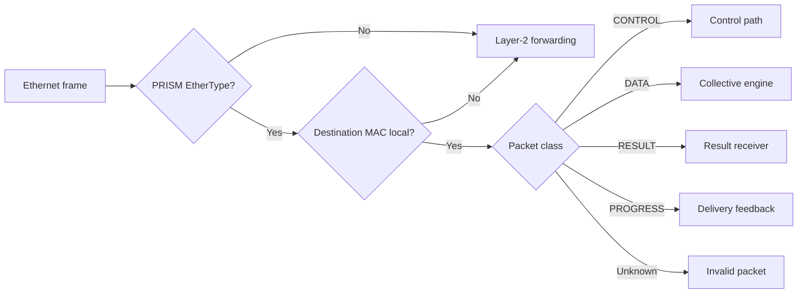
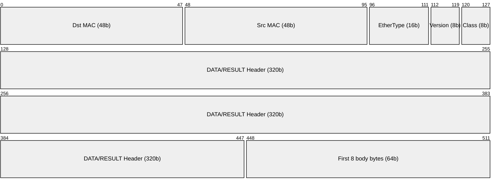
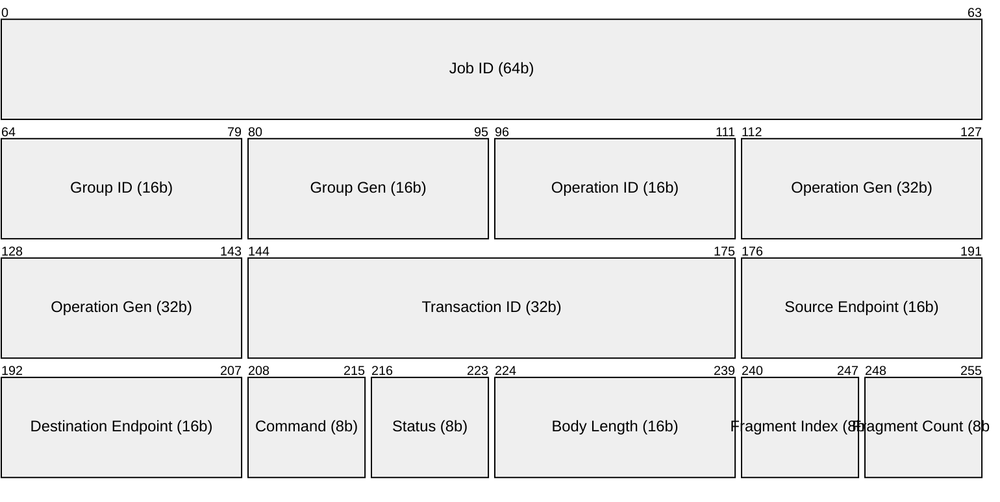
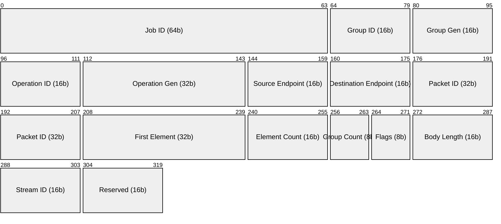
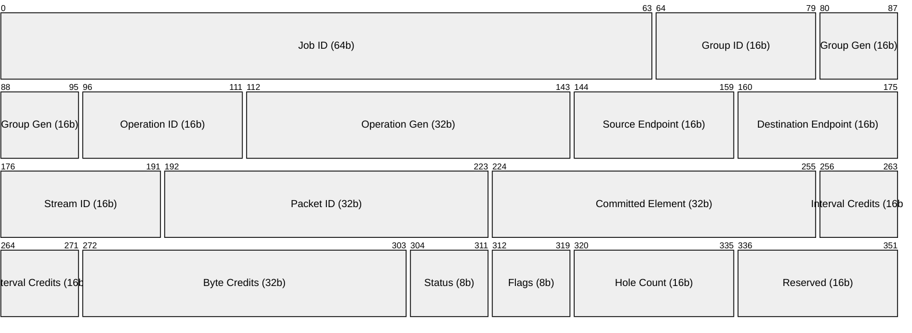

# Protocol

PRISM is a Layer-2 protocol for System Area Networks (SANs), carrying
collective operations directly over Ethernet frames. A switch can combine
contributions locally, send a partial result toward an aggregation root, and
distribute the completed result. CONTROL configures that work in band;
PROGRESS provides bounded, hop-by-hop delivery feedback.

The protocol defines more than the current thesis prototype. The implemented
SINGLE node handles CONTROL setup, rank DATA and RESULT transmission; it does
not provide PROGRESS, retransmission, capability query or multi-switch paths.

The two supported MPI-style semantics are **REDUCE**, which returns the sum to
one selected rank, and **ALLREDUCE**, which returns it to every rank. A **rank**
is a participating process or accelerator endpoint. A **leaf** receives rank
contributions, an optional **internal** node combines partials, and the
**root** completes the reduction. A **SINGLE** node combines directly attached
ranks without a parent switch.

The packet model has four classes: CONTROL for configuration, DATA for
contributions and partials, RESULT for completed values, and PROGRESS for
acknowledgments and receive-window feedback. A packet can contain several
**NumberGroups**: consecutive elements sharing one concrete numeric format.
This lets a partial retain the precision it needs without forcing the entire
vector into one wide format.

PRISM is a research FPGA datapath, not a complete production Ethernet switch.
The protocol therefore prioritizes a clear packet model, reproducible tests,
and implementable hardware over a broad management or security stack.

!!! abstract "Protocol goal"

    The first packet beat identifies the operation and packet class before the
    numeric body reaches the collective engine. Every numeric element retains
    its global vector position even when intermediate nodes repacketize it.

This page moves from frame ownership, identity, chunking, and setup to packet
layouts. The storyboards then connect those rules to complete collective flows.

---

## Frame ownership and forwarding

PRISM classification proceeds from the outer Ethernet frame inward:

1. Parse destination MAC, source MAC, and EtherType.
2. If EtherType is not `0x88B5`, apply the normal Layer-2 forwarding policy.
3. If the frame is PRISM but its destination MAC is not local, forward it
   unchanged when policy permits.
4. Decode the PRISM packet class only for a locally addressed PRISM frame.

The destination MAC selects the next receiver; the packet class selects what
that receiver does. A **logical endpoint ID** identifies the configured
collective edge independently of the physical port and MAC. Such an edge may
cross ordinary forwarding nodes: the logical aggregation tree need not match
the physical Ethernet topology.

---

## Common frame format

The PRISM header sits directly inside an Ethernet frame. All multibyte header
integers use network byte order. Numeric element bit patterns use little-endian
byte order within each value; the signed Kulisch integer uses little endian
too. Reserved fields and alignment padding are zero.

| Ethernet offset | Size | Field |
|---:|---:|---|
| 0 | 6 B | Destination MAC |
| 6 | 6 B | Source MAC |
| 12 | 2 B | Experimental EtherType `0x88B5`[^ethertype] |
| 14 | 1 B | Version: major `2`, minor `0` (`0x20`) |
| 15 | 1 B | Packet class |
| 16 | variable | Class-specific header and body |

For DATA and RESULT, the first 512-bit AXI4-Stream beat contains the 14-byte
Ethernet header, the 2-byte control word, the 40-byte class header, and the
first **8 bytes of the NumberGroup body**. A group descriptor or value may
continue in later beats. `TKEEP` marks valid bytes in the final beat and
`TLAST` ends the physical frame; both must agree with the declared lengths.

The negotiated **MTU** counts bytes after the Ethernet header, including
PRISM's control word, class header, and body. It excludes FCS,
preamble/SFD, and interframe gap. The standard 1500-byte MTU is the default;
576 and 9000 bytes are also defined. Every link in a configured path must
support the selected MTU. Ethernet minimum-frame padding is never numeric
data.

The version byte is split into four-bit major and minor fields. A different
major version is incompatible. The host request and `START_GRANT` are API
events outside this wire format, so the host-controlled start does not add
another Ethernet packet class.

---

## Collective identifiers

- **Job, group, and operation:** `(Job ID:64, Group ID:16, Group
  Generation:16, Operation ID:16, Operation Generation:32)` identifies one
  execution. Generations distinguish reused IDs from delayed packets.
- **Contributor:** a locally bound rank or child subtree supplying DATA to
  one operation.
- **Result path:** one locally bound RESULT destination or replica.
- **Logical endpoint:** a 16-bit address at each end of a directed collective
  edge. Physical port and peer MAC are separate binding data.
- **Packet ID:** a 32-bit identity for retransmission on one direct stream;
  it is not a vector position.
- **First Element:** the zero-based global position of the packet's first
  value. Successive NumberGroup counts determine every later position.

The AM installs each node's local bindings: peer endpoint, MAC, physical port,
rank or child role, and result direction. A receiver admits a packet only
against the matching active operation, endpoint binding, and generation.

!!! note "Why associate a generation with an ID?"

    Numeric IDs have finite width and are reused. A generation distinguishes
    the instances that held the same ID: a late packet from an earlier
    operation cannot enter a newly installed receive window. A retired
    operation ID is reused only with a strictly higher generation.

### Node roles and the SINGLE scenario

- **`LEAF`** combines directly attached ranks and sends one partial stream to
  its parent.
- **`INTERNAL`** combines child-subtree partials and sends one new partial
  stream to its parent.
- **`ROOT`** has child subtrees and no parent; it completes reduction and
  starts result distribution.

These roles belong to the **logical collective tree**; they do not imply a
particular physical switch topology or ordinary Ethernet forwarding ability.

In the **`SINGLE` scenario**, ranks connect directly to one PRISM device,
which has no parent. It completes reduction locally and starts result
distribution.

---

## Chunking model

A PRISM **chunk** is one DATA or RESULT packet containing one to 255
NumberGroups. Each group has one concrete format and a nonempty run of
consecutive values. A homogeneous rank vector normally fills packets with a
single group each. A switch may create more groups when partial values need
different representations.

Unlike Packet ID, the packet's **First Element** directly names a global
vector position. For group \(g\), its first position is

\[
\mathrm{first}(g)=\mathrm{FirstElement}+\sum_{j<g}\mathrm{count}(j).
\]

Thus a child and its parent can choose different packet and group boundaries
without changing which values meet in the accumulator. A receiver checks
that group counts add up to the packet's declared element count and that the
range remains inside the operation's vector.

At MTU 1500, the two-byte control word and 40-byte DATA/RESULT header leave
**1458 bytes** for descriptors, values, and per-group padding:

\[
42+\sum_g\left(4+n_gw_g+(-n_gw_g\bmod 4)\right)\leq\mathrm{MTU},
\]

where \(n_g\) is a group's element count and \(w_g\) its element width in
bytes. No scalar or descriptor crosses a packet boundary. A longer run is
split into packet-local groups; the sender does not need to know the eventual
packet count when the operation is configured.

With a 1500-byte MTU and one group, a packet holds at most **1452 INT8**,
**726 FP16 or BF16**, or **363 FP32** values.
For INT8 at any supported MTU, the one-group bound is
\(4\lfloor(\mathrm{MTU}-46)/4\rfloor\), giving 528 elements at MTU 576.
For a 280-bit Kulisch profile, each value occupies 36 bytes (one state byte
and 35 integer bytes), so the same packet holds at most **40 values**. At the
protocol's maximum width of 4096 bits, each value occupies 513 bytes and
only **two** fit. These counts include the group descriptor and padding.
The 16-bit group count allows 1–65535, but MTU and padding impose the smaller
transmitted limit. A receiver that advertises an MTU must admit a legal
packet-local interval at that MTU; its element window cannot silently impose
a lower packet limit. SINGLE derives its two-frame element window from the
configured MTU and the maximum INT8 packet capacity: 2904 elements at MTU
1500, or 1056 at MTU 576. The build-time maximum MTU sizes the resources.

A five-element partial could use three groups:
`[FP32 × 2][KULISCH × 1][FP32 × 2]`. Their counts assign the values to five
consecutive positions starting at `First Element`; no per-element index is
transmitted. If the next whole value would exceed the MTU, the sender starts
a new packet at the next global position. The receiving switch joins partials
by position, regardless of packet or group boundaries.

Chunks may arrive out of order within the admitted receive window. Each
direct stream has its own Packet IDs, element coverage, and replay lifetime.
`LAST` marks the packet ending at the configured vector length, but does not
prove completion while earlier ranges are missing.

---

## In-band setup

The **Host Coordinator** gathers ranks and their collective request. The
**Aggregation Manager** (AM) chooses an explicit logical tree, checks the
physical paths and advertised capabilities, and sends each PRISM node its own
CONTROL configuration. CONTROL frames use the collective ports but follow a
separate path from arithmetic DATA.

### Host-controlled start

Ranks wait at a host-side barrier. The AM first queries capabilities, then
sends `STAGE` and `COMMIT` to each target. `STAGE` validates and reserves a
complete local context; only `COMMIT` activates its DATA receive windows.
The AM returns a `START_GRANT` only after all required COMMIT acknowledgments
succeed. The grant carries each rank's operation identity, bound destination,
format, vector length, MTU, and receive-window limits. The host request and
grant are runtime events, not PRISM packet classes.

`BEGIN_OPERATION` asks the AM to start one collective; `START_GRANT` confirms
that every target is ready. The Coordinator ignores repeated rank arrivals
for the same invocation. Host-request retries preserve its identity on the
reliable runtime channel. If setup fails anywhere, the AM releases the
partially installed state and no rank receives a grant.

### Target-specific delivery

A CONTROL transaction carries one target's context and endpoint bindings.
The AM resolves the logical edges into explicit physical ports and MACs. A
forwarding node may relay the frame, but never invents or rewrites another
node's configuration. The aggregation root can differ from the rank selected
to receive a REDUCE result.

### From discovery to active operation

| Phase | CONTROL exchange | Effect |
|---|---|---|
| Discover | `CAPS_QUERY` / `CAPS_RESPONSE` | Read supported arithmetic tuples, MTUs, and resource limits |
| Reserve | `STAGE` / `ACK` | Validate and reserve one complete local context |
| Activate | `COMMIT` / `ACK` | Open DATA receive windows |
| Finish | `COMPLETE`, then `RELEASE` / `ACK` | Confirm coverage and free resources |

A capability record advertises one supported tuple of **input format,
accumulator policy, partial policy, and output format** with its limits. The
AM matches the whole tuple on every node; it does not infer that arbitrary
combinations of separately listed formats are supported. No node starts DATA
before the entire tree is active.

### Failure, cancellation, and recovery

If setup fails, the AM sends `ABORT` to contexts already staged or active.
CONTROL retries use the same transaction ID and identical bytes; a duplicate
returns its recorded ACK rather than repeating the state change. A changed
payload under the same ID is a conflict. After `ABORT` or `RELEASE`, the same
Operation ID requires a strictly newer generation. Failure never turns a
partial result into successful application output.

The AM reports incomplete rollback or release rather than claiming a clean
state. A runtime may retry the collective from its original inputs with a
new generation, but not continue from partial PRISM output.

---

## Packet layouts

The four packet classes are not four variants of the same operation. CONTROL
installs and queries state; DATA moves contributions toward the aggregation
root; RESULT moves completed values toward their recipients; PROGRESS reports
delivery and flow control to the previous direct sender. The common control
word selects the following class-specific header.

| Value | Packet class | Purpose |
|---:|---|---|
| `0x01` | `CONTROL` | In-band configuration, capability response, and acknowledgment |
| `0x02` | `DATA` | Rank contributions and switch partials |
| `0x03` | `RESULT` | Completed elements sent toward destination ranks |
| `0x04` | `PROGRESS` | ACK, retry, and receive-window feedback on one direct stream |

### `CONTROL`

CONTROL has a **32-byte header** after the common control word. It includes
the operation identity, Transaction ID, source and destination logical
endpoints, command, status, body length, and fragment index/count.
`CAPS_RESPONSE` may span several pages of complete capability records;
every other command uses one frame. `STAGE` carries one context record and
its bindings; requests or events without a body declare length zero.

| Header offset | Size | Field |
|---:|---:|---|
| 0 | 8 B | Job ID |
| 8, 10, 12 | 2 B each | Group ID, Group Generation, Operation ID |
| 14 | 4 B | Operation Generation |
| 18 | 4 B | Transaction ID |
| 22, 24 | 2 B each | Source and destination logical endpoint |
| 26, 27 | 1 B each | Command and status |
| 28 | 2 B | Body length |
| 30, 31 | 1 B each | Fragment index and count |

!!! example "Reading one CONTROL transaction"

    `STAGE` presents a complete local context. The receiver validates its
    arithmetic tuple, peer bindings, resource credits, and MTU before
    reserving state and replying. A repeated frame with the same Transaction
    ID receives the same ACK; the receiver does not stage it twice.

The eight command values are `STAGE=1`, `COMMIT=2`, `COMPLETE=3`,
`RELEASE=4`, `ACK=5`, `ABORT=6`, `CAPS_QUERY=7`, and `CAPS_RESPONSE=8`.
The ACK status distinguishes `OK`, invalid or unsupported requests, lack of
resources, bad state, stale generation, transaction conflict, and invalid
binding. Malformed framing or an untrusted AM source produces no state change.

DATA, RESULT, and PROGRESS all carry the same operation identity. A delayed
packet therefore cannot be applied to another generation occupying the same
numeric Operation ID.

### `DATA`

DATA carries endpoint values or a switch-produced partial. Its **40-byte
header** gives the operation identity, both logical endpoints, Packet ID,
First Element, total element count, NumberGroup count, `LAST` flag, body
length, and stream ID. In DATA, Stream ID selects the local contributor.
When a switch emits a partial, it uses its bound parent endpoint and MAC,
assigns a new Packet ID, and may repacketize the values.

| Header offset | Size | Field |
|---:|---:|---|
| 0 | 8 B | Job ID |
| 8, 10, 12 | 2 B each | Group ID, Group Generation, Operation ID |
| 14 | 4 B | Operation Generation |
| 18, 20 | 2 B each | Source and destination logical endpoint |
| 22 | 4 B | Packet ID |
| 26 | 4 B | First Element |
| 30 | 2 B | Total element count |
| 32, 33 | 1 B each | NumberGroup count; flags (bit 0 `LAST`, bit 1 `ACCUMULATION_INEXACT`) |
| 34 | 2 B | Body length, including descriptors and group padding |
| 36 | 2 B | Contributor Stream ID |
| 38 | 2 B | Reserved zero |

`ACCUMULATION_INEXACT` is a terminal DATA or RESULT frame with `LAST=1` and
zero elements, groups, and body bytes. It reports that an exact partial could
not be represented without loss. No value from that operation is a valid
result; the destination rank receives the same flag in RESULT. This is an
arithmetic outcome, separate from delivery feedback in PROGRESS.

One **NumberGroup** has a four-byte descriptor followed by whole values and
zero padding to a four-byte boundary for that group's value bytes:

| Group offset | Size | Field |
|---:|---:|---|
| 0 | 1 B | Concrete format ID; `AUTO` is invalid here |
| 1 | 1 B | Reserved zero |
| 2 | 2 B | Element count, 1–65535 |
| 4 | count × width | Encoded consecutive values |
| next | 0–3 B | Zero padding before the next descriptor |

The receiver validates every descriptor, value, count, length, and range
before applying any part of the packet to arithmetic state. A NumberGroup
is a **wire unit**, not a hardware tile or issue group.

!!! note "Proposed Kulisch group encoding (not implemented)"

    In the **current** protocol, descriptor byte 1 is reserved and must be
    zero. The CCL and RTL do not accept compressed Kulisch NumberGroups. A
    proposed extension keeps `format = KULISCH` (`0x80`) and interprets that
    byte as a separate **encoding** selector: `RAW=0`, `RANGE=1`, `INDEX=2`,
    or `MASK=3`. `RAW` retains the existing value bytes; the other modes
    change only the on-wire representation, not the exact numerical value or
    the `KULISCH_FIXED` accumulator policy. Non-Kulisch groups keep byte 1
    equal to zero. The element count still counts decoded values, not bytes.

    `RANGE` begins each value with a sign/count byte, followed by the first
    occupied byte position and the contiguous bytes through the last
    occupied position. `INDEX` begins with the same sign/count byte,
    followed by position/content pairs for nonzero bytes. Bit 6 holds the
    sign, bits 5:0 hold the size, and bit 7 is zero. In `RANGE`, `rs`
    (*range size*) counts bytes in the span, including internal zeros;
    in `INDEX`, `ps` (*positions size*) counts nonzero byte positions.
    `MASK` shares a bitmap of
    occupied byte positions across the group, followed by the bytes at those
    positions for each value; signs are preserved in all modes. `AUTO` may
    choose an encoding **per Kulisch NumberGroup**, including `RAW`, after
    choosing the concrete numeric format. The current software study models
    finite 320-bit values and RESULT traffic only; it does not implement a
    production NumberGroup wire decoder. A future wire specification must define
    canonical variable-length payloads, special-value handling, wider
    position indices for other Kulisch widths, capability negotiation, and
    versioning before nonzero encoding IDs can be accepted.

The Contributor ID names a direct local source. At a leaf it normally names
a rank; at an internal or root node it names a child subtree. A switch
emitting a partial preserves the Job, Group, and Operation identity but uses
the locally bound contributor and endpoint IDs for its parent transfer.
It cannot simply copy an incoming Packet ID: arithmetic and format selection
can combine input ranges or split them into different outgoing packets.

### `RESULT`

RESULT uses the same 40-byte header and NumberGroup body. Its Stream ID is a
**Result Path ID** for one bound recipient rather than a contributor. A node
may replicate or repacketize the same completed element interval on different
result paths. REDUCE selects only the branches leading to its destination
rank; ALLREDUCE selects all participating ranks. A RESULT packet is never
reduced again as an input contribution.

!!! info "Shared DATA/RESULT validation"

    A direct sender keeps its own Packet IDs and may choose different
    NumberGroup boundaries from another sender. Retransmission reuses the
    identical frame bytes and Packet ID. `LAST` is valid only for a packet
    whose exclusive element end equals the configured vector length.

### `PROGRESS`

PROGRESS travels opposite to the DATA or RESULT transfer it controls. An
ACK ends at the previous sender; it is not forwarded unchanged through the
tree. The **44-byte header** names the operation, endpoints, stream and
Packet ID, then reports a committed element watermark and currently free
interval and byte credits. Up to 32 eight-byte hole intervals can follow.

PROGRESS does not mean that the whole collective has started or completed:
the Host Coordinator grants the start only after the AM observes every node
as active. Each direct stream can retransmit missing ranges locally without
restarting the operation. An ACK follows safe acceptance into receiver-owned
state, not necessarily completion of the arithmetic sum.

| Header offset | Size | Field |
|---:|---:|---|
| 0–17 | 18 B | Job, group, operation, and generations |
| 18, 20, 22 | 2 B each | Source endpoint, destination endpoint, stream ID |
| 24 | 4 B | Acknowledged or rejected Packet ID |
| 28 | 4 B | Exclusive committed global-element watermark |
| 32 | 2 B | Free interval credits |
| 34 | 4 B | Free frame-byte credits |
| 38, 39 | 1 B each | Status; complete flag |
| 40, 42 | 2 B each | Hole count; reserved zero |
| 44 onward | 8 B each | First Element and exclusive End of one hole |

The receiver may admit out-of-order, disjoint intervals within its bounded
window. It ACKs an identical duplicate without applying the values again;
overlap under a new Packet ID or changed bytes under the old ID are invalid.
It may receive `LAST` before a hole closes. Completion requires continuous
coverage of the whole vector and no pending intervals, not merely a packet
count or a last-frame marker. Every contributor and result path has its own
window and replay identity.

The window is bounded by packet intervals, frame bytes, and global-element
span at the same time. Credit returns when validated contiguous data has
been committed and released. The receiver needs metadata for only its
active window, not a bitmap proportional to the entire vector. The separately
advertised per-binding replay depth limits packets awaiting ACK even when
aggregate interval credit is larger.

---

## Single-node collective flow

The following storyboard uses one `SINGLE` node and two directly attached
ranks. It follows `REDUCE(SUM, destination = rank1)`; the AM and Host
Coordinator handle setup before numeric packets enter the node.

### 1. Ranks request the collective

The Host Coordinator inside `rank0` waits for both participants and asks the
AM to begin. Both ranks stay at the barrier; neither sends PRISM DATA yet.

<figure markdown="span">
  { loading=lazy }
  <figcaption>The request and later start grant use the host runtime.</figcaption>
</figure>

### 2. Configure the node

The AM checks the node's capability records, binds both ranks to local
endpoints, and stages and commits one operation. The node accepts DATA only
after it acknowledges activation. CONTROL uses the existing collective port.
The binding checks each rank's ingress port and source MAC; the result path
selects the output port and destination MAC. The CONTROL arrows show logical
exchanges, not a third physical port on the switch.

<figure markdown="span">
  { loading=lazy }
  <figcaption>The drawing condenses capability discovery and setup into one exchange.</figcaption>
</figure>

### 3. Release the endpoints from the barrier

Only after the node is active does the AM return `START_GRANT`. The Host
Coordinator then gives each rank its endpoint and operation details through
the runtime channel.

<figure markdown="span">
  { loading=lazy }
  <figcaption>The grant is a host-runtime event, not an Ethernet opcode.</figcaption>
</figure>

### 4. Submit endpoint contributions

Each rank sends DATA for the same global element range with its own bound
source endpoint and contributor ID. The node validates both packets before
combining their values; their Packet IDs and group boundaries need not match.
The receiver rejects overlapping element intervals, so packet boundaries do
not change which values contribute to a position.

<figure markdown="span">
  { loading=lazy }
  <figcaption>Both contributions address the same vector positions.</figcaption>
</figure>

### 5. Reduce each range

Once both contributions to an element range arrive, the backend applies the
selected accumulation policy. Completed ranges are independent;
`KULISCH_FIXED` retains the exact finite sum until output encoding.
The output becomes visible only after all expected contributors to that
range have arrived. Backpressure keeps a completed value in owned storage
until its result path can accept it.

<figure markdown="span">
  { loading=lazy }
  <figcaption>Global element position, rather than packet geometry, identifies accumulator state.</figcaption>
</figure>

### 6. Deliver results

For REDUCE, the result follows the configured path to `rank1`. The sender
forms RESULT NumberGroups within the MTU. ALLREDUCE instead creates paths to both
ranks from the same completed values.
CONTROL responses and RESULT frames share each egress through a frame-locking
arbiter, so their beats cannot interleave.

<figure markdown="span">
  { loading=lazy }
  <figcaption>Only the selected rank receives this REDUCE result.</figcaption>
</figure>

### Completion and release boundary

The SINGLE implementation completes after the required input intervals and
RESULT transmissions. `RELEASE` frees its context. It does not verify
delivery at the ranks; that belongs to the runtime outside this implementation.

## Spine-leaf collective flow

The second storyboard places four ranks under leaves `L0` and `L1` and joins
their partials at aggregation root `S0`. It illustrates one logical tree,
not a requirement that the physical network be spine-leaf. An ordinary
forwarding hop may lie between two logical neighbors without taking part in
the arithmetic.

Steps 1 to 3 start one invocation, steps 4 to 7 can overlap across element
ranges, and steps 8 to 9 close and release its state.

For each element position \(i\):

\[
\mathbf{result}[i]
=\bigl(\mathbf{x}_0[i]+\mathbf{x}_1[i]\bigr)
 +\bigl(\mathbf{x}_2[i]+\mathbf{x}_3[i]\bigr).
\]

The parentheses describe the tree. Rounded FP32 policies may produce a
tree-dependent answer; `KULISCH_FIXED` can transport exact finite partials and
rounds once at final output.

### 1. Ranks request the collective

All four ranks arrive at the host collective. The Coordinator waits for
membership before asking the AM to configure the tree.

<figure markdown="span">
  { loading=lazy }
  <figcaption>The host exchange precedes PRISM DATA transmission.</figcaption>
</figure>

### 2. Configure the switch tree

The AM installs local contexts at `S0`, `L0`, and `L1`. Each leaf binds two
ranks; `S0` binds its two child subtrees. A result path leads from `S0` through
`L0` to the selected destination `rank1`. Each node receives only its own
endpoints, peer MACs, ports, arithmetic tuple, and resource limits.

| Node | Local reduction | Result direction |
|---|---|---|
| `L0` | `rank0`, `rank1` to one partial | toward `rank1` |
| `L1` | `rank2`, `rank3` to one partial | none |
| `S0` | partials from `L0`, `L1` to the final result | toward `L0` |

<figure markdown="span">
  { loading=lazy }
  <figcaption>Each node receives a separate CONTROL transaction.</figcaption>
</figure>

### 3. Release the ranks from the barrier

The AM grants the host request after **all three** nodes acknowledge COMMIT.
A leaf alone cannot establish that the entire tree is ready.

<figure markdown="span">
  { loading=lazy }
  <figcaption>The Coordinator publishes rank-specific grants through the runtime.</figcaption>
</figure>

### 4. Submit rank contributions

Each rank sends DATA to its bound leaf. The packet's First Element and
NumberGroup counts identify its vector range. Each direct receiver returns
PROGRESS as it safely accepts the range.
These reverse ACK arrows are omitted from this frame for legibility. A rank
retains its DATA until that direct transfer is acknowledged.

<figure markdown="span">
  { loading=lazy }
  <figcaption>Reliability and receive windows are local to each direct stream.</figcaption>
</figure>

### 5. Complete the leaf reductions

`L0` combines `rank0` with `rank1`; `L1` combines `rank2` with `rank3`.
They complete independently. A partial's actual format is selected from
its value and the operation's configured partial policy.

\[
\begin{aligned}
\mathbf{partial}_0[i]&=\mathbf{x}_0[i]+\mathbf{x}_1[i],\\
\mathbf{partial}_1[i]&=\mathbf{x}_2[i]+\mathbf{x}_3[i].
\end{aligned}
\]

<figure markdown="span">
  { loading=lazy }
  <figcaption>Each leaf retains its partial until the parent accepts it.</figcaption>
</figure>

### 6. Aggregate at the root

The leaves send their partials as DATA. `S0` joins them by global element
position, regardless of the packets' NumberGroup boundaries, then returns
one PROGRESS acknowledgment per direct transfer.
One child's acknowledgment need not wait for the other child's packet or
for the final result: it closes that leaf-to-root transfer after safe
retention at `S0`.

<figure markdown="span">
  { loading=lazy }
  <figcaption>An ACK closes one leaf-to-root transfer.</figcaption>
</figure>

### 7. Route the result to `rank1`

The root sends RESULT toward `L0`, which forwards it along the bound result
path to `rank1`. Each hop uses its own Result Path ID, Packet IDs, and replay
lifetime; accepting a result transfers responsibility to the next node.
`L0` can acknowledge the incoming result after it can retain and deliver
the onward copy; it keeps its own replay state until `rank1` acknowledges
that second transfer.

<figure markdown="span">
  { loading=lazy }
  <figcaption>The two ACKs are local to their respective transfers.</figcaption>
</figure>

### 8. Complete the operation

Nodes can finish at different times. Each keeps the context until its
input and outgoing transfer obligations finish; the AM checks all targets
before reporting completion to the runtime.
Accumulator and replay storage for completed ranges can be reclaimed
incrementally while the operation identity remains installed.

<figure markdown="span">
  { loading=lazy }
  <figcaption>Tree-wide completion requires every node's local obligations.</figcaption>
</figure>

### 9. Release the operation state

After completion, the AM releases each context. An Operation ID may be
reused only with a higher generation; old frames cannot reopen retired
receive windows.

<figure markdown="span">
  { loading=lazy }
  <figcaption>Release frees resources while preserving stale-generation rejection.</figcaption>
</figure>

### How `ALLREDUCE` differs

Setup and upward aggregation are the same. Result delivery selects both
leaves; each leaf replicates to its two attached ranks. Every direct
RESULT transfer has an independent receive window and replay state.

---

## Collective semantics

| Value | Semantic | Result |
|---:|---|---|
| `0x01` | `REDUCE` | Deliver to one participating destination rank |
| `0x02` | `ALLREDUCE` | Deliver to every participating rank |

The configured vector has a nonzero element count. REDUCE names its
destination rank; ALLREDUCE has no single destination.

---

## Reduction operator

| Value | Operator | Meaning |
|---:|---|---|
| `0x01` | `SUM` | Element-wise addition |

An exact sum preserves each finite original term through the tree before
the requested final conversion. This scalar SUM guarantee does not extend
to a dot product or other unassigned operator.

---

## Wire formats and accumulator profiles

The **input format** describes rank contributions; the **partial policy**
controls DATA emitted by a switch; the **output format** describes final
RESULT elements. The **accumulator policy** controls arithmetic inside a
node. Choosing a partial encoding does not change how its value was computed.

| Value | Concrete format | Element bytes |
|---:|---|---:|
| `0x01` | `INT8` | 1 |
| `0x02` | `FP16` | 2 |
| `0x03` | `BF16` | 2 |
| `0x04` | `FP32` | 4 |
| `0x80` | `KULISCH` | `1 + ceil(W/8)` |

Each group descriptor names one **concrete** format. A Kulisch element has
one state byte followed by a signed, fixed-width integer scaled in units
of \(2^{-149}\). The state byte distinguishes finite nonzero, canonical NaN,
positive and negative infinity, and positive and negative zero. Operation
configuration fixes width \(W\) for the whole tree. For at most \(N\)
original FP32-domain terms per element, a sufficient width is
\(W\geq278+\lceil\log_2 N\rceil\); the term count is over original ranks,
not only one node's immediate children.

| Value | Accumulator policy | Arithmetic behavior |
|---:|---|---|
| `0x01` | `FP32_ARRIVAL` | Round each addition in observed child order |
| `0x80` | `KULISCH_FIXED` | Retain an exact finite sum |

`FP32_ARRIVAL` uses FP32 input and partials in the SINGLE RTL; its RESULT
may be FP32 or `AUTO`. Arrival is the successful handshake of a validated tile
into its arithmetic bank. Arbitration orders simultaneous contenders; stalled
requests do not update the sum. Every admitted contribution updates FP32 state
with round-to-nearest, ties-to-even, without waiting for other contributors.
`AUTO` losslessly encodes the already-rounded value. Tree and admission-order
changes can change the rounded result. Unassigned policy IDs, including `0x02`,
are rejected. `KULISCH_FIXED` can use `KULISCH` or `AUTO` partial transport.
**Auto** names transport selection; it does not change arithmetic.

`AUTO` chooses a concrete, lossless representation for values **already
produced** by the accumulator. It may use INT8, FP16, BF16, FP32, or the
configured Kulisch profile and may coalesce adjacent values into a wider
common format when that saves packet bytes. FP16 and BF16 are incomparable,
not neighboring rungs on one precision ladder. Promotion and demotion are
allowed only when encoding and decoding preserve the value exactly. A
previously rounded FP32 partial cannot be made exact by a later promotion.

The packet model makes this choice with a bounded eight-element lookahead.
It accounts for value widths, group descriptors, alignment padding, and
packet headers, then emits the first selected group and slides the window.
The lookahead bounds state and is deterministic; it does not claim the
globally smallest encoding for every possible vector.

Finite Kulisch sums round once when a native final output is selected, using round-to-nearest,
ties-to-even. Subnormals are retained. An INT8 result must be integral and
in range; it is never silently clamped. NaNs use a canonical quiet NaN,
opposite infinities produce NaN, and an exact zero is negative only when
all inputs were negative zero. These special states remain distinct from
finite exactness. See [Floating-Point Reproducibility](../1-introduction/reproducibility.md)
for the numerical motivation.

---

## Arithmetic support boundary

A node supports an operation only if its advertised record covers the
**complete** `(input, accumulator, partial, output)` tuple, vector and term
bounds, Kulisch width, MTU, and receive-window resources. No format or
policy code alone implies support. If exact width is insufficient, setup
fails rather than saturating and claiming exactness.

[^ethertype]: RFC 9542 reserves `0x88B5` and `0x88B6` for local experimental
    use. They are appropriate for this research prototype, not a globally
    assigned production protocol. <https://www.rfc-editor.org/rfc/rfc9542.html>
