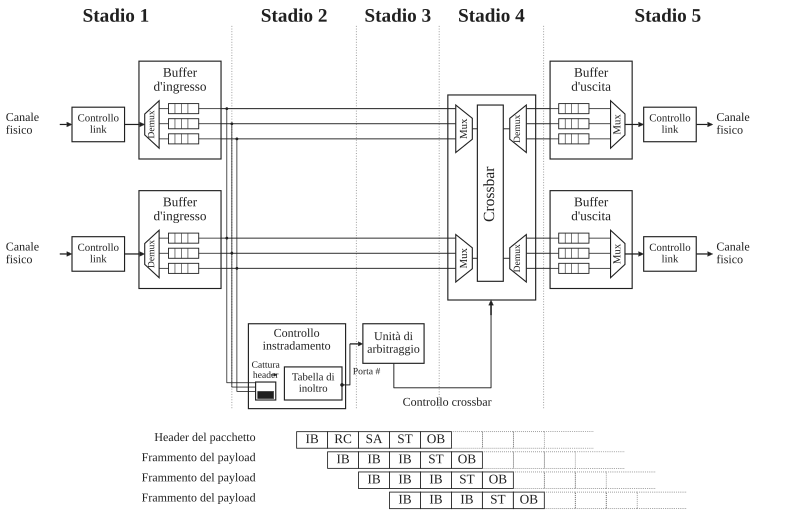
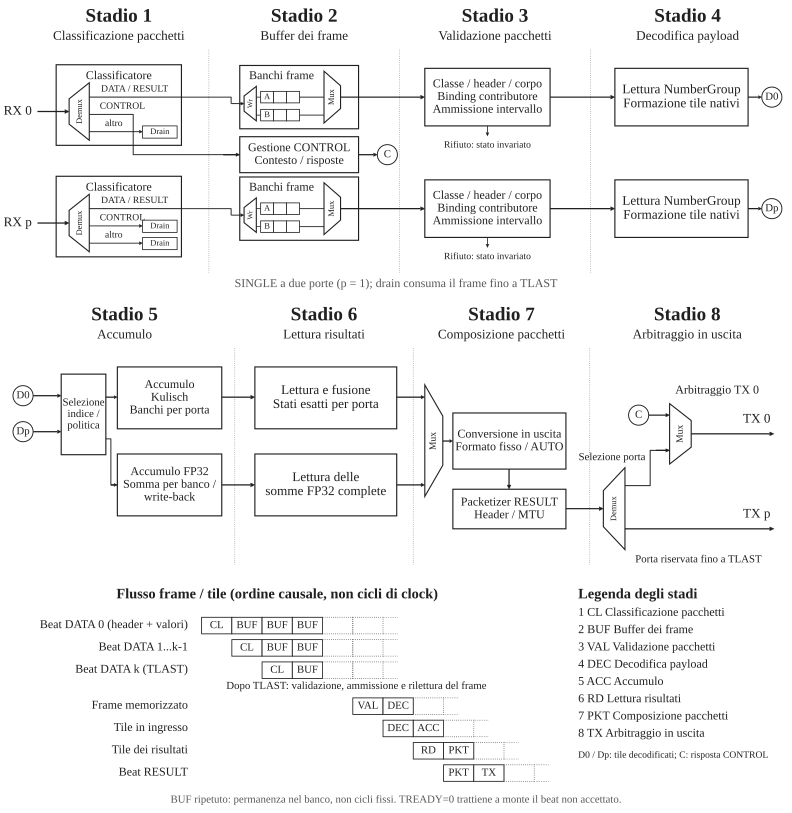
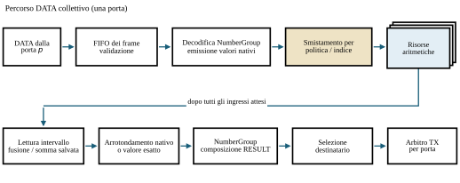
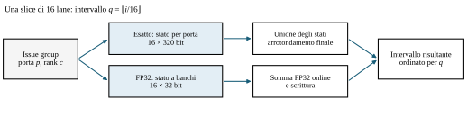

# 3.2 Pipeline

La pipeline di uno switch ricorda l'esecuzione di un processore vettoriale:
l'header di un pacchetto determina come trattarne tutte le unità di trasferimento
interne. I pacchetti su porte diverse vengono elaborati in parallelo.
La latenza può richiedere più cicli; uno stage a line rate ha invece un
intervallo di avvio di un ciclo quando la risorsa a valle è pronta.

In PRISM occorre coordinare inoltro ed elaborazione collettiva locale mantenendo
il ritmo di ingresso. La pipeline deve risolvere la contesa delle risorse,
gestire le dipendenze sui dati, conservare l'ordine dei pacchetti dove richiesto
e propagare la backpressure senza perdere stato o creare deadlock.
Il traffico inoltrato e quello generato dal nodo condividono le risorse di uscita
nell'architettura prevista.

> La sezione introduce una pipeline cut-through convenzionale come riferimento,
> poi segue il nodo collettivo implementato. Le risorse di inoltro tratteggiate
> restano parte dell'architettura prevista.

## 3.2.1 Pipeline cut-through convenzionale

<figure id="fig-cut-through-pipeline" class="architecture-figure" markdown="span">
  { loading=lazy }
  <figcaption>Pipeline cut-through a cinque stage, ridisegnata dalla Figura F.26 di Hennessy e Patterson.</figcaption>
</figure>

In uno switch cut-through una tabella di inoltro seleziona l'uscita.
Il primo stage, dopo il buffering iniziale, analizza l'header ed estrae
destinazione e campi di instradamento. Il secondo consulta la tabella, mentre
gli altri beat del pacchetto continuano ad arrivare nella coda di ingresso.

Nel terzo stage il pacchetto partecipa all'arbitraggio per la porta scelta.
Ottenuto l'accesso, il quarto configura il crossbar fra ingresso e uscita.
Nel quinto l'header raggiunge il buffer di uscita ed è disponibile per
la trasmissione sul link.

Solo l'header attraversa lookup e arbitraggio, che definiscono il percorso
interno. Una volta configurata la connessione, payload e trailer attraversano
buffering di ingresso, crossbar e buffering o trasmissione in uscita.
La [figura della pipeline cut-through](#fig-cut-through-pipeline) mostra
questa organizzazione, ridisegnata da Hennessy e Patterson.[^switch-pipeline]

[^switch-pipeline]: John L. Hennessy e David A. Patterson, *Computer Architecture: A Quantitative Approach*, 5a ed. (Morgan Kaufmann, 2011), Appendice F, Figura F.26.

## 3.2.2 Pipeline PRISM SINGLE

Il percorso convenzionale decide dove inoltrare il pacchetto prima di lasciarne
attraversare il corpo. PRISM aggiunge una destinazione locale per i DATA:
il motore aritmetico collettivo. La figura segue un pacchetto DATA nel
nodo `SINGLE` implementato.

<figure id="fig-prism-pipeline" class="architecture-figure" markdown="span">
  { loading=lazy }
  <figcaption>Pipeline SINGLE a due porte: classificazione, buffering del frame, validazione, decodifica del payload, accumulo, lettura del risultato, composizione dei pacchetti e arbitraggio in uscita.</figcaption>
</figure>

`STAGE` e `COMMIT` installano e attivano l'operazione. Un frame DATA accettato
viene classificato e memorizzato in un banco del frame. Dopo `TLAST`, il frame
completo viene validato rispetto al contesto, ammesso e riletto come NumberGroup.
I valori diventano issue group; gli indici globali degli elementi selezionano
le lane aritmetiche, indipendentemente dai confini dei pacchetti.

Ogni contributo aggiorna lo stato secondo la politica di accumulo scelta.
Il nodo emette un intervallo completato dopo l'arrivo di tutti i contributori
attesi per quell'intervallo, seleziona i formati RESULT, forma i NumberGroup
e trasmette il frame. Un pacchetto DATA può quindi precedere il relativo RESULT
senza che quest'ultimo venga prodotto subito.

La [figura della pipeline PRISM](#fig-prism-pipeline) mostra otto fasi funzionali.
La sequenza inferiore segue beat in ingresso, frame memorizzati e tile derivati
nel loro ordine causale; le celle non indicano durate fisse in cicli di clock.
Entrambe le porte hanno un percorso di drain per il traffico non supportato.
Le risposte CONTROL condividono la porta TX gestita 0 con i frame RESULT.

La backpressure ready/valid può fermare uno stage conservando i beat accettati.
Un intervallo di avvio di un ciclo descrive l'accettazione a regime quando
risorse e interfacce a valle sono pronte. Setup, completamento e durata
dell'intera collettiva richiedono una valutazione separata.

!!! note "Architettura prevista e RTL attuale"

    L'RTL attuale implementa il percorso collettivo SINGLE. Inoltro trasparente,
    VOQ, relay dei risultati tra switch, ACK/retry dei RESULT, interrogazione
    delle capacità e crossbar generale restano da implementare.

## 3.2.3 Viste dell'architettura

Le tre viste passano dall'instradamento per classe al percorso DATA di una
porta, fino alle risorse aritmetiche. Il ramo tratteggiato di inoltro resta
un'estensione prevista; i contorni sovrapposti indicano risorse parallele,
senza fissare il numero di banchi di issue.

<figure id="fig-frame-routing" class="architecture-figure" markdown="span">
  { loading=lazy }
  <figcaption>Instradamento dei frame nel nodo SINGLE. Il ramo tratteggiato di inoltro è esterno all'RTL attuale.</figcaption>
</figure>

<figure id="fig-collective-path" class="architecture-figure" markdown="span">
  { loading=lazy }
  <figcaption>Percorso DATA collettivo di una porta, con risorse aritmetiche parallele e generazione di nuovi frame RESULT.</figcaption>
</figure>

<figure id="fig-arithmetic-paths" class="architecture-figure" markdown="span">
  { loading=lazy }
  <figcaption>Una slice di sedici lane: gli stati esatti vengono uniti, mentre le somme FP32 si aggiornano all'arrivo dei contributi.</figcaption>
</figure>

Le viste dell'[instradamento](#fig-frame-routing), del [percorso DATA](#fig-collective-path)
e dell'[aritmetica](#fig-arithmetic-paths) approfondiscono progressivamente il nodo.

### Percorsi DATA e aritmetici

Il lettore NumberGroup decodifica i DATA validati in issue group a larghezza
nativa: 64 elementi INT8, 32 FP16/BF16 o 16 FP32 per beat a 512 bit.
Un dispatcher distribuisce i gruppi alle slice di sedici lane.
L'indice `i` seleziona l'intervallo `i // 16` e la lane `i % 16`;
posizioni corrispondenti contribuiscono allo stesso risultato, anche quando
arrivano da porte o gruppi diversi.

`KULISCH_FIXED` usa accumulatori paralleli di `KULISCH_W` bit (320 nella
configurazione predefinita, 280 nella build per la U280) locali a ciascuna porta.
Dopo tutti i contributi attesi, gli stati vengono uniti e arrotondati una volta
nel formato RESULT nativo scelto, oppure emessi come valori Kulisch esatti.
`FP32_ARRIVAL` aggiorna somme FP32 a banchi man mano che i tile validati sono
ammessi. Ogni banco legge lo stato locale, somma con l'unità FP32 in pipeline
e riscrive la somma arrotondata. Prenotazioni per lane evitano conflitti
read-after-write; posizioni indipendenti possono entrare a ogni ciclo.
Le righe completate vengono lette dalla stessa porta di memoria.
L'arbitraggio dei banchi determina l'ordine di ammissione anche fra porte simultanee.

Un buffer limitato e distribuito per banchi ripristina l'ordine del vettore
e conserva i risultati nativi arrotondati per la consegna RESULT.
La capacità logica massima è di 4096 valori FP32 (16 KiB); un'implementazione
di 256 parole a 512 bit può usare otto RAMB36 con banchi fisici a 64 bit.
Un tile FP32 arrotondato può attraversare il classificatore AUTO senza perdita;
otto tile memorizzati vengono letti insieme per i formati RESULT AUTO più stretti.
Il costo effettivo dipende dalla mappatura e va ricavato dai report di risorse
della revisione considerata.

Il sender forma frame RESULT NumberGroup, unisce gruppi uniformi adiacenti
attraverso i confini dei tile entro ciascun pacchetto e trasmette ai destinatari
Reduce o AllReduce scelti. ACK e retry dei RESULT restano da implementare.
Il nodo attuale non integra il fabric di inoltro o i ruoli ad albero;
generazione e unione delle somme intermedie esatte sono verificate in un
ambiente RTL separato.
