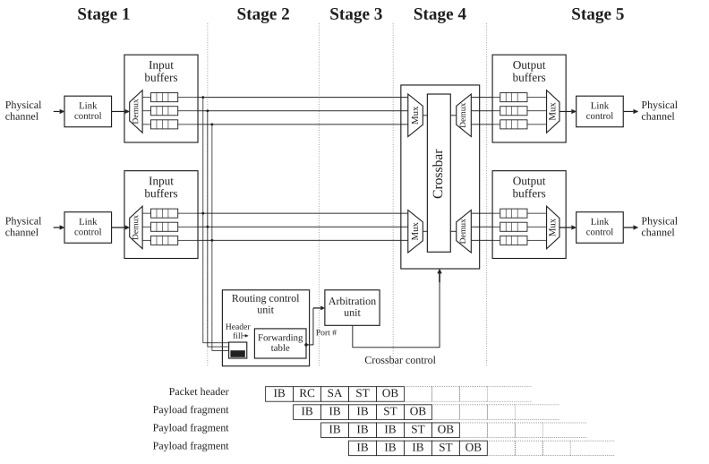
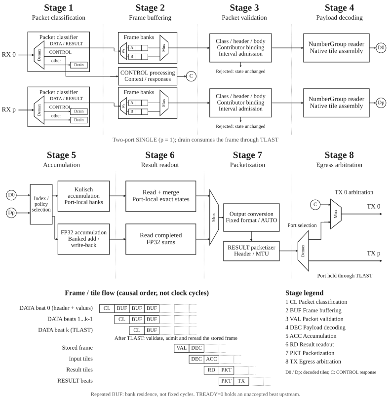
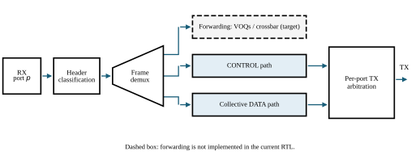
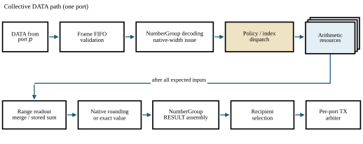
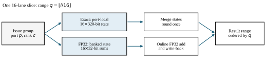

# 3.2 Pipeline

A switch pipeline resembles pipelined execution in a vector processor: a single packet
header indicates how to process all of the internal datapath transfer units of
a packet. Packets at different input ports are independent and are handled in
parallel, similarly to multiple independent instruction streams. Pipeline
latency may be several cycles; line-rate stages are instead defined by an
initiation interval of one cycle whenever their downstream resource is ready.

The central challenge in PRISM is to sustain line-rate operation while safely
coordinating forwarding and local collective processing. The pipeline must:

- resolve resource contention;
- prevent structural and data hazards;
- preserve packet ordering where required;
- propagate backpressure without corrupting state or creating deadlock.

These requirements become critical when forwarded and generated traffic
converge on shared arbitration, crossbar, and egress resources.

> This section first introduces a conventional cut-through switch pipeline as a
> reference model, then follows the collective-node RTL implemented today.
> Dashed forwarding resources remain part of the target architecture.

## 3.2.1 Conventional cut-through pipeline

<figure id="fig-cut-through-pipeline" class="architecture-figure" markdown="span">
  { loading=lazy }
  <figcaption>Five-stage cut-through switch pipeline, redrawn from Fig. F.26 in Hennessy and Patterson.</figcaption>
</figure>

Consider a conventional cut-through switch in which a forwarding table selects
the egress. The first stage (after first buffering) parses the header and extracts the destination and
other routing fields.

The second stage queries the forwarding table. Meanwhile, the remaining packet
beats continue to arrive and wait in the ingress queue.

In the third stage, the packet participates in arbitration for access to the
selected output port. Once the request is granted, the fourth stage configures
the crossbar to establish a temporary connection between the corresponding
ingress and egress ports. In the fifth stage, the packet header reaches the
output-side buffer and becomes available for transmission over the external
link.

Only the header traverses forwarding lookup and arbitration because those stages
establish the internal route. After the crossbar connection is configured, the
payload and trailer bypass the control-processing stages.

They traverse only ingress buffering, crossbar transfer, and egress buffering
or transmission. The [cut-through pipeline figure](#fig-cut-through-pipeline)
shows this five-stage organization, redrawn from Hennessy and Patterson.[^switch-pipeline]

[^switch-pipeline]: John L. Hennessy and David A. Patterson, *Computer Architecture: A Quantitative Approach*, 5th ed. (Morgan Kaufmann, 2011), Appendix F, Fig. F.26.

## 3.2.2 PRISM SINGLE pipeline

The conventional forwarding path makes a route decision before letting the
packet body cross the switch. PRISM adds a different local destination for
DATA: the collective arithmetic engine. The following view tracks one DATA
packet through the **implemented SINGLE node**, rather than depicting a
general forwarding fabric.

<figure id="fig-prism-pipeline" class="architecture-figure" markdown="span">
  { loading=lazy }
  <figcaption>Two-port SINGLE pipeline: classification, frame buffering, validation, payload decoding, accumulation, result readout, packetization, and egress arbitration.</figcaption>
</figure>

`STAGE` and `COMMIT` first install and activate the operation. An accepted DATA
frame is classified and stored in a frame bank. After `TLAST`, the complete
frame is validated against that context, admitted, and reread as
NumberGroups. The group values become issue groups; their **global element
indices**, not their packet boundaries, select arithmetic lanes. Each
contribution updates the selected accumulation policy. The node emits a
completed range only after all required contributors for that range have
arrived, then selects RESULT formats, forms NumberGroups, and transmits the
frame. Thus one DATA packet is not necessarily followed immediately by one
RESULT packet.

The [PRISM pipeline figure](#fig-prism-pipeline) shows eight functional phases.
Its lower strip follows input beats, stored frames, and derived tiles in causal
order; the cells do not imply a fixed number of clock cycles. Both input ports
have a drain path for unsupported traffic. CONTROL processing produces responses
that share managed TX port 0 with RESULT frames.

Ready/valid backpressure can pause a stage without losing accepted beats.
An initiation interval of one describes steady-state beat acceptance when
resources and downstream interfaces are ready; it is not a claim that setup,
completion, or a whole collective takes one cycle.

!!! note "Target architecture and current RTL"

    The current RTL implements the SINGLE collective path. It does not
    implement transparent forwarding, VOQs, multi-switch result relay,
    RESULT acknowledgment/retry, capability query, or the general crossbar.

## 3.2.3 Architecture views

The current RTL implements one `SINGLE` collective node. The three views move
from frame-class routing to one port's DATA traversal, then open the arithmetic
resources. The dashed forwarding branch remains a target; stacked outlines
indicate parallel resources, not a fixed number of issue banks.

<figure id="fig-frame-routing" class="architecture-figure" markdown="span">
  { loading=lazy }
  <figcaption>Frame routing in the SINGLE node. The dashed forwarding branch is outside the current RTL.</figcaption>
</figure>

<figure id="fig-collective-path" class="architecture-figure" markdown="span">
  { loading=lazy }
  <figcaption>Collective DATA path for one port, with parallel arithmetic resources and newly generated RESULT frames.</figcaption>
</figure>

<figure id="fig-arithmetic-paths" class="architecture-figure" markdown="span">
  { loading=lazy }
  <figcaption>One sixteen-lane slice: exact states are merged, while FP32 sums are updated as contributions arrive.</figcaption>
</figure>

The [frame-routing view](#fig-frame-routing), [collective DATA path](#fig-collective-path),
and [arithmetic view](#fig-arithmetic-paths) provide progressively more detail.

### DATA and arithmetic paths

A NumberGroup reader decodes validated DATA into native-width issue groups:
64 INT8, 32 FP16/BF16 or 16 FP32 elements per 512-bit beat. A dispatcher
distributes each group across sixteen-lane arithmetic slices. Group boundaries
and ingress ports do not determine arithmetic ownership: element index `i`
selects range `i // 16` and lane `i % 16`. Matching positions contribute to
the same result.

`KULISCH_FIXED` uses parallel port-local accumulators of `KULISCH_W` bits (320
by default, 280 in the U280 build). Their states are
merged after all expected contributions and either rounded once to a selected
native RESULT format or emitted as exact Kulisch values. `FP32_ARRIVAL` updates
banked FP32 sums as validated tiles are admitted. Each bank reads local state,
adds through the pipelined FP32 unit, and writes the rounded sum back. Per-lane
reservations prevent read-after-write conflicts; independent positions can enter
each cycle. Completed rows are read back through the same memory port. Bank arbitration defines admission order, including simultaneous
ports. A striped, bounded store restores vector order and holds
the rounded native vector for
RESULT delivery. Its maximum logical capacity
is 4096 FP32 values (16 KiB); a 512-bit by 256-word implementation may use
eight RAMB36 blocks when mapped as 64-bit-wide physical banks. A rounded
FP32 tile can also pass through the lossless AUTO classifier after accumulation;
eight stored tiles are read together for narrow AUTO RESULT formats.
Resource cost depends on mapping and should be taken from implementation reports
for the revision being evaluated.

The result sender forms NumberGroup RESULT frames, joins adjacent uniform
groups across tile boundaries within each packet, and transmits them to the
selected Reduce or AllReduce recipients without RESULT ACK or retry.
The current node has no transparent forwarding fabric or integrated tree role;
exact partial generation and merge are verified in a separate RTL harness.
