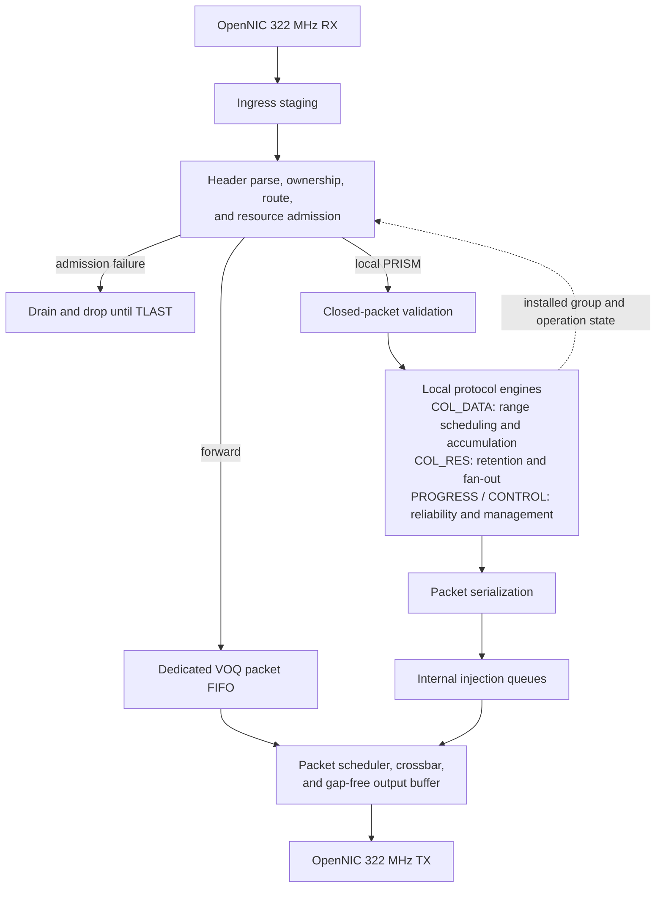

# 3.2 Pipeline

A switch pipeline resembles pipelined execution in a vector processor: a single packet
header indicates how to process all of the internal datapath transfer units of
a packet. Packets at different input ports are independent and are handled in
parallel, similarly to multiple independent instruction streams. Pipeline
latency may be several cycles; line-rate stages are instead defined by an
initiation interval of one cycle whenever their downstream resource is ready.

The central challenge in PRISM is to sustain line-rate operation while safely
coordinating forwarding and local collective processing. The pipeline must:

- resolve resource contention;
- prevent structural and data hazards;
- preserve packet ordering where required;
- propagate backpressure without corrupting state or creating deadlock.

These requirements become critical when forwarded and generated traffic
converge on shared arbitration, crossbar, and egress resources.

> This section first introduces a conventional cut-through switch pipeline as a
> reference model. It then extends that model to incorporate PRISM's forwarding
> and collective-processing paths, highlighting the additional control,
> buffering, arbitration, and flow-control mechanisms required by the resulting
> architecture.

## 3.2.1 Basic Pipeline

<figure markdown="span">
  { loading=lazy }
  <!-- <figcaption>Basic Switch Pipeline</figcaption> -->
</figure>

Consider a conventional cut-through switch in which a forwarding table selects
the egress. The first stage (after first buffering) parses the header and extracts the destination and
other routing fields.

The second stage queries the forwarding table. Meanwhile, the remaining packet
beats continue to arrive and wait in the ingress queue.

In the third stage, the packet participates in arbitration for access to the
selected output port. Once the request is granted, the fourth stage configures
the crossbar to establish a temporary connection between the corresponding
ingress and egress ports. In the fifth stage, the packet header reaches the
output-side buffer and becomes available for transmission over the external
link.

Only the header traverses forwarding lookup and arbitration because those stages
establish the internal route. After the crossbar connection is configured, the
payload and trailer bypass the control-processing stages.

They traverse only ingress buffering, crossbar transfer, and egress buffering
or transmission. This is the five-stage organization illustrated in Figure
F.26 of Hennessy and Patterson.[^switch-pipeline]

## 3.2.2 Introducing Virtual Output Queues

A virtual-channel switch may add virtual-channel allocation and arbitrate every
beat. PRISM instead schedules packets over Virtual Output Queues (VOQs).

Route and queue selection occur once per packet. A successful crossbar grant
remains locked until the accepted `TLAST`, although complex routing and
arbitration may still require several registered cycles.

!!! info "Why Virtual Output Queues?"

    VOQs separate packets by destination egress, preventing a blocked output
    from delaying traffic destined for available ports. They also provide a
    clean, scalable interface through which forwarded and PRISM-injected packets
    can share the same buffering and scheduling infrastructure while remaining
    independently arbitrated.

With `N` physical ingress ports, the forwarding side exposes `VOQ[I][O]` for
every ingress `I` and egress `O`. Generated PRISM traffic adds internal `K` source
rows but uses the same per-egress arbitration.

The matrix is write-parallel by source row. Each row has its own enqueue path,
so all physical ingress and internal injection sources may write one beat in
the same cycle, including when several choose the same egress: those writes
land in different `VOQ[source][egress]` cells. Contention occurs later at the
egress-column arbiter.

## 3.2.3 PRISM Pipeline

The first beat separates transparent forwarding from locally owned PRISM
traffic. Forwarded packets may enter a VOQ as soon as their route and storage are
reserved. Local packets remain buffered until complete validation because they
can change collective, reliability, or management state. The ownership rules are
defined in [Frame ownership and forwarding](1.protocol.md#frame-ownership-and-forwarding).

Generated partials, results, acknowledgments, and responses return through
internal queues and compete in the same packet-level egress scheduler as
forwarded traffic.

| Frame class after ownership | Path | First committed action |
|---|---|---|
| Non-PRISM or non-local PRISM | Forwarding | Start egress transmission after route and storage admission |
| Local `PM_OP_COL_DATA` | Contribution | Accept the complete validated contribution as `STORED` |
| Local `PM_OP_COL_RES` | Result delivery | Retain the validated result and create its fan-out descriptors |
| Local `PM_OP_COL_PROGRESS` | Reliability | Apply validated feedback to replay or window state |
| Local `PM_OP_CONTROL` | Management | Commit a complete validated transaction |

## 3.2.4 Ingress and Resource Admission

The 512-bit OpenNIC `box_322mhz` RX stream cannot be backpressured within a
packet.[^opennic-interface] Each ingress therefore starts with a staging FIFO.
While later beats enter that FIFO, the first beat passes through Header Parsing
(`HP`), Forwarding Classification (`FC`), and Route and Resource Admission
(`RA`). DATA, RES, and CONTROL fixed headers fit in the first beat. PROGRESS
classification also starts there, while its remaining fixed-header bytes are
validated from the closed packet before reliability state changes.

An ordered context FIFO carries the first-beat decision for the rest of each
packet. Body beats inherit the selected path without repeating classification,
while a following header may enter the decision pipeline as soon as capacity is
available.

Because packet length is not announced in advance, admission reserves the
configured maximum frame capacity:

\[
    MAX\_PACKET\_BEATS =
    \left\lceil
    \frac{MAX\_PACKET\_BYTES}{D/8}
    \right\rceil.
\]

Admission either reserves enough capacity in the selected VOQ or local packet
FIFO, or selects the drop path. Successful packets then drain from staging; any
unused reservation is released at `TLAST`. Concurrent requests for the same
resource are resolved before capacity is granted.

`OP_PREPARE` derives the input, partial, and output packet geometries and
reserves the operation context selected by the node role. Per-packet admission
then reserves only the bounded resources the packet can consume: closed-packet
storage, duplicate/window state, an accumulator-range slot when needed, and a
future output obligation. A leaf or internal node accounts for outgoing partial
DATA; a root or single node with result-delivery responsibility accounts for
RES packetization and fan-out. Output VOQ and replay entries are acquired when
an output range becomes ready, while its accumulator slot remains
`OUTPUT_PENDING`; this avoids reserving one physical packet buffer for the full
operation lifetime without ever accepting state that has nowhere to retire.

Forwarded packets can proceed after this decision. A locally consumed packet
must first close in Packet Storage (`PS`) and pass Packet Validation (`PV`). Only
then may it change protocol or arithmetic state. Packet layouts and payload
validation rules remain normative in
[Protocol 1.0 packet layouts](1.protocol.md#protocol-10-packet-layouts).

## 3.2.5 Forwarding, Arbitration, and Gap-Free Transmission

For `N` physical ingress ports and `K` internal injection sources, forwarding
uses `(N + K)` source rows and `N` egress columns:

\[
    VOQ[s][o],
    \qquad 0 \le s < N+K,
    \quad 0 \le o < N.
\]

Switch Allocation (`SA`) selects a matching between non-empty source queues and
egresses. A source drives at most one egress and an egress accepts at most one
source in a cycle:

\[
    \sum_o g[s,o] \le 1,
    \qquad
    \sum_s g[s,o] \le 1.
\]

The grant is packet-granular. Once the first beat starts, the selected source
owns that egress through the accepted `TLAST`; another packet cannot interleave
with it.

!!! info "What does gap-free mean?"

    After TX presents a packet's first beat with `TVALID = 1`, PRISM introduces
    no internal `TVALID` gap before `TLAST`. If downstream `TREADY = 0`, the
    current beat and sideband signals remain stable until accepted.

An open packet is eligible for cut-through only when enough contiguous beats are
buffered and the ingress, crossbar, and output path can maintain that stream. If
this cannot be guaranteed, arbitration waits until the packet is closed. With
continuously asserted downstream `TREADY`, packet-level blocking is bounded by
`MAX_PACKET_BEATS`. Downstream stalls extend the elapsed blocking time.

!!! note "First profile is store-and-forward"

    Cut-through is one optional architecture extension described only in this
    section. The first target profile starts no packet before closure, so every
    cut-through-safe eligibility input is compiled false.

### Forwarding beat timeline

This ideal five-beat example assumes continuous `TREADY`, no contention, and
one illustrative cycle per stage. It describes beat movement, not fixed stage
latencies.

| Beat | C0 | C1 | C2 | C3 | C4 | C5 | C6 | C7 | C8 | C9 | C10 | C11 |
|---|---|---|---|---|---|---|---|---|---|---|---|---|
| `B0` | IB | HP | FC | RA | QE | SA | ST | OB/TX | - | - | - | - |
| `B1` | - | IB | IB | IB | IB | QE | VOQ | ST | OB/TX | - | - | - |
| `B2` | - | - | IB | IB | IB | IB | QE | VOQ | ST | OB/TX | - | - |
| `B3` | - | - | - | IB | IB | IB | IB | QE | VOQ | ST | OB/TX | - |
| `B4` (`TLAST`) | - | - | - | - | IB | IB | IB | IB | QE | VOQ | ST | OB/TX |

Only `B0` performs classification, admission, and allocation. Later beats follow
its packet context. `VOQ` indicates residence at the granted queue output, not a
new arbitration cycle.

## 3.2.6 Collective Processing

`PM_OP_COL_DATA` is the main local-processing path. One packet carries one
contributor's payload for one stream-local Chunk Index, as defined by the
[chunking model](1.protocol.md#chunking-model). The complete packet is stored and
validated before duplicate state or an accumulator changes. Its wire format and
Chunk Index derive a global First Element and element count; these
format-independent coordinates, not the packet index, address collective state.

### Contribution acceptance

Admission checks the active operation, contributor binding, receive window, and
capacity needed to store and eventually retire the contribution. The identity
`(operation, packet class, contributor, stream-local chunk)` selects its receive
lifecycle state:

| State | Meaning |
|---|---|
| `RECEIVING` | Storage is reserved and packet reception is incomplete |
| `STORED` | Full validation succeeded and the contribution is accepted |
| `APPLIED` | Every arithmetic word of the contribution has committed |

`RECEIVING` and its reservations are tentative receive bookkeeping; only the
transition to `STORED` commits protocol acceptance.

Duplicate resolution occurs after validation. A contribution already in
`STORED` or `APPLIED` is never accumulated again. When its DATA header requests
acknowledgment with `ACK_REQUIRED`, safe acceptance produces the corresponding
hop-local acknowledgment. The flag semantics are defined with the
[`PM_OP_COL_DATA` layout](1.protocol.md#pm_op_col_data).

### COL_DATA beat example

The example below isolates a 32-element FP32 packet fragment: 128 numeric bytes
carried in three 512-bit AXI beats. A normal non-final V1 FP32 chunk contains
368 elements and continues through more beats; the shortened example makes the
alignment behavior visible. `B0` is the first packet beat, not a contributor.

| Incoming beat | C0 | C1 | C2 | C3 | C4 | C5 | C6 | C7 |
|---|---|---|---|---|---|---|---|---|
| `B0` (header + 24 B payload) | IB | HP | FC | RA | PS | PS | PS | PS |
| `B1` (64 B payload) | - | IB | IB | IB | IB | PS | PS | PS |
| `B2` (40 B payload, `TLAST`) | - | - | IB | IB | IB | IB | PS | PV |

Different ingress ports can store such packets concurrently. After `PV`,
Contribution Acceptance (`CA`) resolves the contribution identity and exposes a
validated descriptor to Payload Alignment (`PA`).

Independent ingress storage decouples packet arrival from arithmetic issue.
Contributions for different operations may therefore arrive together even when
an ordered policy, backend availability, or an accumulator dependency delays
one of them; only validated descriptors enter the arithmetic scheduler.

### Payload alignment and range scheduling

Payload Alignment (`PA`) removes the packet header and emits fixed-width work
tiles tagged with `(operation slot, global First Element, valid element count,
contributor, accumulator profile, accumulation policy)`. For this FP32 fragment
it forms two 512-bit arithmetic tiles, each containing 16 FP32 elements:

| Arithmetic word | Packet bytes combined by `PA` | Chunk elements | C10 | C11 | C12 | C13 |
|---|---|---|---|---|---|---|
| `AW0` | `B0[40:63] || B1[0:39]` | 0-15 | PA | AS | FP32 backend | - |
| `AW1` | `B1[40:63] || B2[0:39]` | 16-31 | - | PA | AS | FP32 backend |

Reading `B0` first fills the alignment carry state; `AW0` becomes complete when
the required bytes from `B1` arrive. Arithmetic issue and commit are distinct
events. The contribution reaches `APPLIED` only after its final tile commits.
Input conversion occurs before backend issue: a 512-bit beat contains 32
FP16/BF16 or 16 FP32 values. Elements may cross AXI beats, but never packets.

The Accumulation Scheduler (`AS`) arbitrates validated tiles across all active
operations and dispatches each tile to the backend named by its accumulator
profile. Backends are shared across operations. EAGER issues any ready
contributor; CONTRIBUTOR_ORDERED waits only for the next Contributor ID for that
global tile. The first contributor initializes state without adding zero.
Exact semantics are specified in
[Wire formats, accumulator profiles, and policies](1.protocol.md#wire-formats-accumulator-profiles-and-policies).

Backend width and issue capacity are derived from its profile and the datapath;
they are not runtime lane parameters.

A pipelined backend may accept new operands before an earlier result returns.
Consecutive updates to the same global element tile therefore create a
read-after-write dependency. The interlock forwards the completed value, issues
independent work, or stalls before a stale state read.[^pipeline-hazards]

### Range completion and output re-packetization

The Output Range Tracker (`ORT`) makes a global element range ready after every
local contributor has committed it. It does not wait for the whole operation.

The finalizer converts accumulator values to the role-selected outgoing format:
Partial Wire Format for upstream DATA, or Output Wire Format for RES at a
result-producing root or single node. The Output Packetizer (`OPK`) places those
values into maximally packed whole-element chunks and derives new stream-local
Chunk Indices. Input ranges may be combined or split.

For example, one full BF16 input chunk covers 737 elements. Converting those
elements to FP32 produces 368, 368, and one remaining element if the operation
ends there. Global element positions make this relationship unambiguous without
new protocol fields.

### Results and packet reinjection

A locally addressed `PM_OP_COL_RES` follows the same store-and-validate rule but
bypasses arithmetic. Result Delivery (`RD`) deduplicates the packet, retains one
immutable payload, and creates the configured fan-out descriptors. This accepts
one hop and originates the next; hop-local MAC and Result Path identifiers may
change as described by [`PM_OP_COL_RES`](1.protocol.md#pm_op_col_res).

This is protocol forwarding rather than transparent Layer-2 forwarding. A local
result terminates one direct transfer before `SER` originates its downstream
copies. A non-local result whose destination MAC names another node remains on
the ordinary forwarding path and is not rewritten.

The Packet Serializer (`SER`) builds each outgoing DATA partial, result copy,
acknowledgment, or response. Internal Injection Queues (`IQ`) present those
packets to `SA`, after which they use the ordinary `ST` and `OB/TX` stages. When
the selected reliable-transfer profile requests acknowledgment, safe DATA or RES
acceptance generates the corresponding hop-local feedback.

## 3.2.7 Reliability and Control Paths

A local `PM_OP_COL_PROGRESS` packet is completely validated before Progress
Handling (`PH`) changes replay or receive-window state. Validated feedback may
release acknowledged work or update the advertised window. If an acknowledgment
and retry timeout target the same transfer simultaneously, the acknowledgment
wins. Detailed bitmap and feedback semantics remain in
[`PM_OP_COL_PROGRESS`](1.protocol.md#pm_op_col_progress).

`PM_OP_CONTROL` remains outside the numeric path. Management Control (`MC`)
reassembles and validates fragments; a partial transaction cannot modify active
configuration. A complete valid transaction commits atomically, and generated
responses return through `SER` and `IQ`. Command and transaction rules are
defined by [`PM_OP_CONTROL`](1.protocol.md#pm_op_control).

## 3.2.8 Hazards and Flow Control

Reservations and interlocks convert the hazards that shape the datapath into
explicit stalls or packet drops:

| Hazard | Detection point | Response |
|---|---|---|
| Header decision approaches staging capacity | `IB` / `RA` | Bound classification latency and size staging for that bound |
| Packet reservation fails | `RA` | Select the drop path; do not partially enqueue |
| Concurrent requests target one capacity pool | Reservation manager | Serialize the grants and spend each reservation once |
| Several packets request one egress | `SA` | Grant one packet and retain the others |
| An open forwarding packet could underflow | `SA` / `OB` | Delay its start until gap-free service is possible |
| Two packets target one contribution identity | `CA` | Serialize acceptance and reject duplicate accumulation |
| An accumulator result is not yet available | `AS` / backend | Forward, issue independent work, or stall before the read |
| A higher Contributor ID arrives first under CONTRIBUTOR_ORDERED | `AS` | Retain it until the required contributor issues |
| No accumulator-range slot is available | `RA` | Refuse acceptance before arithmetic starts |
| A completed range has no output or replay slot | `ORT` / `OPK` | Hold it in `OUTPUT_PENDING`, backpressure finalization, and continue independent work |
| Acknowledgment races a retry timeout | `PH` / `RT` | Apply the acknowledgment and cancel stale retry work |
| A CONTROL transaction is incomplete | `MC` | Retain fragments without exposing state changes |

The external RX stream, internal ready/valid stages, storage reservations, and
protocol receive windows are distinct flow-control domains. RX cannot be paused
within a packet; internal stages may stall while holding their data; reservations
prevent storage overcommitment; receive windows pace reliable peers but do not
replace local admission.

## 3.2.9 Stage Summary and Invariants

| Stage and full name | Architectural role |
|---|---|
| IB - Ingress Buffer | Absorb the non-backpressurable RX stream during first-beat decisions |
| HP - Header Parsing | Extract Ethernet and fixed PRISM headers |
| FC - Forwarding Classification | Resolve ownership and select forwarding or a local path |
| RA - Route and Resource Admission | Select a destination and reserve required capacity |
| QE - Queue Enqueue | Move forwarded beats into the selected VOQ |
| PS - Packet Storage | Retain locally consumed packet beats through closure |
| PV - Packet Validation | Validate the complete local packet before state changes |
| SA - Switch Allocation | Select and lock one packet for each granted egress |
| ST - Switch Traversal / OB - Output Buffer | Move granted beats and hold the TX interface stable |
| CA - Contribution Acceptance | Resolve validated contribution and duplicate state |
| PA - Payload Alignment | Form arithmetic words from stored numeric payloads |
| AS - Accumulation Scheduler | Select ready operation/range work, enforce the chosen policy, interlock dependencies, and dispatch a backend |
| Accumulator backend | Update profile-specific state and report committed global element tiles; FP32 is the V1 backend |
| ORT - Output Range Tracker | Detect globally addressed ranges with all required local contributions committed |
| OPK - Output Packetizer | Finalize, convert, and pack ready ranges into Partial or Output Wire Format chunks |
| RD - Result Delivery | Retain, deduplicate, and expand result payloads |
| SER - Packet Serialization / IQ - Internal Injection Queues | Serialize prepared packets and return them to egress arbitration |
| PH - Progress Handling / RC - Replay Cache / RT - Retry Timers | Apply validated reliability feedback and manage pending transfers |
| MC - Management Control | Reassemble, validate, and atomically commit control transactions |

The architecture preserves these testable invariants:

- a locally consumed packet changes no protocol or arithmetic state before
  complete validation;
- an egress never interleaves two Ethernet packets;
- PRISM introduces no internal `TVALID` gap after starting a packet;
- reservations prevent storage overcommitment;
- a duplicate contribution is never accumulated twice;
- CONTRIBUTOR_ORDERED applies each element range in ascending Contributor-ID order;
- an output range is emitted only after every required local contribution to that range has committed;
- output Chunk Indices are derived from the outgoing wire format rather than copied from input DATA;
- generated packets rejoin normal packet-level egress arbitration.

[^switch-pipeline]: John L. Hennessy and David A. Patterson, *Computer Architecture: A Quantitative Approach*, 5th ed., Appendix F, Section F.6, especially Figure F.26 on printed page F-64 (PDF page 895).
[^opennic-interface]: AMD/Xilinx, *OpenNIC Shell*, "Shell Interface" section. <https://github.com/Xilinx/open-nic-shell#shell-interface>
[^pipeline-hazards]: Hennessy and Patterson, *Computer Architecture: A Quantitative Approach*, 5th ed., Appendix C, Section C.2, printed pages C-11-C-20 (PDF pages 658-667).
