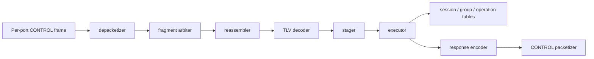
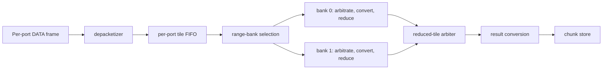

# 3.2 Implemented pipeline

This page describes the RTL listed in `repo/prism-hdl/rtl.f`.

## External boundary

The reusable core exposes `NUM_PORTS` independent AXI4-Stream RX/TX pairs. The
default profile uses two ports, 512 data bits, 64 `tkeep` bits, `tlast`, one
`tuser` bit, and a 250 MHz target clock. A transfer occurs only on
`tvalid && tready`; all data and sideband signals remain stable while stalled.

At 512 bits and 250 MHz the interface capacity is 128 Gbit/s per port and per
direction. This value is not a claim of usable payload throughput or physical
timing closure.

## Ingress and classification

Each port instantiates:

1. `prism_axis_frame_fifo`, which stores beats, validates `tkeep`, counts bytes,
   and makes only complete frames visible;
2. `prism_header_parser`, which extracts the 40-byte fixed prefix from the first
   beat in network byte order;
3. `prism_packet_validator`, which checks adapter/keep errors, EtherType, local
   MAC, version, opcode, flags, operation/contributor lookup, payload length,
   and `LAST_CHUNK`;
4. `prism_ingress_demux`, which locks one frame to CONTROL, DATA, or drain/drop
   until the accepted `tlast`.

This is store-and-forward admission. A malformed frame cannot update control or
arithmetic state. The current demultiplexer has no transparent forwarding path.
Received RES and PROGRESS are not handled by the current RTL.

## CONTROL path

The depacketizer serializes the payload as bytes. The arbiter owns one complete
fragment at a time. The reassembler accepts a bounded number of fragmented
transactions, keyed by cookie/transaction/command, and publishes only a
complete message. The TLV decoder emits structural events; the stager converts
valid records into one typed request. State changes occur only in the owning
session, group, or operation table after full staging.

The response encoder builds the selected TLVs in network byte order. The
packetizer captures the response payload before transmitting a complete
Ethernet CONTROL frame on the request's ingress port.

## DATA and arithmetic path

`prism_data_depacketizer` removes the 40-byte Ethernet/PRISM prefix and emits
format-independent, lane-aligned element tiles with metadata. A three-beat
reservoir bridges the unaligned 40-byte prefix without fragmenting later
full-width tiles. A tile contains up to `LANES` elements; the default is 16.
Each port then has an independent work FIFO.

The core partitions global element ranges by tile-index parity across two
arithmetic banks. Each bank owns its tile arbiter, input converter, range
scheduler, and a small reduced-tile FIFO. The two banks can therefore accept
the two contributors of adjacent ranges concurrently. A final arbiter merges
completed ranges into the shared result conversion and chunk store. The chunk
store restores monotonically increasing chunk order before routing, because
independent banks may complete adjacent chunks out of order.

The input conversion stage owns datatype conversion. For FP32_ARRIVAL and FP32_ORDERED it
produces binary32 lanes. For KULISCH_FP32 it produces aligned signed deposits
and separate zero/NaN/infinity/overflow flags for the selected compiled width.

The range scheduler owns contributor masks and numeric state. Its key includes
the operation and global element range. It rejects a contributor already
present in the range, applies FP32_ARRIVAL in accepted order, folds FP32_ORDERED in
ascending Contributor ID order, or streams Kulisch deposits. For the current
two-contributor FP32_ORDERED profile it sends the ordered pair directly to the
16-lane FP32 backend when the second tile arrives. It publishes an output only
after all expected contributors have arrived.

## Result storage, routing, and egress

The result conversion stage narrows/canonicalizes the final FP32 lanes to the
configured output format and preserves the accumulation warning. The result
chunk store assembles tiles into immutable chunk slots. A reference count keeps
one payload alive while the result router enumerates bounded route and
replication entries.

Each egress has a `prism_result_packetizer`. It reads a chunk slot and creates a
RES frame with exact `tkeep`/`tlast`. A two-source frame arbiter selects CONTROL
or RES and locks that selection through the accepted final beat. A final frame
FIFO isolates downstream stalls.

## Backpressure invariants

- State and indexes advance only on an accepted ready/valid transfer.
- A stalled producer keeps payload and metadata stable.
- A frame arbiter never interleaves two packets.
- A full FIFO propagates `ready=0`; it does not silently discard data.
- Contributor state changes only after complete frame validation.
- A completed result slot is not released until every armed packet job reports
  completion.
- Reset clears valid/FSM/ownership state and prevents partial output frames.

## Implemented and excluded behavior

| Behavior | Current state |
|---|---|
| In-band CONTROL, sessions, groups, operations | Implemented and exercised by full integration |
| REDUCE/ALLREDUCE SUM in a two-port `SINGLE` node | Implemented and exercised |
| FP32_ARRIVAL, FP32_ORDERED, local Kulisch-family accumulation | Implemented; focused arithmetic test |
| INT8/FP16/BF16/FP32 input conversion | Implemented at converter boundary |
| FP16/BF16/FP32 result conversion | Implemented; narrower end-to-end coverage |
| Switch-to-switch partial DATA | Protocol field/model only; no multi-switch RTL path |
| PROGRESS, ACK/replay/retry engine | Documented and modeled in the CCL, not in RTL |
| Transparent L2 forwarding, VOQ, general crossbar, shared packet store | Deliberately excluded |
| 250 MHz timing closure | Requires Vivado implementation evidence; not established by simulation |

## Measured simulation rates and latencies

With 16 FP32 lanes at the 250 MHz target clock, one accepted full tile per
cycle represents 128 Gbit/s of numeric result data. The focused arithmetic
test measures a three-cycle, 12 ns fill latency followed by one tile per cycle.

The complete two-rank, two-port REDUCE test uses four 1472-byte result chunks
and no artificial egress stalls. It measures 23 consecutive full result tiles
at one tile per cycle, 109.19 Gbit/s of result payload at the AXI egress, and
348 ns from the first accepted contribution beat to the first accepted result
beat. A SESSION_OPEN request takes 656 ns to the first response beat in the
same no-stall simulation.

These are RTL simulation measurements at an assumed 4 ns clock. They are not
post-route timing results. A 100 Gbit/s Ethernet PHY also cannot carry 100
Gbit/s of numeric payload because Ethernet framing consumes part of the wire
rate; with 1472-byte PRISM result payloads the idealized share is about 95.8
Gbit/s after Ethernet framing, preamble, and inter-packet gap. Whether line
coding is included depends on whether the quoted rate is at the MAC or SerDes
boundary.
