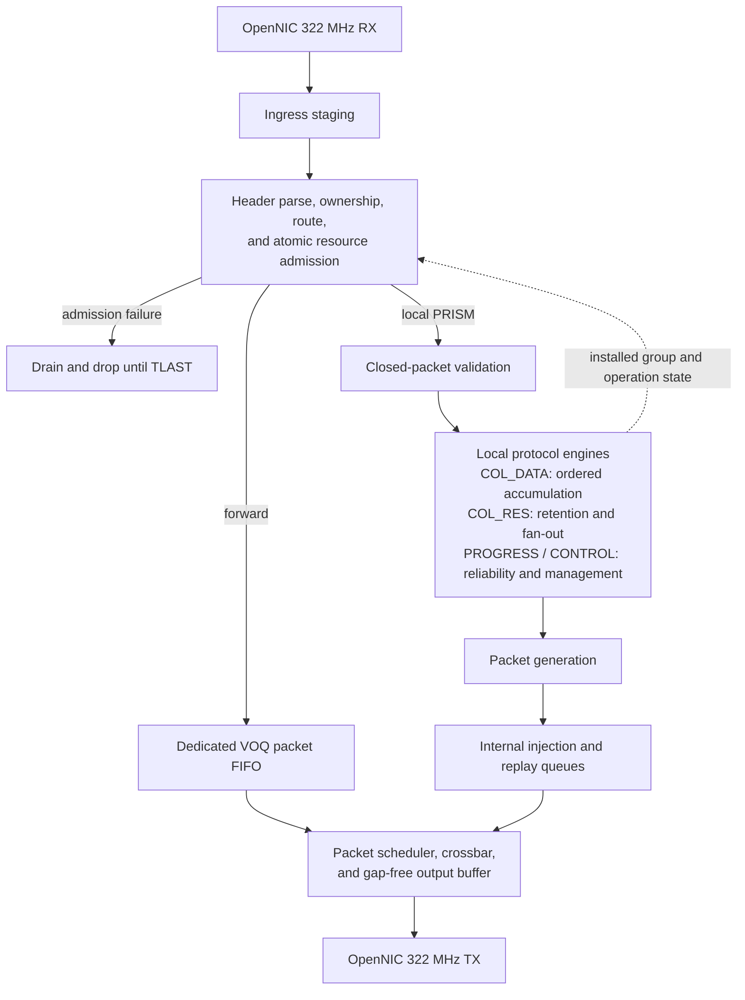

# 3.2 Pipeline

The switch microarchitecture can be enhanced by pipelining its operations. A
switch pipeline resembles pipelined execution in a vector processor: a single
packet header indicates how to process all of the internal datapath transfer
units of a packet. Moreover, packets at different input ports are independent
and can be handled in parallel, similarly to multiple independent instruction
streams.

The central challenge in PRISM is to sustain line-rate operation while safely
coordinating forwarding and local collective processing. The pipeline must:

- resolve resource contention;
- prevent structural and data hazards;
- preserve packet ordering where required;
- propagate backpressure without corrupting state or creating deadlock.

These requirements become critical when forwarded and generated traffic
converge on shared arbitration, crossbar, and egress resources.

> This section first introduces a conventional cut-through switch pipeline as a
> reference model. It then extends that model to incorporate PRISM's forwarding
> and collective-processing paths, highlighting the additional control,
> buffering, arbitration, and flow-control mechanisms required by the resulting
> architecture.

## 3.2.1 Basic Pipeline

<figure markdown="span">
  { loading=lazy }
  <!-- <figcaption>Basic Switch Pipeline</figcaption> -->
</figure>

Consider a conventional cut-through switch in which a forwarding table selects
the egress. The first stage parses the header and extracts the destination and
other routing fields.

The second stage queries the forwarding table. Meanwhile, the remaining packet
flits continue to arrive and wait in the ingress queue.

In the third stage, the packet participates in arbitration for access to the
selected output port. Once the request is granted, the fourth stage configures
the crossbar to establish a temporary connection between the corresponding
ingress and egress ports. In the fifth stage, the packet header reaches the
output-side buffer and becomes available for transmission over the external
link.

Only the header traverses forwarding lookup and arbitration because those stages
establish the internal route. After the crossbar connection is configured, the
payload and trailer bypass the control-processing stages.

They traverse only ingress buffering, crossbar transfer, and egress buffering
or transmission. This is the five-stage organization illustrated in Figure
F.26 of Hennessy and Patterson.[^switch-pipeline]

## 3.2.2 Introducing Virtual Output Queues

A virtual-channel switch may add virtual-channel allocation and arbitrate every
flit. PRISM instead schedules packets over Virtual Output Queues (VOQs).

Route and queue selection occur once per packet. A successful crossbar grant
remains locked until the accepted `TLAST`, although complex routing and
arbitration may still require several registered cycles.

!!! info "Why Virtual Output Queues?"

    VOQs separate packets by destination egress, preventing a blocked output
    from delaying traffic destined for available ports. They also provide a
    clean, scalable interface through which forwarded and PRISM-injected packets
    can share the same buffering and scheduling infrastructure while remaining
    independently arbitrated.

With `N` physical ingress ports, the forwarding side exposes `VOQ[I][O]` for
every ingress `I` and egress `O`. Generated PRISM traffic adds internal source
rows but uses the same per-egress arbitration.

## 3.2.3 PRISM Pipeline

PRISM extends the reference switch with four locally terminated protocol paths.
Forwarding is allowed to cut through once its route and storage are reserved.
Stateful local packets become visible to collective, reliability, or management
state only after complete packet validation.

| Frame class after ownership | Datapath | First irreversible action |
|---|---|---|
| Non-PRISM or non-local PRISM | Forwarding | Start egress transmission after route, capacity, and gap-free service are guaranteed |
| Local `PM_OP_COL_DATA` | Contribution path | Mark the complete, validated payload `STORED` |
| Local `PM_OP_COL_RES` | Result path | Retain the complete result and its required fan-out descriptors |
| Local `PM_OP_COL_PROGRESS` | Reliability path | Apply the complete, validated selective-ACK bitmap or window update |
| Local `PM_OP_CONTROL` | Management path | Apply a complete, reassembled, validated transaction |

## 3.2.4 Ingress and Resource Admission

The first prototype targets OpenNIC's 512-bit `box_322mhz` interface. On its RX
side, PRISM cannot use `TREADY` to stop an arriving packet, and `TVALID` remains
continuous from the first beat through `TLAST`. The interface provides `TKEEP`,
`TLAST`, and `tuser_err`, but no packet-size sideband.[^opennic-interface]

The initial block is therefore an **Ingress Staging FIFO**, not merely a skid
buffer. It must accept one beat per cycle while the first beat passes through
header parsing, ownership, route selection, and resource admission. Its minimum
depth is bounded by the worst-case decision latency:

\[
    IB_{\mathrm{depth}} \ge
    L_{HP+FC+RA} + M,
\]

where `M` covers registered handoff and implementation margin. Admission must
always return success or failure within that bound. Once draining starts, the
staging path must support one simultaneous ingress write and one path-storage
write per cycle so occupancy does not continue to grow.

Every fixed Protocol 1.0 header fits in the first 512-bit beat. `HP` extracts the
Ethernet addresses, EtherType, PRISM control word, and opcode-specific header.
`FC` then applies the required ownership order:

1. non-PRISM traffic follows ordinary Layer-2 policy;
2. non-local PRISM traffic is forwarded unchanged when policy permits;
3. only a locally addressed PRISM frame is dispatched by opcode.

Each ingress uses a FIFO of packet contexts rather than one overwriteable
register. A context records the destination FIFO, ingress metadata, received-beat
count, and packet boundary or error state. This permits back-to-back headers when
the header pipeline has initiation interval one.

### Maximum-packet reservation

Because the 322 MHz interface does not announce packet length, the baseline
reserves the configured maximum frame size. With datapath width `D` and the same
`MAX_PACKET_BYTES` configured in both OpenNIC and PRISM:

\[
    MAX\_PACKET\_BEATS =
    \left\lceil
    \frac{MAX\_PACKET\_BYTES}{D/8}
    \right\rceil.
\]

After `RA` selects the destination FIFO, its reservation manager atomically
checks and consumes that many credits. Concurrent ingress requests are resolved
together; two requests cannot spend the same credit.

If reservation succeeds, the staging FIFO begins draining into the selected
VOQ or local packet store. When `TLAST` arrives, the unused reservation is
returned atomically:

\[
    released\_beats =
    MAX\_PACKET\_BEATS - observed\_beats.
\]

If the observed count reaches `MAX_PACKET_BEATS` without `TLAST`, destination
writes stop and the remainder is drained through the drop path. This prevents a
bad source from writing beyond its reservation even though RX cannot be
backpressured.

If reservation fails, the ingress enters `DROP_UNTIL_TLAST`, discards the beats
already staged for that packet, and continues consuming the non-backpressurable
RX stream through its final beat. Ordinary Ethernet traffic is lost under this
condition. A reliable PRISM DATA or RES sender receives no acceptance ACK and
therefore retains its replay state and retries later.

Forwarding VOQs and local packet stores are dedicated FIFOs. Each FIFO permits
one enqueue and one dequeue in the same cycle so ingress can continue while an
older packet drains.

### Packet finalization

For locally consumed DATA, RES, PROGRESS, and CONTROL, `PV` waits for `TLAST`
and validates the full physical packet before it exposes a descriptor to a
stateful engine. It checks the observed size, final `TKEEP`, `tuser_err`, reserved
bits, and the opcode-specific payload length.

Numeric chunk length and physical frame length are different quantities. The
installed operation determines the exact numeric payload bytes; a short
Ethernet frame may also contain permitted padding, which is drained but never
interpreted as numeric chunk data. Protocol headers use network byte order,
while DATA and RES numeric elements are little-endian.

The OpenNIC integration tests must also freeze the exact frame-size convention,
including minimum-frame padding and whether the CMAC exposes the Ethernet FCS.
Neither padding nor an exposed FCS may enter the numeric payload.

If a local packet fails final validation, all tentative reservations are
released, no contribution/result is accepted, and no ACK is generated. This
store-validate-then-execute rule avoids the need to undo floating-point updates.

Forwarding is the deliberate exception. Once a frame prefix has left through
cut-through, an error reported at the final beat cannot retract it. The
prototype therefore treats a late `tuser_err`, oversize packet, or inconsistent
boundary on an open forwarded packet as a fatal interface event and records it
for verification. `MAX_PACKET_BYTES` and OpenNIC's `max_pkt_len` must match.

## 3.2.5 Forwarding, Arbitration, and Gap-Free Transmission

For `N` physical ingress ports and `K` internal injector classes, the logical
VOQ matrix has `(N + K)` source rows and `N` egress columns:

\[
    VOQ[s][o],
    \qquad 0 \le s < N+K,
    \quad 0 \le o < N.
\]

Each VOQ is a dedicated FIFO of beat records. The first record carries the route
and packet context; every record carries `TKEEP`, `TLAST`, and error state. The
FIFO also reports the contiguous beats at its head and whether that packet is
closed.

`SA` selects a matching between source rows and egresses. For grant `g[s,o]`:

\[
    \sum_o g[s,o] \le 1,
    \qquad
    \sum_s g[s,o] \le 1.
\]

Independent egresses may therefore transfer in parallel, while contending
packets remain queued. A grant advances round-robin or age state only when the
packet actually starts, not when a speculative request is examined.

!!! info "What does gap-free mean?"

    After TX presents a packet's first beat with `TVALID = 1`, PRISM never lowers
    `TVALID` before the accepted `TLAST`. If `TREADY = 0`, the current `TDATA`,
    `TKEEP`, and `TLAST` remain stable until accepted.

    Gap-free does **not** mean that the link accepts a beat every wall-clock
    cycle regardless of the receiver. It means that PRISM inserts no internal
    bubble when the receiver is ready. With continuous `TREADY`, throughput is
    one beat per cycle from the first beat through `TLAST`.

### Open-packet eligibility

The 322 MHz TX contract forbids deasserting `TVALID` between a packet's first
beat and `TLAST`. Merely retaining a crossbar grant when an open VOQ becomes
empty is insufficient: the output must not bubble. An open forwarding packet is
eligible only when:

- a configurable lead of contiguous beats is already buffered;
- the ingress-to-VOQ path is committed to one beat per cycle through `TLAST`;
- the crossbar and output buffer can preserve a gap-free packet stream.

If these conditions cannot be proven, the scheduler waits until the descriptor
is closed. Short packets may therefore behave as store-and-forward packets,
while sufficiently long packets use cut-through. The configured lead threshold
covers the crossbar and output-pipeline latency.

Once transmission starts, the output remains locked to that packet through the
accepted final beat. When downstream `TREADY` is low, `OB` holds `TVALID`, data,
and sideband state stable; it does not switch packets. Packet-granular locking
prevents Ethernet-frame interleaving and makes the maximum blocking time bounded
by the configured maximum packet size.

### Forwarding beat timeline

The following ideal schedule uses the beat-row format of the book. It assumes a
five-beat packet, `B0` as the header beat, `B4` carrying `TLAST`, continuous
`TREADY`, no contention, and one illustrative cycle per stage. It is a behavior
example, not a fixed RTL latency contract.

| Beat | C0 | C1 | C2 | C3 | C4 | C5 | C6 | C7 | C8 | C9 | C10 | C11 |
|---|---|---|---|---|---|---|---|---|---|---|---|---|
| `B0` | IB | HP | FC | RA | QE | SA | ST | OB/TX | - | - | - | - |
| `B1` | - | IB | IB | IB | IB | QE | VOQ | ST | OB/TX | - | - | - |
| `B2` | - | - | IB | IB | IB | IB | QE | VOQ | ST | OB/TX | - | - |
| `B3` | - | - | - | IB | IB | IB | IB | QE | VOQ | ST | OB/TX | - |
| `B4` (`TLAST`) | - | - | - | - | IB | IB | IB | IB | QE | VOQ | ST | OB/TX |

`B0` alone performs Header Parsing, Forwarding Classification, Route and
Resource Admission, and Switch Allocation. There is no separate `LOCK` stage.
`SA` latches the winning source when `B0` starts, and that ownership remains
active until the accepted `TLAST`.

`VOQ` in the later rows means that a body beat is resident at the already
granted queue output for one cycle before Switch Traversal. It is not
re-arbitrated. The dedicated FIFO can enqueue one beat while the crossbar path
consumes the previous beat.

## 3.2.6 Collective Processing

Locally owned DATA and RES packets remain in their packet FIFOs until `PV`
closes and validates them. An open packet never mutates arithmetic, duplicate,
replay, or result state.

### Contribution admission and acceptance

`RA` performs a tentative DATA lookup using the complete Job, Group and
generation, Operation and generation, Contributor ID, and Chunk Index. It then
checks:

- the active operation and configured ingress/source-MAC binding;
- the receive window and existing contribution state;
- packet-storage and ACK-event capacity;
- output and replay capacity if the chunk completes.

Opening a new chunk slot consumes one completion token from the
operation-reserved output pool. Later contributors reuse that guarantee.

A new contribution reserves those resources and enters `RECEIVING`. Final
validation changes it to `STORED` and makes it ACK-eligible. Failed validation
removes the tentative marker.

A duplicate of a `STORED` or `APPLIED` contribution is validated and ACKed again
but never accumulated twice. A duplicate of a `RECEIVING` contribution is not
ACKed early; it waits behind the original commit or is left for sender retry.

This produces the following per-contribution lifecycle:

| State | Meaning | May generate acceptance ACK? |
|---|---|---|
| `RECEIVING` | Header admitted; packet not yet validated | No |
| `STORED` | Complete validated payload belongs to the receiver | Yes |
| `APPLIED` | Every arithmetic word has committed through the Arithmetic Unit | Already accepted |

#### COL_DATA reception timeline

One `PM_OP_COL_DATA` packet carries one contributor's complete payload for one
Chunk Index. This example uses one 32-element FP32 chunk: 128 numeric bytes in
three 512-bit AXI beats. `B0` is a beat, not a contributor.

| Beat | Packet contents |
|---|---|
| `B0` | 40-byte Ethernet/PRISM header + chunk bytes 0-23 |
| `B1` | Chunk bytes 24-87 |
| `B2` | Chunk bytes 88-127; 40 valid bytes and `TLAST` |

| Incoming beat | C0 | C1 | C2 | C3 | C4 | C5 | C6 | C7 | C8 |
|---|---|---|---|---|---|---|---|---|---|
| `B0` (header + 24 B) | IB | HP | FC | RA | PS | PS | PS | PS | PS |
| `B1` (64 B) | - | IB | IB | IB | IB | PS | PS | PS | PS |
| `B2` (40 B, `TLAST`) | - | - | IB | IB | IB | IB | PS | PS | PS |

Repeated `PS` cells mean that the beat remains stored in Packet Storage while
the packet closes and validates; it is written only once. The packet context
then advances separately:

| Packet-level event | C7 | C8 |
|---|---|---|
| Complete DATA contribution | PV | CA |

#### Concurrent COL_DATA arrival

Physical ingress ports receive and store packets independently. For example,
three contributors may send the same chunk concurrently:

| RX cycle | Ingress 0: Contributor 0 | Ingress 1: Contributor 1 | Ingress 2: Contributor 2 |
|---|---|---|---|
| C0 | Chunk `i`, `B0` | Chunk `i`, `B0` | Chunk `i`, `B0` |
| C1 | Chunk `i`, `B1` | Chunk `i`, `B1` | Chunk `i`, `B1` |
| C2 | Chunk `i`, `B2` (`TLAST`) | Chunk `i`, `B2` (`TLAST`) | Chunk `i`, `B2` (`TLAST`) |
| After `PV` | Validated descriptor ready | Validated descriptor ready | Validated descriptor ready |

Each ingress has its own staging and local packet FIFO, so simultaneous arrivals
do not share one packet-store write port. `CA` arbitrates validated descriptors
after storage; a packet with no reserved FIFO capacity follows the drop rule in
Section 3.2.4.

#### COL_DATA chunk-to-arithmetic-word timeline

The packet still contains only one chunk. `PA` removes its header and emits two
512-bit **arithmetic words**, each containing 16 FP32 elements:

| Arithmetic word | Packet bytes combined by `PA` | Chunk elements |
|---|---|---|
| `AW0` | `B0[40:63] || B1[0:39]` | 0-15 |
| `AW1` | `B1[40:63] || B2[0:39]` | 16-31 |

`PA` consumes one stored beat per cycle. Reading `B0` fills its 24-byte carry
register; the first complete arithmetic word appears after `B1`:

| Payload-alignment action | C9 | C10 | C11 |
|---|---|---|---|
| Stored beat read | `B0` | `B1` | `B2` |
| Arithmetic word emitted | - | `AW0` | `AW1` |

| Arithmetic word | Chunk elements | C10 | C11 | C12 | C13 |
|---|---|---|---|---|---|
| `AW0` | 0-15 | PA | OS | AU | - |
| `AW1` | 16-31 | - | PA | OS | AU |

`AU` marks issue, not same-cycle completion. The contribution becomes `APPLIED`
only after `AW1`, its final arithmetic word, commits.

### Payload alignment and accumulation

`PA` reads a stored DATA packet, removes the 40 bytes of Ethernet and PRISM DATA
header, combines the first 24 payload bytes with following beats, and emits
arithmetic words tagged with operation, chunk, contributor, element position,
valid elements, and end-of-payload.

`OS` makes arithmetic order independent of packet arrival. In
`DETERMINISTIC_FP32`, each `(operation, chunk, arithmetic-word position)` tracks
`next_contributor_id`:

- a higher Contributor ID for the same word position waits;
- the next required Contributor ID for that position may issue;
- Contributor 0 initializes the accumulator elements directly, without an
  artificial `0 + x_0` operation;
- later contributors are folded in strictly ascending local Contributor ID
  using the Protocol 1.0 rounding and special-value rules.

Other word positions, chunks, and operations remain schedulable while one
position waits for a missing contributor. Protocol 1.0 freezes this
`DETERMINISTIC_FP32` behavior; exact-accumulator modes are outside this prototype.

A 512-bit arithmetic word contains 16 FP32 elements. A final partial word uses
its valid-element mask so padding never reaches the Arithmetic Unit.

An adder with initiation interval one may accept new operands every cycle, but
its result still takes several cycles to return. Two consecutive updates to the
same accumulator word therefore have a read-after-write dependency. The `OS`
interlock forwards the completed value, issues unrelated work, or stalls before
reading stale state.
[^pipeline-hazards]

`CC` marks a chunk `OUTPUT_PENDING` only after every expected local contributor
is both `STORED` and `APPLIED`. Local arithmetic completion does not complete the
operation.

### Results, packet generation, and replay

A completed non-root chunk produces an upstream `PM_OP_COL_DATA` partial. A root
or result-delivery node produces `PM_OP_COL_RES` packets according to its result
routes and replication groups. `PG` rewrites the hop-local MAC and Contributor
or Result Path ID for every outgoing copy.

An inbound local COL_RES bypasses the accumulator. `RD` validates and
deduplicates it by operation, Chunk Index, and incoming Result Path ID. It keeps
the payload once and creates the required fan-out descriptors.

A new result is ACKed upstream after storage. A duplicate is ACKed again but is
not replicated twice. Several replicas may reference one immutable payload,
while their replay and ACK state remain independent.

#### COL_RES reception timeline

The receive side uses the same three-beat, 128-byte payload example as DATA, but
the validated packet enters Result Datapath instead of the accumulator.

| Incoming beat | C0 | C1 | C2 | C3 | C4 | C5 | C6 | C7 | C8 |
|---|---|---|---|---|---|---|---|---|---|
| `B0` (header + 24 B) | IB | HP | FC | RA | PS | PS | PS | PS | PS |
| `B1` (64 B) | - | IB | IB | IB | IB | PS | PS | PS | PS |
| `B2` (40 B, `TLAST`) | - | - | IB | IB | IB | IB | PS | PS | PS |

| Packet-level event | C7 | C8 |
|---|---|---|
| Complete RES packet | PV | RD |

#### COL_RES generated-beat timeline

After `RD` retains the result, `PG` creates a new three-beat fan-out packet.
`O0`-`O2` are output beats, not aliases for the received `B0`-`B2` beats.

| Generated beat | C9 | C10 | C11 | C12 | C13 | C14 | C15 |
|---|---|---|---|---|---|---|---|
| `O0` | PG | IQ | SA | ST | OB/TX | - | - |
| `O1` | - | PG | IQ | IQ | ST | OB/TX | - |
| `O2` (`TLAST`) | - | - | PG | IQ | IQ | ST | OB/TX |

The repeated `IQ` cell means that a body beat remains in the already granted
internal injection queue while `O0` establishes the packet-level grant. It is
not generated or enqueued twice. Additional result replicas repeat this output
schedule independently for their selected egresses.

Reliable DATA and RES packets consume replay credits reserved at `OP_PREPARE`.
Replay storage retains the payload and per-peer descriptor until a valid
hop-local ACK, abort, or release. A timeout enqueues a generation-tagged retry
descriptor; it does not copy the payload again. New packets and retries use
class-isolated internal injection queues before returning to `SA`.

`CT` declares a switch-local operation `COMPLETE` only when every chunk's
required upstream partial and result replicas are acknowledged and no retry is
outstanding. The Aggregation Manager determines tree-wide completion after
observing every switch.

## 3.2.7 Reliability and Control Paths

`PM_OP_COL_PROGRESS` may include a selective-ACK bitmap spanning several beats.
`PH` applies no replay mutation until the complete packet, bitmap length, and
unused bits have been validated. Protocol 1.0 defines explicit selective ACKs
and receive-window updates; `Window Base` does not implicitly acknowledge every
lower chunk.

A valid ACK releases the named replay entry, updates the phase bitmap, and may
advance the peer window. If an ACK and timeout target the same entry, the ACK
wins.

A queued retry carries the replay-entry generation. It is discarded if the
entry was released or reused before reinjection. A timer starts when the final
beat is accepted by TX, not when a descriptor is enqueued.

### PROGRESS beat timeline

This example applies a three-beat selective-ACK packet. Replay state changes
only at `PH`, after the whole packet has passed `PV`.

| Incoming beat | C0 | C1 | C2 | C3 | C4 | C5 | C6 | C7 | C8 |
|---|---|---|---|---|---|---|---|---|---|
| `B0` | IB | HP | FC | RA | PS | PS | PS | PS | PS |
| `B1` | - | IB | IB | IB | IB | PS | PS | PS | PS |
| `B2` (`TLAST`) | - | - | IB | IB | IB | IB | PS | PS | PS |

| Packet-level event | C7 | C8 | C9 |
|---|---|---|---|
| Complete PROGRESS packet | PV | PH | RC/CT |

`PV` validates the complete bitmap before `PH` changes replay or window state.
`RC/CT` represents the resulting Replay Cache and Completion Tracking update;
it is not another packet beat.

CONTROL remains outside the numeric streaming path. `MC` stores fragments by
session and transaction, checks consistent metadata, reconstructs the TLV, and
validates the complete command schema.

Only then may it change group, operation, routing, or resource state. `RA` never
sees a partial configuration. Responses and events return through `PG` and the
internal injection queues.

### CONTROL beat timeline

The table assumes that this three-beat packet is the transaction's last missing
fragment. For an earlier fragment, `MC` remains in `WAIT` and no `COMMIT` or
response occurs.

| Incoming beat | C0 | C1 | C2 | C3 | C4 | C5 | C6 | C7 | C8 |
|---|---|---|---|---|---|---|---|---|---|
| `B0` | IB | HP | FC | RA | PS | PS | PS | PS | PS |
| `B1` | - | IB | IB | IB | IB | PS | PS | PS | PS |
| `B2` (`TLAST`) | - | - | IB | IB | IB | IB | PS | PS | PS |

| Transaction-level event | C7 | C8 | C9 | C10 | C11 |
|---|---|---|---|---|---|
| Last missing fragment | PV | MC | COMMIT | PG | IQ |
| Earlier fragment | PV | MC / WAIT | - | - | - |

`COMMIT` is the atomic installation event, not a pipeline module. A generated
response proceeds from `IQ` through the same packet-level arbitration and egress
stages shown in the COL_RES output timeline.

## 3.2.8 Hazards and Flow Control

The pipeline uses reservations and interlocks to turn hazards into explicit
stalls or drops rather than corrupted state.

| Hazard | Detection point | Required response |
|---|---|---|
| Header decision approaches ingress-staging capacity | `IB` / `RA` | Keep admission latency bounded; size `IB` for the bound and margin |
| Maximum-packet reservation fails | `RA` | Enter `DROP_UNTIL_TLAST`; do not partially enqueue or ACK |
| Several ports reserve the same pool in one cycle | Reservation manager | Arbitrate atomically and spend each credit once |
| Several packets request one egress | `SA` | Grant one; retain and fairly age the others |
| An open forwarding source could underflow | `SA` / `OB` | Wait for the cut-through lead or packet closure; never create a mid-packet TX bubble |
| Two copies target one contribution record | `RA` | Serialize the update with a `RECEIVING` marker |
| Previous accumulator result is not yet available | `OS` / scoreboard | Forward, issue independent work, or stall before the read |
| `DETERMINISTIC_FP32`: a higher Contributor ID arrives first | `OS` | Retain it until its turn |
| ACK-event, result, or replay capacity is unavailable | `RA` | Reject/drop before acceptance; never strand completed arithmetic without an output path |
| ACK races retry timeout | `PH` / `RT` | Apply the ACK and invalidate stale retry work |
| Bulk traffic could starve PROGRESS | `SA` | Use a reserved queue and bounded priority |
| CONTROL transaction is incomplete | `MC` | Retain fragments and expose no state mutation |

Four flow-control domains must remain distinct:

- the OpenNIC 322 MHz RX stream is non-backpressurable, so overflow is handled
  by prior reservation or packet drop;
- internal stage boundaries use ready/valid handshakes and hold data stable
  while stalled;
- packet-memory and replay credits prevent storage overcommitment;
- PROGRESS receive-window feedback limits how much reliable traffic a direct
  peer injects, but does not replace local buffer admission.

The resource order is deliberate: packet storage, contribution/result state,
ACK-event capacity, and mandatory output/replay capacity are reserved before a
local packet becomes `STORED`. Reliability traffic has reserved injection
capacity. These rules prevent an accepted packet from holding one finite
resource while waiting indefinitely for another resource needed to complete it.

## 3.2.9 Stage Summary and Invariants

| Stage and full name | Responsibility | Logical replication | Unit of progress |
|---|---|---|---|
| IB - Ingress Buffer | Absorb non-backpressurable RX traffic during the decision pipeline | Per physical ingress | Beat |
| HP - Header Parsing | Extract Ethernet and fixed PRISM headers | Per physical ingress | First beat / context |
| FC - Forwarding Classification | Apply ownership, then select forwarding or a local opcode | Per physical ingress | Context |
| RA - Route and Resource Admission | Select the path and atomically reserve all mandatory resources | Per-ingress front ends with shared managers | Context |
| PS - Packet Storage / PV - Packet Validation | Retain packet beats and finalize local packet validity | Per forwarding VOQ or ingress-local path | Beat / packet |
| QE - Queue Enqueue | Write forwarding and internal beat records to the selected VOQ FIFO | Per source row and egress | Beat |
| SA - Switch Allocation / ST - Switch Traversal / OB - Output Buffer | Match, lock, traverse, and provide gap-free egress | Per egress around one crossbar | Beat with packet lock |
| CA - Contribution Acceptance / PA - Payload Alignment | Commit safe contribution storage and form arithmetic words | Collective path | Packet / arithmetic word |
| OS - Ordered Issue / AU - Arithmetic Unit | Preserve Contributor ID order and update accumulator state | Collective path | Arithmetic word |
| CC - Chunk Completion | Detect local chunk arithmetic completion | Per active chunk | Event |
| RD - Result Datapath | Retain, deduplicate, and expand received results | Result path | Packet / descriptor |
| PG - Packet Generation / RC - Replay Cache / IQ - Internal Injection Queues | Build, retain, replay, and reinject generated packets | Internal traffic classes | Descriptor / beat |
| PH - Progress Handling / RT - Retry Timers | Apply validated feedback and schedule retries | Per replay entry or timer wheel | Packet / timer event |
| MC - Management Control | Reassemble and atomically apply management transactions | Shared control path | Fragment / transaction |
| CT - Completion Tracking | Track ACK-gated chunk phases and local operation completion | Per active operation | Event |

[^switch-pipeline]: John L. Hennessy and David A. Patterson, *Computer Architecture: A Quantitative Approach*, 5th ed., Appendix F, Section F.6, especially Figure F.26 on printed page F-64 (PDF page 895).
[^opennic-interface]: AMD/Xilinx, *OpenNIC Shell*, "Shell Interface" section. <https://github.com/Xilinx/open-nic-shell#shell-interface>
[^pipeline-hazards]: Hennessy and Patterson, *Computer Architecture: A Quantitative Approach*, 5th ed., Appendix C, Section C.2, printed pages C-11-C-20 (PDF pages 658-667).
