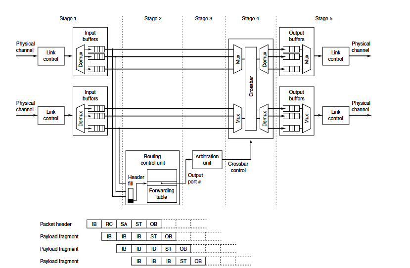

# 3.2 Pipeline

The switch microarchitecture can be enhanced by pipelining the operations. Network switches in that term have similarities with pipelined execution of instructions in a CPU, a single packet header indicates how to process all of the internal data path physical transfer units of a packet. Moreover, packets at different input ports are independently processed, they can be handled in parallel similar to the way multiple independent instructions are executed in parallel.

The central challenge in PRISM is to sustain line-rate operation while safely coordinating two distinct datapaths. The pipeline must resolve resource contention, prevent structural and data hazards, preserve packet ordering where required, and propagate backpressure without causing state corruption or deadlock. These requirements become particularly important when ordinary forwarding traffic and collective-operation traffic converge on shared buffering, arbitration, and egress resources.

> This section first introduces a conventional cut-through switch pipeline as a reference model. It then extends that model to incorporate PRISM’s forwarding and collective-processing paths, highlighting the additional control, buffering, arbitration, and flow-control mechanisms required by the resulting architecture.

# 3.2.1 Basic Pipeline

<figure markdown="span">
  { loading=lazy }
  <!-- <figcaption>Basic Switch Pipeline</figcaption> -->
</figure>

Consider a conventional cut-through switch microarchitecture in which packet forwarding decisions are derived from a forwarding table. In the first pipeline stage, the switch receives and parses the packet header to extract the destination address and any other fields required for forwarding. During the second stage, this information is used to query the forwarding table and determine the set of eligible egress ports. Meanwhile, the remaining packet flits continue to arrive and are temporarily stored in the ingress queue.

In the third stage, the packet participates in arbitration for access to the selected output port. Once the request is granted, the fourth stage configures the crossbar to establish a temporary connection between the corresponding ingress and egress ports. In the fifth stage, the packet header reaches the output-side buffer and becomes available for transmission over the external link.

Only the packet header traverses the forwarding-lookup and arbitration stages, because these stages are responsible for establishing the packet’s internal route. After the forwarding decision has been made and the crossbar connection has been configured, the payload and trailer bypass these control-processing stages. They therefore traverse only the three stages directly involved in data movement: ingress reception and buffering, crossbar transfer, and egress buffering or transmission.

# 3.2.2 Introducing Virtual Output Queues
A virtual channel switch usually requires an additional stage for virtual channel allocation. Moreover, arbitration is required for every beat before transmission through the crossbar. Finally, depending on the complexity of the routing and
arbitration algorithms, several clock cycles may be required for these operations.

!!! info "Why Virtual Output Queues?"
    VOQs separate packets by destination egress, preventing a blocked output from delaying traffic destined for available ports. They also provide a clean, scalable interface through which forwarded and PRISM-injected packets can share the same buffering and scheduling infrastructure while remaining independently arbitrated.

todo