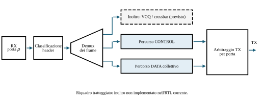

# 3. Architettura

<figure id="fig-architecture-overview" class="architecture-figure" markdown="span">
  { loading=lazy }
  <figcaption><strong>Architettura del nodo SINGLE.</strong> La classificazione separa l'elaborazione dei frame CONTROL e DATA. Il ramo tratteggiato di inoltro è un'estensione futura.</figcaption>
</figure>

Uno switch combina instradamento, arbitraggio, buffering, commutazione e controllo
del flusso. L'architettura prevista per PRISM aggiunge la riduzione collettiva
in rete: i frame ordinari seguono il percorso di inoltro, mentre quelli PRISM
destinati al nodo entrano nei percorsi di controllo ed elaborazione collettiva.

La [panoramica dell'architettura](#fig-architecture-overview) mostra la
classificazione dei frame, l'elaborazione CONTROL e il percorso collettivo.
Inoltro trasparente, VOQ e crossbar generale restano estensioni future.

L'implementazione attuale è un nodo collettivo con `NUM_PORTS` porte
AXI4-Stream full-duplex a 512 bit: due nella configurazione predefinita, una
nella build per la scheda U280. Riceve
frame PRISM CONTROL e DATA destinati al nodo, esegue la riduzione configurata
e genera risposte CONTROL e frame RES. Il traffico non supportato o destinato
ad altri nodi viene scartato; l'RTL non offre inoltro Ethernet trasparente.

L'elenco ordinato dei sorgenti RTL è `repo/prism-hdl/rtl.f`. Il modulo principale
riutilizzabile è `prism_collective_core`; `prism_sim_top` lo adatta alla
verifica e `prism_u280_top` alla porta 100G della Alveo U280.

## Pagine successive

- [3.1 Protocollo](1.protocol.md): layout dei pacchetti, registri e record di
  configurazione condivisi da RTL e CCL.
- [3.2 Pipeline](2.pipeline.md): il percorso dagli ingressi per porta a
  controllo, riduzione, memorizzazione dei risultati e uscita.
- [3.3 Parametri](4.parameters.md): costanti del protocollo, parametri di
  elaborazione, stato a runtime e valori derivati.
- [3.4 Moduli RTL](4-modules/index.md): i moduli che possiedono lo stato e il
  top della scheda.

Il protocollo definisce il formato sul filo e il comportamento previsto; la
pagina della pipeline distingue questo obiettivo da ciò che l'RTL implementa oggi.
