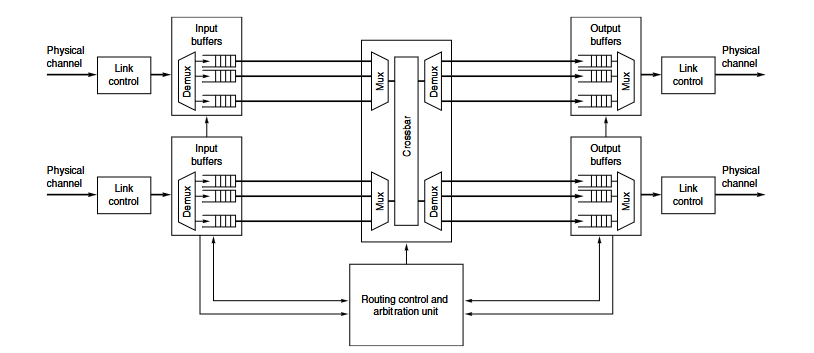

# 3. Architecture
> What are the major components, and where should I read next?

<figure markdown="span">
  { loading=lazy }
  <!-- <figcaption>PRISM Switch Architecture Overview</figcaption> -->
</figure>

Network switches implement the routing, arbitration, and switching functions of
switched-media networks. Switches also implement buffer management mechanisms and,
in the case of lossless networks, the associated flow control.

PRISM extends this conventional switch datapath with support for
**in-network collective reduction**. Ordinary Ethernet frames follow the
transparent Layer-2 forwarding path, whereas locally addressed PRISM packets
may be consumed by the control, aggregation, result-delivery, or progress paths
defined by the protocol.

## Next pages

-   :material-map-marker-path: **Introduction**

    Move through [3.1 Protocol](1.protocol.md),
    [3.2 Pipeline](2.pipeline.md) pages.

-   :material-chip: **Modules view**

    Start with [3.4 Interfaces](4-interfaces/index.md) and continue
    with [3.4. Collective Engine](4-interfaces/collective-engine.md).

