# Protocollo

PRISM opera al **livello 2** (*Layer 2*) e usa frame Ethernet per trasportare
operazioni collettive attraverso un datapath FPGA. Il livello 2 è la parte della
rete che trasferisce i frame in base agli indirizzi MAC, prima di protocolli come
IP.

Il prototipo iniziale si concentra su due semantiche analoghe a quelle di MPI:

- `REDUCE`: più rank contribuiscono, ma un solo rank selezionato riceve la somma;
- `ALLREDUCE`: la stessa somma viene restituita a tutti i rank partecipanti.

Un **rank** è un processo partecipante o un endpoint acceleratore. In un albero
di riduzione, gli switch foglia ricevono i contributi dei rank, gli eventuali
switch interni combinano le somme parziali e una radice di aggregazione produce
il risultato finale.

PRISM combina il normale inoltro di livello 2 con tre flussi elaborati
localmente: controllo in-band, aggregazione verso la radice e distribuzione del
risultato. Una quarta classe di pacchetto trasporta conferme e richieste di
ritrasmissione nella direzione opposta. La sezione sulle classi di pacchetto ne
introduce nomi e ruoli.

PRISM è un datapath FPGA di ricerca, non uno switch Ethernet di produzione
completo. Il protocollo privilegia quindi un modello dei pacchetti chiaro, test
riproducibili e una realizzazione RTL concreta rispetto a un ampio stack di
gestione o sicurezza.

!!! abstract "Obiettivo del protocollo"

    Il primo beat del pacchetto deve contenere informazioni sufficienti perché
    il parser scelga tra inoltro, controllo, aggregazione, distribuzione del
    risultato o gestione dell'avanzamento prima che il payload numerico raggiunga
    il motore delle collettive.

Questa pagina introduce inoltro, identità, suddivisione in chunk e avvio, quindi
presenta i layout dei pacchetti. Segue lo storyboard di una riduzione completa;
le sezioni finali raccolgono i registri numerici e le regole di validazione del
Protocollo 1.0 necessarie a RTL e software host.

---

## Proprietà e inoltro dei frame

La classificazione PRISM procede dal frame Ethernet esterno verso l'interno:

1. interpreta MAC di destinazione, MAC sorgente ed EtherType;
2. se l'EtherType non è `0x88B5`, applica la normale politica di livello 2;
3. se il frame è PRISM ma il MAC di destinazione non è un MAC di terminazione
   PRISM locale, lo inoltra senza modificarlo quando la politica lo consente;
4. decodifica l'opcode PRISM soltanto per un frame PRISM indirizzato localmente.

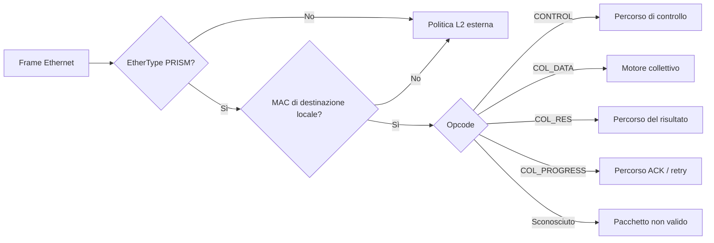

Il MAC di destinazione e l'opcode rispondono a due domande diverse:

- il MAC seleziona il nodo successivo o il proprietario locale;
- l'opcode seleziona che cosa deve fare quel proprietario con il pacchetto.

`PM_TRANSPARENT` consente il normale inoltro di livello 2. `PM_STRICT` rifiuta i
frame non locali, a meno che sia abilitata un'eccezione esplicita per l'inoltro
di gestione. Il prototipo usa normalmente l'inoltro trasparente.

---

## Identificatori delle collettive

Questa sezione definisce come i pacchetti riferiscono, senza ambiguità, le
diverse entità di una collettiva. Distingue tre livelli logici con durate
diverse:

1. il **gruppo**, cioè l'albero dei contributori configurato negli switch e
   riutilizzabile;
2. l'**operazione**, cioè una singola esecuzione della collettiva su quel gruppo
   (per esempio, una specifica invocazione di `ALLREDUCE`);
3. il **chunk**, cioè la porzione del vettore elaborata durante quell'operazione.

Per **campi identificativi nel pacchetto** si intendono i valori effettivamente
trasmessi sul collegamento (*on the wire*). Quando sono indicati più campi, la
loro tupla costituisce la chiave identificativa:
per esempio, `(Group ID, Group Generation)` identifica una precisa istanza di
gruppo, non il solo valore numerico del Group ID. La colonna **Scopo** specifica
che cosa identifica la chiave e per quanto tempo tale identità resta valida.

| Oggetto o campo | Campi identificativi nel pacchetto | Scopo |
|---|---|---|
| Job / sessione AM | `Job ID:64` più un Session Cookie locale allo switch | Dominio di proprietà e recupero |
| Gruppo collettivo | `Group ID:16`, `Group Generation:16` | Albero logico e insieme dei contributori, riutilizzabili tra più operazioni |
| Operazione collettiva | `Operation ID:16`, `Operation Generation:32` | Una specifica esecuzione della collettiva su quel gruppo |
| Contributor ID | 16b | Un rank o sottoalbero figlio visto dallo switch ricevente |
| Result Path ID | 16b | Una replica del risultato configurata sul collegamento diretto corrente |
| Chunk Index | 24b | Posizione di un intervallo di elementi nel vettore |

!!! note "Perché associare una generazione all'ID?"

    Gli ID numerici hanno dimensione finita e vengono quindi riutilizzati. La
    **generazione** distingue le diverse istanze che hanno occupato lo stesso
    ID: se un pacchetto della vecchia istanza arriva in ritardo, la sua
    generazione non coincide con quella corrente e lo switch può scartarlo. Un
    Group ID può essere riutilizzato solo dopo che `GROUP_DESTROY` è stato
    confermato ovunque; un Operation ID solo dopo `OP_RELEASE_RESPONSE`. A ogni
    riutilizzo la generazione viene incrementata.

Ogni switch memorizza soltanto la propria parte locale di un gruppo logico. In
una foglia, i Contributor ID identificano normalmente i rank; in un nodo interno
identificano i sottoalberi figli. I Contributor ID sono densi e associati a una
porta di ingresso e a un MAC sorgente attesi.

### Ruoli dei nodi e caso con un solo switch

`Node Role` descrive la posizione di uno switch nell'**albero logico della
collettiva**. Non modifica il ruolo Ethernet fisico dello switch né la politica
di inoltro dei frame non locali.

| Ruolo | Contributori locali | Parent | Comportamento nella collettiva |
|---|---|---|---|
| `LEAF` | Rank collegati direttamente | Obbligatorio | Riduce i contributi locali ed emette uno stream DATA parziale verso il parent |
| `INTERNAL` | Sottoalberi figli | Obbligatorio | Riduce i parziali dei figli ed emette un nuovo stream DATA parziale verso il parent |
| `ROOT` | Sottoalberi figli | Assente | Completa la riduzione e avvia la distribuzione del risultato |
| `SINGLE` | Rank collegati direttamente | Assente | Completa localmente la riduzione e avvia la distribuzione del risultato senza emettere un parziale upstream |

---

## Suddivisione in chunk

Un vettore collettivo è diviso in **chunk**. Un chunk è un intervallo consecutivo
di elementi, non un numero arbitrario di byte in ingresso.

Per il chunk `i`:

\[
\mathrm{first\_element}=i\,\mathrm{elements\_per\_chunk}
\]

\[
\mathrm{elements\_in\_chunk}=
\min(\mathrm{elements\_per\_chunk},
\mathrm{element\_count}-\mathrm{first\_element})
\]

e

\[
\mathrm{expected\_chunks}=
\left\lceil\frac{\mathrm{element\_count}}
{\mathrm{elements\_per\_chunk}}\right\rceil,
\qquad 0<\mathrm{expected\_chunks}\le 2^{24}.
\]

Lo stesso Chunk Index identifica lo stesso intervallo di elementi in tutto
l'albero. L'AM configura quindi lo stesso numero di elementi e lo stesso numero
di elementi per chunk su ogni nodo.

Il payload Ethernet standard è di 1500 byte. La control word PRISM da 2 byte e
l'header DATA/RES da 24 byte lasciano:

\[
\boxed{\mathrm{PM\_CHUNK\_PAYLOAD\_BYTES}=1500-2-24=1474}.
\]

La lunghezza del payload di un pacchetto trasmesso localmente è

\[
\mathrm{elements\_in\_chunk}\times
\mathrm{bytes\_per\_element}(\mathrm{packet\ wire\ format}).
\]

Poiché FP32 è l'unico formato partial assegnato, il Protocollo 1.0 limita ogni
operazione a `floor(1474/4) = 368` elementi per chunk, anche quando input e output
degli endpoint sono più stretti. La stessa geometria può così essere installata
su ogni nodo. Per esempio, 1000 elementi formano chunk da 368, 368 e 264 elementi.
Nessun elemento viene diviso tra due pacchetti. L'AM seleziona una sola tupla
aritmetica per l'intero albero e impone lo stesso Partial Wire Format su ogni
arco di aggregazione. L'eventuale padding minimo Ethernet non viene interpretato
come dato del vettore.

DATA e RES non contengono un tag di formato per pacchetto. La codifica è
selezionata dal descrittore Operation installato: il DATA da endpoint a foglia
usa Input Wire Format, il DATA tra switch usa Partial Wire Format e RES usa
Output Wire Format. Il Protocollo 1.0 impone una sola tupla aritmetica per
l'intero albero, così ogni ricevitore decodifica il payload dal proprio ruolo e
dal Contributor binding configurato.

I chunk possono arrivare in ordine diverso all'interno della finestra di
ricezione ammessa. È il Chunk Index, non l'ordine di arrivo, a selezionare lo
stato temporaneo corretto.

---

## Classi di pacchetto PRISM

Dopo aver stabilito la proprietà Ethernet, l'opcode seleziona uno dei seguenti
percorsi:

| Valore | Classe di pacchetto | Scopo |
|---:|---|---|
| `0x00` | `PM_OP_INVALID` | Classificazione interna non valida; non è un normale pacchetto trasmesso |
| `0x01` | `PM_OP_CONTROL` | Configurazione in-band, risposte di gestione ed eventi |
| `0x02` | `PM_OP_COL_DATA` | Contributi e somme parziali diretti verso la radice di aggregazione |
| `0x03` | `PM_OP_COL_RES` | Risultati completi diretti verso i rank destinatari |
| `0x04` | `PM_OP_COL_PROGRESS` | ACK, ritrasmissione e feedback sulla finestra di ricezione per un trasferimento diretto |

Un **ACK** è una conferma: informa il mittente precedente che un pacchetto è
stato accettato in modo sicuro. Un trasferimento diretto, chiamato anche un
**salto di rete** (*network hop*), attraversa un solo collegamento tra due nodi
adiacenti, per esempio `rank0 -> L0` oppure `L0 -> S0`.

---

## Configurazione in-band

Il lato applicativo e quello di rete hanno responsabilità diverse. Un
**Host Coordinator** raccoglie i rank partecipanti e la loro richiesta
collettiva. L'**Aggregation Manager** (AM) traduce la richiesta in un piano per
l'intero albero usando topologia, capability e risorse disponibili degli switch.

Qui **in-band** indica in modo specifico il controllo tra AM e switch: i comandi
viaggiano come pacchetti Ethernet attraverso le stesse porte fisiche dei dati
collettivi. Dopo il parsing seguono un percorso separato e non entrano mai
nell'accumulatore numerico.

Per esempio, il prototipo può usare OpenNIC come shell FPGA: OpenNIC fornisce le
porte verso l'host e il percorso driver, mentre PRISM implementa il protocollo
collettivo nel datapath programmabile. Il setup in-band permette quindi di
avviare gli esperimenti senza richiedere prima un processore di gestione separato.

### Avvio controllato dall'host

Una chiamata collettiva non autorizza i rank a trasmettere immediatamente. Il
runtime porta prima tutti i rank attesi a una barriera lato host; l'Host
Coordinator chiede quindi all'AM di attivare un'operazione. Soltanto dopo che
ogni switch destinatario ha riportato `ACTIVE`, l'AM restituisce uno
`StartGrant`, che il coordinatore distribuisce ai rank tramite il canale host
affidabile del runtime. Lo stesso canale trasporta in seguito a tutti i rank
l'esito terminale `DONE` oppure `ERROR`.

Il grant fornisce a ogni rank `Job ID`, `Group ID/Generation`, `Operation
ID/Generation`, Contributor ID locale, MAC della foglia destinataria, MAC di
destinazione del risultato, formati wire, geometria dei chunk e finestra
realmente ammessa da quella foglia. Per `REDUCE`, la richiesta host identifica
anche l'unico rank destinatario. Se uno switch rifiuta preparazione o commit,
l'AM annulla e rilascia lo stato parziale; il coordinatore risveglia tutti i rank
in attesa con lo stesso errore e nessuno riceve il grant.

Il coordinamento host rimane intenzionalmente fuori dal protocollo Ethernet
PRISM. Nel prototipo coordinatore e AM possono condividere un processo e usare
una chiamata di funzione; in un deployment possono comunicare tramite RPC.
Restano due ruoli logici distinti, e né la richiesta host né `StartGrant`
introducono un opcode `PM_*`.

L'Host Coordinator è un ruolo logico del runtime, non necessariamente un
processo aggiuntivo. Può essere eseguito in un rank partecipante, in un servizio
separato del runtime oppure accanto all'AM. Per rendere concreta la storyboard,
l'esempio seguente lo colloca in `rank0`: `rank0` continua a contribuire dati
come gli altri rank e gestisce anche la barriera lato host.

### Consegna specifica per ciascun destinatario

Per ogni comando di gestione, l'AM invia una transazione `PM_OP_CONTROL`
distinta a ciascuno switch destinatario. `GROUP_STAGE`, `GROUP_COMMIT`,
`OP_PREPARE` e `OP_COMMIT` sono quindi transazioni separate; una singola
transazione può inoltre essere frammentata in più frame. La destinazione
Ethernet è il MAC PRISM locale del destinatario e il payload contiene soltanto i
suoi record. Se l'AM immette il traffico attraverso la radice `S0`, questa
consuma le transazioni locali e inoltra senza modifiche quelle per `L0` e `L1`.
La radice non deriva né riscrive la configurazione dei figli.

### Dalla scoperta all'operazione attiva

Il Protocollo 1.0 separa la topologia riutilizzabile da una singola invocazione:

| Fase | Comandi principali | Effetto |
|---|---|---|
| Scoperta | `CAPS_QUERY`, `RESOURCE_QUERY` | Legge le funzionalità supportate e la disponibilità corrente |
| Proprietà | `SESSION_OPEN` | Stabilisce la proprietà del Job e un cookie locale allo switch rinnovabile |
| Installazione della topologia | `GROUP_STAGE`, poi `GROUP_COMMIT` | Convalida e installa atomicamente contributori, azione verso il parent e destinazioni successive dei risultati |
| Avvio dell'invocazione | `OP_PREPARE`, poi `OP_COMMIT` | Riserva lo stato dell'operazione e abilita atomicamente l'accettazione dei DATA |

Una fotografia delle risorse è soltanto indicativa. Il successo di `GROUP_STAGE`
o `OP_PREPARE` è ciò che riserva realmente le risorse. Se uno switch rifiuta la
preparazione, l'AM annulla e rilascia ogni switch che l'aveva accettata. Una
`GROUP_COMMIT_RESPONSE` valida deve riportare `INSTALLED` e ogni
`OP_COMMIT_RESPONSE` deve riportare `ACTIVE` prima che l'AM possa restituire il
grant lato host.

Prima dell'ammissione, l'AM convalida anche un unico albero connesso e aciclico,
con una sola radice e un parent per ogni nodo non radice. Tutti i nodi usano la
stessa semantica collettiva, lo stesso operatore, la stessa geometria e lo stesso
formato finale; ogni collegamento associa l'output del figlio all'input del
parent. La validazione lato host dimostra inoltre che ogni chunk rappresentativo
raggiunga esattamente il rank richiesto da `REDUCE` oppure tutti i rank
partecipanti ad `ALLREDUCE`.

I comandi sono idempotenti: ripetere la stessa transazione non la applica due
volte. Un riutilizzo in conflitto dello stesso Transaction ID restituisce
`TXN_CONFLICT`.

!!! warning "Ambito della sicurezza nel prototipo"

    Il prototipo della tesi assume un piano di controllo host fidato (Host Coordinator
    e AM) e usa il profilo esplicito di laboratorio. Autenticazione e gestione
    delle chiavi crittografiche sono fuori dall'ambito dell'implementazione
    corrente; il registro numerico in fondo alla pagina riserva profili per una
    futura installazione protetta.

---

## Formato comune dei frame

PRISM è trasportato direttamente in un frame Ethernet. L'header Ethernet
seleziona la destinazione successiva; l'header PRISM identifica la classe del
pacchetto e l'operazione collettiva.

Per un frame standard `PM_OP_COL_DATA` o `PM_OP_COL_RES`, il primo beat
AXI4-Stream da 512 bit è:

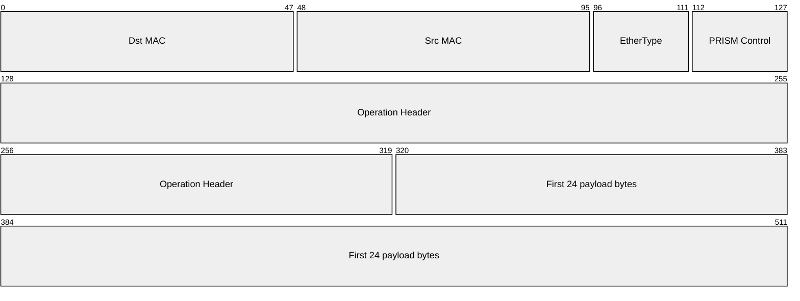

| Campo | Dimensione | Significato |
|---|---:|---|
| `Dst MAC` | 48b | Destinazione Ethernet del collegamento diretto successivo |
| `Src MAC` | 48b | MAC del mittente su quel collegamento |
| `EtherType` | 16b | `0x88B5`, EtherType sperimentale di PRISM[^ethertype] |
| `PRISM Control` | 16b | Versione e opcode della classe di pacchetto |
| `Operation Header` | 192b | Identità di job, gruppo, operazione, contributore/percorso e chunk |
| `First payload bytes` | 192b | Primi 24 byte del chunk del vettore |

`TKEEP` identifica i byte validi nell'ultimo beat e `TLAST` indica la fine fisica
del frame. Questi segnali convalidano il confine del pacchetto; la configurazione
dell'operazione determina comunque la lunghezza logica esatta del vettore.

La control word comune da 16 bit è:

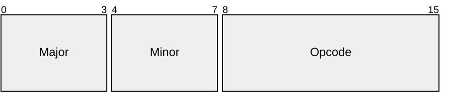

Il Protocollo 1.0 usa `Major=1` e `Minor=0`. Una versione major diversa è
incompatibile. L'opcode indica al parser locale come interpretare l'header che
segue. La richiesta host e `StartGrant` sono eventi API esterni a questo wire
ABI: il modello di avvio controllato dall'host non modifica quindi il layout del
Protocollo 1.0. Questa è la specifica 1.0 canonica prima del rilascio: i layout
delle bozze precedenti non pubblicate sono sostituiti, non mantenuti come
varianti di compatibilità.

## Layout dei pacchetti del Protocollo 1.0

I quattro opcode non rappresentano quattro varianti della stessa operazione.
`CONTROL` configura e interroga gli switch; `COL_DATA` trasporta contributi
verso la radice; `COL_RES` distribuisce i risultati; `COL_PROGRESS` restituisce
al mittente adiacente conferme e informazioni di flusso. La control word comune
seleziona uno di questi header; i diagrammi mostrano soltanto la codifica, mentre
le tabelle seguenti spiegano la funzione dei campi.

Salvo diversa indicazione:

- i campi sono mostrati nell'ordine di trasmissione;
- gli interi multibyte e gli elementi numerici usano l'ordine dei byte di rete:
  viene trasmesso prima il byte più significativo;
- i campi riservati e i bit di flag inutilizzati vengono trasmessi a zero e
  causano un rifiuto se ricevuti con valore diverso da zero;
- le larghezze sono espresse in bit e gli offset in byte dall'inizio dell'header
  o del record Type-Length-Value (TLV) che li contiene.

### `PM_OP_CONTROL`

`PM_OP_CONTROL` ha questo header fisso da 24 byte dopo la control word comune:

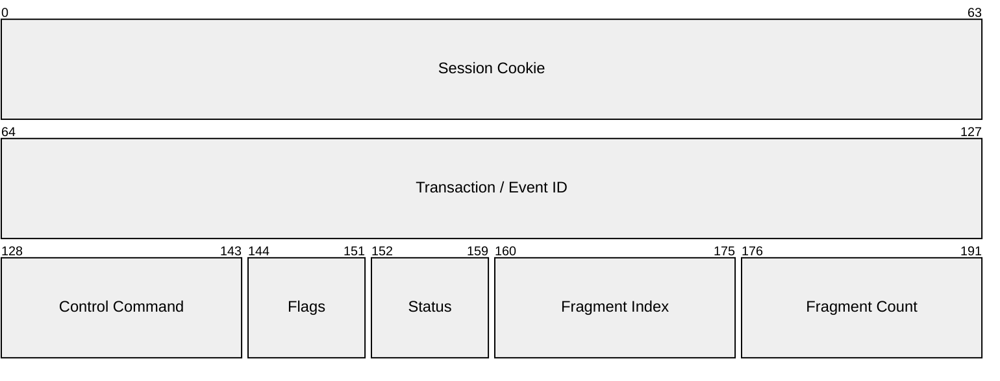

`CONTROL` è il contenitore del protocollo di gestione in-band. L'AM lo usa per
aprire sessioni, installare gruppi, preparare operazioni e interrogare stato o
risorse; gli switch lo usano per risposte ed eventi. L'header identifica e rende
riassemblabile lo scambio, mentre il payload TLV contiene i parametri specifici
del comando.

| Campo | A che cosa serve | Perché è necessario |
|---|---|---|
| Session Cookie | Seleziona la sessione AM locale allo switch | Impedisce che comandi appartenenti a sessioni diverse condividano proprietà e risorse; vale zero soltanto prima dell'apertura o per le query esplicitamente ammesse |
| Transaction / Event ID | Identifica una richiesta con la sua risposta, oppure un evento | Permette correlazione, deduplicazione e riassemblaggio anche quando più scambi sono contemporaneamente attivi |
| Control Command | Specifica l'azione di gestione e determina quali TLV sono ammessi | Consente a un solo formato di trasportare setup, query, commit, rilascio ed eventi |
| Flags | Distingue richiesta, risposta o evento e segnala proprietà dell'envelope | Il significato dell'ID e del campo Status dipende dal ruolo del messaggio |
| Status | Comunica l'esito della richiesta o la condizione associata a un evento | Separa l'esito generale dai dettagli strutturati o diagnostici contenuti nei TLV; nelle richieste è zero |
| Fragment Index / Count | Posiziona il frammento corrente e dichiara il numero totale di frammenti | Un comando di configurazione può superare un singolo frame Ethernet e deve essere ricostruito atomicamente prima di modificare lo stato |

!!! example "Lettura di una transazione CONTROL"

    Una `GROUP_STAGE` inviata in tre frame mantiene gli stessi Session Cookie,
    Transaction ID, comando, flag, status e Fragment Count. Cambia soltanto
    Fragment Index (`0`, `1`, `2`). Lo switch riassembla i tre payload, valida i
    TLV e solo allora tenta di installare lo stato del gruppo.

<details class="protocol-registry" markdown="1">
<summary>Flag di controllo, TLV e regole di frammentazione</summary>

`SESSION_OPEN` e una richiesta statica `CAPS_QUERY` non autenticata usano un
cookie pari a zero. Le richieste usano un Transaction ID; gli eventi usano un
Event ID. I flag di controllo sono:

| Valore | Flag |
|---:|---|
| `0x01` | `REQUEST` |
| `0x02` | `RESPONSE` |
| `0x04` | `EVENT` |
| `0x08` | `ACK_REQUIRED` |
| `0x10` | `AUTH_PRESENT` |

Il payload di controllo è una sequenza di record Type-Length-Value allineati a
64 bit:

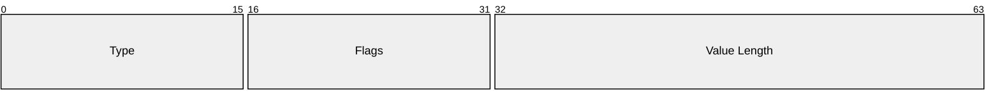

Value Length conta soltanto i byte del valore. Un padding di allineamento a zero
porta ogni record completo a un multiplo di 8 byte. L'unico flag TLV assegnato
è `MANDATORY=0x0001`. Un TLV mandatory sconosciuto causa il rifiuto della
transazione; un TLV opzionale sconosciuto viene ignorato. Un TLV non ripetibile
non può comparire due volte.

Fragment Count è positivo e Fragment Index è minore di tale valore. Ogni
frammento della stessa coppia `(Session Cookie, Transaction ID)` ha identici
command, flag, status e count. Il riassemblaggio termina prima del parsing dei
TLV o di qualunque modifica dello stato. Un riassemblaggio in conflitto,
incoerente, scaduto o oltre capacità viene scartato.

`PROTOCOL_VERSION_RANGE` occupa 8 byte: major minimo, minor minimo, major
massimo e minor massimo (8 bit ciascuno), seguiti da 32 bit a zero. I TLV
scalari di identità, lease, profilo, feature e stato contengono un singolo valore
unsigned a 64 bit. `PAYLOAD_DIGEST` è uno SHA-256 da 32 byte,
`ERROR_DETAIL` è UTF-8 e `AUTH_DATA` contiene byte opachi definiti dal
profilo.

</details>

`DATA`, `RES` e `PROGRESS` appartengono a una singola operazione già
configurata. I primi due trasportano elementi numerici; `PROGRESS` non trasporta
dati del vettore, ma controlla l'affidabilità di un singolo collegamento. I
campi Job, Group e Operation compaiono in tutti e tre per impedire che un
pacchetto valido venga applicato al contesto sbagliato.

| Identità condivisa | Funzione |
|---|---|
| Job ID | Seleziona il dominio di proprietà dell'AM |
| Group ID + Group Generation | Seleziona la precisa istanza dell'albero logico |
| Operation ID + Operation Generation | Seleziona la precisa esecuzione attiva su quell'albero |

### `PM_OP_COL_DATA`

L'header DATA da 24 byte è seguito dagli elementi numerici del vettore:


Il Contributor ID identifica una sorgente locale direttamente collegata. In una
foglia normalmente identifica un rank; in un nodo interno identifica un
sottoalbero figlio. Quando uno switch invia il proprio risultato parziale verso
l'alto conserva Job, Group, Operation e Chunk Index, sostituisce il Contributor
ID con il `parent_contributor_id` installato, usa il proprio MAC PRISM di uscita
come sorgente e il Parent MAC dell'azione upstream come destinazione.

| Campo specifico | Funzione |
|---|---|
| Contributor ID | Seleziona il contributore atteso sul collegamento corrente e consente di rilevare contributi duplicati o provenienti dalla sorgente sbagliata |
| Chunk Index | Colloca il payload nel corretto intervallo del vettore e seleziona lo stato di riduzione temporaneo, indipendentemente dall'ordine di arrivo |
| Flags | Indica ritrasmissione, richiesta di ACK e ultimo chunk |
| Payload | Contiene elementi in Input Wire Format se il mittente è un endpoint, oppure in Partial Wire Format se il mittente è uno switch figlio |

### `PM_OP_COL_RES`

L'header di risultato da 24 byte è seguito dagli elementi del risultato:

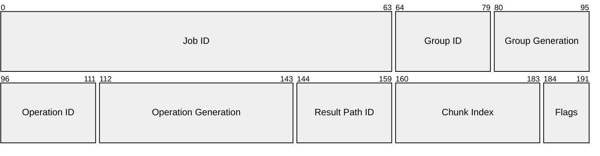

Il Result Path ID identifica una replica di risultato configurata sul
collegamento diretto corrente. Quando un altro switch replica il risultato, il
campo viene sostituito con l'identificatore configurato localmente. Ogni replica
conserva Job, Group, Operation e Chunk Index, usa il MAC PRISM locale di uscita
come sorgente e prende il MAC di destinazione dalla voce selezionata del
replication group.

| Campo specifico | Funzione |
|---|---|
| Result Path ID | Seleziona la replica o destinazione attesa sul collegamento corrente; è locale al salto e può cambiare quando uno switch replica il risultato |
| Chunk Index | Colloca il risultato nella stessa porzione del vettore identificata durante l'aggregazione |
| Flags | Indica ritrasmissione, richiesta di ACK e ultimo chunk |
| Payload | Contiene gli elementi finali del chunk, non un nuovo contributo da ridurre |

!!! info "Flag condivisi da DATA/RES e validazione del payload"

    Una **controparte** (*peer*) è il mittente o ricevente adiacente su un
    singolo collegamento diretto. DATA e RES condividono le stesse assegnazioni
    dei flag:

    | Valore | Flag | Significato |
    |---:|---|---|
    | `0x01` | `RETRANSMIT` | Questo pacchetto è una ritrasmissione |
    | `0x02` | `ACK_REQUIRED` | La controparte diretta deve confermare l'accettazione sicura |
    | `0x04` | `LAST_CHUNK` | Questo è l'ultimo Chunk Index dell'operazione |

    La lunghezza esatta del payload deriva dal modello di suddivisione in chunk
    descritto sopra e dal formato wire del pacchetto. Il padding Ethernet non è
    parte del vettore.

### `PM_OP_COL_PROGRESS`

`PM_OP_COL_PROGRESS` ha questo header fisso da 40 byte, seguito da una bitmap
selective ACK opzionale:

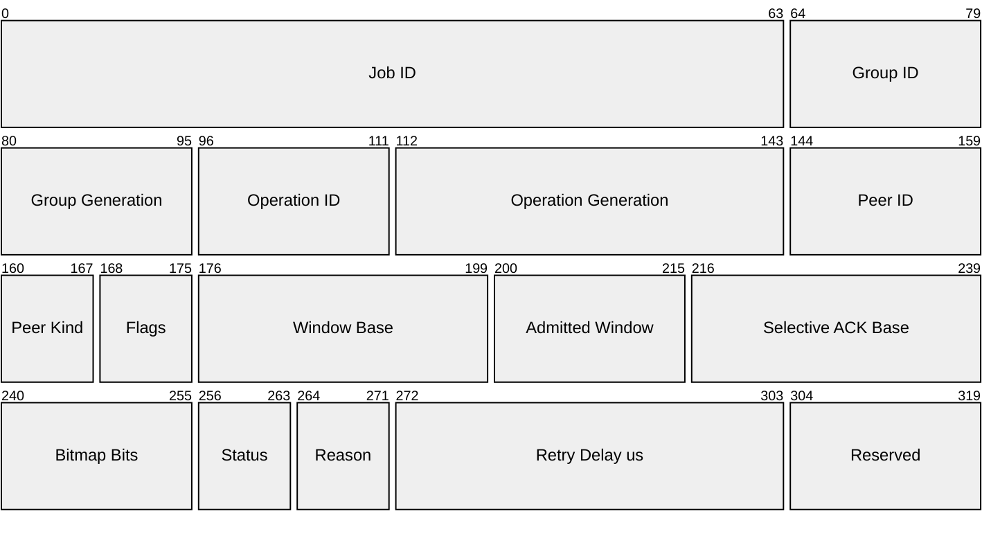

`PROGRESS` viaggia nella direzione opposta rispetto al `DATA` o `RES` che sta
controllando. Non indica che l'intera collettiva sia iniziata o terminata:
descrive ciò che il ricevitore adiacente ha accettato e quanto altro traffico
può ricevere. Non costituisce mai il segnale di avvio dell'albero: tale segnale
proviene dall'Host Coordinator soltanto dopo che l'AM ha osservato tutti gli
switch in stato `ACTIVE`. In questo modo ogni collegamento diretto può
ritrasmettere localmente i chunk mancanti senza riavviare l'operazione end-to-end.
Un ACK termina nel mittente immediatamente precedente: non viene mai inoltrato
nell'albero come lo stesso ACK.

| Campo | A che cosa serve | Perché è necessario |
|---|---|---|
| Job, Group, Operation | Selezionano l'operazione cui appartiene il feedback | Un ACK relativo a una generazione precedente deve essere ignorato |
| Peer ID | Identifica il contributore, il percorso di risultato o l'endpoint cui si riferisce il feedback | Uno switch può gestire più flussi diretti della stessa operazione |
| Peer Kind | Definisce lo spazio di nomi nel quale interpretare Peer ID | Lo stesso valore numerico può indicare entità di tipo diverso; per un ACK di risultato, Peer ID è un Result Path ID |
| Flags | Indicano duplicato, presenza della bitmap, aggiornamento della finestra, result path o errore fatale | Permettono di omettere parti non necessarie e qualificano il significato degli altri campi |
| Window Base | Indica il primo Chunk Index della finestra di ricezione comunicata | Distingue chunk ancora ammissibili da chunk ormai precedenti o troppo avanti |
| Admitted Window | Comunica quanti chunk consecutivi, a partire da Window Base, il ricevitore è disposto ad ammettere | Realizza controllo di flusso e impedisce di eccedere bitmap, slot di aggregazione o replay buffer disponibili |
| Selective ACK Base | Associa il primo bit della bitmap a un Chunk Index | La bitmap può descrivere una porzione arbitraria dell'operazione senza avere un bit per ogni chunk globale |
| Bitmap Bits | Dichiara quanti bit della bitmap sono significativi | Consente ACK selettivi di lunghezza variabile e validazione esatta del payload |
| Status / Reason | Riportano rispettivamente l'esito generale e la causa specifica del feedback | Distinguono, per esempio, un duplicato innocuo da finestra esaurita, payload errato o errore irreversibile |
| Retry Delay us | Suggerisce quanto attendere prima di ritrasmettere | Evita retry immediati quando il rifiuto dipende da pressione temporanea sulle risorse; vale zero se non applicabile |
| Reserved | Spazio per estensioni compatibili, trasmesso a zero | Mantiene l'header allineato senza attribuire oggi una semantica futura |

!!! example "Lettura di un selective ACK"

    Con `Selective ACK Base = 40`, `Bitmap Bits = 4` e bitmap `1011`, il
    ricevitore conferma i chunk 40, 42 e 43; il chunk 41 resta non confermato e
    può essere ritrasmesso. Se comunica anche `Window Base = 40` e
    `Admitted Window = 8`, dichiara di poter ammettere i chunk da 40 a 47.

<details class="protocol-registry" markdown="1">
<summary>Codifica selective ACK e flag PROGRESS</summary>

Il payload della bitmap occupa esattamente `ceil(Bitmap Bits/8)` byte. Il bit
`j`, partendo dal bit più significativo di ciascun byte, conferma
`Selective ACK Base + j` per la controparte indicata. I bit bassi inutilizzati
nell'ultimo byte sono zero. Un ACK per un solo chunk usa un bit; un puro
aggiornamento della finestra può usarne zero.

I flag PROGRESS sono:

| Valore | Flag | Significato |
|---:|---|---|
| `0x01` | `DUPLICATE` | Il ricevitore aveva già accettato l'elemento |
| `0x02` | `SELECTIVE_ACK` | È presente una bitmap selective ACK |
| `0x04` | `WINDOW_UPDATE` | Window Base o Admitted Window contiene il valore autorevole |
| `0x08` | `RESULT_PATH` | La controparte identifica un percorso di risultato |
| `0x10` | `FATAL` | L'operazione non può recuperare tramite retry |

</details>

---

## Esempio: `REDUCE(SUM, root = rank1)`

La topologia contiene uno **spine**, cioè lo switch di livello superiore `S0`,
due switch foglia (`L0`, `L1`) e quattro rank.
`rank1` è l'unico destinatario del risultato. I passaggi 1–3 stabiliscono una
singola invocazione; i passaggi 4–7 possono procedere in pipeline per ciascun
chunk; i passaggi 8–9 chiudono l'invocazione dopo il completamento di tutti i
chunk.

Per il chunk `i`:

\[
\mathbf{result}[i]=
\mathbf{x}_0[i]+\mathbf{x}_1[i]+\mathbf{x}_2[i]+\mathbf{x}_3[i].
\]

### 1. Richiedere la collettiva

I quattro rank entrano nella stessa collettiva tramite il runtime. In questa
storyboard, `rank0` ospita anche l'Host Coordinator: entra localmente nella
barriera, mentre il runtime porta allo stesso punto gli arrivi degli altri rank.
Quando l'insieme dei partecipanti è completo, il Coordinator chiede all'AM di
avviare l'operazione. In questa fase non viene ancora inviato alcun pacchetto
dati PRISM.

<figure markdown="span">
  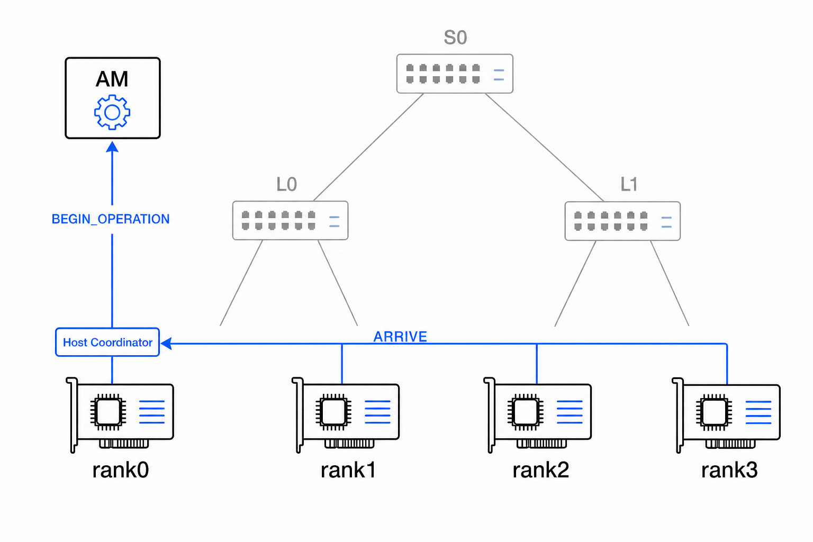{ loading=lazy }
  <figcaption>Il badge del Coordinator appartiene a <code>rank0</code>. Il bus blu e <code>BEGIN_OPERATION</code> rappresentano comunicazione del runtime host, non pacchetti Ethernet PRISM.</figcaption>
</figure>

### 2. Configurare l'albero degli switch

Se il Group riutilizzabile non è già installato, l'AM lo installa per primo.
Prepara quindi un handle di Operation e la relativa geometria dei chunk, poi ne
esegue il commit su ogni switch destinatario.

| Nodo | Riduzione locale | Direzione del risultato |
|---|---|---|
| `L0` | `rank0`, `rank1` → parziale per `S0` | verso `rank1` |
| `L1` | `rank2`, `rank3` → parziale per `S0` | nessuna |
| `S0` | sottoalberi `L0`, `L1` → risultato finale | verso `L0` |

<figure markdown="span">
  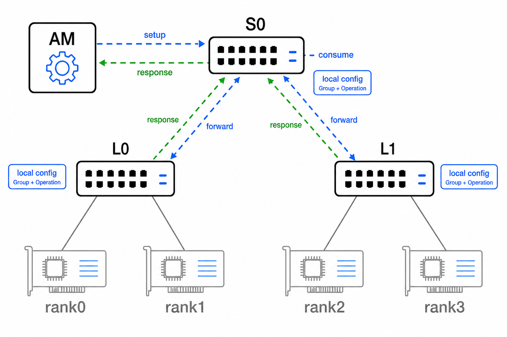{ loading=lazy }
  <figcaption>Il disegno condensa più comandi in un percorso per destinatario; ogni comando reale resta una transazione separata, eventualmente frammentata.</figcaption>
</figure>

Il Group può servire invocazioni successive. Lunghezza del vettore, aritmetica,
ammissione, completamento e retry appartengono invece a questa Operation.

### 3. Sbloccare i rank

L'AM restituisce `StartGrant` soltanto dopo la conferma `ACTIVE` da parte di
`S0`, `L0` e `L1`. L'Host Coordinator in `rank0` pubblica quindi i grant
specifici per sé e per gli altri tre rank tramite lo stesso canale del runtime.
Una foglia non invia un ACK di avvio: possiede soltanto conoscenza locale e non
può dimostrare che l'intero albero sia pronto.

<figure markdown="span">
  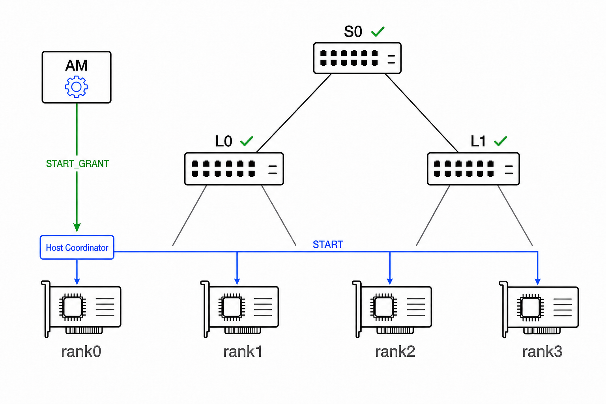{ loading=lazy }
  <figcaption>Il grant lato host costituisce la barriera di disponibilità globale. Il Coordinator è ospitato da <code>rank0</code>, non è un quinto partecipante.</figcaption>
</figure>

### 4. Inviare i contributi dei rank

Dopo `START`, ogni rank invia alla foglia configurata un pacchetto DATA per il
chunk `i`. L'header contiene `Job ID`, `Group ID/Generation`, `Operation
ID/Generation`, Contributor ID locale alla foglia e Chunk Index. Ogni foglia
conferma l'accettazione sicura.

<figure markdown="span">
  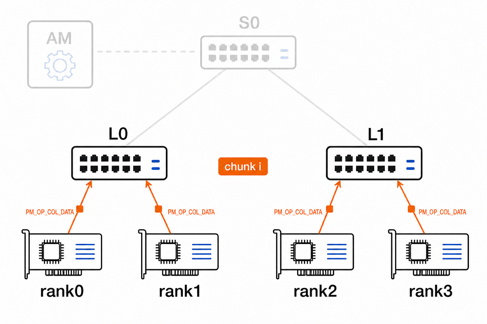{ loading=lazy }
  <figcaption>Ogni contributo viaggia soltanto verso la foglia configurata; ACK e ritrasmissione proteggono ogni collegamento diretto.</figcaption>
</figure>

### 5. Completare le riduzioni nelle foglie

Le foglie si completano in modo indipendente:

\[
\begin{aligned}
\mathbf{partial}_0[i] &= \mathbf{x}_0[i]+\mathbf{x}_1[i],\\
\mathbf{partial}_1[i] &= \mathbf{x}_2[i]+\mathbf{x}_3[i].
\end{aligned}
\]

<figure markdown="span">
  { loading=lazy }
  <figcaption>Il conteggio dei contributori è locale; le due foglie non devono completarsi nello stesso momento.</figcaption>
</figure>

Ogni foglia conserva la somma parziale completata finché il parent non la
conferma.

### 6. Aggregare nello switch radice

`L0` e `L1` emettono le proprie somme parziali come DATA. In `S0`, ciascun
sottoalbero figlio costituisce un contributore locale, identificato dal
`parent_contributor_id` configurato per quel figlio.

Dopo aver accettato entrambe le somme parziali, `S0` calcola il chunk finale:

\[
\mathbf{result}[i]=\mathbf{partial}_0[i]+\mathbf{partial}_1[i].
\]

L'accettazione sicura di ogni parziale costituisce anche un passaggio di
responsabilità locale. `S0` invia un ACK `PM_OP_COL_PROGRESS` a `L0` e un altro
a `L1`. Dopo aver ricevuto il proprio ACK, la foglia può riutilizzare il replay
buffer che conteneva il parziale del chunk `i`; non attende che il risultato
finale raggiunga `rank1`.

<figure markdown="span">
  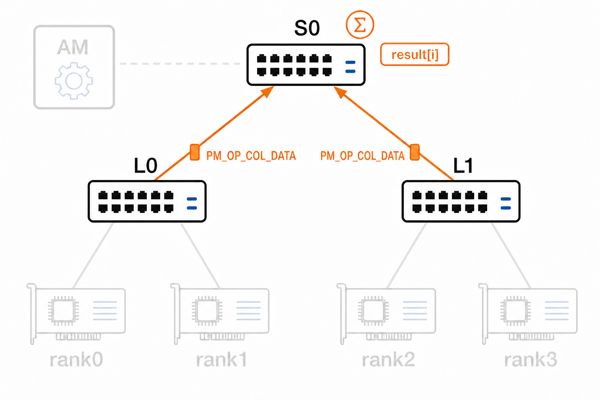{ loading=lazy }
  <figcaption>Ogni ACK tratteggiato appartiene a un trasferimento DATA foglia-S0; nessuno dei due proviene da <code>rank1</code>.</figcaption>
</figure>

### 7. Instradare il risultato verso `rank1`

La rotta in `S0` seleziona una voce di replica verso `L0`; quella in `L0`
seleziona `rank1`. `L1` e gli altri rank non ricevono traffico di risultato.

<figure markdown="span">
  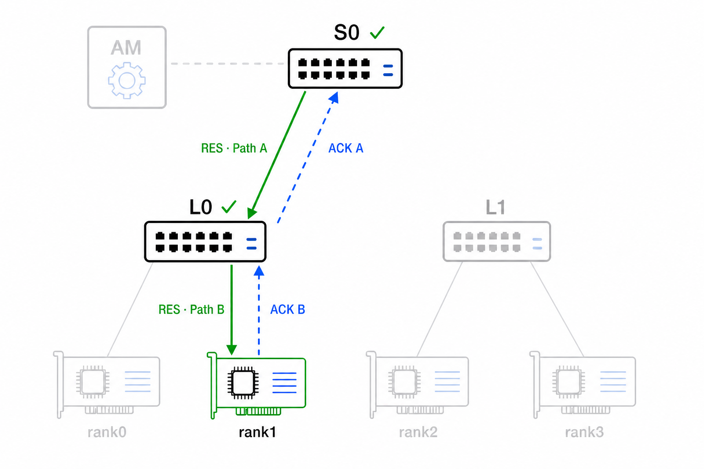{ loading=lazy }
  <figcaption>Path A e Path B sono trasferimenti indipendenti. <code>ACK B</code> termina in <code>L0</code>; <code>ACK A</code> è una risposta distinta generata da <code>L0</code>.</figcaption>
</figure>

Ethernet non comunica al mittente che il nodo successivo ha accettato il
pacchetto. `S0` conserva quindi la copia A finché `L0` non trattiene il risultato
in modo sicuro e restituisce `ACK A`. `L0` può inviare tale ACK senza attendere
`rank1`: ha assunto la responsabilità del Path B e conserva una propria copia
finché `rank1` non restituisce `ACK B`. Un ACK chiude quindi un singolo
trasferimento diretto e rende riutilizzabile lo slot di replay limitato del
mittente. La perdita del pacchetto o dell'ACK causa un retry soltanto su quel
collegamento.

Uno switch sopprime un risultato già accettato sullo stesso Result Path locale e
conferma nuovamente il duplicato. Nel rank finale, il Protocollo 1.0 richiede al
runtime/endpoint di deduplicare usando Operation handle, Result Path ID e Chunk
Index fino al rilascio; il solo protocollo degli switch non garantisce una
consegna applicativa exactly-once.

### 8. Completare l'operazione

Il recupero dei buffer avviene progressivamente, non come un singolo evento
globale. `L1` può completarsi dopo che `S0` ha confermato tutti i suoi parziali.
`S0` si completa quando ogni risultato finale è stato accettato dal next hop
configurato, `L0`. Poiché `L0` svolge entrambi i ruoli, si completa soltanto dopo
che `S0` ha confermato tutti i suoi parziali e `rank1` ha confermato tutti i
risultati. I tre switch possono quindi raggiungere `COMPLETE` in momenti diversi.

Al completamento locale, i buffer pesanti di aggregazione e replay sono già
riutilizzabili. Lo switch conserva ancora l'Operation handle, lo stato di
completamento/fase e i tombstone di deduplicazione, così da respingere i pacchetti
tardivi.

<figure markdown="span">
  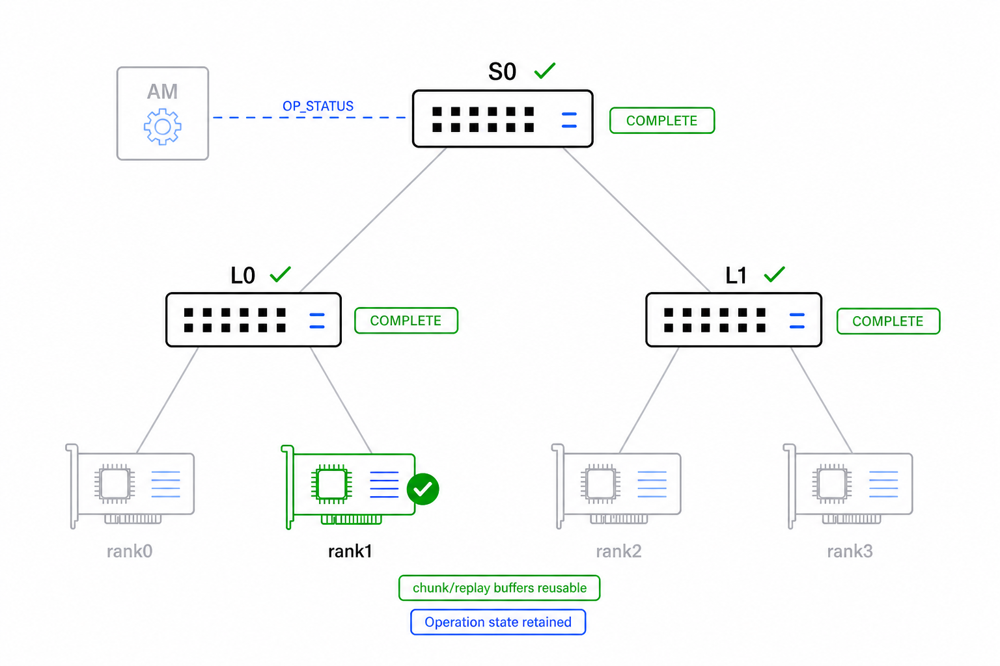{ loading=lazy }
  <figcaption><code>COMPLETE</code> registra che uno switch ha terminato i propri obblighi locali; non è un ACK globale del risultato e non libera l'Operation handle.</figcaption>
</figure>

L'Host Coordinator chiama `wait_operation(...)`; l'AM usa le risposte autorevoli
di `OP_STATUS`, eventualmente anticipate da `OP_COMPLETE_EVENT`, finché ogni
switch non riporta `COMPLETE`. La chiamata restituisce quindi al coordinatore il
completamento globale e ritira i vecchi start grant. La singola linea di gestione
nel disegno rappresenta scambi di stato distinti e specifici per `S0`, `L0` e
`L1`; `S0` non riassume lo stato dei figli.

### 9. Rilasciare lo stato dell'Operation

L'AM non rilascia autonomamente un'Operation. Dopo che `wait_operation(...)` ha
restituito il completamento globale, l'Host Coordinator in `rank0` chiama
esplicitamente `release_operation(...)`. L'AM invia quindi a ciascuno switch un
`OP_RELEASE` specifico per destinazione e attende tutte le risposte.

Il comando resta necessario anche se i buffer dei chunk sono già riutilizzabili:
elimina l'Operation handle conservato, lo stato di completamento/fase, i tombstone
di retry e deduplicazione e la proprietà residua dell'Operation ID. La topologia
riutilizzabile del Group rimane installata.

<figure markdown="span">
  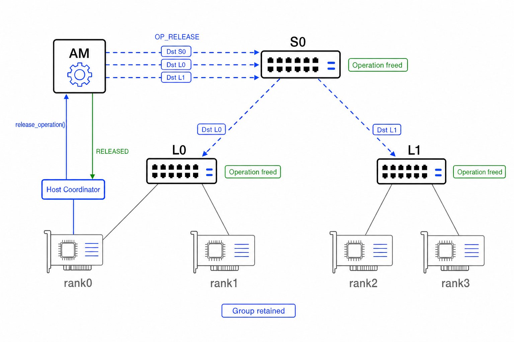{ loading=lazy }
  <figcaption>Il Coordinator avvia il rilascio. <code>S0</code> consuma la propria richiesta e inoltra invariate quelle per <code>L0</code>/<code>L1</code>; il ritorno verde <code>RELEASED</code> avviene soltanto dopo ogni risposta.</figcaption>
</figure>

Soltanto dopo ogni `OP_RELEASE_RESPONSE` l'AM restituisce `RELEASED` all'Host
Coordinator. Lo stesso Operation ID può poi essere riutilizzato soltanto con una
generazione superiore e il Coordinator conclude la chiamata collettiva di ogni
rank con `DONE`. Un fallimento viene propagato a tutti come lo stesso `ERROR`
terminale. Questi esiti host usano il canale del runtime, non pacchetti Ethernet
`PM_*`.

### Differenza di `ALLREDUCE`

La configurazione e l'aggregazione verso la radice non cambiano. Cambia soltanto
l'albero dei risultati: `S0` replica verso entrambe le foglie e ogni foglia verso
tutti i rank locali partecipanti. Ogni collegamento del risultato usa comunque
un proprio Result Path ID e ACK.

### Ciclo di vita e comportamento non valido

Il ciclo di vita principale dell'operazione è:

```text
FREE -> PREPARED -> ACTIVE -> COMPLETE -> RELEASING -> FREE
```

Gli stati `PREPARED` o `ACTIVE` possono invece passare ad `ABORTED`, ma i
tombstone delle generazioni obsolete e del completamento rimangono fino al
rilascio.

In un singolo switch, un'operazione diventa `COMPLETE` soltanto dopo che ogni
output di aggregazione locale e ogni replica di risultato richiesta localmente,
per tutti i chunk, sono stati confermati e non rimane alcun retry in sospeso. Una
foglia priva del ruolo di consegna del risultato non attende alcun ACK di
risultato. Gli eventi di completamento sono notifiche utili, mentre `OP_STATUS`
rimane la fonte autorevole.

Un pacchetto o una transazione non è valido, per esempio, quando contiene una
versione o un opcode non supportati, un TLV malformato, una sessione o generazione
obsoleta, un'associazione errata del contributore, un chunk fuori intervallo, una
lunghezza del payload errata, rotte del risultato sovrapposte, un Result Path
sconosciuto oppure bit riservati diversi da zero. Gli errori di gestione
restituiscono uno stato preciso; quando possibile, gli errori DATA/RES usano il
feedback PROGRESS. Un input non valido non conta mai come prenotazione o
contributo riuscito.

---

## Semantiche collettive

| Valore | Semantica | Significato |
|---:|---|---|
| `0x00` | `INVALID` | Collettiva non supportata |
| `0x01` | `REDUCE` | Consegna il vettore ridotto a un solo rank selezionato |
| `0x02` | `ALLREDUCE` | Consegna il vettore ridotto a ogni rank partecipante |
| `0x03` | `REDUCE_SCATTER` | Semantica riservata; il supporto deve essere dichiarato |

Il primo prototipo RTL si concentra su `REDUCE` e `ALLREDUCE`.

---

## Operatore di riduzione

| Valore | Operatore | Significato |
|---:|---|---|
| `0x00` | `INVALID` | Operatore non supportato |
| `0x01` | `SUM` | Somma elemento per elemento |

`SUM` è l'operatore di riduzione previsto dal prototipo della tesi.

---

## Formati wire e modalità di accumulo

Un **Input Wire Format** descrive i contributi degli endpoint, un **Partial Wire
Format** descrive il DATA emesso da uno switch verso il parent e un **Output
Wire Format** descrive gli elementi RES finali. Una **modalità di accumulo**
descrive come uno switch combina i valori internamente. Rendere esplicite tutte
e quattro le scelte rende selezionabile e interrogabile ogni confine di
conversione.

| Valore | Formato wire | Byte per elemento |
|---:|---|---:|
| `0x01` | `INT8` | 1 |
| `0x02` | `FP16` | 2 |
| `0x03` | `BF16` | 2 |
| `0x04` | `FP32` | 4 |

Il Protocollo 1.0 assegna soltanto FP32 ai parziali tra switch:

| Valore | Partial Wire Format | Byte per elemento |
|---:|---|---:|
| `0x00` | `INVALID` | — |
| `0x04` | `FP32` | 4 |

La scelta è intenzionalmente più restrittiva del registro dei formati endpoint:
impedisce che l'albero restringa i parziali a INT8, FP16 o BF16 a ogni salto.
I parziali exact-FP32 e Kulisch non sono assegnati in 1.0 perché layout in byte,
regole di fusione, valori speciali e overflow non sono ancora fissati. Il campo
Partial Wire Format consente a una revisione successiva di aggiungerli senza
modificare il descrittore Operation. FP32 conserva il valore `0x04` del normale
registro Wire Format, così la stessa codifica del payload non ha due codici
numerici diversi.

Le assegnazioni delle modalità di accumulo sono:

| Valore | Modalità di accumulo |
|---:|---|
| `0x01` | `NATIVE` |
| `0x02` | `FP32` |
| `0x03` | `DETERMINISTIC_FP32` |

L'assegnazione di un codice non implica il supporto RTL: la tupla completa
`(input, accumulator, partial, output)` deve essere dichiarata e accettata da
`OP_PREPARE`.

`DETERMINISTIC_FP32` combina i contributori in ordine crescente di Contributor
ID locale. Un accumulatore esatto non viene intenzionalmente assegnato nel
Protocollo 1.0: con un partial FP32 arrotonderebbe comunque a ogni confine tra
switch, mentre un profilo esatto per l'intero albero richiede anche una nuova
codifica partial. La derivazione numerica è descritta in
[Riproducibilità in virgola mobile](../1-introduction/reproducibility.md).

---


## Registri normativi e record di configurazione

Il percorso dei pacchetti descritto sopra è sufficiente per comprendere il
protocollo. I blocchi compressi seguenti costituiscono il riferimento esatto per
il lavoro su parser, RTL e software host.

<details class="protocol-registry" markdown="1">
<summary>Registro dei comandi e dei TLV</summary>

<p class="protocol-registry__heading">Comandi di controllo</p>

Il registro dei comandi del Protocollo 1.0 usa tre colonne per rimanere
leggibile. La colonna dello schema elenca i TLV obbligatori, opzionali e
ripetibili; `—` indica che il comando non ne trasporta.

| Valore | Comando | TLV ammessi |
|---:|---|---|
| `0x0000` | `INVALID` | riservato |
| `0x0001` | `CAPS_QUERY` | **Opzionali:** `SECURITY_PROFILE` |
| `0x0002` | `CAPS_RESPONSE` | **Obbligatori:** `DEVICE_BOOT_ID`, `PROTOCOL_VERSION_RANGE`, `CAPABILITIES`<br>**Opzionali:** `FEATURE_MASK`, `SECURITY_PROFILE` |
| `0x0003` | `RESOURCE_QUERY` | **Opzionali:** `GROUP_HANDLE`, `OPERATION_HANDLE` |
| `0x0004` | `RESOURCE_RESPONSE` | **Obbligatori:** `RESOURCE_SNAPSHOT_ID`, `RESOURCE_SNAPSHOT`<br>**Opzionali:** `SESSION_USAGE` |
| `0x0010` | `SESSION_OPEN` | **Obbligatori:** `JOB_ID`, `SECURITY_PROFILE`<br>**Opzionali:** `AUTH_DATA`, `LEASE_MS` |
| `0x0011` | `SESSION_OPEN_RESPONSE` | **Obbligatori:** `SESSION_COOKIE`, `DEVICE_BOOT_ID`, `LEASE_MS`, `LEASE_GRACE_MS` |
| `0x0012` | `SESSION_RENEW` | **Opzionali:** `LEASE_MS`, `AUTH_DATA` |
| `0x0013` | `SESSION_RENEW_RESPONSE` | **Obbligatori:** `LEASE_MS` |
| `0x0014` | `SESSION_CLOSE` | — |
| `0x0015` | `SESSION_CLOSE_RESPONSE` | **Opzionali:** `RELEASED_RESOURCES` |
| `0x0100` | `GROUP_STAGE` | **Obbligatori:** `GROUP_HANDLE`, `GROUP_DESCRIPTOR`, `UPSTREAM_ACTION`<br>**Opzionali:** `CONTRIBUTOR_BINDING`, `REPLICATION_GROUP`<br>**Ripetibili:** `CONTRIBUTOR_BINDING`, `REPLICATION_GROUP` |
| `0x0101` | `GROUP_STAGE_RESPONSE` | **Obbligatori:** `GROUP_HANDLE`, `RESOURCE_RESERVATION` |
| `0x0102` | `GROUP_COMMIT` | **Obbligatori:** `GROUP_HANDLE` |
| `0x0103` | `GROUP_COMMIT_RESPONSE` | **Obbligatori:** `GROUP_HANDLE`, `GROUP_STATUS` |
| `0x0104` | `GROUP_ABORT` | **Obbligatori:** `GROUP_HANDLE` |
| `0x0105` | `GROUP_ABORT_RESPONSE` | **Opzionali:** `RELEASED_RESOURCES` |
| `0x0106` | `GROUP_STATUS` | **Obbligatori:** `GROUP_HANDLE` |
| `0x0107` | `GROUP_STATUS_RESPONSE` | **Obbligatori:** `GROUP_HANDLE`, `GROUP_STATUS` |
| `0x0108` | `GROUP_DESTROY` | **Obbligatori:** `GROUP_HANDLE` |
| `0x0109` | `GROUP_DESTROY_RESPONSE` | **Obbligatori:** `GROUP_HANDLE`<br>**Opzionali:** `RELEASED_RESOURCES` |
| `0x0200` | `OP_PREPARE` | **Obbligatori:** `GROUP_HANDLE`, `OPERATION_HANDLE`, `OPERATION_DESCRIPTOR`<br>**Opzionali:** `RESULT_ROUTE`, `RETRY_POLICY`<br>**Ripetibili:** `RESULT_ROUTE` |
| `0x0201` | `OP_PREPARE_RESPONSE` | **Obbligatori:** `OPERATION_HANDLE`, `GRANTED_RESOURCES` |
| `0x0202` | `OP_COMMIT` | **Obbligatori:** `OPERATION_HANDLE` |
| `0x0203` | `OP_COMMIT_RESPONSE` | **Obbligatori:** `OPERATION_HANDLE`, `OPERATION_STATUS` |
| `0x0204` | `OP_ABORT` | **Obbligatori:** `OPERATION_HANDLE` |
| `0x0205` | `OP_ABORT_RESPONSE` | **Obbligatori:** `OPERATION_HANDLE`, `OPERATION_STATUS` |
| `0x0206` | `OP_STATUS` | **Obbligatori:** `OPERATION_HANDLE` |
| `0x0207` | `OP_STATUS_RESPONSE` | **Obbligatori:** `OPERATION_HANDLE`, `OPERATION_STATUS`<br>**Opzionali:** `PHASE_BITMAP_SUMMARY`, `ERROR_DETAIL` |
| `0x0208` | `OP_RELEASE` | **Obbligatori:** `OPERATION_HANDLE` |
| `0x0209` | `OP_RELEASE_RESPONSE` | **Obbligatori:** `OPERATION_HANDLE`<br>**Opzionali:** `RELEASED_RESOURCES` |
| `0x0300` | `OP_COMPLETE_EVENT` | **Obbligatori:** `OPERATION_HANDLE`, `EVENT_DETAIL` |
| `0x0301` | `OP_ERROR_EVENT` | **Obbligatori:** `OPERATION_HANDLE`, `EVENT_DETAIL`, `ERROR_DETAIL` |
| `0x0302` | `RESOURCE_PRESSURE_EVENT` | **Obbligatori:** `EVENT_DETAIL` |
| `0x0303` | `EVENT_ACK` | **Obbligatori:** `EVENT_DETAIL` |

<p class="protocol-registry__heading">Assegnazioni dei tipi TLV</p>

| Valore | Tipo TLV | Famiglia |
|---:|---|---|
| `0x0000` | `INVALID` | Generale |
| `0x0001` | `JOB_ID` | Generale |
| `0x0002` | `DEVICE_BOOT_ID` | Generale |
| `0x0003` | `SESSION_COOKIE` | Generale |
| `0x0004` | `LEASE_MS` | Generale |
| `0x0005` | `LEASE_GRACE_MS` | Generale |
| `0x0006` | `SECURITY_PROFILE` | Generale |
| `0x0007` | `FEATURE_MASK` | Generale |
| `0x0008` | `PROTOCOL_VERSION_RANGE` | Generale |
| `0x0009` | `CAPABILITIES` | Generale |
| `0x000A` | `RESOURCE_SNAPSHOT_ID` | Generale |
| `0x000B` | `RESOURCE_SNAPSHOT` | Generale |
| `0x000C` | `RESOURCE_RESERVATION` | Generale |
| `0x000D` | `PAYLOAD_DIGEST` | Generale |
| `0x000E` | `ERROR_DETAIL` | Generale |
| `0x000F` | `RELEASED_RESOURCES` | Generale |
| `0x0010` | `AUTH_DATA` | Generale |
| `0x0011` | `SESSION_USAGE` | Generale |
| `0x0100` | `GROUP_HANDLE` | Gruppo |
| `0x0101` | `GROUP_DESCRIPTOR` | Gruppo |
| `0x0102` | `CONTRIBUTOR_BINDING` | Gruppo |
| `0x0103` | `UPSTREAM_ACTION` | Gruppo |
| `0x0104` | `REPLICATION_GROUP` | Gruppo |
| `0x0105` | `GROUP_STATUS` | Gruppo |
| `0x0200` | `OPERATION_HANDLE` | Operazione |
| `0x0201` | `OPERATION_DESCRIPTOR` | Operazione |
| `0x0202` | `RESULT_ROUTE` | Operazione |
| `0x0203` | `GRANTED_RESOURCES` | Operazione |
| `0x0204` | `OPERATION_STATUS` | Operazione |
| `0x0205` | `PHASE_BITMAP_SUMMARY` | Operazione |
| `0x0206` | `RETRY_POLICY` | Operazione |
| `0x0300` | `EVENT_DETAIL` | Evento |

`CONTRIBUTOR_BINDING`, `REPLICATION_GROUP` e `RESULT_ROUTE` sono
ripetibili soltanto nei comandi il cui schema permette la ripetizione.

</details>

<details class="protocol-registry" markdown="1">
<summary>Layout dei record di gruppo e operazione</summary>

<p class="protocol-registry__heading">Record di gruppo</p>

Il valore `GROUP_HANDLE` da 4 byte è:

| Offset | Larghezza | Campo |
|---:|---:|---|
| 0 | 16 | Group ID |
| 2 | 16 | Group Generation |

Il valore `GROUP_DESCRIPTOR` da 8 byte è:

| Offset | Larghezza | Campo |
|---:|---:|---|
| 0 | 8 | Node Role |
| 1 | 8 | Flag, a zero nel Protocollo 1.0 |
| 2 | 16 | Expected Local Contributors |
| 4 | 16 | Maximum Replication Groups |
| 6 | 16 | Maximum Entries per Replication Group |

Ogni valore `CONTRIBUTOR_BINDING` da 12 byte è:

| Offset | Larghezza | Campo |
|---:|---:|---|
| 0 | 16 | Contributor ID |
| 2 | 16 | Ingress Port |
| 4 | 48 | Source MAC |
| 10 | 16 | Riservato, a zero |

I Contributor ID formano esattamente l'intervallo denso
`0 <= id < expected_local_contributors`. I Contributor ID e le associazioni
`(Ingress Port, Source MAC)` sono univoci.

Il valore `UPSTREAM_ACTION` da 16 byte è:

| Offset | Larghezza | Campo |
|---:|---:|---|
| 0 | 8 | Has Parent, `0` oppure `1` |
| 1 | 8 | Riservato, a zero |
| 2 | 16 | Parent Contributor ID |
| 4 | 16 | Egress Port |
| 6 | 48 | Parent MAC |
| 12 | 32 | Riservato, a zero |

Un `REPLICATION_GROUP` inizia con un header da 8 byte:

| Offset | Larghezza | Campo |
|---:|---:|---|
| 0 | 16 | Replication Group ID |
| 2 | 16 | Entry Count |
| 4 | 32 | Riservato, a zero |

Seguono esattamente Entry Count elementi da 12 byte:

| Offset nell'elemento | Larghezza | Campo |
|---:|---:|---|
| 0 | 16 | Result Path ID |
| 2 | 16 | Egress Port |
| 4 | 8 | Next-Hop Type |
| 5 | 8 | Riservato, a zero |
| 6 | 48 | Destination MAC |

Entry Count è positivo. I Result Path ID e le coppie
`(Egress Port, Destination MAC)` sono univoci all'interno del replication
group.

<p class="protocol-registry__heading">Record di operazione</p>

Il valore `OPERATION_HANDLE` da 6 byte è:

| Offset | Larghezza | Campo |
|---:|---:|---|
| 0 | 16 | Operation ID |
| 2 | 32 | Operation Generation |

Il valore `OPERATION_DESCRIPTOR` da 40 byte è:

| Offset | Larghezza | Campo |
|---:|---:|---|
| 0 | 8 | Collective Semantic |
| 1 | 8 | Reduction Operator |
| 2 | 8 | Input Wire Format |
| 3 | 8 | Accumulator Mode |
| 4 | 8 | Partial Wire Format |
| 5 | 8 | Output Wire Format |
| 6 | 8 | Flag; il bit 0 è Result Delivery Role |
| 7 | 8 | Riservato, a zero |
| 8 | 32 | Element Count |
| 12 | 16 | Elements per Chunk |
| 14 | 16 | Requested Window, in chunk |
| 16 | 32 | Maximum Reduction Terms |
| 20 | 32 | Timeout, ms |
| 24 | 16 | Requested Replay Slots |
| 26 | 16 | Result Route Count |
| 28 | 8 | Result Delivery Role, `0` oppure `1` |
| 29 | 8 | Riservato, a zero |
| 30 | 16 | Riservato, a zero |
| 32 | 32 | Expected Chunks |
| 36 | 16 | Retry Limit |
| 38 | 16 | Riservato, a zero |

Il bit 0 dei flag del descrittore e il byte Result Delivery Role codificano lo
stesso valore e devono coincidere; tutti gli altri bit di flag sono a zero.
Expected Chunks coincide con il valore derivato dalla geometria degli elementi
ed è rappresentabile nel Chunk Index a 24 bit.

Ogni valore `RESULT_ROUTE` da 8 byte è:

| Offset | Larghezza | Campo |
|---:|---:|---|
| 0 | 24 | Primo Chunk Index, incluso |
| 3 | 24 | Ultimo Chunk Index, incluso |
| 6 | 16 | Replication Group ID |

Gli intervalli delle route appartengono all'operazione e non si sovrappongono.
In un nodo che distribuisce risultati coprono ogni Chunk Index. Non esiste una
regola di priorità, first-match o longest-match; intervalli disgiunti possono
selezionare lo stesso replication group.

</details>

<details class="protocol-registry" markdown="1">
<summary>Vettori di capability, risorse e allocazioni</summary>

`CAPABILITIES`, `RESOURCE_SNAPSHOT`, `SESSION_USAGE`,
`RESOURCE_RESERVATION`, `GRANTED_RESOURCES` e `RELEASED_RESOURCES` usano
elementi da 16 byte:

| Offset | Larghezza | Campo |
|---:|---:|---|
| 0 | 16 | Key |
| 2 | 16 | Flag, a zero |
| 4 | 64 | Value |
| 12 | 32 | Riservato, a zero |

Uno snapshot delle risorse descrive la disponibilità ma non effettua alcuna
riserva. Soltanto `GROUP_STAGE` e `OP_PREPARE` riservano risorse.

<p class="protocol-registry__heading">Chiavi delle capability</p>

| Valore | Chiave capability |
|---:|---|
| `0x0000` | `INVALID` |
| `0x0001` | `MAX_SESSIONS` |
| `0x0002` | `MAX_INSTALLED_GROUPS` |
| `0x0003` | `MAX_PREPARED_OPERATIONS` |
| `0x0004` | `MAX_ACTIVE_OPERATIONS_GLOBAL` |
| `0x0005` | `MAX_ACTIVE_OPERATIONS_PER_GROUP` |
| `0x0006` | `MAX_CHUNKS_PER_OPERATION` |
| `0x0007` | `MAX_BITMAP_BYTES_PER_OPERATION` |
| `0x0008` | `TOTAL_PHASE_BITMAP_POOL_BYTES` |
| `0x0009` | `MAX_ACTIVE_AGGREGATION_SLOTS_GLOBAL` |
| `0x000A` | `MAX_ACTIVE_AGGREGATION_SLOTS_PER_OPERATION` |
| `0x000B` | `TOTAL_REPLAY_OUTPUT_SLOTS` |
| `0x000C` | `MAX_LOCAL_CONTRIBUTORS` |
| `0x000D` | `MAX_GROUP_REPLICATION_GROUPS` |
| `0x000E` | `MAX_ENTRIES_PER_REPLICATION_GROUP` |
| `0x000F` | `MAX_OPERATION_RESULT_ROUTES` |
| `0x0010` | `MAX_MANAGEMENT_STAGING_BYTES` |
| `0x0011` | `MAX_SELECTIVE_ACK_WINDOW` |
| `0x0012` | `SUPPORTED_COLLECTIVE_SEMANTICS` |
| `0x0013` | `SUPPORTED_REDUCTION_OPERATORS` |
| `0x0014` | `SUPPORTED_ARITHMETIC_TUPLE` |
| `0x0015` | `MTU_BYTES` |
| `0x0016` | `MAX_PRISM_PAYLOAD_BYTES` |
| `0x0017` | `SUPPORTED_SECURITY_PROFILES` |
| `0x0018` | `SUPPORTED_RELIABILITY_FEATURES` |
| `0x0019` | `REPLAY_CACHE_DEPTH` |
| `0x001A` | `REPLAY_CACHE_RETENTION_MS` |

I valori delle semantiche, degli operatori e dei profili di sicurezza supportati
sono bitmask in cui il bit `n` corrisponde al valore numerico `n` del relativo
registro. Gli elementi delle tuple aritmetiche codificano il formato di input
nei bit 63:56, la modalità dell'accumulatore nei bit 55:48, il formato partial
wire nei bit 47:40, il formato di output nei bit 39:32 e zero nei bit 31:0.
`SUPPORTED_ARITHMETIC_TUPLE` può quindi
comparire più volte; le altre chiavi capability compaiono una volta.

<p class="protocol-registry__heading">Chiavi delle risorse dinamiche</p>

| Valore | Chiave risorsa |
|---:|---|
| `0x0000` | `INVALID` |
| `0x0001` | `FREE_GROUP_SLOTS` |
| `0x0002` | `FREE_PREPARED_OPERATION_SLOTS` |
| `0x0003` | `FREE_ACTIVE_OPERATION_SLOTS` |
| `0x0004` | `FREE_PHASE_BITMAP_BYTES` |
| `0x0005` | `FREE_AGGREGATION_SLOTS` |
| `0x0006` | `FREE_REPLAY_OUTPUT_SLOTS` |
| `0x0007` | `FREE_ROUTE_ENTRIES` |
| `0x0008` | `FREE_REPLICATION_GROUPS` |
| `0x0009` | `FREE_REPLICATION_ENTRIES` |
| `0x000A` | `SESSION_GROUP_USAGE` |
| `0x000B` | `SESSION_PREPARED_OPERATION_USAGE` |
| `0x000C` | `SESSION_ACTIVE_OPERATION_USAGE` |
| `0x000D` | `SESSION_BITMAP_USAGE_BYTES` |
| `0x000E` | `SESSION_AGGREGATION_SLOT_USAGE` |

<p class="protocol-registry__heading">Chiavi di riserva, concessione e rilascio</p>

| Valore | Chiave allocazione |
|---:|---|
| `0x0000` | `INVALID` |
| `0x0001` | `GROUP_SLOTS` |
| `0x0002` | `OPERATION_SLOTS` |
| `0x0003` | `PHASE_BITMAP_BYTES` |
| `0x0004` | `AGGREGATION_SLOTS` |
| `0x0005` | `REPLAY_OUTPUT_SLOTS` |
| `0x0006` | `ROUTE_ENTRIES` |
| `0x0007` | `REPLICATION_GROUPS` |
| `0x0008` | `REPLICATION_ENTRIES` |

</details>

<details class="protocol-registry" markdown="1">
<summary>Status e altri registri numerici</summary>

<p class="protocol-registry__heading">Assegnazioni degli status</p>

| Valore | Status |
|---:|---|
| `0x00` | `OK` |
| `0x01` | `UNSUPPORTED_VERSION` |
| `0x02` | `UNSUPPORTED_COMMAND` |
| `0x03` | `UNSUPPORTED_FEATURE` |
| `0x04` | `INVALID_REQUEST` |
| `0x05` | `INVALID_RECORD` |
| `0x06` | `INVALID_STATE` |
| `0x07` | `AUTH_REQUIRED` |
| `0x08` | `AUTH_FAILED` |
| `0x09` | `STALE_SESSION` |
| `0x0A` | `STALE_DEVICE_BOOT_ID` |
| `0x0B` | `TXN_CONFLICT` |
| `0x0C` | `NOT_FOUND` |
| `0x0D` | `ALREADY_EXISTS` |
| `0x0E` | `GENERATION_MISMATCH` |
| `0x0F` | `GROUP_BUSY` |
| `0x10` | `OPERATION_BUSY` |
| `0x11` | `NO_GROUP_SLOT` |
| `0x12` | `NO_OPERATION_SLOT` |
| `0x13` | `NO_BITMAP_MEMORY` |
| `0x14` | `NO_AGGREGATION_SLOT` |
| `0x15` | `NO_REPLAY_BUFFER` |
| `0x16` | `NO_ROUTE_RESOURCE` |
| `0x17` | `NO_REPLICATION_RESOURCE` |
| `0x18` | `UNSUPPORTED_ARITHMETIC_TUPLE` |
| `0x19` | `BAD_PAYLOAD_LENGTH` |
| `0x1A` | `OUT_OF_WINDOW` |
| `0x1B` | `RETRY` |
| `0x1C` | `TIMEOUT` |
| `0x1D` | `ABORTED` |
| `0x1E` | `INTERNAL_ERROR` |

<p class="protocol-registry__heading">Altri registri numerici</p>

Ogni nome e valore riportato di seguito è un'assegnazione canonica del
Protocollo 1.0.

| Registro | Assegnazioni |
|---|---|
| Stato sessione | `CLOSED=0x00`, `OPEN=0x01`, `EXPIRING=0x02`, `ORPHANED=0x03` |
| Stato gruppo | `FREE=0x00`, `STAGED=0x01`, `INSTALLED=0x02`, `DESTROYING=0x03` |
| Stato operazione | `FREE=0x00`, `PREPARED=0x01`, `ACTIVE=0x02`, `COMPLETE=0x03`, `RELEASING=0x04`, `ABORTED=0x05` |
| Stato Aggregation Slot | `EMPTY=0x00`, `ACTIVE=0x01`, `OUTPUT_PENDING=0x02` |
| Ruolo del nodo | `INVALID=0x00`, `LEAF=0x01`, `INTERNAL=0x02`, `ROOT=0x03`, `SINGLE=0x04` |
| Tipo di destinazione successiva | `INVALID=0x00`, `SWITCH=0x01`, `RANK=0x02` |
| Tipo di controparte PROGRESS | `INVALID=0x00`, `CONTRIBUTOR=0x01`, `RESULT_PATH=0x02`, `ENDPOINT=0x03` |
| Causa PROGRESS | `NONE=0x00`, `ACCEPTED=0x01`, `DUPLICATE=0x02`, `OUT_OF_WINDOW=0x03`, `NO_SLOT=0x04`, `STALE_GENERATION=0x05`, `BAD_PAYLOAD=0x06`, `RETRY_LATER=0x07`, `FATAL_OPERATION=0x08` |

Le assegnazioni dei bit di `FEATURE_MASK` e
`SUPPORTED_RELIABILITY_FEATURES` sono:

| Valore | Bit di feature |
|---:|---|
| `0x0001` | `RELIABLE_HOP_BY_HOP` |
| `0x0002` | `SELECTIVE_ACK` |
| `0x0004` | `RESULT_ACK` |
| `0x0008` | `LEASED_SESSIONS` |
| `0x0010` | `MANAGEMENT_AUTH` |
| `0x0020` | `MACSEC_MANAGEMENT_DOMAIN` |
| `0x0040` | `EXTERNAL_BITMAP_MEMORY` |

Il bit di feature `0x0080` è riservato e deve essere trasmesso a zero nel
Protocollo 1.0. Un futuro formato partial verrà negoziato tramite
`SUPPORTED_ARITHMETIC_TUPLE`; non richiederà un bit di feature indipendente.

</details>

## Limite del supporto aritmetico

I valori dei formati wire e degli accumulatori sono assegnazioni di registro,
non dichiarazioni di supporto. Gli elementi INT8 sono byte con segno in
complemento a due; FP16 e FP32 trasportano i bit IEEE 754 binary16 e binary32;
BF16 trasporta un bit di segno, otto bit di esponente e sette bit di frazione.

Un nodo supporta l'aritmetica soltanto tramite una tupla dichiarata
esplicitamente `(input_format, accumulator_mode, partial_format,
output_format)`. `OP_PREPARE` seleziona esattamente una tupla dichiarata e l'AM
impone la stessa tupla su ogni switch dell'albero. Il Protocollo 1.0 congela una
tupla di riferimento per l'operatore `SUM`:

\[
(\mathrm{FP32},\ \mathrm{DETERMINISTIC\_FP32},\ \mathrm{FP32},\ \mathrm{FP32}).
\]

Un'implementazione che dichiara questa tupla rispetta le seguenti semantiche
normative:

- ogni input e output è un pattern di bit IEEE 754 `binary32`;
- i contributori vengono combinati in ordine strettamente crescente di
  Contributor ID locale, iniziando dal valore con ID minore; non viene inserito
  uno zero iniziale;
- ogni addizione binaria viene eseguita in `binary32` e arrotondata
  immediatamente al più vicino con spareggio al pari; non sono ammessi
  intermedi fusi o a precisione maggiore;
- input e risultati subnormal usano l'underflow graduale e non vengono forzati
  a zero;
- l'overflow di valori finiti produce l'infinito con il segno corretto;
- gli infiniti seguono l'addizione IEEE 754, incluso il risultato non valido di
  `+infinito + -infinito`;
- qualunque input NaN, signaling NaN o addizione non valida produce il quiet NaN
  canonico con pattern `0x7FC00000`; il payload del NaN non viene propagato;
- la somma di zeri con lo stesso segno conserva quel segno; una somma esattamente
  nulla di operandi con segno opposto produce `+0` con l'arrotondamento scelto;
- il Protocollo 1.0 non trasporta flag di eccezione aritmetica né trap.

L'aritmetica exact e Kulisch non deve essere dichiarata nel Protocollo 1.0. Una
revisione successiva dovrà assegnare sia Accumulator Mode sia Partial Wire Format
e fissare le relative semantiche di fusione.

<details class="protocol-registry" markdown="1">
<summary>Assegnazioni dei profili di sicurezza</summary>

Il Protocollo 1.0 assegna valori di negoziazione, ma non seleziona una primitiva
crittografica:

| Valore | Profilo di sicurezza | Significato di riferimento |
|---:|---|---|
| `0x00` | `LAB_UNAUTHENTICATED` | Bring-up di laboratorio senza autenticazione del management |
| `0x01` | `EXTERNAL_AUTHENTICATED_CHANNEL` | L'autenticazione è fornita dal canale di management esterno |
| `0x02` | `IN_PROTOCOL_AUTHENTICATION` | `AUTH_DATA` trasporta dati di autenticazione definiti dal profilo |

Le assegnazioni eseguibili canoniche si trovano in
`repo/traffic-gen/src/prism_protocol/constants.py`.

</details>

[^ethertype]: RFC 9542 riserva `0x88B5` e `0x88B6` all'uso sperimentale locale.
    Sono adatti a questo prototipo di ricerca, non a un protocollo di produzione
    assegnato globalmente. <https://www.rfc-editor.org/rfc/rfc9542.html>
