# Protocollo

PRISM opera al **Layer 2** del modello OSI e utilizza un protocollo
personalizzato basato su Ethernet per identificare i pacchetti che devono essere
elaborati dal datapath PRISM.

Il protocollo di base supporta due semantiche collettive in stile MPI:

- `REDUCE`, nella quale un rank root selezionato riceve il risultato finale;
- `ALLREDUCE`, nella quale tutti i rank partecipanti ricevono il risultato finale.

Il protocollo supporta tre modalità del data plane:

1. **Inoltro trasparente dei pacchetti**, nel quale i frame Ethernet non locali
   possono essere inoltrati attraverso la pipeline L2 simile a quella di uno switch.
2. **Aggregazione streaming delle collettive**, nella quale i pacchetti
   `PM_OP_COL_DATA` aggiornano un contesto di riduzione e risalgono un albero di aggregazione.
3. **Distribuzione dei risultati**, nella quale i pacchetti `PM_OP_COL_RES`
   scendono lungo un result route tree installato dall'Aggregation Manager.

PRISM è attualmente un datapath FPGA orientato alla ricerca, non uno switch
Ethernet di produzione. Il protocollo privilegia quindi semplicità,
ispezionabilità, fattibilità hardware e chiarezza RTL a livello di ciclo rispetto
a gestione, sicurezza e interoperabilità complete di livello produttivo.

!!! abstract "Obiettivo del protocollo"

    Il protocollo PRISM deve rendere semplice la classificazione dei
    pacchetti nelle prime fasi della pipeline. Il primo beat deve contenere
    informazioni sufficienti affinché il parser decida se inoltrare o scartare
    il pacchetto, inviarlo al percorso di setup, consegnarlo al motore delle
    collettive oppure replicarlo nel percorso di distribuzione dei risultati.

---

## Formato comune del frame

I frame PRISM sono trasportati all'interno di frame Ethernet. L'header
Ethernet fornisce l'indirizzamento Layer 2 del next hop, mentre l'header
PRISM identifica versione del protocollo, classe del pacchetto, metadati
specifici dell'operazione e payload.

Il diagramma completo del primo beat raggruppa intenzionalmente i campi più
piccoli per evitare rappresentazioni illeggibili.

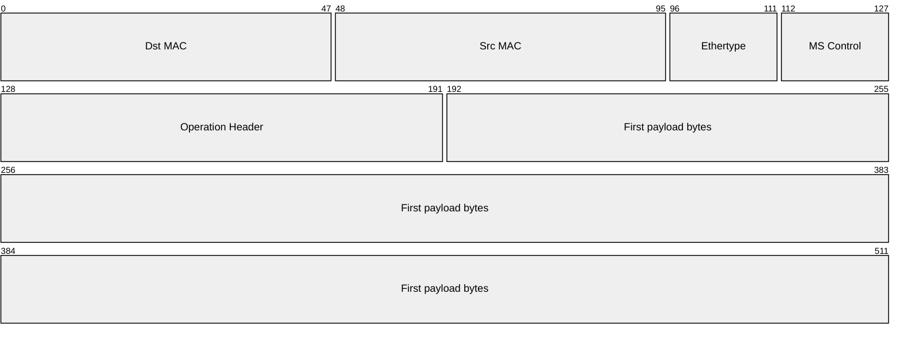

| Campo | Dimensione | Significato |
|---|---:|---|
| `Dst MAC` | 48b | MAC Ethernet di destinazione del next hop |
| `Src MAC` | 48b | MAC Ethernet sorgente |
| `Ethertype` | 16b | `0x88B5` per i frame sperimentali PRISM |
| `MS Control` | 16b | `Version Major`, `Version Minor` e `Opcode` |
| `Operation Header` | 64b | Header fisso specifico dell'opcode |
| `First payload bytes` | 320b | Primo frammento di payload nel primo beat AXI-Stream a 512 bit |

La control word PRISM è definita come segue:

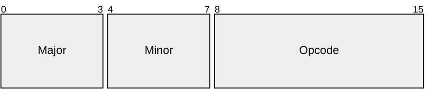

| Campo di controllo | Dimensione | Significato |
|---|---:|---|
| `Version Major` | 4b | Revisione incompatibile del formato del protocollo |
| `Version Minor` | 4b | Estensione compatibile o revisione minore |
| `Opcode` | 8b | Classe del pacchetto PRISM |

La versione iniziale del protocollo sperimentale è:

\[
\mathrm{VersionMajor}=0,\qquad \mathrm{VersionMinor}=1.
\]

Le versioni major non supportate non sono valide. Se la versione major è
supportata ma la minor è più recente dell'implementazione locale, PRISM può
elaborare soltanto il sottoinsieme di campi definito dalla minor supportata. Le
funzionalità di minor più recenti non sono garantite se non implementate
esplicitamente. I campi riservati devono essere trasmessi a zero.

---

## Proprietà e inoltro dei frame

PRISM utilizza un EtherType personalizzato per identificare i frame della
famiglia di protocolli PRISM. Nel progetto sperimentale corrente viene usato
`0x88B5`. Questo valore appartiene all'intervallo degli EtherType sperimentali
locali ed è adatto a laboratorio e ricerca, ma non è un'assegnazione di
protocollo per la produzione.[^ethertype]

La classificazione PRISM avviene in tre fasi:

1. Il parser Ethernet legge `Dst MAC`, `Src MAC` ed `Ethertype`.
2. Se `Ethertype != 0x88B5`, il frame viene trattato come frame Ethernet non
   PRISM e gestito dalla politica di inoltro L2 esterna.
3. Se `Ethertype == 0x88B5`, lo switch verifica prima se `Dst MAC` corrisponde a
   uno dei suoi MAC di terminazione PRISM locali. Soltanto i frame terminati
   localmente vengono decodificati dal parser degli opcode. Gli altri frame
   PRISM vengono inoltrati come normali frame L2 verso il next hop.

La distinzione è importante: `Dst MAC` seleziona il next hop o il proprietario
locale del frame; **non** decide se il payload sia un contributo o un risultato.
Questa decisione semantica è codificata dall'opcode PRISM e dal contesto
della collettiva installato dall'Aggregation Manager.

PRISM può essere configurato con una delle due politiche di inoltro esterne:

| Politica | Comportamento |
|---|---|
| `MSP_TRANSPARENT` | I frame non locali vengono inoltrati attraverso il normale datapath L2. |
| `MSP_STRICT` | I frame non locali o non PRISM vengono scartati o reindirizzati a un percorso di debug/controllo. |

La politica predefinita del prototipo è `MSP_TRANSPARENT`, perché durante il
bring-up hardware PRISM deve comportarsi come un datapath di switching e non
deve scartare inutilmente il normale traffico Ethernet.

!!! note "Inoltro del setup"

    I pacchetti di setup in-band usano la stessa regola di proprietà.
    L'Aggregation Manager indirizza ogni frame al MAC PRISM dello switch che
    deve installare lo stato locale corrispondente. Gli switch intermedi possono
    inoltrare il frame; soltanto lo switch di destinazione lo consuma.

---

## Identificatori delle collettive

PRISM separa l'identità del contesto installato, l'identità di un
contributore locale e la posizione del chunk all'interno del vettore.

| Campo | Dimensione | Significato |
|---|---:|---|
| `Collective Context ID` | 16b | Identificatore assegnato dall'AM, coerente lungo un albero configurato in v0.1 |
| `Contributor ID` | 16b | Identificatore del contributore locale nel contesto |
| `Chunk Index` | 24b | Indice a partire da zero del chunk nel vettore configurato |
| `Flags` | 8b | Flag specifici dell'opcode; devono essere zero se non documentati |

`Collective Context ID` non deve essere un communicator MPI o un identificatore
di operazione applicativo globalmente univoco. Tuttavia, v0.1 non definisce una
traduzione del contesto per hop. L'AM deve quindi installare lo stesso valore a
16 bit sul wire in tutti gli switch che scambiano `PM_OP_COL_DATA` o
`PM_OP_COL_RES` nello stesso albero di aggregazione/risultato. Alberi disgiunti
possono riutilizzare lo stesso valore.

`Contributor ID` sostituisce il precedente nome di campo `Rank`. In uno switch
leaf può indicare un rank locale o un endpoint host. In uno switch interno indica
spesso uno switch figlio, un sottoalbero figlio o un'altra sorgente di
aggregazione. Non deve coincidere con il rank MPI globale.

`Chunk Index` è la placement key utilizzata dal motore delle collettive per
individuare lo stato di riduzione del singolo chunk.

---

## Modello di chunking

I vettori delle collettive PRISM sono suddivisi in **chunk**. Un chunk è
rappresentato da un pacchetto Ethernet/PRISM e può occupare più beat
AXI-Stream.

PRISM non trasporta un campo con la lunghezza del payload negli header comuni
data/result. L'Aggregation Manager configura il contesto della collettiva,
includendo dimensione del vettore, formato di input, modalità dell'accumulatore,
formato di output, numero di contributori locali attesi, azione upstream e
result route.

Nel caso Ethernet standard non jumbo:

\[
\mathrm{EthernetPayloadMax}=1500\ \mathrm{bytes}
\]

\[
\mathrm{PRISMHeaderBytes}
=
1_{\mathrm{version}}
+
1_{\mathrm{opcode}}
+
8_{\mathrm{operation\ header}}
=
10\ \mathrm{bytes}
\]

\[
\mathrm{MS\_CHUNK\_PAYLOAD\_BYTES}
=
1500 - 10
=
1490\ \mathrm{bytes}
\]

Pertanto, la dimensione predefinita del payload di un chunk PRISM per frame
Ethernet standard è:

\[
\boxed{\mathrm{MS\_CHUNK\_PAYLOAD\_BYTES}=1490}
\]

Il supporto ai jumbo frame è intenzionalmente escluso dal protocollo v0.1 e
dipende dalla configurazione della rete e dei dispositivi.[^ethernet-frame]

!!! note "Primo beat AXI-Stream"

    Nel datapath AXI-Stream a 512 bit, il primo beat contiene l'header Ethernet,
    i campi di controllo PRISM, l'operation header e i primi 40 byte del
    payload del vettore. I beat successivi trasportano soltanto byte di payload.
    `TLAST` indica la fine del pacchetto corrente e `TKEEP` identifica i byte
    validi nel beat finale.

Lo switch calcola il numero di chunk attesi dal contesto installato dall'AM:

\[
\mathrm{vector\_bytes}
=
\mathrm{element\_count}
\cdot
\mathrm{bytes\_per\_element}(\mathrm{input\_format})
\]

\[
\mathrm{expected\_chunks}
=
\left\lceil
\frac{\mathrm{vector\_bytes}}
{\mathrm{MS\_CHUNK\_PAYLOAD\_BYTES}}
\right\rceil
\]

Per ogni chunk:

\[
\mathrm{ChunkIndex}\in[0,\ \mathrm{expected\_chunks}-1].
\]

L'ultimo chunk può essere più corto di `PM_CHUNK_PAYLOAD_BYTES`; i byte validi
sono determinati dalla dimensione configurata del vettore e dalla fine del
pacchetto segnalata mediante `TLAST/TKEEP`.

I chunk possono arrivare fuori ordine perché il motore delle collettive usa
`Chunk Index` come placement key. Per i dati di una collettiva, l'identità
logica di un contributo è:

\[
(\mathrm{CollectiveContextID},\ \mathrm{ContributorID},\ \mathrm{ChunkIndex})
\]

Ogni chunk viene completato indipendentemente. Il suo risultato può essere
emesso verso l'alto come nuovo contributo o verso il basso come risultato non
appena lo switch ha ricevuto tutti i contributori locali attesi; non è
necessario attendere gli altri chunk dello stesso vettore.

---

## Classi di pacchetto del data plane

I pacchetti PRISM vengono classificati dal parser dopo il controllo di
proprietà Ethernet. Se il frame trasporta l'EtherType PRISM ed è indirizzato
al MAC PRISM locale, il campo `Opcode` determina come interpretare
l'operation header e il payload.

| Valore | Classe del pacchetto | Scopo |
|---:|---|---|
| `0x00` | `PM_OP_INVALID` | Decisione interna del parser per pacchetti non supportati, malformati o scartati intenzionalmente |
| `0x01` | `PM_OP_COL_SETUP` | L'Aggregation Manager installa uno o più record di contesto |
| `0x02` | `PM_OP_COL_DATA` | Il payload viene consumato dal motore delle collettive come contributo |
| `0x03` | `PM_OP_COL_RES` | Il pacchetto trasporta un chunk risultato completo lungo l'albero di distribuzione |

`PM_OP_INVALID` non è un normale formato trasmesso. Rappresenta l'esito di una
classificazione interna. L'opcode tutto a zero è intenzionalmente non valido,
affinché lo stato di reset/default non codifichi accidentalmente un'operazione
PRISM valida.

I valori degli opcode fanno parte dell'ABI PRISM v0.1 e devono essere
definiti nel package RTL, nel testbench e nel generatore di pacchetti lato host.

---

## Setup in-band

Per il prototipo FPGA iniziale PRISM usa un **modello di setup in-band** e
chiama **Aggregation Manager** (**AM**) l'entità di controllo che installa i
contesti delle collettive. L'AM è un singolo attore logico che conosce i
partecipanti, la topologia fisica o logica e il posizionamento dei rank dietro
gli switch.

L'AM non deve necessariamente essere implementato come un singolo host fisico.
Nel prototipo della tesi può essere software fidato, un componente del testbench
o un processo di controllo lato host che invia pacchetti `PM_OP_COL_SETUP` per
configurare ogni contesto locale allo switch.

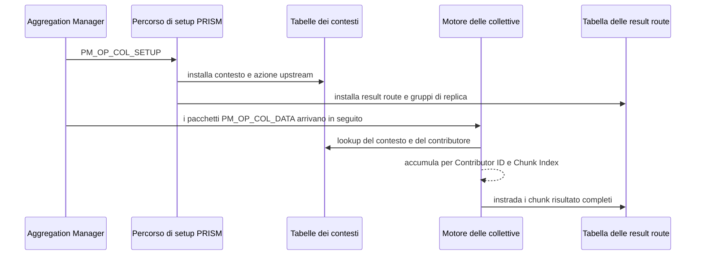

La scelta è intenzionale. Per un prototipo FPGA connesso tramite un ambiente
simile a OpenNIC, il setup in-band permette di configurare lo switch senza
richiedere una CPU di management separata, un'interfaccia PCIe BAR, una mappa di
registri AXI-Lite o uno stack di control plane esterno.

!!! warning "Ambito della sicurezza"

    Il setup in-band non è sicuro per la produzione di per sé. Un deployment
    reale richiederebbe filtraggio, autenticazione, autorizzazione o un canale di
    management fidato. PRISM lo tratta attualmente come meccanismo di ricerca
    e prototipazione, non come protocollo di management sicuro.

L'interfaccia logica dell'AM è indipendente dal trasporto fisico dei comandi di
setup. Implementazioni future potranno mappare le stesse operazioni su
un'interfaccia sideband come AXI-Lite, registri PCIe BAR, firmware o un'API
software di control plane.

---

## Operation header

L'header comune PRISM contiene un operation header fisso a 64 bit. La sua
interpretazione dipende dall'opcode.

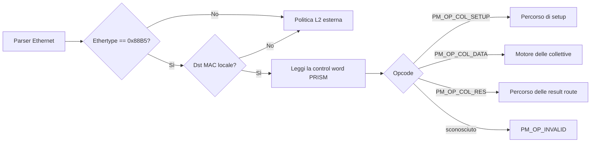

In v0.1 i campi riservati devono essere trasmessi a zero e ignorati dai
ricevitori.

---

### PM_OP_COL_SETUP

`PM_OP_COL_SETUP` viene inviato dall'Aggregation Manager per installare,
sostituire o estendere lo stato locale delle collettive di uno switch.

Il pacchetto viene consumato dal percorso di setup e non deve essere inserito
nel normale datapath di inoltro basato su VOQ.

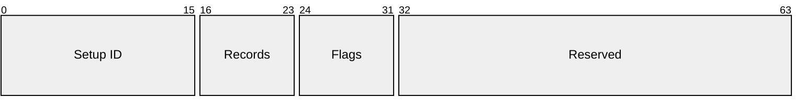

| Campo | Dimensione | Scopo |
|---|---:|---|
| `Setup ID` | 16b | Identificatore scelto dall'AM per tracing o retry idempotenti |
| `Records` | 8b | Numero di record di setup trasportati nel payload |
| `Flags` | 8b | Flag di setup; devono essere zero in v0.1 |
| `Reserved` | 32b | Deve essere zero in v0.1 |

Il payload di setup è basato su record. Un singolo pacchetto può così installare
più contesti o più parti dello stato dello stesso contesto, se i record entrano
in un frame Ethernet.

| Tipo di record | Scopo |
|---:|---|
| `PM_SETUP_CONTEXT` | Definisce semantica collettiva, formati, fan-in e lunghezza del vettore di un contesto |
| `PM_SETUP_UPSTREAM` | Definisce come una riduzione locale completa viene emessa verso il parent di aggregazione |
| `PM_SETUP_RESULT_ROUTE` | Mappa `(Collective Context ID, intervallo di Chunk Index)` su un gruppo di replica |
| `PM_SETUP_REPLICATION_GROUP` | Definisce MAC dei next hop e porte egress usate per inoltrare i chunk risultato |

Ogni record di setup è allineato a word da 64 bit e inizia con lo stesso header
a 64 bit:

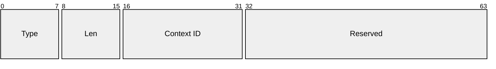

| Campo | Dimensione | Scopo |
|---|---:|---|
| `Type` | 8b | Uno dei tipi di record `PM_SETUP_*` |
| `Len` | 8b | Lunghezza in word da 64 bit, incluso questo header |
| `Context ID` | 16b | Contesto locale allo switch interessato dal record |
| `Reserved` | 32b | Deve essere zero in v0.1 |

Tipi di record sconosciuti, lunghezze nulle o record che superano il payload di
setup non sono validi in v0.1.

#### Record di contesto

Un record di contesto definisce il comportamento della riduzione e il fan-in per
chunk:

Dopo l'header comune, `PM_SETUP_CONTEXT` trasporta:

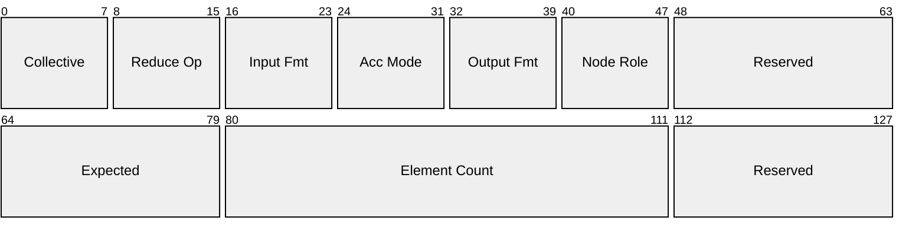

| Campo | Dimensione | Scopo |
|---|---:|---|
| `collective_semantic` | 8b | `PM_COL_REDUCE` oppure `PM_COL_ALLREDUCE` |
| `reduction_operator` | 8b | v0.1 supporta `PM_RED_SUM` |
| `input_format` | 8b | Formato sul wire degli elementi `PM_OP_COL_DATA` in ingresso |
| `accumulator_mode` | 8b | Strategia interna di accumulazione |
| `output_format` | 8b | Formato sul wire degli elementi risultato emessi |
| `node_role` | 8b | `ROOT`, `INTERNAL`, `LEAF` o `SINGLE` per validazione/debug |
| `expected_local_contributors` | 16b | Numero di contributori locali univoci attesi per ogni chunk |
| `element_count` | 32b | Numero di elementi logici del vettore |
| `Reserved` | 32b totali | Devono essere zero in v0.1 |

`expected_local_contributors` è locale allo switch e al contesto. Non è il
numero di rank globali dell'intero job. In una topologia spine-leaf, un leaf
attende i rank locali, mentre uno spine attende i leaf figli.

#### Record dell'azione upstream

Un record di azione upstream definisce cosa accade dopo che lo switch completa
un chunk di riduzione locale.

Dopo l'header comune, `PM_SETUP_UPSTREAM` trasporta:

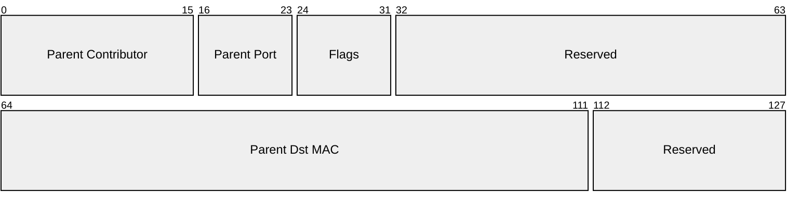

| Campo | Dimensione | Scopo |
|---|---:|---|
| `parent_contributor_id` | 16b | Contributor ID usato dallo switch quando invia al parent |
| `parent_egress_port` | 8b | Porta locale usata per raggiungere il parent di aggregazione |
| `flags.has_parent` | 1b | Se impostato, i chunk completi sono emessi verso l'alto come `PM_OP_COL_DATA` |
| `parent_dst_mac` | 48b | MAC PRISM del nodo parent di aggregazione |
| `Reserved` | 48b totali | Devono essere zero in v0.1 |

Se `has_parent == 1`, un chunk completo viene emesso come `PM_OP_COL_DATA`. Se
`has_parent == 0`, lo switch è la root di aggregazione del contesto e il chunk
entra nel percorso delle result route come `PM_OP_COL_RES`.

#### Record delle result route

Un record di result route definisce dove inviare i chunk risultato completi:

Dopo l'header comune, `PM_SETUP_RESULT_ROUTE` trasporta una word a 64 bit:

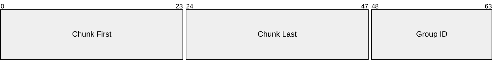

| Campo | Dimensione | Scopo |
|---|---:|---|
| `chunk_first` | 24b | Primo indice di chunk selezionato dalla route |
| `chunk_last` | 24b | Ultimo indice di chunk selezionato dalla route |
| `replication_group_id` | 16b | Gruppo di replica locale da eseguire |

La chiave di lookup della result route è:

\[
(\mathrm{CollectiveContextID},\ \mathrm{ChunkIndex})
\]

Questo rende dirette `REDUCE` e `ALLREDUCE` e lascia un percorso naturale per
una futura `REDUCE_SCATTER`, nella quale intervalli di chunk differenti vengono
instradati verso rami di destinazione diversi.

#### Record dei gruppi di replica

Un record di gruppo di replica definisce uno o più next hop locali:

Dopo l'header comune, `PM_SETUP_REPLICATION_GROUP` inizia con un header di
gruppo a 64 bit:

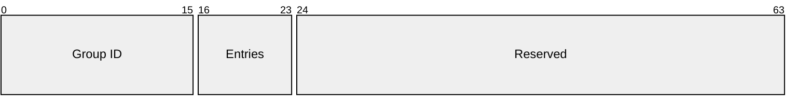

Seguono `Entries` record di next hop a 64 bit:

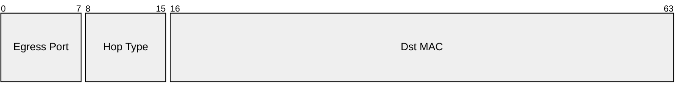

| Campo | Dimensione | Scopo |
|---|---:|---|
| `replication_group_id` | 16b | Gruppo locale selezionato da una result route |
| `entries` | 8b | Numero di record di next hop nel gruppo |
| `egress_port` | 8b | Porta di uscita locale per una replica |
| `next_hop_type` | 8b | `SWITCH` o `RANK`, usato per validazione/debug |
| `dst_mac` | 48b | MAC PRISM o del rank next hop |
| `Reserved` | 40b | Deve essere zero in v0.1 |

Il comportamento di inoltro dipende da `egress_port` e `dst_mac`;
`next_hop_type` non è necessario per la consegna, ma è utile per verificare che
l'AM abbia installato l'albero dei risultati previsto.

Un pacchetto o record di setup non è valido se:

- `Records == 0`;
- la lunghezza di un record non è coerente con il tipo;
- `expected_local_contributors == 0`;
- `element_count == 0`;
- `chunk_first > chunk_last`;
- la lunghezza del gruppo di replica non coincide con il numero di entry;
- `collective_semantic` non è supportata;
- `reduction_operator` non è supportato;
- `input_format`, `accumulator_mode` o `output_format` non sono supportati;
- manca un'azione upstream per un nodo non root;
- un nodo root non ha una result route per un chunk che può completarsi;
- una result route punta a un gruppo di replica sconosciuto;
- i campi riservati sono diversi da zero.

Nel prototipo corrente PRISM assume che le scritture di setup abbiano
successo. Non definisce acknowledgement, risposte di setup o pacchetti di stato.

---

### PM_OP_COL_DATA

`PM_OP_COL_DATA` trasporta i dati di un contributore per un chunk del vettore.
Il pacchetto viene consumato dal motore delle collettive e non viene inoltrato
direttamente attraverso il normale datapath VOQ.

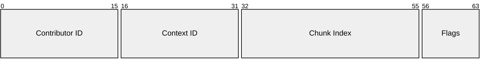

| Campo | Dimensione | Scopo |
|---|---:|---|
| `Contributor ID` | 16b | Identificatore del contributore locale per lo switch/contesto |
| `Context ID` | 16b | Identificatore assegnato dall'AM all'albero configurato |
| `Chunk Index` | 24b | Indice a partire da zero nel vettore configurato |
| `Flags` | 8b | Devono essere zero in v0.1 |

Per ogni chunk, il motore delle collettive attende di aver ricevuto
`expected_local_contributors` Contributor ID univoci. Quando il chunk è
completo, il contesto decide l'azione successiva:

- se è configurato un parent upstream, lo switch emette un nuovo pacchetto
  `PM_OP_COL_DATA` verso il parent. Il pacchetto usa `parent_contributor_id`,
  perché il parent vede l'intero sottoalbero figlio come un contributore locale;
- se non è configurato un parent upstream, lo switch è la root di aggregazione
  ed emette `PM_OP_COL_RES` secondo la tabella delle result route.

La regola elimina l'ambiguità: `PM_OP_COL_DATA` appartiene sempre alla fase di
aggregazione verso l'alto.

---

### PM_OP_COL_RES

`PM_OP_COL_RES` trasporta un chunk risultato completo lungo l'albero di
distribuzione. Viene generato dalla root di aggregazione e può essere inoltrato
da switch intermedi fino a raggiungere il rank o i rank di destinazione.

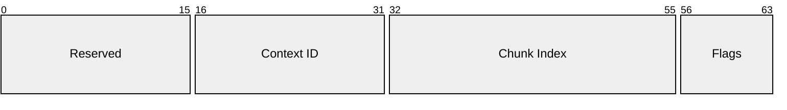

| Campo | Dimensione | Scopo |
|---|---:|---|
| `Reserved` | 16b | Deve essere zero in v0.1 |
| `Context ID` | 16b | Identificatore assegnato dall'AM all'albero configurato |
| `Chunk Index` | 24b | Indice del chunk risultato |
| `Flags` | 8b | Devono essere zero in v0.1 |

Quando uno switch riceve un `PM_OP_COL_RES` locale, esegue un lookup delle result
route usando `(Context ID, Chunk Index)`. La route corrispondente seleziona un
gruppo di replica. Lo switch emette quindi una replica per ogni entry, impostando
il `Dst MAC` Ethernet di ciascuna al next hop configurato.

`PM_OP_COL_RES` non viene mai accumulato nuovamente. Appartiene sempre alla fase
di distribuzione del risultato verso il basso.

Il formato del payload risultato è determinato dal contesto configurato da
`PM_OP_COL_SETUP`. Il formato di output può differire sia da quello di input sia
dalla modalità interna dell'accumulatore.

Esempio:

```text
input_format     = PM_FMT_FP32
accumulator_mode = PM_ACC_EXACT_FP32_MAG277
output_format    = PM_FMT_FP32
```

Gli elementi in ingresso vengono quindi ricevuti come `PM_FMT_FP32`, accumulati
internamente con una famiglia di accumulatori esatti per somme scalari FP32 ed
emessi come `PM_FMT_FP32`.

---

## Semantiche collettive

La semantica collettiva descrive il comportamento a livello di comunicazione.

| Valore | Semantica | Significato |
|---:|---|---|
| `0x00` | `PM_COL_INVALID` | Semantica non valida o non supportata |
| `0x01` | `PM_COL_REDUCE` | I contributori producono un risultato consegnato a un rank root |
| `0x02` | `PM_COL_ALLREDUCE` | I contributori producono un risultato consegnato a tutti i rank partecipanti |

`REDUCE` e `ALLREDUCE` rientrano nell'ambito del primo protocollo PRISM della
tesi. Le altre semantiche, come `REDUCE_SCATTER`, sono sviluppi futuri.

`REDUCE_SCATTER` non è intenzionalmente codificata come caso speciale nel
percorso del risultato. La tabella delle result route opera già su intervalli di
chunk, quindi un'implementazione futura potrà instradare intervalli differenti
verso rami diversi senza sostituire il modello di distribuzione.

---

## Operatore di riduzione

L'operatore di riduzione descrive l'operazione matematica applicata agli elementi.

| Valore | Operatore | Significato |
|---:|---|---|
| `0x00` | `PM_RED_INVALID` | Operatore non valido o non supportato |
| `0x01` | `PM_RED_SUM` | Addizione |

Soltanto `PM_RED_SUM` rientra nell'ambito del primo prototipo della tesi.

---

## Formati sul wire e modalità dell'accumulatore

PRISM distingue i **formati sul wire** dalle **modalità dell'accumulatore**.

Un formato sul wire descrive come gli elementi sono codificati nei payload
`PM_OP_COL_DATA` e `PM_OP_COL_RES`.

| Valore | Formato sul wire | Significato |
|---:|---|---|
| `0x00` | `PM_FMT_INVALID` | Formato non valido o non supportato |
| `0x01` | `PM_FMT_INT8` | Elementi interi a 8 bit |
| `0x02` | `PM_FMT_FP16` | Elementi IEEE binary16 |
| `0x03` | `PM_FMT_BF16` | Elementi bfloat16 |
| `0x04` | `PM_FMT_FP32` | Elementi IEEE binary32 |

Una modalità dell'accumulatore descrive come il motore delle collettive combina
internamente i contributi.

| Valore | Modalità dell'accumulatore | Significato |
|---:|---|---|
| `0x00` | `PM_ACC_INVALID` | Modalità non valida o non supportata |
| `0x01` | `PM_ACC_NATIVE` | Accumula con l'aritmetica nativa associata al formato di input |
| `0x02` | `PM_ACC_FP32` | Accumula con aritmetica FP32 |
| `0x03` | `PM_ACC_DETERMINISTIC_FP32` | Attende i contributi e riduce in ordine logico deterministico |
| `0x04` | `PM_ACC_EXACT_FP16_MAG40` | Famiglia di accumulatori esatti per somme scalari FP16 |
| `0x05` | `PM_ACC_EXACT_BF16_MAG261` | Famiglia di accumulatori esatti per somme scalari BF16 |
| `0x06` | `PM_ACC_EXACT_FP32_MAG277` | Famiglia di accumulatori esatti per somme scalari FP32 |

!!! note "Perché `MAG40`, `MAG261` e `MAG277`?"

    I nomi indicano il range esatto della magnitudine della somma scalare prima
    di aggiungere margine per i riporti dovuti al numero di rank e segno. Non
    sono dimensioni di accumulatori per prodotti scalari. La larghezza signed
    finale dipende ancora dal numero massimo di rank contributori.

Per la somma scalare finita esatta con \(R\) rank contributori:

\[
W_{\mathrm{signed}}
=
W_{\mathrm{mag}}
+
\lceil \log_2 R \rceil
+
1
\]

Questo segue il modello di dimensionamento della riduzione scalare, non il bound
più ampio del prodotto scalare di Kulisch.[^superaccumulator-sizing]

Per la derivazione dettagliata, vedi
[1.2 Riproducibilità](../1-introduction/reproducibility.md#accumulator-sizing-for-scalar-reductions).

!!! note "Ruoli di input, accumulatore e output"

    `input_format`, `accumulator_mode` e `output_format` sono intenzionalmente
    separati. PRISM può ricevere dati in una rappresentazione, accumularli
    con una strategia interna riproducibile ed emettere risultati nel formato
    scelto dall'Aggregation Manager.

---

## Esempio: `REDUCE(SUM, root = rank1)`

L'esempio segue un chunk lungo l'intero ciclo di vita nominale del protocollo.
Le stesse fasi del data plane vengono eseguite indipendentemente per ogni chunk
configurato e indici differenti possono trovarsi contemporaneamente in fasi
diverse.

La topologia contiene uno spine, due leaf e quattro rank partecipanti:

- `L0` collega `rank0` e `rank1`;
- `L1` collega `rank2` e `rank3`;
- `S0` è la root di aggregazione;
- `rank1` è l'unica destinazione del risultato.

Per il chunk `i`, PRISM calcola la riduzione elemento per elemento

\[
\mathbf{result}[i] =
\mathbf{x}_0[i] + \mathbf{x}_1[i] + \mathbf{x}_2[i] + \mathbf{x}_3[i].
\]

L'azzurro indica il setup del control plane, l'arancione l'aggregazione verso
l'alto, il verde la consegna del risultato verso il basso; i nodi attenuati non
sono attivi nella fase illustrata.

### 1. Installazione del contesto della collettiva

L'AM conosce topologia, posizionamento dei partecipanti e rank root. Invia a
ogni switch un frame `PM_OP_COL_SETUP` indirizzato individualmente. Il MAC
Ethernet di destinazione identifica lo switch che consuma il frame di setup; gli
switch intermedi si limitano a inoltrare i frame destinati a un altro nodo
PRISM.

In v0.1, l'AM installa lo stesso `Context ID` sul wire, indicato con `C`, lungo
tutto l'albero perché non è definita una traduzione per hop. Lo stato locale
rilevante è:

| Nodo | Contributori locali attesi | Azione upstream dopo il completamento locale | Result route per il chunk `i` |
|---|---|---|---|
| `L0` | `rank0`, `rank1` | Emette un `PM_OP_COL_DATA` verso `S0` come parent contributor configurato | Gruppo di replica `{rank1}` |
| `L1` | `rank2`, `rank3` | Emette un `PM_OP_COL_DATA` verso `S0` come parent contributor configurato | Nessuna result route |
| `S0` | `L0`, `L1` | Nessun parent; inietta il chunk completo come `PM_OP_COL_RES` | Gruppo di replica `{L0}` |

Ogni entry del gruppo di replica contiene una porta egress locale e il MAC di
destinazione del next hop. Uno switch necessita quindi soltanto della decisione
locale e non scopre la topologia globale a runtime.

<figure markdown="span">
  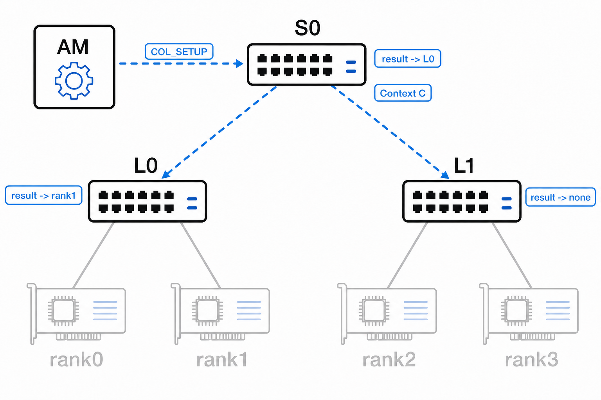{ loading=lazy }
  <figcaption>Il setup installa sia le azioni di aggregazione verso l'alto sia il percorso selettivo del risultato verso <code>rank1</code>.</figcaption>
</figure>

### 2. Invio dei contributi dei rank

Per il chunk `i`, ogni rank invia un pacchetto `PM_OP_COL_DATA` al leaf locale.
L'operation header trasporta il `Contributor ID` locale al leaf,
`Context ID = C` e `Chunk Index = i`; il MAC Ethernet di destinazione seleziona
il leaf ricevente.

Il leaf usa `(Context ID, Contributor ID, Chunk Index)` per rifiutare duplicati
e aggiornare l'accumulatore corretto. `Chunk Index` è anche la placement key:
pacchetti di chunk differenti possono arrivare fuori ordine senza modificare il
routing del risultato.

<figure markdown="span">
  { loading=lazy }
  <figcaption>Ogni contributo raggiunge soltanto il leaf configurato direttamente.</figcaption>
</figure>

### 3. Completamento delle riduzioni nei leaf

`L0` completa il chunk locale dopo aver ricevuto i contributi univoci di
`rank0` e `rank1`; indipendentemente, `L1` attende `rank2` e `rank3`:

\[
\begin{aligned}
\mathbf{partial}_0[i] &= \mathbf{x}_0[i] + \mathbf{x}_1[i], \\
\mathbf{partial}_1[i] &= \mathbf{x}_2[i] + \mathbf{x}_3[i].
\end{aligned}
\]

I due leaf non devono completarsi nello stesso istante. Ciascuno può emettere il
proprio risultato parziale non appena soddisfa la condizione
`expected_local_contributors`.

<figure markdown="span">
  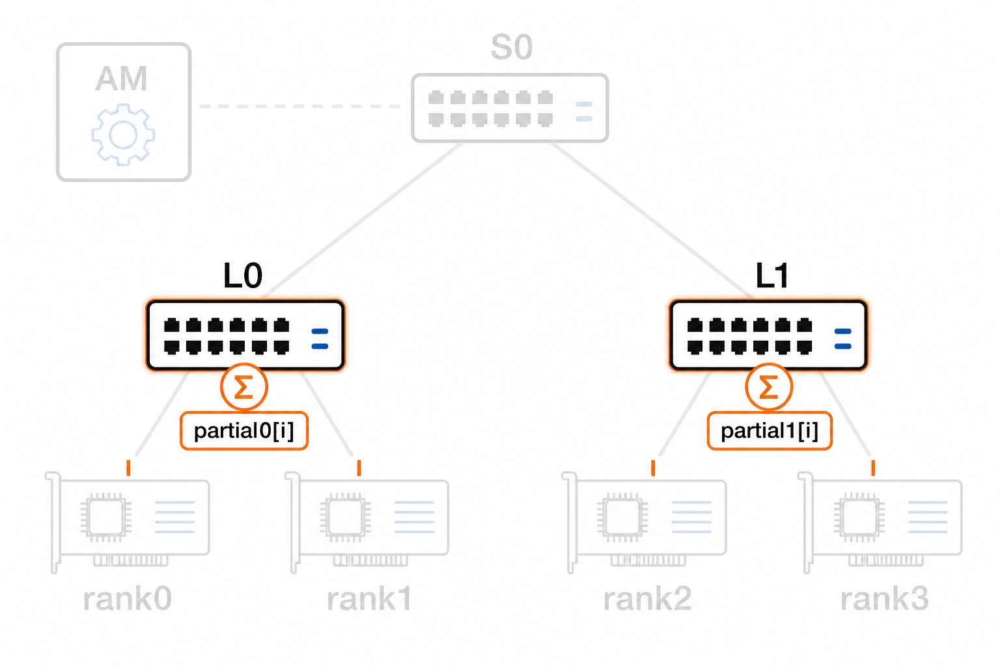{ loading=lazy }
  <figcaption>Il conteggio dei contributori è locale a ogni switch e contesto.</figcaption>
</figure>

### 4. Aggregazione nello switch root

L'azione upstream di ciascun leaf crea un nuovo pacchetto `PM_OP_COL_DATA`
indirizzato a `S0`. Il suo `Contributor ID` è il `parent_contributor_id`
configurato, quindi `S0` vede ogni intero sottoalbero leaf come un contributore,
non i rank originali.

Dopo aver ricevuto i parziali da `L0` e `L1`, `S0` calcola

\[
\mathbf{result}[i] = \mathbf{partial}_0[i] + \mathbf{partial}_1[i].
\]

L'opcode selezionato dopo il completamento deriva dall'azione upstream
installata, non dal MAC di destinazione: un nodo con `has_parent == 1` emette
`PM_OP_COL_DATA`; la root di aggregazione ha `has_parent == 0` e inietta
`PM_OP_COL_RES` nel percorso delle result route.

<figure markdown="span">
  { loading=lazy }
  <figcaption>L'aggregazione in-network riduce quattro pacchetti dei rank a due parziali dei leaf prima dello spine.</figcaption>
</figure>

### 5. Routing del risultato verso `rank1`

`S0` cerca `(C, i)` nella tabella delle result route. Il gruppo di replica
corrispondente contiene soltanto `L0`, quindi `S0` emette una replica
`PM_OP_COL_RES` sulla porta egress di `L0` e imposta il MAC Ethernet di
destinazione al MAC configurato di `L0`.

`L0` consuma il frame indirizzato localmente ed esegue lo stesso lookup. Il suo
gruppo di replica contiene soltanto `rank1`, quindi emette una replica con il
MAC di destinazione di `rank1`. `L1`, `rank0`, `rank2` e `rank3` non ricevono
traffico risultato.

I due meccanismi hanno responsabilità distinte:

- la result route e il gruppo di replica selezionano il next hop o i next hop locali;
- il MAC Ethernet di destinazione identifica sul wire il next hop selezionato.

La regola per hop funziona a qualunque profondità dell'albero: ogni switch
intermedio ripete lookup locale e riscrittura del MAC. Nessuno switch deve
dedurre se una porta raggiunga un leaf o un rank e non è necessario flooding.

<figure markdown="span">
  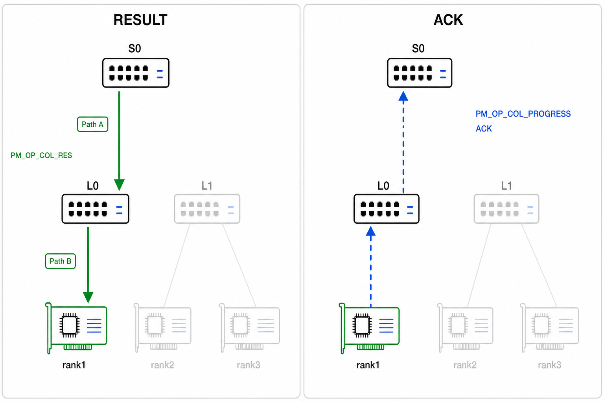{ loading=lazy }
  <figcaption>La result route seleziona un ramo a ogni hop; tutti i rami non destinazione restano inattivi.</figcaption>
</figure>

### 6. Consegna del risultato e rilascio dello stato del chunk

`rank1` consuma il payload risultato. Lo stato dell'accumulatore del chunk non è
più necessario dopo che uno switch ha consegnato correttamente il proprio output:

- `L0` e `L1` rilasciano lo stato dopo aver emesso verso l'alto i pacchetti
  `PM_OP_COL_DATA`;
- `S0` rilascia lo stato dopo aver iniettato `PM_OP_COL_RES` nel percorso del risultato;
- contesto, azioni upstream, result route e gruppi di replica configurati
  rimangono installati per gli altri chunk della collettiva.

In particolare, `L1` non attende un pacchetto risultato perché non appartiene
all'albero dei risultati di `REDUCE`. L'inoltro dipende soltanto dallo stato
persistente delle route, non dal mantenimento di un accumulatore completato.

<figure markdown="span">
  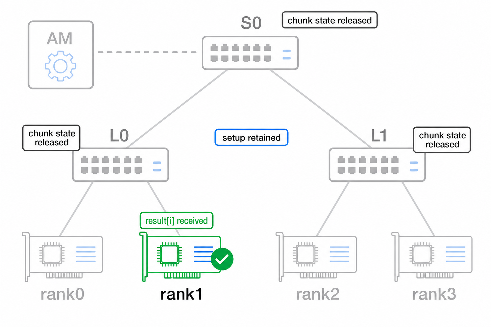{ loading=lazy }
  <figcaption>Lo stato temporaneo dell'accumulatore e lo stato persistente di routing hanno cicli di vita differenti.</figcaption>
</figure>

!!! note "Perdita di pacchetti in v0.1"

    Questo è il ciclo di vita nominale con esito positivo. PRISM v0.1 non
    fornisce acknowledgement, ritrasmissione, timeout o pacchetti di abort. La
    perdita di `PM_OP_COL_DATA` lascia incompleto il chunk di destinazione; la
    perdita di `PM_OP_COL_RES` lascia il rank root senza risultato. Le
    implementazioni possono esporre occupazione dei contesti e contatori di
    drop/errore, mentre completamento affidabile e recovery restano sviluppi futuri.

### Differenze per `ALLREDUCE`

Le fasi di setup e aggregazione verso l'alto sono identiche. Cambia soltanto
l'albero delle result route: `S0` seleziona un gruppo di replica contenente `L0`
e `L1`; ogni leaf seleziona quindi tutti i rank locali partecipanti. Ciascun ramo
riceve una replica del risultato per livello, senza broadcast su porte estranee.

---

## Ciclo di vita e comportamento non valido

Il contesto e le tabelle di route configurati sono stato persistente del control
plane. Lo stato dell'accumulatore per chunk è stato temporaneo del data plane.

Uno switch può rilasciare lo stato locale dell'accumulatore dopo aver emesso con
successo il chunk completo verso l'alto come `PM_OP_COL_DATA` o averlo iniettato
nel percorso delle result route come `PM_OP_COL_RES`. Un leaf che partecipa a
`ALLREDUCE` non deve mantenere lo stato mentre attende il ritorno del risultato:
l'inoltro usa le tabelle persistenti.

Un pacchetto non è valido se usa versioni major non supportate, opcode
sconosciuti, valori di setup non supportati, campi riservati non nulli,
identificatori di contesto non installati, contributi duplicati per lo stesso
`(Collective Context ID, Contributor ID, Chunk Index)` o payload incoerenti con
il contesto configurato.

PRISM v0.1 non genera pacchetti di errore. I pacchetti non validi vengono
scartati o ignorati e l'implementazione può incrementare contatori visibili in
simulazione, debug o tramite registri. Protocolli di completamento affidabile,
ritrasmissione, messaggi espliciti di abort e gestione dei guasti di produzione
sono fuori dall'ambito del primo protocollo della tesi.


[^ethertype]: RFC 9542 documenta `0x88B5` e `0x88B6` come EtherType sperimentali
    locali. Sono adatti alla sperimentazione locale ma non devono essere trattati
    come assegnazioni di protocollo per la produzione.

[^ethernet-frame]: Il payload Ethernet standard è di 1500 byte per frame non
    jumbo. L'header Ethernet è di 14 byte e l'FCS di 4; preambolo, SFD e
    interpacket gap sono overhead del livello fisico e normalmente non fanno
    parte del payload AXI-Stream visto da PRISM.

[^superaccumulator-sizing]: La regola di dimensionamento segue il modello di
    riduzione scalare PRISM. È intenzionalmente diversa dal bound più ampio
    del prodotto scalare di Kulisch, perché le riduzioni PRISM sommano valori
    numerici già calcolati, non prodotti.
