# Protocol

PRISM operates at **Layer 2** of the OSI model and uses a custom
Ethernet-based protocol to identify packets that must be processed by the
PRISM datapath.

The baseline protocol supports two MPI-style collective semantics:

- `REDUCE`, where one selected root rank receives the final result.
- `ALLREDUCE`, where all participating ranks receive the final result.

The protocol supports three data-plane modes:

1. **Transparent packet forwarding**, where non-local Ethernet frames may be
   forwarded through the switch-like L2 pipeline.
2. **Streaming collective aggregation**, where `PM_OP_COL_DATA` packets update
   a reduction context and flow upward through an aggregation tree.
3. **Result dissemination**, where `PM_OP_COL_RES` packets flow downward through
   a result route tree installed by the Aggregation Manager.

PRISM is currently a research-oriented FPGA datapath, not a production
Ethernet switch. The protocol therefore prioritizes simplicity, inspectability,
hardware feasibility, and cycle-level RTL clarity over full production-grade
management, security, and interoperability.

!!! abstract "Protocol goal"

    The PRISM protocol should make packets easy to classify early in the
    pipeline. The first packet beat should contain enough information for the
    parser to decide whether the packet must be forwarded, dropped, routed to
    the setup path, consumed by the collective engine, or replicated on the
    result-dissemination path.

---

## Common frame format

PRISM frames are carried inside Ethernet frames. The Ethernet header
provides next-hop Layer-2 addressing, while the PRISM header identifies the
protocol version, packet class, operation-specific metadata, and payload.

The full first-beat diagram intentionally groups small fields to avoid
unreadable packet diagrams.

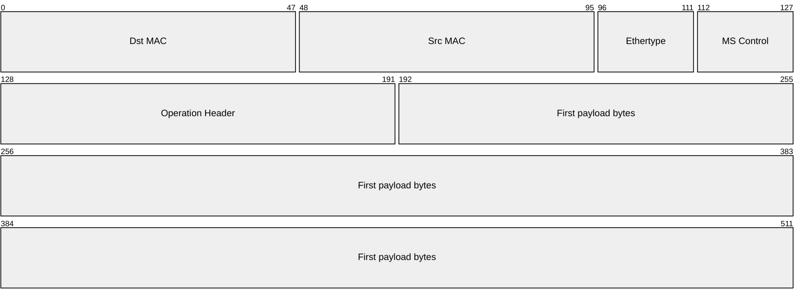

| Field | Size | Meaning |
|---|---:|---|
| `Dst MAC` | 48b | Ethernet next-hop destination MAC |
| `Src MAC` | 48b | Ethernet source MAC |
| `Ethertype` | 16b | `0x88B5` for PRISM experimental frames |
| `MS Control` | 16b | `Version Major`, `Version Minor`, and `Opcode` |
| `Operation Header` | 64b | Opcode-specific fixed header |
| `First payload bytes` | 320b | First payload fragment in the first 512-bit AXI-Stream beat |

The PRISM control word is defined as:

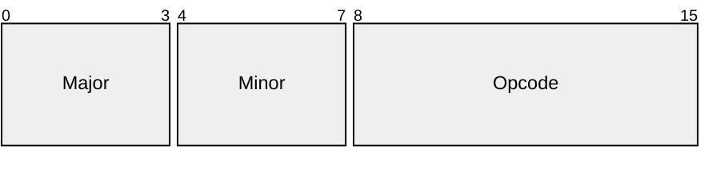

| Control field | Size | Meaning |
|---|---:|---|
| `Version Major` | 4b | Incompatible protocol-format revision |
| `Version Minor` | 4b | Compatible extension or minor revision |
| `Opcode` | 8b | PRISM packet class |

The initial experimental protocol version is:

\[
\mathrm{VersionMajor}=0,\qquad \mathrm{VersionMinor}=1.
\]

Unsupported major versions are invalid. If the major version is supported but
the minor version is newer than the local implementation, PRISM may process
only the subset of fields defined by its supported minor version. Newer
minor-version features are not guaranteed unless explicitly implemented.
Reserved fields must be transmitted as zero.

---

## Frame ownership and forwarding

PRISM uses a custom EtherType to identify frames belonging to the PRISM
protocol family. In the current experimental design, `0x88B5` is used as the
PRISM EtherType. This value belongs to the local experimental EtherType
range and is suitable for laboratory and research use, but it is not a
production protocol assignment.[^ethertype]

PRISM classification happens in three stages:

1. The Ethernet parser reads `Dst MAC`, `Src MAC`, and `Ethertype`.
2. If `Ethertype != 0x88B5`, the frame is treated as a non-PRISM Ethernet
   frame and handled by the outer L2 forwarding policy.
3. If `Ethertype == 0x88B5`, the switch first checks whether `Dst MAC` matches
   one of its local PRISM termination MAC addresses. Only locally terminated
   frames are decoded by the PRISM opcode parser. Other PRISM frames are
   forwarded as ordinary L2 frames toward their next hop.

This distinction is important: the `Dst MAC` selects the next hop or local owner
of the frame; it does **not** decide whether the payload is a contribution or a
result. That semantic decision is encoded by the PRISM opcode and by the
collective context installed by the Aggregation Manager.

PRISM may be configured with one of two outer forwarding policies:

| Policy | Behavior |
|---|---|
| `MSP_TRANSPARENT` | Non-local frames are forwarded through the normal L2 forwarding datapath. |
| `MSP_STRICT` | Non-local or non-PRISM frames are dropped or redirected to a debug/control path. |

The default prototype policy is expected to be `MSP_TRANSPARENT`, because
PRISM is intended to behave as a switch-like datapath during hardware
bring-up and should not unnecessarily discard ordinary Ethernet traffic.

!!! note "Setup forwarding"

    In-band setup packets use the same ownership rule. The Aggregation Manager
    addresses each setup frame to the PRISM MAC of the switch that must
    install the corresponding local state. Intermediate switches may forward the
    frame; only the target switch consumes it.

---

## Collective identifiers

PRISM separates the identity of the installed context, the identity of a
local contributor, and the position of a chunk inside the vector.

| Field | Size | Meaning |
|---|---:|---|
| `Collective Context ID` | 16b | AM-assigned context identifier, consistent across one configured tree in v0.1 |
| `Contributor ID` | 16b | Local contributor identifier inside that context |
| `Chunk Index` | 24b | Zero-based chunk index inside the configured vector |
| `Flags` | 8b | Opcode-specific flags; must be zero unless documented |

`Collective Context ID` is not required to be a globally unique MPI
communicator or application-level operation ID. However, v0.1 does not define
per-hop context translation. The AM must therefore install the same 16-bit wire
value on all switches that exchange `PM_OP_COL_DATA` or `PM_OP_COL_RES` for one
aggregation/result tree. Disjoint trees may reuse the same value.

`Contributor ID` replaces the older `Rank` field name. At a leaf switch it may
refer to a local rank or host endpoint. At an internal switch it often refers to
a child switch, child subtree, or other aggregation source. It does not need to
equal the global MPI rank.

`Chunk Index` is the placement key used by the collective engine to locate the
per-chunk reduction state.

---

## Chunking model

PRISM collective vectors are split into **chunks**. A chunk is represented by
one Ethernet/PRISM packet and may span multiple AXI-Stream beats.

PRISM does not carry a payload-length field in the common data/result
headers. The Aggregation Manager configures the collective context, including
vector size, input format, accumulator mode, output format, number of expected
local contributors, upstream action, and result routes.

For the standard non-jumbo Ethernet case:

\[
\mathrm{EthernetPayloadMax}=1500\ \mathrm{bytes}
\]

\[
\mathrm{PRISMHeaderBytes}
=
1_{\mathrm{version}}
+
1_{\mathrm{opcode}}
+
8_{\mathrm{operation\ header}}
=
10\ \mathrm{bytes}
\]

\[
\mathrm{MS\_CHUNK\_PAYLOAD\_BYTES}
=
1500 - 10
=
1490\ \mathrm{bytes}
\]

Therefore, the default PRISM chunk payload size for standard Ethernet frames
is:

\[
\boxed{\mathrm{MS\_CHUNK\_PAYLOAD\_BYTES}=1490}
\]

Jumbo-frame support is intentionally left outside the v0.1 protocol baseline and
depends on the network and device configuration.[^ethernet-frame]

!!! note "AXI-Stream first beat"

    On the 512-bit AXI-Stream datapath, the first beat contains the Ethernet
    header, PRISM control fields, the operation header, and the first
    40 bytes of vector payload. Continuation beats carry payload bytes only.
    `TLAST` marks the end of the current packet, and `TKEEP` identifies valid
    bytes in the final beat.

The switch computes the expected number of chunks from the context installed by
the AM:

\[
\mathrm{vector\_bytes}
=
\mathrm{element\_count}
\cdot
\mathrm{bytes\_per\_element}(\mathrm{input\_format})
\]

\[
\mathrm{expected\_chunks}
=
\left\lceil
\frac{\mathrm{vector\_bytes}}
{\mathrm{MS\_CHUNK\_PAYLOAD\_BYTES}}
\right\rceil
\]

For each chunk:

\[
\mathrm{ChunkIndex}\in[0,\ \mathrm{expected\_chunks}-1].
\]

The last chunk may be shorter than `PM_CHUNK_PAYLOAD_BYTES`; its valid bytes are
determined by the configured vector size and by the packet ending signaled
through `TLAST/TKEEP`.

Chunks may arrive out of order because the collective engine uses `Chunk Index`
as the placement key. For collective data, the logical identity of a contribution
is:

\[
(\mathrm{CollectiveContextID},\ \mathrm{ContributorID},\ \mathrm{ChunkIndex})
\]

Each chunk is completed independently. A chunk result may be emitted upward as a
new contribution or downward as a result as soon as the switch has received all
expected local contributors for that chunk; it does not need to wait for other
chunks of the same vector.

---

## Data-plane packet classes

PRISM packets are classified by the parser after the Ethernet ownership
check. If the Ethernet frame carries the PRISM EtherType and is addressed to
the local PRISM MAC, the `Opcode` field determines how the operation header
and payload are interpreted.

| Value | Packet class | Purpose |
|---:|---|---|
| `0x00` | `PM_OP_INVALID` | Internal parser decision for unsupported, malformed, or intentionally discarded packets |
| `0x01` | `PM_OP_COL_SETUP` | Aggregation Manager installs one or more collective-context records |
| `0x02` | `PM_OP_COL_DATA` | Packet payload is consumed by the collective engine as a contribution |
| `0x03` | `PM_OP_COL_RES` | Packet carries a completed result chunk through the result-dissemination tree |

`PM_OP_INVALID` is not a normal transmitted packet format. It represents an
internal classification outcome. The all-zero opcode is intentionally invalid so
that reset/default state does not accidentally encode a valid PRISM
operation.

The opcode values are part of the PRISM v0.1 ABI and should be defined in
the RTL package, testbench, and host-side packet generator.

---

## In-band setup

PRISM uses an **in-band setup model** for the initial FPGA prototype and
calls the control entity that installs collective contexts the **Aggregation
Manager** (**AM**). The AM is a single logical actor that knows the collective
participants, the physical or logical topology, and the placement of ranks
behind switches.

The AM does not need to be implemented as a single physical host in every
deployment. For the thesis prototype it can be trusted software, a testbench
component, or a host-side control process that sends `PM_OP_COL_SETUP` packets
to configure each switch-local collective context.

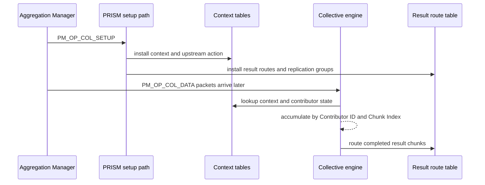

This choice is intentional. For an FPGA prototype connected through an
OpenNIC-like environment, in-band setup is a practical way to configure the
switch without requiring a separate management CPU, PCIe BAR interface, AXI-Lite
register map, or external control-plane stack.

!!! warning "Security scope"

    In-band setup is not production-secure by itself. A real deployment would
    need filtering, authentication, authorization, or a trusted management
    channel. PRISM currently treats in-band setup as a research and
    prototyping mechanism, not as a secure production management protocol.

The logical AM interface is independent from the physical transport used to
deliver setup commands. Future implementations may map the same operations to a
sideband interface such as AXI-Lite, PCIe BAR registers, firmware, or a software
control-plane API.

---

## Operation headers

The common PRISM header contains a fixed 64-bit operation header. Its
interpretation depends on the opcode.

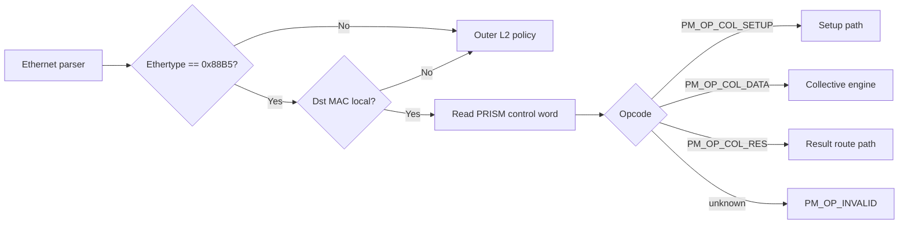

Reserved fields must be transmitted as zero and ignored by receivers in v0.1.

---

### PM_OP_COL_SETUP

`PM_OP_COL_SETUP` is sent by the Aggregation Manager to install, replace, or
extend switch-local collective state.

This packet is consumed by the setup path and must not be inserted into the
normal forwarding VOQ datapath.

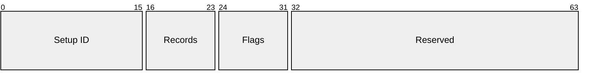

| Field | Size | Purpose |
|---|---:|---|
| `Setup ID` | 16b | AM-selected identifier for tracing or idempotent retries |
| `Records` | 8b | Number of setup records carried in the payload |
| `Flags` | 8b | Setup flags; must be zero in v0.1 |
| `Reserved` | 32b | Must be zero in v0.1 |

The setup payload is record-based. This allows a single setup packet to install
several contexts or several pieces of state for the same context when the
records fit in one Ethernet frame.

| Record type | Purpose |
|---:|---|
| `PM_SETUP_CONTEXT` | Defines the collective semantic, formats, fan-in, and vector length for one context |
| `PM_SETUP_UPSTREAM` | Defines how a completed local reduction is emitted toward the aggregation parent |
| `PM_SETUP_RESULT_ROUTE` | Maps `(Collective Context ID, Chunk Index range)` to a replication group |
| `PM_SETUP_REPLICATION_GROUP` | Defines the next-hop MACs and egress ports used when forwarding result chunks |

Each setup record is aligned to 64-bit words and starts with the same 64-bit
record header:

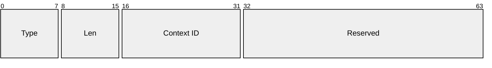

| Field | Size | Purpose |
|---|---:|---|
| `Type` | 8b | One of the `PM_SETUP_*` record types |
| `Len` | 8b | Record length in 64-bit words, including this header |
| `Context ID` | 16b | Switch-local context affected by this record |
| `Reserved` | 32b | Must be zero in v0.1 |

Unknown record types, zero lengths, or records that extend beyond the setup
payload are invalid for v0.1.

#### Context record

A context record defines the reduction behavior and per-chunk fan-in:

After the common record header, `PM_SETUP_CONTEXT` carries:

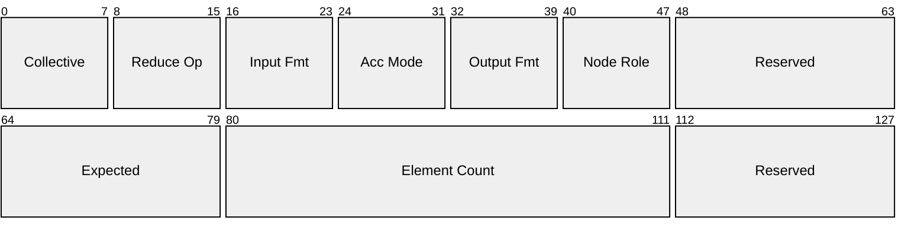

| Field | Size | Purpose |
|---|---:|---|
| `collective_semantic` | 8b | `PM_COL_REDUCE` or `PM_COL_ALLREDUCE` |
| `reduction_operator` | 8b | v0.1 supports `PM_RED_SUM` |
| `input_format` | 8b | Wire format of incoming `PM_OP_COL_DATA` elements |
| `accumulator_mode` | 8b | Internal accumulation strategy |
| `output_format` | 8b | Wire format of emitted result elements |
| `node_role` | 8b | `ROOT`, `INTERNAL`, `LEAF`, or `SINGLE` for validation/debug |
| `expected_local_contributors` | 16b | Number of unique local contributors expected for each chunk |
| `element_count` | 32b | Number of logical vector elements |
| `Reserved` | 32b total | Must be zero in v0.1 |

`expected_local_contributors` is local to this switch and this context. It is
not the number of global ranks in the whole job. In a spine-leaf topology, a
leaf waits for its local ranks, while a spine waits for its child leaves.

#### Upstream action record

An upstream action record defines what happens after the switch completes a
local reduction chunk.

After the common record header, `PM_SETUP_UPSTREAM` carries:

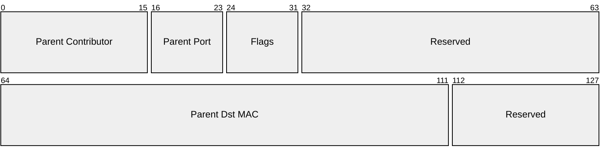

| Field | Size | Purpose |
|---|---:|---|
| `parent_contributor_id` | 16b | Contributor ID used by this switch when sending to its parent |
| `parent_egress_port` | 8b | Local port used to reach the aggregation parent |
| `flags.has_parent` | 1b | If set, completed chunks are emitted upward as `PM_OP_COL_DATA` |
| `parent_dst_mac` | 48b | PRISM MAC of the parent aggregation node |
| `Reserved` | 48b total | Must be zero in v0.1 |

If `has_parent == 1`, a completed chunk is emitted as `PM_OP_COL_DATA`. If
`has_parent == 0`, the switch is the aggregation root for this context and the
completed chunk enters the result route path as `PM_OP_COL_RES`.

#### Result route records

A result route record defines where completed result chunks go:

After the common record header, `PM_SETUP_RESULT_ROUTE` carries one 64-bit word:

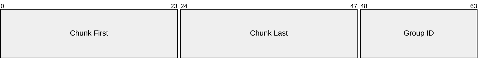

| Field | Size | Purpose |
|---|---:|---|
| `chunk_first` | 24b | First chunk index matched by this route |
| `chunk_last` | 24b | Last chunk index matched by this route |
| `replication_group_id` | 16b | Local replication group to execute |

The result route lookup key is:

\[
(\mathrm{CollectiveContextID},\ \mathrm{ChunkIndex})
\]

This makes `REDUCE` and `ALLREDUCE` direct, and it also leaves a clean path for
future `REDUCE_SCATTER`, where different chunk ranges are routed to different
destination branches.

#### Replication group records

A replication group record defines one or more local next hops:

After the common record header, `PM_SETUP_REPLICATION_GROUP` begins with a
64-bit group header:

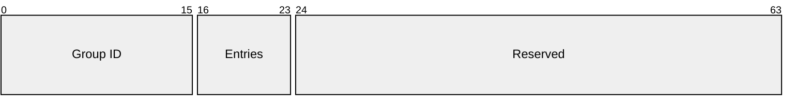

It is followed by `Entries` 64-bit next-hop records:

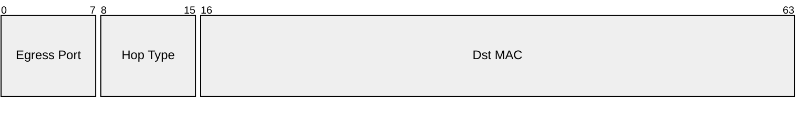

| Field | Size | Purpose |
|---|---:|---|
| `replication_group_id` | 16b | Local group selected by a result route |
| `entries` | 8b | Number of next-hop records in the group |
| `egress_port` | 8b | Local output port for one replica |
| `next_hop_type` | 8b | `SWITCH` or `RANK`, used for validation/debug |
| `dst_mac` | 48b | Next-hop PRISM or rank MAC |
| `Reserved` | 40b | Must be zero in v0.1 |

The forwarding behavior depends on `egress_port` and `dst_mac`; `next_hop_type`
is not required for packet delivery, but it is useful for checking that the AM
installed the intended result tree.

A setup packet or setup record is invalid if:

- `Records == 0`;
- a record length is inconsistent with its type;
- `expected_local_contributors == 0`;
- `element_count == 0`;
- `chunk_first > chunk_last`;
- a replication-group length does not match its entry count;
- `collective_semantic` is unsupported;
- `reduction_operator` is unsupported;
- `input_format`, `accumulator_mode`, or `output_format` is unsupported;
- an upstream action is missing for a non-root node;
- a root node has no result route for a chunk that may complete;
- a result route points to an unknown replication group;
- reserved fields are non-zero.

PRISM trusts setup writes to succeed in the current prototype. It does not
define setup acknowledgments, setup responses, or status packets.

---

### PM_OP_COL_DATA

`PM_OP_COL_DATA` carries one contributor's data for one vector chunk. The packet
is consumed by the collective engine and is not forwarded directly through the
normal VOQ datapath.

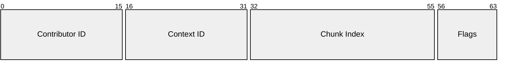

| Field | Size | Purpose |
|---|---:|---|
| `Contributor ID` | 16b | Local contributor identifier for this switch/context |
| `Context ID` | 16b | AM-assigned context identifier for the configured tree |
| `Chunk Index` | 24b | Zero-based chunk index within the configured vector |
| `Flags` | 8b | Must be zero in v0.1 |

For each chunk, the collective engine waits until it has received
`expected_local_contributors` unique contributor IDs. Once the chunk is complete,
the context decides the next action:

- If an upstream parent is configured, the switch emits a new `PM_OP_COL_DATA`
  packet toward that parent. The emitted packet uses `parent_contributor_id`,
  because the parent sees the whole child subtree as one local contributor.
- If no upstream parent is configured, the switch is the aggregation root and
  emits `PM_OP_COL_RES` according to the result route table.

This rule removes ambiguity: `PM_OP_COL_DATA` always belongs to the upward
aggregation phase.

---

### PM_OP_COL_RES

`PM_OP_COL_RES` carries one completed result chunk through the
result-dissemination tree. It is generated by the aggregation root and may be
forwarded by intermediate switches until it reaches the destination rank or
ranks.

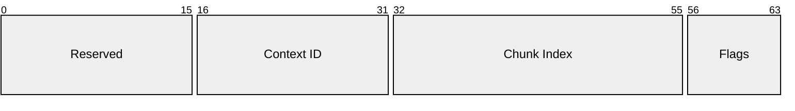

| Field | Size | Purpose |
|---|---:|---|
| `Reserved` | 16b | Must be zero in v0.1 |
| `Context ID` | 16b | AM-assigned context identifier for the configured tree |
| `Chunk Index` | 24b | Result chunk index |
| `Flags` | 8b | Must be zero in v0.1 |

When a switch receives a local `PM_OP_COL_RES`, it performs a result route lookup
using `(Context ID, Chunk Index)`. The matching route selects one replication
group. The switch then emits one replica per group entry, setting each replica's
Ethernet `Dst MAC` to the configured next hop.

`PM_OP_COL_RES` is never accumulated again. It always belongs to the downward
result-dissemination phase.

The result payload format is determined by the context configured by
`PM_OP_COL_SETUP`. The output format may differ from both the input format and
the internal accumulator mode.

Example:

```text
input_format     = PM_FMT_FP32
accumulator_mode = PM_ACC_EXACT_FP32_MAG277
output_format    = PM_FMT_FP32
```

This means that input elements are received as `PM_FMT_FP32`, accumulated
internally using an exact FP32 scalar-sum accumulator family, and emitted as
`PM_FMT_FP32`.

---

## Collective semantics

The collective semantic describes the communication-level behavior.

| Value | Semantic | Meaning |
|---:|---|---|
| `0x00` | `PM_COL_INVALID` | Invalid or unsupported collective semantic |
| `0x01` | `PM_COL_REDUCE` | Contributors produce a result delivered to one root rank |
| `0x02` | `PM_COL_ALLREDUCE` | Contributors produce a result delivered to all participating ranks |

`REDUCE` and `ALLREDUCE` are in scope for the first PRISM thesis protocol.
Other collective semantics, such as `REDUCE_SCATTER`, are future work.

`REDUCE_SCATTER` is intentionally not encoded as a special case in the result
path. The result route table is already chunk-range based, so a future
implementation can route different chunk ranges to different destination
branches without replacing the dissemination model.

---

## Reduction operator

The reduction operator describes the mathematical operation applied to elements.

| Value | Operator | Meaning |
|---:|---|---|
| `0x00` | `PM_RED_INVALID` | Invalid or unsupported reduction operator |
| `0x01` | `PM_RED_SUM` | Addition |

Only `PM_RED_SUM` is in scope for the first PRISM thesis prototype.

---

## Wire formats and accumulator modes

PRISM distinguishes **wire formats** from **accumulator modes**.

A wire format describes how elements are encoded in `PM_OP_COL_DATA` and
`PM_OP_COL_RES` payloads.

| Value | Wire format | Meaning |
|---:|---|---|
| `0x00` | `PM_FMT_INVALID` | Invalid or unsupported wire format |
| `0x01` | `PM_FMT_INT8` | 8-bit integer payload elements |
| `0x02` | `PM_FMT_FP16` | IEEE binary16 payload elements |
| `0x03` | `PM_FMT_BF16` | bfloat16 payload elements |
| `0x04` | `PM_FMT_FP32` | IEEE binary32 payload elements |

An accumulator mode describes how the collective engine internally combines
contributions.

| Value | Accumulator mode | Meaning |
|---:|---|---|
| `0x00` | `PM_ACC_INVALID` | Invalid or unsupported accumulator mode |
| `0x01` | `PM_ACC_NATIVE` | Accumulate using the native arithmetic associated with the input format |
| `0x02` | `PM_ACC_FP32` | Accumulate using FP32 arithmetic |
| `0x03` | `PM_ACC_DETERMINISTIC_FP32` | Wait for contributions and reduce in deterministic logical order |
| `0x04` | `PM_ACC_EXACT_FP16_MAG40` | Exact scalar-sum accumulator family for FP16 inputs |
| `0x05` | `PM_ACC_EXACT_BF16_MAG261` | Exact scalar-sum accumulator family for BF16 inputs |
| `0x06` | `PM_ACC_EXACT_FP32_MAG277` | Exact scalar-sum accumulator family for FP32 inputs |

!!! note "Why `MAG40`, `MAG261`, and `MAG277`?"

    These names refer to the exact scalar-sum magnitude range before rank-count
    carry headroom and sign are added. They are not dot-product accumulator
    sizes. The final signed storage width still depends on the maximum number of
    contributing ranks.

For exact finite scalar summation with \(R\) contributing ranks:

\[
W_{\mathrm{signed}}
=
W_{\mathrm{mag}}
+
\lceil \log_2 R \rceil
+
1
\]

This follows the scalar-reduction sizing model, not the wider dot-product
Kulisch bound.[^superaccumulator-sizing]

For the detailed derivation, see
[1.2 Reproducibility](../1-introduction/reproducibility.md#accumulator-sizing-for-scalar-reductions).

!!! note "Input, accumulator, and output roles"

    `input_format`, `accumulator_mode`, and `output_format` are intentionally
    separate. PRISM may receive data in one representation, accumulate it
    using a reproducible internal strategy, and emit results in a format selected
    by the Aggregation Manager.

---

## Example: `REDUCE(SUM, root = rank1)`

This example follows one chunk through the complete nominal protocol lifecycle.
The same data-plane steps execute independently for every configured chunk, and
different chunk indices may be in different phases at the same time.

The topology contains one spine, two leaves, and four participating ranks:

- `L0` connects `rank0` and `rank1`;
- `L1` connects `rank2` and `rank3`;
- `S0` is the aggregation root;
- `rank1` is the only result destination.

For chunk `i`, PRISM computes the element-wise reduction

\[
\mathbf{result}[i] =
\mathbf{x}_0[i] + \mathbf{x}_1[i] + \mathbf{x}_2[i] + \mathbf{x}_3[i].
\]

Blue denotes control-plane setup, orange denotes upward aggregation, green
denotes downward result delivery, and attenuated nodes are not active in the
illustrated step.

### 1. Install the collective context

The AM knows the topology, participant placement, and root rank. It sends an
individually addressed `PM_OP_COL_SETUP` frame to each switch. The Ethernet
destination MAC identifies the switch that consumes a setup frame; intermediate
switches only forward frames addressed to another PRISM node.

For v0.1, the AM installs the same wire `Context ID`, shown as `C`, throughout
this tree because no per-hop context translation is defined. The relevant local
state is:

| Node | Expected local contributors | Upstream action after local completion | Result route for chunk `i` |
|---|---|---|---|
| `L0` | `rank0`, `rank1` | Emit one `PM_OP_COL_DATA` to `S0` as the configured parent contributor | Replication group `{rank1}` |
| `L1` | `rank2`, `rank3` | Emit one `PM_OP_COL_DATA` to `S0` as the configured parent contributor | No result route |
| `S0` | `L0`, `L1` | No parent; inject the completed chunk as `PM_OP_COL_RES` | Replication group `{L0}` |

Each replication-group entry contains a local egress port and the destination
MAC of its next hop. Therefore a switch needs only its local decision; it does
not discover the global topology at runtime.

<figure markdown="span">
  { loading=lazy }
  <figcaption>Setup installs both the upward aggregation actions and the selective result path to <code>rank1</code>.</figcaption>
</figure>

### 2. Submit rank contributions

For chunk `i`, every rank sends one `PM_OP_COL_DATA` packet to its local leaf.
The operation header carries the leaf-local `Contributor ID`, `Context ID = C`,
and `Chunk Index = i`; the Ethernet destination MAC selects the receiving leaf.

The leaf uses `(Context ID, Contributor ID, Chunk Index)` to reject duplicates
and update the correct accumulator. `Chunk Index` is also the placement key, so
packets for different chunks may arrive out of order without changing result
routing.

<figure markdown="span">
  { loading=lazy }
  <figcaption>Each contribution travels only to its directly configured leaf.</figcaption>
</figure>

### 3. Complete the leaf reductions

`L0` completes its local chunk after receiving the unique contributions from
`rank0` and `rank1`; independently, `L1` waits for `rank2` and `rank3`:

\[
\begin{aligned}
\mathbf{partial}_0[i] &= \mathbf{x}_0[i] + \mathbf{x}_1[i], \\
\mathbf{partial}_1[i] &= \mathbf{x}_2[i] + \mathbf{x}_3[i].
\end{aligned}
\]

The two leaves do not need to complete at the same time. Each can emit its
partial result as soon as its own `expected_local_contributors` condition is
satisfied.

<figure markdown="span">
  { loading=lazy }
  <figcaption>Contributor counting is local to each switch and context.</figcaption>
</figure>

### 4. Aggregate at the root switch

The upstream action at each leaf creates a new `PM_OP_COL_DATA` packet addressed
to `S0`. Its `Contributor ID` is the configured `parent_contributor_id`, so `S0`
sees each whole leaf subtree as one contributor rather than seeing the original
ranks.

After receiving the partials from both `L0` and `L1`, `S0` computes

\[
\mathbf{result}[i] = \mathbf{partial}_0[i] + \mathbf{partial}_1[i].
\]

The opcode selected after completion comes from the installed upstream action,
not from the destination MAC: a node with `has_parent == 1` emits
`PM_OP_COL_DATA`; the aggregation root has `has_parent == 0` and injects
`PM_OP_COL_RES` into the result route path.

<figure markdown="span">
  { loading=lazy }
  <figcaption>In-network aggregation reduces four rank packets to two leaf partials before the spine.</figcaption>
</figure>

### 5. Route the result to `rank1`

`S0` looks up `(C, i)` in its result route table. The matching replication group
contains only `L0`, so `S0` emits one `PM_OP_COL_RES` replica on the `L0` egress
port and sets its Ethernet destination MAC to the configured MAC of `L0`.

`L0` consumes the locally addressed frame and performs the same lookup. Its
replication group contains only `rank1`, so it emits one replica with the
destination MAC of `rank1`. `L1`, `rank0`, `rank2`, and `rank3` receive no result
traffic.

The two mechanisms have distinct responsibilities:

- the result route and replication group select the local next hop or next hops;
- the Ethernet destination MAC identifies the selected next hop on the wire.

This per-hop rule works at any tree depth: every intermediate switch repeats the
local lookup and MAC rewrite. No switch needs to infer whether a port reaches a
leaf or a rank, and no result flooding is required.

<figure markdown="span">
  { loading=lazy }
  <figcaption>The result route selects one branch at each hop; all non-destination branches remain idle.</figcaption>
</figure>

### 6. Deliver the result and release chunk state

`rank1` consumes the result payload. The per-chunk accumulator state is no
longer needed after a switch has successfully handed off its completed output:

- `L0` and `L1` release their chunk state after emitting their upward
  `PM_OP_COL_DATA` packets;
- `S0` releases its chunk state after injecting `PM_OP_COL_RES` into the result
  path;
- the configured context, upstream actions, result routes, and replication
  groups remain installed for the other chunks in the collective.

In particular, `L1` does not wait for a result packet because it is not on the
`REDUCE` result tree. Result forwarding depends only on persistent route state,
not on keeping a completed accumulator alive.

<figure markdown="span">
  { loading=lazy }
  <figcaption>Temporary accumulator state and persistent routing state have different lifetimes.</figcaption>
</figure>

!!! note "Packet loss in v0.1"

    This is the nominal successful lifecycle. PRISM v0.1 does not provide
    acknowledgment, retransmission, timeout, or abort packets. A lost
    `PM_OP_COL_DATA` leaves the destination chunk incomplete; a lost
    `PM_OP_COL_RES` leaves the root rank without that result. Implementations may
    expose context occupancy and drop/error counters for experiments, while
    reliable completion and recovery remain future work.

### How `ALLREDUCE` differs

The setup and upward aggregation phases are identical. Only the result route
tree changes: `S0` selects a replication group containing both `L0` and `L1`;
each leaf then selects all of its participating local ranks. Each branch receives
one result replica per tree level, without broadcasting onto unrelated ports.

---

## Lifecycle and invalid behavior

The configured context and route tables are persistent control-plane state. The
per-chunk accumulator state is temporary data-plane state.

A switch can release the local accumulator state for a chunk after it has
successfully emitted the completed chunk upward as `PM_OP_COL_DATA` or injected
it into the result route path as `PM_OP_COL_RES`. A leaf that participates in
`ALLREDUCE` does not need to keep its accumulator state while waiting for the
result to return; result forwarding uses the persistent route tables.

A packet is invalid if it uses unsupported major versions, unknown opcodes,
unsupported setup values, non-zero reserved fields where zero is required,
context identifiers that are not installed, duplicate contributions for the same
`(Collective Context ID, Contributor ID, Chunk Index)`, or payloads inconsistent
with the configured collective context.

PRISM v0.1 does not generate error packets. Invalid packets are dropped or
ignored, and the implementation may increment simulation-visible, debug-visible,
or register-visible error counters. Reliable completion protocols,
retransmission, explicit abort messages, and production fault handling are
outside the first thesis protocol.


[^ethertype]: RFC 9542 documents `0x88B5` and `0x88B6` as local experimental
    EtherTypes. These values are suitable for local experimentation but should
    not be treated as production protocol assignments.

[^ethernet-frame]: Standard Ethernet payload is 1500 bytes for non-jumbo frames.
    The Ethernet header is 14 bytes and the FCS is 4 bytes; preamble, SFD, and
    interpacket gap are physical-layer overhead and are normally not part of the
    AXI-Stream payload seen by PRISM.

[^superaccumulator-sizing]: The sizing rule follows the PRISM
    scalar-reduction model. It is intentionally different from the wider
    dot-product Kulisch bound because PRISM collective reductions sum
    already-formed numeric values rather than products.
