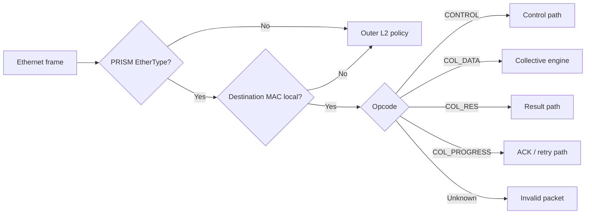
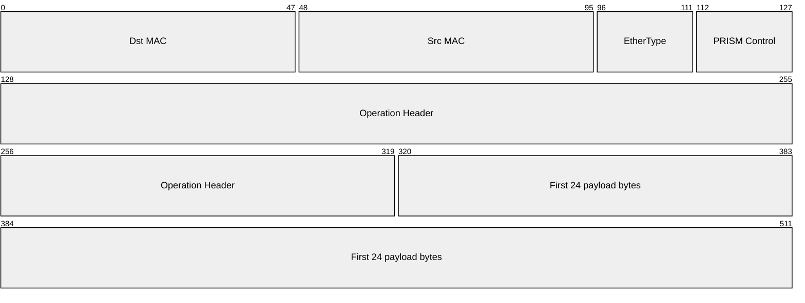
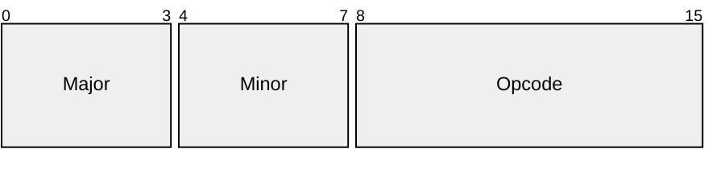
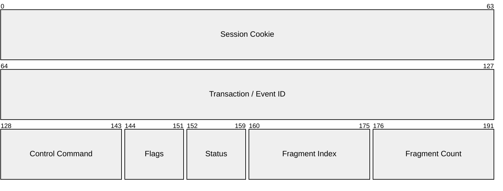
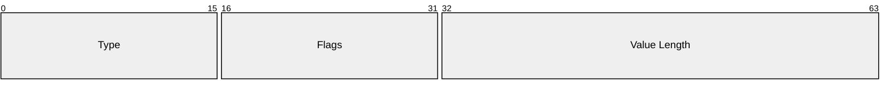
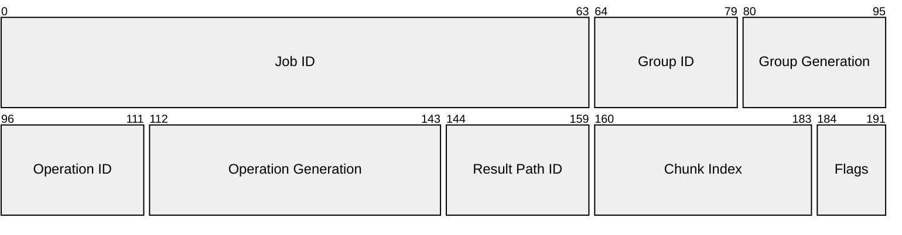
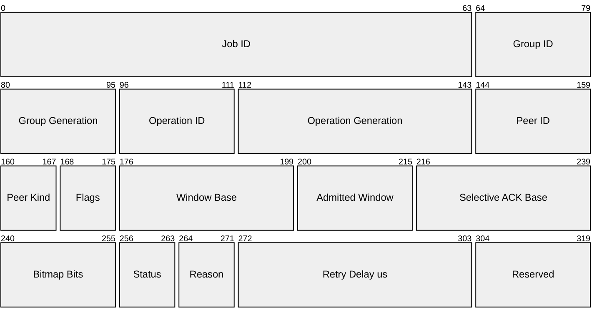

# Protocol

PRISM operates at **Layer 2** and uses Ethernet frames to carry collective
operations through an FPGA datapath. Layer 2 is the part of networking that
moves frames according to MAC addresses, before protocols such as IP.

The initial prototype focuses on two MPI-style semantics:

- `REDUCE`: several ranks contribute, but one selected rank receives the sum;
- `ALLREDUCE`: the same sum is returned to every participating rank.

A **rank** is one participating process or accelerator endpoint. In a reduction
tree, leaf switches receive rank contributions, optional internal switches
combine partial sums, and one aggregation root produces the final result.

PRISM combines ordinary Layer-2 forwarding with three locally processed flows:
in-band control, upward aggregation, and downward result delivery. A fourth
packet class carries acknowledgments and retry feedback in the reverse
direction. The packet-class section below introduces their names and roles.

PRISM is a research FPGA datapath, not a complete production Ethernet switch.
The protocol therefore prioritizes a clear packet model, reproducible tests,
and implementable RTL over a broad management or security stack.

!!! abstract "Protocol goal"

    The first packet beat should contain enough information for the parser to
    select forwarding, control, aggregation, result, or progress handling before
    the numeric payload reaches the collective engine.

This page introduces the forwarding, identity, chunking, and startup model
before presenting the packet layouts. A complete reduction storyboard follows;
the final sections collect the exact Protocol 1.0 registries and validation
rules needed by RTL and host software.

---

## Frame ownership and forwarding

PRISM classification proceeds from the outer Ethernet frame inward:

1. Parse destination MAC, source MAC, and EtherType.
2. If EtherType is not `0x88B5`, apply the normal Layer-2 policy.
3. If the frame is PRISM but its destination MAC is not a local PRISM
   termination MAC, forward it unchanged when policy permits.
4. Decode the PRISM opcode only for a locally addressed PRISM frame.



The destination MAC and opcode answer different questions:

- the MAC selects the next node or local owner;
- the opcode selects what that owner does with the packet.

`PM_TRANSPARENT` permits ordinary Layer-2 forwarding. `PM_STRICT` rejects
non-local frames unless an explicit management-forwarding exception is enabled.
The prototype normally uses transparent forwarding.

---

## Collective identifiers

This section defines how packets refer unambiguously to the different entities
of a collective. It distinguishes three logical levels with different
lifetimes:

1. the **group**, namely the contributor tree configured in the switches and
   reusable across executions;
2. the **operation**, namely one execution of the collective on that group (for
   example, one specific invocation of `ALLREDUCE`);
3. the **chunk**, namely the portion of the vector processed during that
   operation.

**Identifier fields in the packet** are the values actually transmitted on the
link (*on the wire*). When multiple fields are listed, their tuple forms the
identifying key: for example,
`(Group ID, Group Generation)` identifies one precise group instance, not just
the numeric Group ID. The **Purpose** column states what the key identifies and
the lifetime over which that identity remains valid.

| Object or field | Identifier fields in the packet | Purpose |
|---|---|---|
| Job / AM session | `Job ID:64` plus a switch-local Session Cookie | Ownership and recovery domain |
| Collective Group | `Group ID:16`, `Group Generation:16` | Logical tree and contributor set, reusable across multiple operations |
| Collective Operation | `Operation ID:16`, `Operation Generation:32` | One specific execution of the collective on that group |
| Contributor ID | 16b | One rank or child subtree as seen by the receiving switch |
| Result Path ID | 16b | One configured result replica on the current direct link |
| Chunk Index | 24b | Position of one element interval in the vector |

!!! note "Why associate a generation with an ID?"

    Numeric IDs have finite width and are therefore reused. The **generation**
    distinguishes the different instances that occupied the same ID: if a
    packet from an old instance arrives late, its generation does not match the
    current one and the switch can discard it. A Group ID is reusable only after
    `GROUP_DESTROY` has been acknowledged everywhere; an Operation ID is
    reusable only after `OP_RELEASE_RESPONSE`. Every reuse increments its
    generation.

Each switch stores only its local part of a logical group. At a leaf, Contributor
IDs normally identify ranks. At an internal node, they identify child subtrees.
Contributor IDs are dense and bound to an expected ingress port and source MAC.

---

## Chunking model

A collective vector is split into **chunks**. A chunk is a consecutive interval
of elements, not an arbitrary number of input bytes.

For chunk `i`:

\[
\mathrm{first\_element}=i\,\mathrm{elements\_per\_chunk}
\]

\[
\mathrm{elements\_in\_chunk}=
\min(\mathrm{elements\_per\_chunk},
\mathrm{element\_count}-\mathrm{first\_element})
\]

and

\[
\mathrm{expected\_chunks}=
\left\lceil\frac{\mathrm{element\_count}}
{\mathrm{elements\_per\_chunk}}\right\rceil,
\qquad 0<\mathrm{expected\_chunks}\le 2^{24}.
\]

The same Chunk Index identifies the same element interval throughout the tree.
The AM therefore configures the same element count and elements per chunk at
every node.

The standard Ethernet payload is 1500 bytes. The 2-byte PRISM control word and
24-byte DATA/RES header leave:

\[
\boxed{\mathrm{PM\_CHUNK\_PAYLOAD\_BYTES}=1500-2-24=1474}.
\]

The payload length of a locally transmitted packet is

\[
\mathrm{elements\_in\_chunk}\times
\mathrm{bytes\_per\_element}(\mathrm{packet\ wire\ format}).
\]

| Formats used by the tree | Maximum elements per chunk |
|---|---:|
| INT8 input, INT8 output | 1474 |
| FP32 input, FP32 output | 368 |
| INT8 input, FP32 output | 368 |

For example, 1000 FP32 elements form chunks of 368, 368, and 264 elements.
No FP16, BF16, or FP32 element is split across packets. The AM also enforces
`child.output_format == parent.input_format` on every aggregation edge.
Ethernet minimum-frame padding is not interpreted as vector data.

`PM_OP_COL_RES` carries no per-packet format tag. Protocol 1.0 therefore also
requires one tree-wide `output_format`, equal to the aggregation root's result
format. A leaf may convert its input before emitting the first partial—for
example INT8 to FP32—but later levels cannot introduce another wire-format
conversion. Trees that need different intermediate and final formats are
unsupported in 1.0.

Chunks may arrive in a different order inside the admitted receive window.
Chunk Index, not arrival order, selects the correct temporary state.

---

## PRISM packet classes

After Ethernet ownership is established, the opcode selects one of these paths:

| Value | Packet class | Purpose |
|---:|---|---|
| `0x00` | `PM_OP_INVALID` | Internal invalid classification; not a normal transmitted packet |
| `0x01` | `PM_OP_CONTROL` | In-band setup, management responses, and events |
| `0x02` | `PM_OP_COL_DATA` | Contributions and partial sums moving toward the aggregation root |
| `0x03` | `PM_OP_COL_RES` | Completed results moving toward destination ranks |
| `0x04` | `PM_OP_COL_PROGRESS` | ACK, retry, and receive-window feedback for one direct transfer |

An **ACK** is an acknowledgment: it tells the previous sender that a packet was
accepted safely. A **direct transfer**, also called one network hop, is one link
between two neighboring nodes—for example `rank0 -> L0` or `L0 -> S0`.

---

## In-band setup

The application side and the network side have different responsibilities. A
**Host Coordinator** gathers the participating ranks and their collective
request. The **Aggregation Manager** (AM) turns that request into a tree-wide
plan using switch topology, capabilities, and available resources.

Here, **in-band** refers specifically to AM-to-switch control: its commands
travel as Ethernet packets through the same physical ports as collective data.
After parsing, control packets use a separate control path and never enter the
numeric accumulator.

For example, the prototype can use OpenNIC as its FPGA shell: OpenNIC provides
the host-facing ports and driver path, while PRISM implements the collective
protocol in the programmable datapath. In-band setup therefore lets experiments
start without first requiring a separate management processor.

### Host-controlled start

A collective call does not make ranks transmit immediately. The runtime first
brings all expected ranks to a host-side barrier; the Host Coordinator then asks
the AM to activate one operation. Only after every target switch reports
`ACTIVE` does the AM return a `StartGrant`, which the coordinator distributes to
the ranks through the runtime's reliable host channel. The same channel later
carries a terminal `DONE` or `ERROR` outcome to every rank.

The grant gives each rank the `Job ID`, `Group ID/Generation`, `Operation
ID/Generation`, local Contributor ID, destination leaf MAC, result destination
MAC, wire formats, chunk geometry, and receive window actually admitted by that
leaf. For `REDUCE`, the host request also identifies the one destination rank.
If any switch rejects preparation or commit, the AM aborts and releases partial
state; the coordinator wakes every waiting rank with the same failure, and none
receives a grant.

Host coordination is deliberately outside the PRISM Ethernet wire protocol. A
prototype may co-locate coordinator and AM behind a function call; a deployment
may separate them with RPC. They remain distinct logical roles, and neither the
host request nor `StartGrant` introduces a `PM_*` opcode.

The Host Coordinator is a logical runtime role, not a mandatory extra process.
It may run inside a participating rank, in a separate runtime service, or beside
the AM. To keep the storyboard concrete, the example below places it in
`rank0`: `rank0` still contributes data like every other rank while also
coordinating the host-side barrier.

### Target-specific delivery

For each management command, the AM sends a distinct `PM_OP_CONTROL`
transaction to every target switch. `GROUP_STAGE`, `GROUP_COMMIT`, `OP_PREPARE`,
and `OP_COMMIT` are therefore separate transactions, and one transaction may be
fragmented across several frames. Each Ethernet destination is the target's
local PRISM MAC and each payload contains only that target's local records. If
the AM injects traffic through root `S0`, `S0` consumes locally addressed
transactions and forwards those for `L0` and `L1` unchanged. The root never
derives or rewrites child configuration.

### From discovery to active operation

Protocol 1.0 separates reusable topology from one invocation:

| Phase | Main commands | Effect |
|---|---|---|
| Discover | `CAPS_QUERY`, `RESOURCE_QUERY` | Read supported features and current availability |
| Own | `SESSION_OPEN` | Establish Job ownership and a renewable switch-local cookie |
| Install topology | `GROUP_STAGE`, then `GROUP_COMMIT` | Validate and atomically install contributors, parent action, and result next hops |
| Start invocation | `OP_PREPARE`, then `OP_COMMIT` | Reserve operation state and atomically enable DATA acceptance |

A resource snapshot is only advisory. Successful `GROUP_STAGE` or `OP_PREPARE`
is what reserves resources. If one switch rejects prepare, the AM aborts and
releases every switch that prepared. A successful `GROUP_COMMIT_RESPONSE` must
report `INSTALLED`, and every `OP_COMMIT_RESPONSE` must report `ACTIVE`, before
the AM can return the host-side grant.

Before admission, the AM also validates one connected acyclic tree with exactly
one root and one parent per non-root node. Every node uses the same collective
semantic, reduction operator, element geometry, and final result format; each
aggregation edge matches child output to parent input. Host-side route
validation proves that every representative chunk reaches exactly the requested
root rank for `REDUCE`, or every participating rank for `ALLREDUCE`.

Commands are idempotent: retrying the same transaction does not apply it twice.
A conflicting reuse of one Transaction ID returns `TXN_CONFLICT`.

!!! warning "Prototype security scope"

    The thesis prototype assumes a trusted host control plane (Host Coordinator
    and AM) and uses the explicit laboratory profile. Authentication and
    cryptographic key management are outside the current implementation scope;
    the numeric registry at the end of this page reserves profiles for a future
    protected deployment.

---

## Common frame format

PRISM is carried directly inside an Ethernet frame. The Ethernet header selects
the next destination; the PRISM header identifies the packet class and the
collective operation.

For a standard `PM_OP_COL_DATA` or `PM_OP_COL_RES` frame, the first 512-bit
AXI4-Stream beat is:



| Field | Size | Meaning |
|---|---:|---|
| `Dst MAC` | 48b | Ethernet destination for the next direct link |
| `Src MAC` | 48b | MAC of the sender on that link |
| `EtherType` | 16b | `0x88B5`, the PRISM experimental EtherType[^ethertype] |
| `PRISM Control` | 16b | Version and packet-class opcode |
| `Operation Header` | 192b | Job, group, operation, contributor/path, and chunk identity |
| `First payload bytes` | 192b | First 24 bytes of the vector chunk |

`TKEEP` identifies valid bytes in the final beat and `TLAST` marks the physical
end of the frame. They validate the packet boundary; the operation configuration
still determines the exact logical vector length.

The common 16-bit control word is:



Protocol 1.0 uses `Major=1` and `Minor=0`. A different major version is
incompatible. The opcode tells the local parser how to interpret the following
header. The host request and `StartGrant` are API events outside this wire ABI,
so the host-controlled startup model does not change the Protocol 1.0 layout.
This is the canonical pre-release 1.0 specification; earlier unpublished draft
layouts are superseded rather than maintained as compatibility variants.

## Protocol 1.0 packet layouts

The four opcodes are not four variants of the same operation. `CONTROL`
configures and queries switches; `COL_DATA` carries contributions toward the
root; `COL_RES` distributes results; and `COL_PROGRESS` returns acknowledgments
and flow information to the adjacent sender. The common control word selects
one of these headers. The diagrams show the encoding; the following tables
explain the function of each field.

Unless a field says otherwise:

- fields appear in transmission order;
- multibyte integers and numeric elements use network byte order: the most
  significant byte is transmitted first;
- reserved fields and unused flag bits are transmitted as zero and rejected
  when received non-zero;
- widths are in bits and offsets are in bytes from the start of the containing
  header or Type-Length-Value (TLV) record.

### `PM_OP_CONTROL`

`PM_OP_CONTROL` has this fixed 24-byte header after the common control word:



`CONTROL` is the envelope of the in-band management protocol. The AM uses it to
open sessions, install groups, prepare operations, and query state or resources;
switches use it for responses and events. The header identifies the exchange
and makes it reassemblable, while the TLV payload carries command-specific
parameters.

| Field | What it does | Why it is needed |
|---|---|---|
| Session Cookie | Selects the AM session local to the switch | Prevents commands from different sessions from sharing ownership and resources; it is zero only before session opening or for explicitly permitted queries |
| Transaction / Event ID | Identifies a request and its response, or one event | Enables correlation, deduplication, and reassembly while multiple exchanges are active |
| Control Command | Selects the management action and determines the permitted TLVs | Lets one envelope carry setup, query, commit, release, and event messages |
| Flags | Distinguish a request, response, or event and qualify the envelope | The meaning of the ID and Status field depends on the message role |
| Status | Reports the request outcome or the condition associated with an event | Separates the general outcome from structured or diagnostic details in TLVs; it is zero in requests |
| Fragment Index / Count | Positions this fragment and declares the total fragment count | A configuration command may exceed one Ethernet frame and must be reconstructed atomically before state changes |

!!! example "Reading one CONTROL transaction"

    A `GROUP_STAGE` sent in three frames keeps the same Session Cookie,
    Transaction ID, command, flags, status, and Fragment Count. Only Fragment
    Index changes (`0`, `1`, `2`). The switch reassembles all three payloads,
    validates the TLVs, and only then attempts to install group state.

<details class="protocol-registry" markdown="1">
<summary>Control flags, TLVs, and fragmentation rules</summary>

`SESSION_OPEN` and an unauthenticated static `CAPS_QUERY` use cookie zero.
Requests use a Transaction ID; events use an Event ID. Control flags are:

| Value | Flag |
|---:|---|
| `0x01` | `REQUEST` |
| `0x02` | `RESPONSE` |
| `0x04` | `EVENT` |
| `0x08` | `ACK_REQUIRED` |
| `0x10` | `AUTH_PRESENT` |

The control payload is a sequence of 64-bit-aligned Type-Length-Value records:



Value Length counts only value bytes. Zero alignment padding extends each whole
record to a multiple of 8 bytes. The only assigned TLV flag is
`MANDATORY=0x0001`. An unknown mandatory TLV rejects the transaction; an
unknown optional TLV is skipped. A non-repeatable TLV must not appear twice.

Fragment Count is positive and Fragment Index is smaller than it. Every
fragment of one `(Session Cookie, Transaction ID)` has the same command, flags,
status, and count. Reassembly completes before TLV parsing or state mutation.
Conflicting, inconsistent, timed-out, or over-capacity reassembly is discarded.

`PROTOCOL_VERSION_RANGE` is 8 bytes: minimum major, minimum minor, maximum
major, and maximum minor (8 bits each), followed by 32 zero bits. Scalar
identity, lease, profile, feature, and state TLVs contain one unsigned 64-bit
value. `PAYLOAD_DIGEST` is 32-byte SHA-256, `ERROR_DETAIL` is UTF-8, and
`AUTH_DATA` contains profile-defined opaque bytes.

</details>

`DATA`, `RES`, and `PROGRESS` belong to one already-configured operation. The
first two carry numeric elements; `PROGRESS` carries no vector data and instead
controls reliability on one direct link. Job, Group, and Operation fields occur
in all three so that a valid packet cannot be applied to the wrong context.

| Shared identity | Function |
|---|---|
| Job ID | Selects the AM ownership domain |
| Group ID + Group Generation | Selects the precise instance of the logical tree |
| Operation ID + Operation Generation | Selects the precise active execution on that tree |

### `PM_OP_COL_DATA`

The 24-byte DATA header is followed by numeric vector elements:


The Contributor ID names a direct local source. At a leaf it normally names a
rank; at an internal node it names a child subtree. When a switch sends its
partial upward, it preserves the Job, Group, Operation, and Chunk Index,
replaces Contributor ID with the installed `parent_contributor_id`, uses its
local PRISM egress MAC as source, and uses the Parent MAC from the upstream
action as destination.

| Specific field | Function |
|---|---|
| Contributor ID | Selects the expected contributor on the current link and allows duplicate or wrong-source contributions to be detected |
| Chunk Index | Places the payload in the correct vector interval and selects temporary reduction state independently of arrival order |
| Flags | Mark retransmission, ACK request, and the last chunk |
| Payload | Contains the elements that this node must accumulate for the named chunk |

### `PM_OP_COL_RES`

The 24-byte result header is followed by result elements:



The Result Path ID identifies one configured result replica on the current
direct path. It is replaced with the locally configured ID when another switch
replicates the result. Each replica preserves the Job, Group, Operation, and
Chunk Index, uses the local PRISM egress MAC as source, and takes its destination
MAC from the selected replication-group entry.

| Specific field | Function |
|---|---|
| Result Path ID | Selects the expected result replica or destination on the current link; it is hop-local and may change when a switch replicates the result |
| Chunk Index | Places the result in the same vector interval identified during aggregation |
| Flags | Mark retransmission, ACK request, and the last chunk |
| Payload | Contains final elements for the chunk, not another contribution to reduce |

!!! info "Shared DATA/RES flags and payload validation"

    A **peer** is the neighboring sender or receiver on one direct link. DATA
    and RES use the same flag assignments:

    | Value | Flag | Meaning |
    |---:|---|---|
    | `0x01` | `RETRANSMIT` | This packet is a retransmission |
    | `0x02` | `ACK_REQUIRED` | The direct peer must acknowledge safe acceptance |
    | `0x04` | `LAST_CHUNK` | This is the last Chunk Index of the operation |

    The exact payload length is derived from the chunking model above and the
    packet wire format. Ethernet padding is not vector data.

### `PM_OP_COL_PROGRESS`

`PM_OP_COL_PROGRESS` has this fixed 40-byte header, followed by an optional
selective-ACK bitmap:



`PROGRESS` travels in the opposite direction from the `DATA` or `RES` packet it
controls. It does not mean that the whole collective has started or completed:
it reports what the adjacent receiver accepted and how much more traffic it can
receive. It is never the tree-wide start signal; that signal comes from the Host
Coordinator only after the AM has observed every switch as `ACTIVE`. Each direct
link can therefore retransmit missing chunks locally without restarting the
end-to-end operation. An ACK terminates at the immediately previous sender; it
is never forwarded through the tree as the same ACK.

| Field | What it does | Why it is needed |
|---|---|---|
| Job, Group, Operation | Select the operation to which the feedback belongs | An ACK for an earlier generation must be ignored |
| Peer ID | Identifies the contributor, result path, or endpoint to which the feedback applies | A switch may manage multiple direct streams for the same operation |
| Peer Kind | Defines the namespace in which Peer ID is interpreted | The same numeric value can name different entity types; for a result ACK, Peer ID is a Result Path ID |
| Flags | Mark duplicate reception, bitmap presence, window update, result path, or fatal error | Allow unused parts to be omitted and qualify the meaning of other fields |
| Window Base | Gives the first Chunk Index in the advertised receive window | Distinguishes chunks that remain admissible from chunks that are old or too far ahead |
| Admitted Window | Gives the number of consecutive chunks, starting at Window Base, that the receiver is prepared to admit | Provides flow control and prevents overrunning available bitmap, aggregation-slot, or replay-buffer resources |
| Selective ACK Base | Maps the first bitmap bit to a Chunk Index | Lets the bitmap describe an arbitrary portion of the operation without one bit per global chunk |
| Bitmap Bits | Declares how many bitmap bits are meaningful | Supports variable-length selective ACKs and exact payload validation |
| Status / Reason | Report the general outcome and the specific cause of the feedback | Distinguish, for example, a harmless duplicate from an exhausted window, malformed payload, or unrecoverable error |
| Retry Delay us | Suggests how long to wait before retransmission | Avoids immediate retries when rejection is due to temporary resource pressure; zero means not applicable |
| Reserved | Space for compatible extensions, transmitted as zero | Keeps the header aligned without assigning future semantics today |

!!! example "Reading a selective ACK"

    With `Selective ACK Base = 40`, `Bitmap Bits = 4`, and bitmap `1011`, the
    receiver acknowledges chunks 40, 42, and 43; chunk 41 remains unacknowledged
    and may be retransmitted. If it also advertises `Window Base = 40` and
    `Admitted Window = 8`, it is prepared to admit chunks 40 through 47.

<details class="protocol-registry" markdown="1">
<summary>Selective-ACK encoding and PROGRESS flags</summary>

The bitmap payload is exactly `ceil(Bitmap Bits/8)` bytes. Bit `j`,
most-significant bit first within each byte, acknowledges
`Selective ACK Base + j` for the named peer. Unused low bits in the final byte
are zero. A single-chunk ACK uses one bit; a pure window update may use zero.

Progress flags are:

| Value | Flag | Meaning |
|---:|---|---|
| `0x01` | `DUPLICATE` | The receiver had already accepted the item |
| `0x02` | `SELECTIVE_ACK` | A selective-ACK bitmap is present |
| `0x04` | `WINDOW_UPDATE` | Window Base or Admitted Window is authoritative |
| `0x08` | `RESULT_PATH` | The peer identifies a result path |
| `0x10` | `FATAL` | The operation cannot recover by retry |

</details>

---

## Example: `REDUCE(SUM, root = rank1)`

The topology has one **spine**, the upper-level switch `S0`, two leaf switches
(`L0`, `L1`), and four ranks.
`rank1` is the only result destination. Steps 1–3 establish one invocation;
steps 4–7 may be pipelined independently for each chunk; steps 8–9 close the
invocation after every chunk completes.

For chunk `i`:

\[
\mathbf{result}[i]=
\mathbf{x}_0[i]+\mathbf{x}_1[i]+\mathbf{x}_2[i]+\mathbf{x}_3[i].
\]

### 1. Ranks request the collective

The four ranks enter the same collective through their runtime. In this
storyboard, `rank0` also hosts the Host Coordinator: it joins locally while the
runtime carries the other arrivals to the same barrier. Once the participant
set is complete, the Coordinator asks the AM to begin the operation. No PRISM
data packet is sent yet.

<figure markdown="span">
  { loading=lazy }
  <figcaption>The Coordinator badge belongs to <code>rank0</code>. The blue bus and <code>BEGIN_OPERATION</code> are host-runtime communication, not PRISM Ethernet packets.</figcaption>
</figure>

### 2. Configure the switch tree

If the reusable Group is not already installed, the AM installs it first. It
then prepares and commits one Operation handle and its chunk geometry on every
target switch.

| Node | Local reduction | Result direction |
|---|---|---|
| `L0` | `rank0`, `rank1` → partial for `S0` | toward `rank1` |
| `L1` | `rank2`, `rank3` → partial for `S0` | none |
| `S0` | subtrees `L0`, `L1` → final result | toward `L0` |

<figure markdown="span">
  { loading=lazy }
  <figcaption>The drawing condenses several commands into one path per target; each real command remains a separate transaction, possibly fragmented.</figcaption>
</figure>

The Group can serve later invocations. Vector length, arithmetic, admission,
completion, and retry state belong to this Operation.

### 3. Release the ranks from the barrier

The AM returns `StartGrant` only after `S0`, `L0`, and `L1` have all confirmed
`ACTIVE`. The Host Coordinator in `rank0` then publishes the rank-specific
grants to itself and the other three ranks over the same runtime channel. A leaf
does not send a startup ACK: it has only local knowledge and cannot prove that
the whole tree is ready.

<figure markdown="span">
  { loading=lazy }
  <figcaption>The host-side grant is the global readiness barrier. The Coordinator is hosted by <code>rank0</code>; it is not a fifth participant.</figcaption>
</figure>

### 4. Submit rank contributions

After `START`, every rank sends one DATA packet for chunk `i` to its configured
leaf. The header carries `Job ID`, `Group ID/Generation`, `Operation
ID/Generation`, leaf-local Contributor ID, and Chunk Index. Each leaf
acknowledges safe acceptance.

<figure markdown="span">
  { loading=lazy }
  <figcaption>Each contribution travels only to its configured leaf; ACK and retry protect each direct link.</figcaption>
</figure>

### 5. Complete the leaf reductions

The leaves complete independently:

\[
\begin{aligned}
\mathbf{partial}_0[i] &= \mathbf{x}_0[i]+\mathbf{x}_1[i],\\
\mathbf{partial}_1[i] &= \mathbf{x}_2[i]+\mathbf{x}_3[i].
\end{aligned}
\]

<figure markdown="span">
  { loading=lazy }
  <figcaption>Contributor counting is local; the two leaves do not need to complete together.</figcaption>
</figure>

Each leaf retains the completed partial until the parent acknowledges it.

### 6. Aggregate at the root switch

`L0` and `L1` emit their partials as DATA. At `S0`, each whole child subtree is
one local contributor identified by the child's configured
`parent_contributor_id`.

After both partials are accepted, `S0` computes the final chunk:

\[
\mathbf{result}[i]=\mathbf{partial}_0[i]+\mathbf{partial}_1[i].
\]

Safe acceptance of each partial is also a local handoff. `S0` sends one
`PM_OP_COL_PROGRESS` ACK to `L0` and another to `L1`. After receiving its ACK,
that leaf may reuse the replay buffer holding the transmitted partial for chunk
`i`; it does not wait for the final result to reach `rank1`.

<figure markdown="span">
  { loading=lazy }
  <figcaption>Each dashed ACK belongs to one leaf-to-S0 DATA transfer; neither ACK comes from <code>rank1</code>.</figcaption>
</figure>

### 7. Route the result to `rank1`

The route at `S0` selects a replication entry toward `L0`; the route at `L0`
selects `rank1`. `L1` and the other ranks receive no result traffic.

<figure markdown="span">
  { loading=lazy }
  <figcaption>Path A and Path B are independent transfers. <code>ACK B</code> stops at <code>L0</code>; <code>ACK A</code> is a separate response generated by <code>L0</code>.</figcaption>
</figure>

Ethernet does not tell a sender that the next node accepted a packet. Therefore
`S0` keeps replay A until `L0` has safely retained the result and returns
`ACK A`. `L0` may send that ACK without waiting for `rank1`: it has accepted
responsibility for Path B and keeps its own replay copy until `rank1` returns
`ACK B`. An ACK therefore closes one direct transfer and makes the sender's
bounded replay slot reusable. A missing packet or ACK retries only that link.

A switch suppresses a result it has already accepted on the same local Result
Path and acknowledges the duplicate again. At the final rank, Protocol 1.0
requires the endpoint/runtime to deduplicate by Operation handle, Result Path
ID, and Chunk Index until release; the switch protocol alone does not claim
exactly-once application delivery.

### 8. Complete the operation

Buffer reclamation is incremental rather than one tree-wide event. `L1` may
complete after `S0` has acknowledged all of its partials. `S0` completes after
every final result has been accepted by its configured next hop, `L0`. Because
`L0` has both roles, it completes only after `S0` has acknowledged all of its
partials and `rank1` has acknowledged all of its results. The three switches may
therefore reach `COMPLETE` at different times.

By local completion, heavy aggregation and replay buffers are already reusable.
The switch still retains the Operation handle, completion/phase state, and
deduplication tombstones so that late packets are rejected.

<figure markdown="span">
  { loading=lazy }
  <figcaption><code>COMPLETE</code> records that one switch has finished its local obligations; it is not a global result ACK and does not free the Operation handle.</figcaption>
</figure>

The Host Coordinator calls `wait_operation(...)`; the AM uses authoritative
`OP_STATUS` responses, optionally accelerated by `OP_COMPLETE_EVENT`, until
every switch reports `COMPLETE`. The call then returns tree-wide completion to
the coordinator and retires the old start grants. The single management line in
the drawing represents separate target-specific status exchanges with `S0`,
`L0`, and `L1`; `S0` does not summarize its children.

### 9. Release the Operation state

The AM does not release an Operation autonomously. After
`wait_operation(...)` has returned global completion, the Host Coordinator in
`rank0` explicitly calls `release_operation(...)`. The AM then sends one
target-specific `OP_RELEASE` to each switch and waits for every response.

This command is still necessary even though chunk buffers are already reusable:
it removes the retained Operation handle, completion/phase state, retry and
deduplication tombstones, and the remaining ownership of the Operation ID. The
reusable Group topology remains installed.

<figure markdown="span">
  { loading=lazy }
  <figcaption>The Coordinator triggers release. <code>S0</code> consumes its request and forwards those for <code>L0</code>/<code>L1</code> unchanged; the green <code>RELEASED</code> return occurs only after every response.</figcaption>
</figure>

Only after every `OP_RELEASE_RESPONSE` does the AM return `RELEASED` to the Host
Coordinator. The same Operation ID may then be reused only with a higher
generation, and the Coordinator resolves the collective call for every rank as
`DONE`. A failure is propagated to all ranks as the same terminal `ERROR`.
These host outcomes use the runtime channel, not `PM_*` Ethernet packets.

### How `ALLREDUCE` differs

Setup and upward aggregation are unchanged. Only the result tree differs: `S0`
replicates toward both leaves and each leaf replicates toward all participating
local ranks. Each result link still uses its own Result Path ID and ACK.

### Lifecycle and invalid behavior

The main operation lifecycle is:

```text
FREE -> PREPARED -> ACTIVE -> COMPLETE -> RELEASING -> FREE
```

`PREPARED` or `ACTIVE` may instead enter `ABORTED`, but stale-generation and
completion tombstones remain until release.

At one switch, an operation becomes `COMPLETE` only after every local
aggregation output and every locally required result replica for all chunks has
been acknowledged, with no retry outstanding. A leaf without a result role has
no result ACK to await. Completion events are useful notifications, while
`OP_STATUS` remains authoritative.

A packet or transaction is invalid when, for example, it has an unsupported
version/opcode, malformed TLV, stale session or generation, wrong contributor
binding, out-of-range chunk, wrong payload length, overlapping result routes,
unknown Result Path, or non-zero reserved bits. Management failures return a
precise status; DATA/RES failures use PROGRESS feedback where possible. Invalid
input never counts as a successful reservation or contribution.

---

## Collective semantics

| Value | Semantic | Meaning |
|---:|---|---|
| `0x00` | `INVALID` | Unsupported collective |
| `0x01` | `REDUCE` | Deliver the reduced vector to one selected rank |
| `0x02` | `ALLREDUCE` | Deliver the reduced vector to every participating rank |
| `0x03` | `REDUCE_SCATTER` | Reserved semantic; support must be advertised |

The first RTL prototype focuses on `REDUCE` and `ALLREDUCE`.

---

## Reduction operator

| Value | Operator | Meaning |
|---:|---|---|
| `0x00` | `INVALID` | Unsupported operator |
| `0x01` | `SUM` | Element-wise addition |

`SUM` is the reduction operator in scope for the thesis prototype.

---

## Wire formats and accumulator modes

A **wire format** describes how elements are encoded in DATA or RES. An
**accumulator mode** describes how a switch combines them internally. The
output format is independent, so INT8 input may be accumulated or emitted in a
wider representation.

| Value | Wire format | Bytes per element |
|---:|---|---:|
| `0x01` | `INT8` | 1 |
| `0x02` | `FP16` | 2 |
| `0x03` | `BF16` | 2 |
| `0x04` | `FP32` | 4 |

The accumulator-mode assignments are:

| Value | Accumulator mode |
|---:|---|
| `0x01` | `NATIVE` |
| `0x02` | `FP32` |
| `0x03` | `DETERMINISTIC_FP32` |
| `0x04` | `EXACT_FP16_MAG40` |
| `0x05` | `EXACT_BF16_MAG261` |
| `0x06` | `EXACT_FP32_MAG277` |

Assignment of a code does not claim RTL support: the complete
`(input, accumulator, output)` tuple
must be advertised and accepted by `OP_PREPARE`.

`DETERMINISTIC_FP32` combines contributors in ascending local Contributor ID.
Exact accumulation is local to one node. Serializing a local exact partial as
FP32 rounds at that link, so global tree-independent exactness requires a
lossless partial representation that Protocol 1.0 does not yet define. See
[Floating-Point Reproducibility](../1-introduction/reproducibility.md) for the
numerical derivation.

---


## Normative registries and setup records

The packet path above is sufficient to understand the protocol. The following
collapsed blocks are the exact implementation reference for parser, RTL, and
host-software work.

<details class="protocol-registry" markdown="1">
<summary>Control commands and TLV registry</summary>

<p class="protocol-registry__heading">Control commands</p>

The Protocol 1.0 command registry uses three columns to remain readable. The
schema cell lists required, optional, and repeatable TLVs; `—` means that the
command carries none.

| Value | Command | Accepted TLVs |
|---:|---|---|
| `0x0000` | `INVALID` | reserved |
| `0x0001` | `CAPS_QUERY` | **Optional:** `SECURITY_PROFILE` |
| `0x0002` | `CAPS_RESPONSE` | **Required:** `DEVICE_BOOT_ID`, `PROTOCOL_VERSION_RANGE`, `CAPABILITIES`<br>**Optional:** `FEATURE_MASK`, `SECURITY_PROFILE` |
| `0x0003` | `RESOURCE_QUERY` | **Optional:** `GROUP_HANDLE`, `OPERATION_HANDLE` |
| `0x0004` | `RESOURCE_RESPONSE` | **Required:** `RESOURCE_SNAPSHOT_ID`, `RESOURCE_SNAPSHOT`<br>**Optional:** `SESSION_USAGE` |
| `0x0010` | `SESSION_OPEN` | **Required:** `JOB_ID`, `SECURITY_PROFILE`<br>**Optional:** `AUTH_DATA`, `LEASE_MS` |
| `0x0011` | `SESSION_OPEN_RESPONSE` | **Required:** `SESSION_COOKIE`, `DEVICE_BOOT_ID`, `LEASE_MS`, `LEASE_GRACE_MS` |
| `0x0012` | `SESSION_RENEW` | **Optional:** `LEASE_MS`, `AUTH_DATA` |
| `0x0013` | `SESSION_RENEW_RESPONSE` | **Required:** `LEASE_MS` |
| `0x0014` | `SESSION_CLOSE` | — |
| `0x0015` | `SESSION_CLOSE_RESPONSE` | **Optional:** `RELEASED_RESOURCES` |
| `0x0100` | `GROUP_STAGE` | **Required:** `GROUP_HANDLE`, `GROUP_DESCRIPTOR`, `UPSTREAM_ACTION`<br>**Optional:** `CONTRIBUTOR_BINDING`, `REPLICATION_GROUP`<br>**Repeatable:** `CONTRIBUTOR_BINDING`, `REPLICATION_GROUP` |
| `0x0101` | `GROUP_STAGE_RESPONSE` | **Required:** `GROUP_HANDLE`, `RESOURCE_RESERVATION` |
| `0x0102` | `GROUP_COMMIT` | **Required:** `GROUP_HANDLE` |
| `0x0103` | `GROUP_COMMIT_RESPONSE` | **Required:** `GROUP_HANDLE`, `GROUP_STATUS` |
| `0x0104` | `GROUP_ABORT` | **Required:** `GROUP_HANDLE` |
| `0x0105` | `GROUP_ABORT_RESPONSE` | **Optional:** `RELEASED_RESOURCES` |
| `0x0106` | `GROUP_STATUS` | **Required:** `GROUP_HANDLE` |
| `0x0107` | `GROUP_STATUS_RESPONSE` | **Required:** `GROUP_HANDLE`, `GROUP_STATUS` |
| `0x0108` | `GROUP_DESTROY` | **Required:** `GROUP_HANDLE` |
| `0x0109` | `GROUP_DESTROY_RESPONSE` | **Required:** `GROUP_HANDLE`<br>**Optional:** `RELEASED_RESOURCES` |
| `0x0200` | `OP_PREPARE` | **Required:** `GROUP_HANDLE`, `OPERATION_HANDLE`, `OPERATION_DESCRIPTOR`<br>**Optional:** `RESULT_ROUTE`, `RETRY_POLICY`<br>**Repeatable:** `RESULT_ROUTE` |
| `0x0201` | `OP_PREPARE_RESPONSE` | **Required:** `OPERATION_HANDLE`, `GRANTED_RESOURCES` |
| `0x0202` | `OP_COMMIT` | **Required:** `OPERATION_HANDLE` |
| `0x0203` | `OP_COMMIT_RESPONSE` | **Required:** `OPERATION_HANDLE`, `OPERATION_STATUS` |
| `0x0204` | `OP_ABORT` | **Required:** `OPERATION_HANDLE` |
| `0x0205` | `OP_ABORT_RESPONSE` | **Required:** `OPERATION_HANDLE`, `OPERATION_STATUS` |
| `0x0206` | `OP_STATUS` | **Required:** `OPERATION_HANDLE` |
| `0x0207` | `OP_STATUS_RESPONSE` | **Required:** `OPERATION_HANDLE`, `OPERATION_STATUS`<br>**Optional:** `PHASE_BITMAP_SUMMARY`, `ERROR_DETAIL` |
| `0x0208` | `OP_RELEASE` | **Required:** `OPERATION_HANDLE` |
| `0x0209` | `OP_RELEASE_RESPONSE` | **Required:** `OPERATION_HANDLE`<br>**Optional:** `RELEASED_RESOURCES` |
| `0x0300` | `OP_COMPLETE_EVENT` | **Required:** `OPERATION_HANDLE`, `EVENT_DETAIL` |
| `0x0301` | `OP_ERROR_EVENT` | **Required:** `OPERATION_HANDLE`, `EVENT_DETAIL`, `ERROR_DETAIL` |
| `0x0302` | `RESOURCE_PRESSURE_EVENT` | **Required:** `EVENT_DETAIL` |
| `0x0303` | `EVENT_ACK` | **Required:** `EVENT_DETAIL` |

<p class="protocol-registry__heading">TLV type assignments</p>

| Value | TLV type | Family |
|---:|---|---|
| `0x0000` | `INVALID` | General |
| `0x0001` | `JOB_ID` | General |
| `0x0002` | `DEVICE_BOOT_ID` | General |
| `0x0003` | `SESSION_COOKIE` | General |
| `0x0004` | `LEASE_MS` | General |
| `0x0005` | `LEASE_GRACE_MS` | General |
| `0x0006` | `SECURITY_PROFILE` | General |
| `0x0007` | `FEATURE_MASK` | General |
| `0x0008` | `PROTOCOL_VERSION_RANGE` | General |
| `0x0009` | `CAPABILITIES` | General |
| `0x000A` | `RESOURCE_SNAPSHOT_ID` | General |
| `0x000B` | `RESOURCE_SNAPSHOT` | General |
| `0x000C` | `RESOURCE_RESERVATION` | General |
| `0x000D` | `PAYLOAD_DIGEST` | General |
| `0x000E` | `ERROR_DETAIL` | General |
| `0x000F` | `RELEASED_RESOURCES` | General |
| `0x0010` | `AUTH_DATA` | General |
| `0x0011` | `SESSION_USAGE` | General |
| `0x0100` | `GROUP_HANDLE` | Group |
| `0x0101` | `GROUP_DESCRIPTOR` | Group |
| `0x0102` | `CONTRIBUTOR_BINDING` | Group |
| `0x0103` | `UPSTREAM_ACTION` | Group |
| `0x0104` | `REPLICATION_GROUP` | Group |
| `0x0105` | `GROUP_STATUS` | Group |
| `0x0200` | `OPERATION_HANDLE` | Operation |
| `0x0201` | `OPERATION_DESCRIPTOR` | Operation |
| `0x0202` | `RESULT_ROUTE` | Operation |
| `0x0203` | `GRANTED_RESOURCES` | Operation |
| `0x0204` | `OPERATION_STATUS` | Operation |
| `0x0205` | `PHASE_BITMAP_SUMMARY` | Operation |
| `0x0206` | `RETRY_POLICY` | Operation |
| `0x0300` | `EVENT_DETAIL` | Event |

`CONTRIBUTOR_BINDING`, `REPLICATION_GROUP`, and `RESULT_ROUTE` are
repeatable only in commands whose schema permits repetition.

</details>

<details class="protocol-registry" markdown="1">
<summary>Group and operation record layouts</summary>

<p class="protocol-registry__heading">Group records</p>

The 4-byte `GROUP_HANDLE` value is:

| Offset | Width | Field |
|---:|---:|---|
| 0 | 16 | Group ID |
| 2 | 16 | Group Generation |

The 8-byte `GROUP_DESCRIPTOR` value is:

| Offset | Width | Field |
|---:|---:|---|
| 0 | 8 | Node Role |
| 1 | 8 | Flags, zero in Protocol 1.0 |
| 2 | 16 | Expected Local Contributors |
| 4 | 16 | Maximum Replication Groups |
| 6 | 16 | Maximum Entries per Replication Group |

Each 12-byte `CONTRIBUTOR_BINDING` value is:

| Offset | Width | Field |
|---:|---:|---|
| 0 | 16 | Contributor ID |
| 2 | 16 | Ingress Port |
| 4 | 48 | Source MAC |
| 10 | 16 | Reserved, zero |

Contributor IDs are exactly the dense range
`0 <= id < expected_local_contributors`. Contributor IDs and
`(Ingress Port, Source MAC)` bindings are unique.

The 16-byte `UPSTREAM_ACTION` value is:

| Offset | Width | Field |
|---:|---:|---|
| 0 | 8 | Has Parent, `0` or `1` |
| 1 | 8 | Reserved, zero |
| 2 | 16 | Parent Contributor ID |
| 4 | 16 | Egress Port |
| 6 | 48 | Parent MAC |
| 12 | 32 | Reserved, zero |

A `REPLICATION_GROUP` begins with an 8-byte header:

| Offset | Width | Field |
|---:|---:|---|
| 0 | 16 | Replication Group ID |
| 2 | 16 | Entry Count |
| 4 | 32 | Reserved, zero |

It is followed by exactly Entry Count 12-byte entries:

| Entry offset | Width | Field |
|---:|---:|---|
| 0 | 16 | Result Path ID |
| 2 | 16 | Egress Port |
| 4 | 8 | Next-Hop Type |
| 5 | 8 | Reserved, zero |
| 6 | 48 | Destination MAC |

Entry Count is positive. Result Path IDs and `(Egress Port, Destination MAC)`
pairs are unique within the replication group.

<p class="protocol-registry__heading">Operation records</p>

The 6-byte `OPERATION_HANDLE` value is:

| Offset | Width | Field |
|---:|---:|---|
| 0 | 16 | Operation ID |
| 2 | 32 | Operation Generation |

The 40-byte `OPERATION_DESCRIPTOR` value is:

| Offset | Width | Field |
|---:|---:|---|
| 0 | 8 | Collective Semantic |
| 1 | 8 | Reduction Operator |
| 2 | 8 | Input Wire Format |
| 3 | 8 | Accumulator Mode |
| 4 | 8 | Output Wire Format |
| 5 | 8 | Flags; bit 0 is Result Delivery Role |
| 6 | 16 | Reserved, zero |
| 8 | 32 | Element Count |
| 12 | 16 | Elements per Chunk |
| 14 | 16 | Requested Window, in chunks |
| 16 | 32 | Maximum Reduction Terms |
| 20 | 32 | Timeout, ms |
| 24 | 16 | Requested Replay Slots |
| 26 | 16 | Result Route Count |
| 28 | 8 | Result Delivery Role, `0` or `1` |
| 29 | 8 | Reserved, zero |
| 30 | 16 | Reserved, zero |
| 32 | 32 | Expected Chunks |
| 36 | 16 | Retry Limit |
| 38 | 16 | Reserved, zero |

Descriptor flag bit 0 and the Result Delivery Role byte encode the same value
and must agree; all other descriptor flag bits are zero. Expected Chunks equals
the value derived from element geometry and fits the 24-bit Chunk Index.

Each 8-byte `RESULT_ROUTE` value is:

| Offset | Width | Field |
|---:|---:|---|
| 0 | 24 | First Chunk Index, inclusive |
| 3 | 24 | Last Chunk Index, inclusive |
| 6 | 16 | Replication Group ID |

Route ranges lie within the operation and do not overlap. On a result-delivery
node they cover every Chunk Index. There is no priority, first-match, or
longest-match rule; disjoint ranges may select the same replication group.

</details>

<details class="protocol-registry" markdown="1">
<summary>Capability, resource, and allocation vectors</summary>

`CAPABILITIES`, `RESOURCE_SNAPSHOT`, `SESSION_USAGE`,
`RESOURCE_RESERVATION`, `GRANTED_RESOURCES`, and `RELEASED_RESOURCES` use
16-byte entries:

| Offset | Width | Field |
|---:|---:|---|
| 0 | 16 | Key |
| 2 | 16 | Flags, zero |
| 4 | 64 | Value |
| 12 | 32 | Reserved, zero |

A resource snapshot reports availability but reserves nothing. Only
`GROUP_STAGE` and `OP_PREPARE` reserve resources.

<p class="protocol-registry__heading">Capability keys</p>

| Value | Capability key |
|---:|---|
| `0x0000` | `INVALID` |
| `0x0001` | `MAX_SESSIONS` |
| `0x0002` | `MAX_INSTALLED_GROUPS` |
| `0x0003` | `MAX_PREPARED_OPERATIONS` |
| `0x0004` | `MAX_ACTIVE_OPERATIONS_GLOBAL` |
| `0x0005` | `MAX_ACTIVE_OPERATIONS_PER_GROUP` |
| `0x0006` | `MAX_CHUNKS_PER_OPERATION` |
| `0x0007` | `MAX_BITMAP_BYTES_PER_OPERATION` |
| `0x0008` | `TOTAL_PHASE_BITMAP_POOL_BYTES` |
| `0x0009` | `MAX_ACTIVE_AGGREGATION_SLOTS_GLOBAL` |
| `0x000A` | `MAX_ACTIVE_AGGREGATION_SLOTS_PER_OPERATION` |
| `0x000B` | `TOTAL_REPLAY_OUTPUT_SLOTS` |
| `0x000C` | `MAX_LOCAL_CONTRIBUTORS` |
| `0x000D` | `MAX_GROUP_REPLICATION_GROUPS` |
| `0x000E` | `MAX_ENTRIES_PER_REPLICATION_GROUP` |
| `0x000F` | `MAX_OPERATION_RESULT_ROUTES` |
| `0x0010` | `MAX_MANAGEMENT_STAGING_BYTES` |
| `0x0011` | `MAX_SELECTIVE_ACK_WINDOW` |
| `0x0012` | `SUPPORTED_COLLECTIVE_SEMANTICS` |
| `0x0013` | `SUPPORTED_REDUCTION_OPERATORS` |
| `0x0014` | `SUPPORTED_ARITHMETIC_TUPLE` |
| `0x0015` | `MTU_BYTES` |
| `0x0016` | `MAX_PRISM_PAYLOAD_BYTES` |
| `0x0017` | `SUPPORTED_SECURITY_PROFILES` |
| `0x0018` | `SUPPORTED_RELIABILITY_FEATURES` |
| `0x0019` | `REPLAY_CACHE_DEPTH` |
| `0x001A` | `REPLAY_CACHE_RETENTION_MS` |

Supported-semantic, operator, and security-profile values are bitmasks with bit
`n` corresponding to numeric registry value `n`. Arithmetic tuple entries
encode input format in bits 63:56, accumulator mode in 55:48, output format in
47:40, and zero in 39:0. `SUPPORTED_ARITHMETIC_TUPLE` may therefore appear
more than once; other capability keys appear once.

<p class="protocol-registry__heading">Dynamic resource keys</p>

| Value | Resource key |
|---:|---|
| `0x0000` | `INVALID` |
| `0x0001` | `FREE_GROUP_SLOTS` |
| `0x0002` | `FREE_PREPARED_OPERATION_SLOTS` |
| `0x0003` | `FREE_ACTIVE_OPERATION_SLOTS` |
| `0x0004` | `FREE_PHASE_BITMAP_BYTES` |
| `0x0005` | `FREE_AGGREGATION_SLOTS` |
| `0x0006` | `FREE_REPLAY_OUTPUT_SLOTS` |
| `0x0007` | `FREE_ROUTE_ENTRIES` |
| `0x0008` | `FREE_REPLICATION_GROUPS` |
| `0x0009` | `FREE_REPLICATION_ENTRIES` |
| `0x000A` | `SESSION_GROUP_USAGE` |
| `0x000B` | `SESSION_PREPARED_OPERATION_USAGE` |
| `0x000C` | `SESSION_ACTIVE_OPERATION_USAGE` |
| `0x000D` | `SESSION_BITMAP_USAGE_BYTES` |
| `0x000E` | `SESSION_AGGREGATION_SLOT_USAGE` |

<p class="protocol-registry__heading">Reservation, grant, and release keys</p>

| Value | Allocation key |
|---:|---|
| `0x0000` | `INVALID` |
| `0x0001` | `GROUP_SLOTS` |
| `0x0002` | `OPERATION_SLOTS` |
| `0x0003` | `PHASE_BITMAP_BYTES` |
| `0x0004` | `AGGREGATION_SLOTS` |
| `0x0005` | `REPLAY_OUTPUT_SLOTS` |
| `0x0006` | `ROUTE_ENTRIES` |
| `0x0007` | `REPLICATION_GROUPS` |
| `0x0008` | `REPLICATION_ENTRIES` |

</details>

<details class="protocol-registry" markdown="1">
<summary>Status and remaining numeric registries</summary>

<p class="protocol-registry__heading">Status assignments</p>

| Value | Status |
|---:|---|
| `0x00` | `OK` |
| `0x01` | `UNSUPPORTED_VERSION` |
| `0x02` | `UNSUPPORTED_COMMAND` |
| `0x03` | `UNSUPPORTED_FEATURE` |
| `0x04` | `INVALID_REQUEST` |
| `0x05` | `INVALID_RECORD` |
| `0x06` | `INVALID_STATE` |
| `0x07` | `AUTH_REQUIRED` |
| `0x08` | `AUTH_FAILED` |
| `0x09` | `STALE_SESSION` |
| `0x0A` | `STALE_DEVICE_BOOT_ID` |
| `0x0B` | `TXN_CONFLICT` |
| `0x0C` | `NOT_FOUND` |
| `0x0D` | `ALREADY_EXISTS` |
| `0x0E` | `GENERATION_MISMATCH` |
| `0x0F` | `GROUP_BUSY` |
| `0x10` | `OPERATION_BUSY` |
| `0x11` | `NO_GROUP_SLOT` |
| `0x12` | `NO_OPERATION_SLOT` |
| `0x13` | `NO_BITMAP_MEMORY` |
| `0x14` | `NO_AGGREGATION_SLOT` |
| `0x15` | `NO_REPLAY_BUFFER` |
| `0x16` | `NO_ROUTE_RESOURCE` |
| `0x17` | `NO_REPLICATION_RESOURCE` |
| `0x18` | `UNSUPPORTED_ARITHMETIC_TUPLE` |
| `0x19` | `BAD_PAYLOAD_LENGTH` |
| `0x1A` | `OUT_OF_WINDOW` |
| `0x1B` | `RETRY` |
| `0x1C` | `TIMEOUT` |
| `0x1D` | `ABORTED` |
| `0x1E` | `INTERNAL_ERROR` |

<p class="protocol-registry__heading">Remaining numeric registries</p>

Each name and value below is one canonical Protocol 1.0 assignment.

| Registry | Assignments |
|---|---|
| Session state | `CLOSED=0x00`, `OPEN=0x01`, `EXPIRING=0x02`, `ORPHANED=0x03` |
| Group state | `FREE=0x00`, `STAGED=0x01`, `INSTALLED=0x02`, `DESTROYING=0x03` |
| Operation state | `FREE=0x00`, `PREPARED=0x01`, `ACTIVE=0x02`, `COMPLETE=0x03`, `RELEASING=0x04`, `ABORTED=0x05` |
| Aggregation Slot state | `EMPTY=0x00`, `ACTIVE=0x01`, `OUTPUT_PENDING=0x02` |
| Node role | `INVALID=0x00`, `LEAF=0x01`, `INTERNAL=0x02`, `ROOT=0x03`, `SINGLE=0x04` |
| Next-hop type | `INVALID=0x00`, `SWITCH=0x01`, `RANK=0x02` |
| Progress peer kind | `INVALID=0x00`, `CONTRIBUTOR=0x01`, `RESULT_PATH=0x02`, `ENDPOINT=0x03` |
| Progress reason | `NONE=0x00`, `ACCEPTED=0x01`, `DUPLICATE=0x02`, `OUT_OF_WINDOW=0x03`, `NO_SLOT=0x04`, `STALE_GENERATION=0x05`, `BAD_PAYLOAD=0x06`, `RETRY_LATER=0x07`, `FATAL_OPERATION=0x08` |

The `FEATURE_MASK` and `SUPPORTED_RELIABILITY_FEATURES` bit assignments are:

| Value | Feature bit |
|---:|---|
| `0x0001` | `RELIABLE_HOP_BY_HOP` |
| `0x0002` | `SELECTIVE_ACK` |
| `0x0004` | `RESULT_ACK` |
| `0x0008` | `LEASED_SESSIONS` |
| `0x0010` | `MANAGEMENT_AUTH` |
| `0x0020` | `MACSEC_MANAGEMENT_DOMAIN` |
| `0x0040` | `EXTERNAL_BITMAP_MEMORY` |
| `0x0080` | `EXACT_PARTIAL_WIRE` |

</details>

## Arithmetic support boundary

Wire-format and accumulator values are registry assignments, not support
claims. INT8 payload elements are signed two's-complement bytes; FP16 and FP32
carry IEEE 754 binary16 and binary32 bit patterns; BF16 carries one sign bit,
eight exponent bits, and seven fraction bits. Multibyte bit patterns are sent
most-significant byte first.

A node supports arithmetic only through an explicitly advertised
`(input_format, accumulator_mode, output_format)` tuple. The present RTL does
not yet freeze the required rounding, integer-overflow, NaN, infinity,
subnormal, or signed-zero behavior, so no tuple is claimed as implemented RTL
semantics in this pre-implementation draft. The FP32 / `DETERMINISTIC_FP32` /
FP32 tuple in the host reference capability is a wire-encoding test fixture,
not a hardware-support claim. When implemented, `DETERMINISTIC_FP32` uses
ascending local Contributor ID order.

The exact accumulator codes describe node-local finite accumulation. They do
not provide global tree-independent exactness when a partial is serialized as
FP32; that requires `EXACT_PARTIAL_WIRE` or another lossless merge format.

<details class="protocol-registry" markdown="1">
<summary>Security-profile assignments</summary>

Protocol 1.0 assigns negotiation values but does not select a cryptographic
primitive:

| Value | Security profile | Reference meaning |
|---:|---|---|
| `0x00` | `LAB_UNAUTHENTICATED` | Laboratory bring-up without management authentication |
| `0x01` | `EXTERNAL_AUTHENTICATED_CHANNEL` | Authentication is provided by the enclosing management channel |
| `0x02` | `IN_PROTOCOL_AUTHENTICATION` | `AUTH_DATA` carries profile-defined authentication data |

The canonical executable assignments are in
`repo/traffic-gen/src/prism_protocol/constants.py`.

</details>

[^ethertype]: RFC 9542 reserves `0x88B5` and `0x88B6` for local experimental
    use. They are appropriate for this research prototype, not a globally
    assigned production protocol. <https://www.rfc-editor.org/rfc/rfc9542.html>
