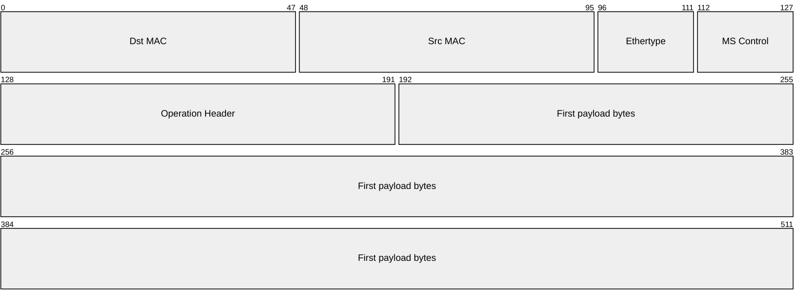
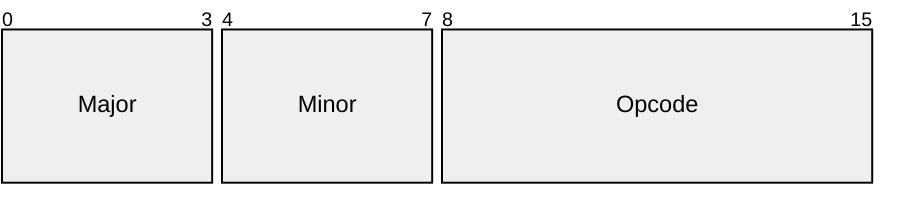
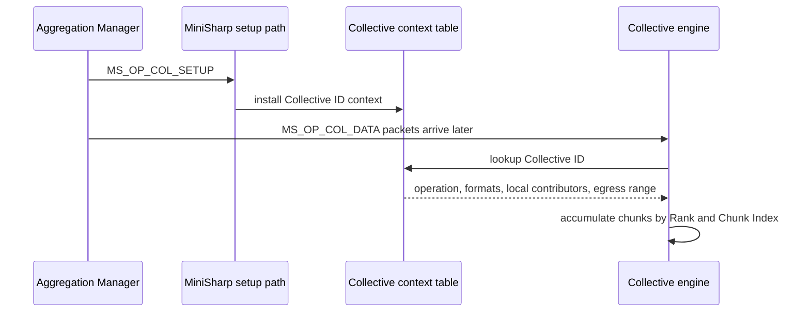
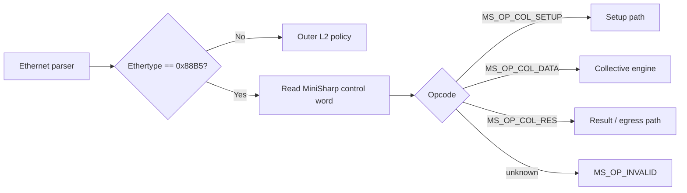
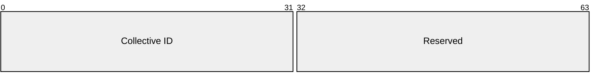
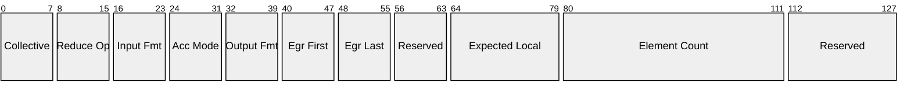
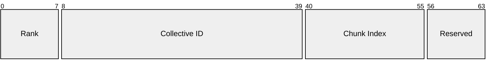
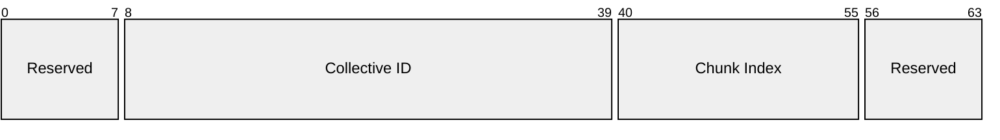

# Protocol

MiniSharp operates at **Layer 2** of the OSI model and uses a custom Ethernet-based protocol to identify packets that must be processed by the MiniSharp datapath.

The protocol supports two main data-plane modes:

1. **Transparent packet forwarding**, where non-MiniSharp Ethernet frames may be forwarded through the switch-like forwarding pipeline.
2. **Streaming collective accumulation**, where MiniSharp collective packets are consumed by the collective engine and used to update an in-network reduction context.

MiniSharp is currently a research-oriented FPGA datapath, not a production Ethernet switch. The protocol therefore prioritizes simplicity, inspectability, hardware feasibility, and cycle-level RTL clarity over full production-grade management, security, and interoperability.

!!! abstract "Protocol goal"

    The MiniSharp protocol should make packets easy to classify early in the pipeline.
    The first packet beat should contain enough information for the parser to decide
    whether the packet must be forwarded, dropped, routed to the setup path, or consumed
    by the collective engine.

---

## Common frame format

MiniSharp frames are carried inside Ethernet frames. The Ethernet header provides Layer-2 addressing, while the MiniSharp header identifies the protocol version, packet class, operation-specific metadata, and payload.

The full first-beat diagram intentionally groups small fields to avoid unreadable packet diagrams.



| Field | Size | Meaning |
|---|---:|---|
| `Dst MAC` | 48b | Ethernet destination MAC |
| `Src MAC` | 48b | Ethernet source MAC |
| `Ethertype` | 16b | `0x88B5` for MiniSharp experimental frames |
| `MS Control` | 16b | `Version Major`, `Version Minor`, and `Opcode` |
| `Operation Header` | 64b | Opcode-specific fixed header |
| `First payload bytes` | 320b | First payload fragment in the first 512-bit AXI-Stream beat |

The MiniSharp control word is defined as:



| Control field | Size | Meaning |
|---|---:|---|
| `Version Major` | 4b | Incompatible protocol-format revision |
| `Version Minor` | 4b | Compatible extension or minor revision |
| `Opcode` | 8b | MiniSharp packet class |

The initial experimental protocol version is:

\[
\mathrm{VersionMajor}=0,\qquad \mathrm{VersionMinor}=1.
\]

Unsupported major versions are invalid. If the major version is supported but the minor version is newer than the local implementation, MiniSharp may process only the subset of fields defined by its supported minor version. Newer minor-version features are not guaranteed unless explicitly implemented. Reserved fields must be transmitted as zero.

---

## MiniSharp EtherType and forwarding policy

MiniSharp uses a custom EtherType to identify frames belonging to the MiniSharp protocol family. In the current experimental design, `0x88B5` is used as the MiniSharp EtherType. This value belongs to the local experimental EtherType range and is suitable for laboratory and research use, but it is not a production protocol assignment.[^ethertype]

Frame classification happens in two stages:

1. The Ethernet parser reads `Dst MAC`, `Src MAC`, and `Ethertype`.
2. If `Ethertype == 0x88B5`, the MiniSharp parser interprets the MiniSharp control word, opcode, operation header, and payload.
3. If `Ethertype != 0x88B5`, the frame is treated as a non-MiniSharp Ethernet frame.

MiniSharp may be configured with one of two outer forwarding policies:

| Policy | Behavior |
|---|---|
| `MSP_TRANSPARENT` | Non-MiniSharp frames are forwarded through the normal L2 forwarding datapath. |
| `MSP_STRICT` | Non-MiniSharp frames are dropped or redirected to a debug/control path. |

The default prototype policy is expected to be `MSP_TRANSPARENT`, because MiniSharp is intended to behave as a switch-like datapath during hardware bring-up and should not unnecessarily discard ordinary Ethernet traffic.

!!! note "Important distinction"

    A non-MiniSharp Ethernet frame does not contain a MiniSharp opcode. It may be forwarded
    only because of the outer Ethernet classification policy. There is no `MS_OP_FORWARD`
    opcode in the current MiniSharp protocol.

---

## Chunking model

MiniSharp collective vectors are split into **chunks**. A chunk is represented by one Ethernet/MiniSharp packet and may span multiple AXI-Stream beats.

MiniSharp does not carry a payload-length field in the common header. The Aggregation Manager configures the collective context, including vector size, input format, accumulator mode, output format, number of expected local contributors, and result egress range.

For the standard non-jumbo Ethernet case:

\[
\mathrm{EthernetPayloadMax}=1500\ \mathrm{bytes}
\]

\[
\mathrm{MiniSharpHeaderBytes}
=
1_{\mathrm{version}}
+
1_{\mathrm{opcode}}
+
8_{\mathrm{operation\ header}}
=
10\ \mathrm{bytes}
\]

\[
\mathrm{MS\_CHUNK\_PAYLOAD\_BYTES}
=
1500 - 10
=
1490\ \mathrm{bytes}
\]

Therefore, the default MiniSharp chunk payload size for standard Ethernet frames is:

\[
\boxed{\mathrm{MS\_CHUNK\_PAYLOAD\_BYTES}=1490}
\]

Jumbo-frame support is intentionally left outside the v0.1 protocol baseline and depends on the network and device configuration.[^ethernet-frame]

!!! note "AXI-Stream first beat"

    On the 512-bit AXI-Stream datapath, the first beat contains the Ethernet header,
    MiniSharp control fields, the operation header, and the first 40 bytes of vector
    payload. Continuation beats carry payload bytes only. `TLAST` marks the end of the
    current packet, and `TKEEP` identifies valid bytes in the final beat.

The switch computes the expected number of chunks from the context installed by the AM:

\[
\mathrm{vector\_bytes}
=
\mathrm{element\_count}
\cdot
\mathrm{bytes\_per\_element}(\mathrm{input\_format})
\]

\[
\mathrm{expected\_chunks}
=
\left\lceil
\frac{\mathrm{vector\_bytes}}
{\mathrm{MS\_CHUNK\_PAYLOAD\_BYTES}}
\right\rceil
\]

For each chunk:

\[
\mathrm{ChunkIndex}\in[0,\ \mathrm{expected\_chunks}-1].
\]

The last chunk may be shorter than `MS_CHUNK_PAYLOAD_BYTES`; its valid bytes are determined by the configured vector size and by the packet ending signaled through `TLAST/TKEEP`.

Chunks may arrive out of order if the collective engine uses `Chunk Index` as the placement key.

For collective data, the logical identity of a contribution is:

\[
(\mathrm{CollectiveID},\ \mathrm{RankID},\ \mathrm{ChunkIndex})
\]

Each chunk is completed independently. A chunk result may be emitted as soon as the switch has received all expected local contributors for that chunk; it does not need to wait for other chunks of the same vector.

---

## Data-plane packet classes

MiniSharp packets are classified by the parser. If the Ethernet frame carries the MiniSharp EtherType, the `Opcode` field determines how the operation header and payload are interpreted.

| Value | Packet class | Purpose |
|---:|---|---|
| `0x00` | `MS_OP_INVALID` | Internal parser decision for unsupported, malformed, or intentionally discarded packets |
| `0x01` | `MS_OP_COL_SETUP` | Aggregation Manager installs a collective context |
| `0x02` | `MS_OP_COL_DATA` | Packet payload is consumed by the collective engine |
| `0x03` | `MS_OP_COL_RES` | Packet generated by MiniSharp after a collective chunk completes |

`MS_OP_INVALID` is not a normal transmitted packet format. It represents an internal classification outcome. The all-zero opcode is intentionally invalid so that reset/default state does not accidentally encode a valid MiniSharp operation.

The opcode values are part of the MiniSharp v0.1 ABI and should be defined in the RTL package, testbench, and host-side packet generator.

---

## In-band setup

MiniSharp uses an **in-band setup model** for the initial FPGA prototype and calls the control entity that installs collective contexts the **Aggregation Manager** (**AM**). The name is intentionally aligned with SHARP-style terminology: the AM is the entity that prepares aggregation state before collective data packets arrive. In MiniSharp v0.1, the AM is not a full production control plane; it is the trusted software, testbench, or host-side component that sends `MS_OP_COL_SETUP` packets to configure the switch-local collective context.



This choice is intentional. For an FPGA prototype connected through an OpenNIC-like environment, in-band setup is a practical way to configure the switch without requiring a separate management CPU, PCIe BAR interface, AXI-Lite register map, or external control-plane stack.

!!! note "Why in-band setup?"

    In-band setup keeps the first MiniSharp prototype simple and testable.
    A host can generate setup frames, send them to the FPGA, and observe how
    the RTL updates internal MiniSharp state. This is useful for simulation,
    hardware bring-up, and early experiments.

!!! warning "Security scope"

    In-band setup is not production-secure by itself. A real deployment would need
    filtering, authentication, authorization, or a trusted management channel.
    MiniSharp currently treats in-band setup as a research and prototyping mechanism,
    not as a secure production management protocol.

The logical AM interface is independent from the physical transport used to deliver setup commands. Future implementations may map the same operations to a sideband interface such as AXI-Lite, PCIe BAR registers, firmware, or a software control-plane API.

---

## Operation headers

The common MiniSharp header contains a fixed 64-bit operation header. Its interpretation depends on the opcode.



Reserved fields must be transmitted as zero and ignored by receivers in v0.1.

---

### MS_OP_COL_SETUP

`MS_OP_COL_SETUP` is sent by the Aggregation Manager to install or replace a switch-local collective context.

This packet is consumed by the setup path and must not be inserted into the normal forwarding VOQ datapath.



| Field | Size | Purpose |
|---|---:|---|
| `Collective ID` | 32b | Switch-local collective context identifier |
| `Reserved` | 32b | Must be zero in v0.1 |

The setup payload carries the collective context record. MiniSharp currently uses in-band setup packets as the practical control-plane mechanism for the FPGA prototype.

!!! note "Why `MS_OP_COL_SETUP` instead of generic configuration?"

    The current protocol has only one configuration operation: installing or replacing
    collective state before data packets arrive. `MS_OP_COL_SETUP` is therefore more
    precise than a generic configuration write opcode. Generic configuration read/write
    messages can be added later if the project grows a broader management plane.

The v0.1 setup record is fixed-size and begins at the payload of `MS_OP_COL_SETUP`.



| Field | Size | Purpose |
|---|---:|---|
| `collective_semantic` | 8b | v0.1 supports only `MS_COL_REDUCE` |
| `reduction_operator` | 8b | v0.1 supports only `MS_RED_SUM` |
| `input_format` | 8b | Wire format of incoming elements |
| `accumulator_mode` | 8b | Internal accumulation strategy |
| `output_format` | 8b | Wire format of result elements |
| `egress_port_first` | 8b | First local output port used for result emission |
| `egress_port_last` | 8b | Last local output port used for result emission |
| `reserved0` | 8b | Must be zero |
| `expected_local_contributors` | 16b | Number of unique local contributors expected for each chunk |
| `element_count` | 32b | Number of logical vector elements |
| `reserved1` | 16b | Must be zero |

`expected_local_contributors` is local to this switch and this `Collective ID`. It is not the number of global ranks in the whole job. In a spine-leaf topology, each aggregation node waits only for the contributors directly assigned to that node by the AM.

The result of a completed chunk is emitted to every local output port \(O\) such that:

\[
\mathrm{egress\_port\_first}
\le
O
\le
\mathrm{egress\_port\_last}.
\]

Examples:

| Range | Meaning |
|---|---|
| `1..1` | Send the result only to output port 1 |
| `0..1` | Send the result to output ports 0 and 1 |
| `0..NUM_PORTS-1` | Send the result to all local output ports |

This range-based model is simple and FPGA-friendly. Non-contiguous output sets are out of scope for v0.1 and may be added later through a bitmap or table-based destination model.

The setup packet does not carry a result destination MAC address. The AM configures each switch in the topology with the local egress range for the given `Collective ID`. The packet builder is responsible for generating valid Ethernet headers for emitted `MS_OP_COL_RES` frames according to local topology or testbench configuration.

A setup packet is invalid if:

- `expected_local_contributors == 0`;
- `element_count == 0`;
- `egress_port_first > egress_port_last`;
- `egress_port_last >= NUM_PORTS`;
- `collective_semantic` is unsupported;
- `reduction_operator` is unsupported;
- `input_format`, `accumulator_mode`, or `output_format` is unsupported;
- reserved fields are non-zero.

MiniSharp trusts setup writes to succeed in the current prototype. It does not define setup acknowledgments, setup responses, or status packets.

---

### MS_OP_COL_DATA

`MS_OP_COL_DATA` carries a rank contribution for one vector chunk. The packet is consumed by the collective engine and is not forwarded directly through the normal VOQ datapath.



| Field | Size | Purpose |
|---|---:|---|
| `Rank` | 8b | Local contributor identifier for this switch/context |
| `Collective ID` | 32b | Switch-local collective context identifier |
| `Chunk Index` | 16b | Zero-based chunk index within the configured vector |
| `Reserved` | 8b | Must be zero in v0.1 |

`Rank` is interpreted as a local contributor identifier within the collective context installed on this switch. It does not need to be the global MPI rank or the global process identifier.

`Chunk Index` identifies the vector region carried by this packet. It replaces the older `Sequence` name because its semantic role is placement within the configured vector, not generic packet sequencing.

The AM configures vector length, input format, accumulator mode, output format, and expected local contributors for the given `Collective ID`. Therefore, `MS_OP_COL_DATA` does not carry a payload-length field.

For each chunk, the collective engine waits until it has received `expected_local_contributors` unique local rank contributions. Once the chunk is complete, it can generate `MS_OP_COL_RES` for that chunk without waiting for other chunks of the same vector.

---

### MS_OP_COL_RES

`MS_OP_COL_RES` is generated by MiniSharp when the collective engine has produced a result chunk and the configured egress range requires result emission.



| Field | Size | Purpose |
|---|---:|---|
| `Reserved` | 8b | Must be zero in v0.1 |
| `Collective ID` | 32b | Switch-local collective context identifier |
| `Chunk Index` | 16b | Result chunk index |
| `Reserved` | 8b | Must be zero in v0.1 |

The result payload format is determined by the context configured by `MS_OP_COL_SETUP`. The output format may differ from both the input format and the internal accumulator mode.

Example:

```text
input_format     = MS_FMT_FP32
accumulator_mode = MS_ACC_EXACT_FP32_MAG277
output_format    = MS_FMT_FP32
```

This means that input elements are received as `MS_FMT_FP32`, accumulated internally using an exact FP32 scalar-sum accumulator family, and emitted as `MS_FMT_FP32`.

---

### MS_OP_INVALID

`MS_OP_INVALID` represents an internal parser or setup-path decision. It is used when a packet cannot be processed safely.

Examples include:

- unsupported MiniSharp major version;
- unknown opcode;
- malformed header;
- invalid setup payload;
- unknown `Collective ID`;
- unsupported wire format;
- unsupported accumulator mode;
- duplicate contribution for the same `(Collective ID, Rank ID, Chunk Index)`;
- payload inconsistent with the configured collective context.

The current prototype drops invalid packets or streams and increments internal simulation-visible error counters. It does not generate error packets.

---

## Collective semantic

The collective semantic describes the communication-level behavior.

| Value | Semantic | Meaning |
|---:|---|---|
| `0x00` | `MS_COL_INVALID` | Invalid or unsupported collective semantic |
| `0x01` | `MS_COL_REDUCE` | Multiple local contributors produce one or more result chunks |

Only `MS_COL_REDUCE` is in scope for the first MiniSharp thesis prototype.

Other collective semantics, such as allreduce, broadcast, and reduce-scatter, are future work. In particular, reduce-scatter requires a mapping from result chunks to different destinations and is intentionally left outside the v0.1 protocol.

---

## Reduction operator

The reduction operator describes the mathematical operation applied to elements.

| Value | Operator | Meaning |
|---:|---|---|
| `0x00` | `MS_RED_INVALID` | Invalid or unsupported reduction operator |
| `0x01` | `MS_RED_SUM` | Addition |

Only `MS_RED_SUM` is in scope for the first MiniSharp thesis prototype.

---

## Wire formats and accumulator modes

MiniSharp distinguishes **wire formats** from **accumulator modes**.

A wire format describes how elements are encoded in `MS_OP_COL_DATA` and `MS_OP_COL_RES` payloads.

| Value | Wire format | Meaning |
|---:|---|---|
| `0x00` | `MS_FMT_INVALID` | Invalid or unsupported wire format |
| `0x01` | `MS_FMT_INT8` | 8-bit integer payload elements |
| `0x02` | `MS_FMT_FP16` | IEEE binary16 payload elements |
| `0x03` | `MS_FMT_BF16` | bfloat16 payload elements |
| `0x04` | `MS_FMT_FP32` | IEEE binary32 payload elements |

An accumulator mode describes how the collective engine internally combines contributions.

| Value | Accumulator mode | Meaning |
|---:|---|---|
| `0x00` | `MS_ACC_INVALID` | Invalid or unsupported accumulator mode |
| `0x01` | `MS_ACC_NATIVE` | Accumulate using the native arithmetic associated with the input format |
| `0x02` | `MS_ACC_FP32` | Accumulate using FP32 arithmetic |
| `0x03` | `MS_ACC_DETERMINISTIC_FP32` | Wait for contributions and reduce in deterministic logical order |
| `0x04` | `MS_ACC_EXACT_FP16_MAG40` | Exact scalar-sum accumulator family for FP16 inputs |
| `0x05` | `MS_ACC_EXACT_BF16_MAG261` | Exact scalar-sum accumulator family for BF16 inputs |
| `0x06` | `MS_ACC_EXACT_FP32_MAG277` | Exact scalar-sum accumulator family for FP32 inputs |

!!! note "Why `MAG40`, `MAG261`, and `MAG277`?"

    These names refer to the exact scalar-sum magnitude range before rank-count carry
    headroom and sign are added. They are not dot-product accumulator sizes. The final
    signed storage width still depends on the maximum number of contributing ranks.

For exact finite scalar summation with \(R\) contributing ranks:

\[
W_{\mathrm{signed}}
=
W_{\mathrm{mag}}
+
\lceil \log_2 R \rceil
+
1
\]

This follows the scalar-reduction sizing model, not the wider dot-product Kulisch bound.[^superaccumulator-sizing]

For the detailed derivation, see [1.2 Reproducibility](../1-introduction/reproducibility.md#accumulator-sizing-for-scalar-reductions).

!!! note "Input, accumulator, and output roles"

    `input_format`, `accumulator_mode`, and `output_format` are intentionally separate.
    MiniSharp may receive data in one representation, accumulate it using a reproducible
    internal strategy, and emit results in a format selected by the Aggregation Manager.

---

## Out-of-order chunks

MiniSharp allows collective chunks to arrive out of order if the collective engine uses `Chunk Index` as the placement key.

For each contribution, the collective engine identifies:

\[
(\mathrm{CollectiveID},\ \mathrm{RankID},\ \mathrm{ChunkIndex})
\]

The `Chunk Index` determines the vector region updated by the packet payload. This allows the communication layer or packet generator to split a large vector into Ethernet-sized chunks and transmit them in an order independent of the final vector order.

Each chunk is treated as an independently completable reduction unit. A chunk result can be emitted once the switch has received all expected local contributors for that chunk.

Duplicate contributions for the same `(Collective ID, Rank ID, Chunk Index)` are ignored or dropped.

!!! note "Local contribution tracking"

    MiniSharp tracks contributors locally at each aggregation node. For each
    `(Collective ID, Chunk Index)`, the switch waits for `expected_local_contributors`
    unique `Rank` values. This state is proportional to the local fan-in of the switch,
    not to the total number of ranks in the global job.

    A simple implementation can store the seen `Rank` values in a small per-chunk table.
    If an incoming contribution has a `Rank` already present in the table, the contribution
    is treated as a duplicate and ignored.

---

## Reserved and invalid behavior

Reserved fields must be transmitted as zero and ignored by receivers in v0.1.

A packet is invalid if it uses unsupported major versions, unknown opcodes, unsupported setup values, non-zero reserved fields where zero is required, or context identifiers that are not installed.

MiniSharp v0.1 does not generate error packets. Invalid packets are dropped or ignored, and the implementation may increment simulation-visible or debug-visible error counters.


[^ethertype]: RFC 9542 documents `0x88B5` and `0x88B6` as local experimental EtherTypes. These values are suitable for local experimentation but should not be treated as production protocol assignments.

[^ethernet-frame]: Standard Ethernet payload is 1500 bytes for non-jumbo frames. The Ethernet header is 14 bytes and the FCS is 4 bytes; preamble, SFD, and interpacket gap are physical-layer overhead and are normally not part of the AXI-Stream payload seen by MiniSharp.

[^mpi-collectives]: The MPI standard defines collective communication operations involving process groups, including reductions and related collective patterns. MiniSharp borrows the terminology of collective communication but does not attempt to implement a complete MPI transport.

[^superaccumulator-sizing]: The sizing rule follows the MiniSharp scalar-reduction model. It is intentionally different from the wider dot-product Kulisch bound because MiniSharp collective reductions sum already-formed numeric values rather than products.
