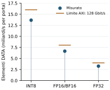
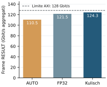
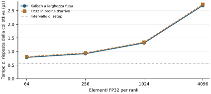
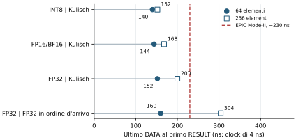

# 4.1 Prestazioni

Il datapath SINGLE è valutato in simulazione RTL con periodo di 4 ns.
Throughput e tempo di risposta AllReduce usano due rank su porte separate;
la latenza dell'ultimo contributo usa otto rank su una porta full-duplex.

## Throughput DATA

Con 4096 elementi per rank e accumulo Kulisch, INT8 raggiunge **13,65 miliardi
di elementi/s per porta**, rispetto ai **3,26 miliardi** di FP32. A velocità
simili in bit numerici, il numero di elementi cambia perché ogni beat contiene
più valori nei formati più stretti.

<figure id="fig-data-throughput" class="results-figure" markdown="span">

{ loading=lazy }

<figcaption>Due rank su porte separate, 4096 elementi per rank. I segmenti brevi
indicano il limite AXI ideale di 128 Gbit/s, convertito in elementi/s per ogni
larghezza di ingresso. Il throughput dei valori DATA esclude gli header.</figcaption>
</figure>

## Throughput RESULT

Con gli stessi ingressi FP32, il throughput aggregato dei frame raggiunge
**110,5 Gbit/s con AUTO**, 121,5 Gbit/s con uscita FP32 e 124,3 Gbit/s con uscita
Kulisch. La composizione dei pacchetti e la selezione del formato contribuiscono
alla differenza. Per valutare il traffico necessario a una collettiva occorre
anche considerare i byte totali, confrontati nella pagina [Traffico](traffic.md).

<figure id="fig-result-throughput" class="results-figure" markdown="span">

{ loading=lazy }

<figcaption>Due rank, 4096 elementi FP32 per rank, accumulo Kulisch. Il throughput
conteggia tutti i byte dei frame RESULT durante l'uscita, aggregati sulle due
porte. La linea di riferimento indica il limite AXI ideale usato nella tesi.</figcaption>
</figure>

## Tempo di risposta AllReduce

Il tempo di risposta include la configurazione e va dalla prima trasmissione
STAGE all'ultimo beat RESULT accettato dall'ultima destinazione. La configurazione
richiede 141 cicli. Con Kulisch il tempo totale passa da 196 cicli per 64 elementi
a 673 per 4096; FP32_ARRIVAL richiede rispettivamente 203 e 683 cicli. Per 4096
elementi corrispondono a **2,69 µs e 2,73 µs**, con il periodo assunto di 4 ns.

<figure id="fig-collective-response" class="results-figure" markdown="span">

{ loading=lazy }

<figcaption>Due rank FP32, uscita AUTO. L'asse orizzontale riporta le quattro
lunghezze misurate—64, 256, 1024 e 4096—con spaziatura logaritmica.</figcaption>
</figure>

## Latenza dell'ultimo contributo

In questo caso i primi sette contributi sono già presenti. L'intervallo misurato
parte dall'ultimo beat DATA accettato dell'ottavo contributo e termina al primo
beat RESULT accettato in uscita.

Con ingressi FP32, Kulisch richiede **152 ns per 64 elementi** e **200 ns per
256**; FP32_ARRIVAL richiede 160 ns e 304 ns. L'accumulo Kulisch emette valori
Kulisch, mentre l'accumulo FP32 emette valori FP32. Ripetendo il precaricamento
con 128 e 256 cicli di attesa si ottengono le stesse latenze.

<figure id="fig-final-contribution" class="results-figure" markdown="span">

{ loading=lazy }

<figcaption>Otto rank su una porta full-duplex; periodo simulato di 4 ns.
Il riferimento EPIC Mode-II in rosso è di circa 230 ns. La fonte non specifica
la lunghezza del vettore né il beat iniziale della misura.</figcaption>
</figure>

Lo [studio FPGA di EPIC](https://arxiv.org/html/2605.18683v2#appendix.K) riporta
quel riferimento per otto rank FP32 su Agilex. I dettagli mancanti e la diversa
piattaforma permettono soltanto un confronto di contesto.

??? info "Sorgenti delle misure"

    Le figure sono copiate dagli asset di valutazione della tesi. Il throughput
    usa le misure Kulisch in
    `experiments/02-experiment-numbergroup-single/results/evaluation-cycle-exact.csv`.
    Le figure di risposta e latenza usano le misure sul percorso in ordine
    d'arrivo sotto `build/experiments/fp32-arrival-online/`; le sorgenti della
    latenza sono registrate nell'asset della tesi
    `final_contribution_latency_8rank_sources.json`.

Le prestazioni sulla scheda e le collettive più lunghe o multi-switch richiedono
[ulteriori misure](../5-future-works/hardware.md).
