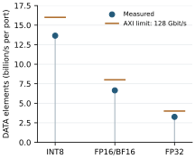
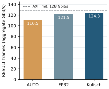
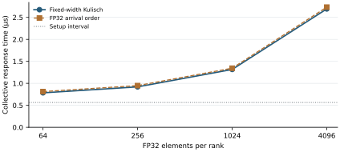
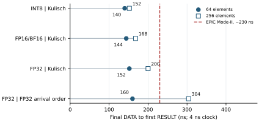

# 4.1 Performance

The SINGLE datapath is evaluated in RTL simulation with a 4 ns period.
Throughput and AllReduce response use two ranks on separate ports;
final-contribution latency uses eight ranks on one full-duplex port.

## DATA throughput

With 4096 elements per rank and Kulisch accumulation, INT8 reaches **13.65
billion elements/s per port**, compared with **3.26 billion** for FP32. The
element rates reflect the number of values packed into each beat at similar
numeric bit rates.

<figure id="fig-data-throughput" class="results-figure" markdown="span">

{ loading=lazy }

<figcaption>Two ranks, separate ports, 4096 elements per rank. Short marks show
the ideal 128 Gbit/s AXI rate converted to elements/s for each input width.
Frame headers are excluded from the DATA value rate.</figcaption>
</figure>

## RESULT throughput

For the same FP32 inputs, the aggregate frame rate reaches **110.5 Gbit/s with
AUTO**, 121.5 Gbit/s with FP32 output, and 124.3 Gbit/s with Kulisch output.
Packetization and format selection contribute to the difference. A higher
frame-byte rate does not by itself imply less traffic for a collective: that
comparison is made on the [traffic page](traffic.md).

<figure id="fig-result-throughput" class="results-figure" markdown="span">

{ loading=lazy }

<figcaption>Two ranks, 4096 FP32 elements per rank, Kulisch accumulation.
Throughput counts all RESULT-frame bytes over the output window and aggregates
the two ports. The reference line is the ideal AXI limit used in the thesis.</figcaption>
</figure>

## AllReduce response

Response time includes setup and runs from the first STAGE transmission to the
last RESULT beat accepted by the last destination. Setup stays at 141 cycles.
With Kulisch, total time grows from 196 cycles at 64 elements to 673 at 4096;
FP32_ARRIVAL takes 203 and 683 cycles. At 4096 elements, these correspond to
**2.69 µs and 2.73 µs** at the assumed 4 ns period.

<figure id="fig-collective-response" class="results-figure" markdown="span">

{ loading=lazy }

<figcaption>Two FP32 ranks, AUTO output. The horizontal axis contains the four
measured lengths—64, 256, 1024, and 4096—with logarithmic spacing.</figcaption>
</figure>

## Final-contribution latency

Here the first seven contributions are already present. The measured interval
starts at the last accepted DATA beat of the eighth contribution and ends at
the first accepted outgoing RESULT beat.

For FP32 inputs, Kulisch takes **152 ns at 64 elements** and **200 ns at 256**;
FP32_ARRIVAL takes 160 ns and 304 ns. Kulisch accumulation emits Kulisch values,
while FP32 accumulation emits FP32 values. Repeating the preload with 128 and
256 idle cycles gives the same measured latencies.

<figure id="fig-final-contribution" class="results-figure" markdown="span">

{ loading=lazy }

<figcaption>Eight ranks sharing one full-duplex port; simulated 4 ns period.
The red EPIC Mode-II reference is approximately 230 ns. Its source does not
specify the vector length or the starting beat of the measurement.</figcaption>
</figure>

[EPIC's FPGA study](https://arxiv.org/html/2605.18683v2#appendix.K) reports that
reference for eight FP32 ranks on Agilex. The missing measurement details and
different platform limit it to contextual comparison.

??? info "Evidence sources"

    The figures are copied from the thesis evaluation assets. Throughput uses
    the Kulisch runs in
    `experiments/02-experiment-numbergroup-single/results/evaluation-cycle-exact.csv`.
    Response and final-contribution figures use the online-arrival runs under
    `build/experiments/fp32-arrival-online/`, with the latency source record in
    the thesis asset `final_contribution_latency_8rank_sources.json`.

On-board performance and longer or multi-switch collectives require
[further measurements](../5-future-works/hardware.md).
