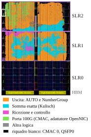
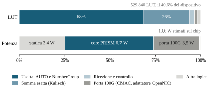

# 4.3 Implementazione

I dati provengono dall'implementazione **post-route con Vivado 2022.1** della
build per la scheda U280 (`make u280`, RS-FEC attivo): il core SINGLE con
**una porta e quattro banchi Kulisch a 280 bit**, senza il percorso FP32 di
arrivo, dietro il sottosistema CMAC e il packet adapter della shell OpenNIC
(vedi [`prism_u280_top`](../3-architecture/4-modules/components/prism_u280_top.md)).

## Timing

Ogni percorso rispetta il periodo di 4 ns del clock a 250 MHz: margine di setup
peggiore **+0,005 ns**, margine di hold peggiore 0,000 ns e nessun endpoint in
violazione su 1,23 milioni. La build con RS-FEC disattivo chiude con
+0,010 ns. Entrambi i bitstream sono allegati alla release v1.0.0.

## Placement

La U280 è formata da tre die, detti *super logic region* (SLR). Il progetto
occupa SLR1 e SLR2; SLR0, accanto alla HBM, resta vuota. Il percorso di uscita,
che classifica i risultati, forma i gruppi AUTO e scrive i frame RESULT, copre
la maggior parte dei due die. I segnali tra SLR1 e SLR2 usano 13.984 dei 23.040
collegamenti disponibili su quel confine (61%).

<figure id="fig-u280-placement" class="results-figure" markdown="span">

{ loading=lazy }

<figcaption>Checkpoint instradato della v1.0.0 nella vista del dispositivo di
Vivado. SLR2 è in alto; il CMAC pilota la QSFP0 dal bordo sinistro di SLR2;
SLR0 non è usata.</figcaption>
</figure>

## Occupazione

| Risorsa | Build della scheda | Core | Dispositivo | SLR1 | SLR2 |
| --- | ---: | ---: | ---: | ---: | ---: |
| CLB LUT | 529.840 | 519.855 | **40,64%** | 62,95% | 59,70% |
| Registri CLB | 542.583 | 508.849 | 20,81% | 38,78% | 24,02% |
| Tile BRAM | 281 | 263,5 | 13,94% | 38,10% | 3,72% |
| DSP | 2 | 2 | 0,02% | 0,07% | 0,00% |

Il percorso di uscita usa il 68% delle LUT, l'aritmetica esatta (banchi e
arrotondamento finale) il 26%, ricezione e controllo il 3%, e il sottosistema
CMAC con il packet adapter circa 10.000 LUT, cioè il 2%.

## Potenza

La stima vectorless di Vivado della potenza on-chip è **13,6 W**: 10,2 W
dinamici e 3,4 W statici, con la giunzione a 30,9 °C. Il core vale 6,7 W e la
porta 100G 3,5 W, di cui 2,3 W per i suoi quattro transceiver da 25 Gbit/s. La
sola distribuzione del clock costa 3,8 W, più della logica CLB (0,9 W).

<figure id="fig-u280-budget" class="results-figure" markdown="span">

{ loading=lazy }

<figcaption>Quote di LUT per blocco della build della scheda e stima
vectorless della potenza di Vivado a 25 °C ambiente.</figcaption>
</figure>

## Ambito e limiti

- I dati riguardano la build della scheda; le
  [simulazioni di prestazioni a due porte](performance.md) usano una
  configurazione diversa, e la
  [velocità di linea di questo profilo](performance.md#velocita-di-linea-del-profilo-u280)
  è misurata a parte. Anche la larghezza di 280 bit dei banchi aritmetici
  differisce dalla rappresentazione Kulisch serializzata a 320 bit usata nel
  [confronto del traffico](traffic.md).
- Il timing chiude con poco margine: una piccola modifica del progetto o del
  flusso può lasciare una build completa sotto il vincolo (vedi
  [Alveo U280](../2-getting-started/u280.md)).
- Due porte superano gli stessi test di velocità in simulazione, ma
  richiedono 687.220 LUT dopo la sintesi e la loro lettura dei risultati
  attraversa i confini tra SLR più spesso di quanto i 23.040 collegamenti
  consentano. La lettura va modificata prima di poter piazzare due porte.
- Manca ancora un confronto d'area con un profilo FP32 equivalente.
- La tesi depositata riporta una revisione precedente del core standalone,
  con 682.704 LUT (52,37%).

Throughput, tempo di risposta e potenza sulla scheda rientrano negli
[sviluppi hardware](../5-future-works/hardware.md).

??? info "Provenienza del report"

    `post_route_physopt/utilization.rpt`, `utilization_hierarchical.rpt` e
    `timing_summary.rpt` nella cartella di uscita della build che ha prodotto il
    bitstream pubblicato con RS-FEC attivo, del 15 ottobre 2026; potenza da
    `report_power` sul suo checkpoint instradato. Valori, screenshot di Vivado e
    script dei grafici sono in `experiments/05-experiment-u280-release/`.

    SHA-256 di `utilization.rpt`:
    `0071bef0b4fd6ee179a55f3f5ba67ec26861b72179dfd45d1b7e7d37eeadf066`.
