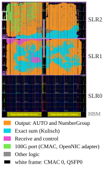
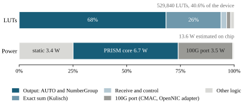

# 4.3 Implementation

The figures come from the **Vivado 2022.1 post-route** implementation of the
U280 board build (`make u280`, RS-FEC on): the SINGLE core with **one port and
four 280-bit Kulisch banks**, without the FP32 arrival path, behind the CMAC
subsystem and packet adapter of the OpenNIC shell
(see [`prism_u280_top`](../3-architecture/4-modules/components/prism_u280_top.md)).

## Timing

Every path meets the 4 ns period of the 250 MHz clock: worst setup slack
**+0.005 ns**, worst hold slack 0.000 ns, and no failing endpoint among 1.23
million. The RS-FEC-off build closes with +0.010 ns. Both bitstreams are
attached to the v1.0.0 release.

## Placement

The U280 is built from three dies, or super logic regions (SLRs). The design
fills SLR1 and SLR2; SLR0, next to the HBM, stays empty. The output path, which
classifies results, forms the AUTO groups, and writes RESULT frames, covers
most of both dies. Signals between SLR1 and SLR2 use 13,984 of the 23,040
links across that boundary (61%).

<figure id="fig-u280-placement" class="results-figure" markdown="span">

{ loading=lazy }

<figcaption>Routed v1.0.0 checkpoint in the Vivado device view. SLR2 is at the
top; the CMAC drives QSFP0 from the left edge of SLR2; SLR0 is unused.</figcaption>
</figure>

## Utilization

| Resource | Board build | Core | Device | SLR1 | SLR2 |
| --- | ---: | ---: | ---: | ---: | ---: |
| CLB LUTs | 529,840 | 519,855 | **40.64%** | 62.95% | 59.70% |
| CLB registers | 542,583 | 508,849 | 20.81% | 38.78% | 24.02% |
| BRAM tiles | 281 | 263.5 | 13.94% | 38.10% | 3.72% |
| DSPs | 2 | 2 | 0.02% | 0.07% | 0.00% |

The output path uses 68% of the LUTs, the exact arithmetic (banks and final
rounding) 26%, reception and control 3%, and the CMAC subsystem with the packet
adapter about 10,000 LUTs, or 2%.

## Power

Vivado's vectorless estimate of on-chip power is **13.6 W**: 10.2 W dynamic and
3.4 W static, at a junction temperature of 30.9 °C. The core accounts for
6.7 W and the 100G port for 3.5 W, 2.3 W of which go to its four 25 Gbit/s
transceivers. Clock distribution alone costs 3.8 W, more than the CLB logic
(0.9 W).

<figure id="fig-u280-budget" class="results-figure" markdown="span">

{ loading=lazy }

<figcaption>LUT shares by block of the board build, and Vivado's vectorless
power estimate at 25 °C ambient.</figcaption>
</figure>

## Scope and limits

- These figures describe the board build; the
  [two-port performance simulations](performance.md) use a different
  configuration, and the [line rate of this profile](performance.md#line-rate-of-the-u280-profile)
  is measured separately. The 280-bit arithmetic-bank width also differs from
  the 320-bit serialized Kulisch representation used in the
  [traffic comparison](traffic.md).
- Timing closes with little margin: a small change of the design or of the
  flow can leave a full build short of it (see [Alveo U280](../2-getting-started/u280.md)).
- Two ports pass the same rate tests in simulation, but need 687,220 LUTs
  after synthesis, and their readout crosses the SLR boundaries more often
  than the 23,040 links allow. The readout has to change before two ports can
  be placed.
- An area comparison with an equivalent FP32 profile is still missing.
- The thesis as deposited reports an earlier revision of the standalone core,
  at 682,704 LUTs (52.37%).

Throughput, response time and power on the card itself are part of the
[hardware work](../5-future-works/hardware.md).

??? info "Report provenance"

    `post_route_physopt/utilization.rpt`, `utilization_hierarchical.rpt` and
    `timing_summary.rpt` in the output directory of the build that produced the
    published RS-FEC-on bitstream, dated 15 October 2026; power from
    `report_power` on its routed checkpoint. The numbers, the Vivado
    screenshot and the plotting script are in `experiments/05-experiment-u280-release/`.

    Report SHA-256 (`utilization.rpt`):
    `0071bef0b4fd6ee179a55f3f5ba67ec26861b72179dfd45d1b7e7d37eeadf066`.
