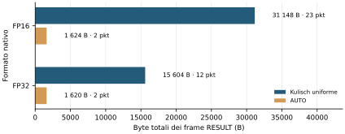
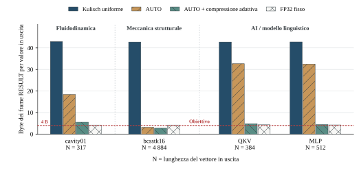

# 4.2 Traffico

L'accumulo esatto può richiedere un risultato più ampio del formato di ingresso.
AUTO raggruppa valori consecutivi scegliendo il formato supportato più stretto
che conserva ogni somma esatta. La valutazione misura prima questa selezione,
già implementata, poi stima il beneficio aggiuntivo della compressione dei gruppi
Kulisch rimanenti.

## Uscita AUTO nativa

Due casi Reduce riempiono un pacchetto DATA per rank con MTU di 1500 byte: 726
elementi FP16 oppure 363 FP32. Un risultato richiede Kulisch; tutti gli altri
mantengono un formato nativo. Il confronto usa un'uscita uniforme in cui ogni
risultato è rappresentato in Kulisch a 320 bit.

AUTO risparmia **29.524 byte dei frame RESULT (94,8%)** nel caso FP16 e **13.984
byte (89,6%)** nel caso FP32. Sono casi costruiti con un solo valore che richiede
Kulisch.

<figure id="fig-native-auto" class="results-figure" markdown="span">

{ loading=lazy }

<figcaption>Un risultato richiede Kulisch. Ogni rank invia un frame DATA di 1512
byte in entrambi i casi. Il conteggio include gli header Ethernet e PRISM;
esclude FCS, preambolo e intervallo tra i frame.</figcaption>
</figure>

## Compressione dei superaccumulatori

Un valore Kulisch serializzato occupa attualmente **41 byte**: 40 per il
superaccumulatore a 320 bit e uno di stato. Molti byte dell'accumulatore possono
essere zero: lo studio software estende quindi AUTO con una scelta di codifiche
senza perdita per ogni NumberGroup. Il confronto per carico ottimizza insieme
gruppi, formati, codifiche e confini dei pacchetti per minimizzare i byte totali.
Anche i bit dei formati nativi possono essere compressi senza cambiare i valori.

Per Kulisch, il descrittore proposto mantiene `format = KULISCH` e distingue
`encoding = RAW | RANGE | INDEX | MASK` dal conteggio dei valori.

| Codifica | Dati trasmessi | Ambito dei metadati |
| --- | --- | --- |
| RAW | Accumulatore completo e stato. | Per valore. |
| RANGE | Byte con bit di segno e `rs` (*range size*, lunghezza in byte), posizione del primo byte occupato, poi tutti i byte fino all'ultimo, inclusi gli zeri interni. | Due byte di metadati per valore. |
| INDEX | Byte con bit di segno e `ps` (*positions size*, numero di posizioni non nulle), poi le relative coppie posizione-contenuto. | Un byte di metadati per valore e una posizione per byte non nullo. |
| MASK | Maschera di 40 bit delle posizioni usate da almeno un valore del gruppo, seguita dai byte in quelle posizioni per ogni valore. | Una maschera condivisa dal gruppo. |

Lo studio ricostruisce esattamente ogni valore finito. La compressione nativa
opera sulla parola originale, inclusi segno ed esponente, senza una maschera
separata per i segni. RAW rimane disponibile. L'ottimizzazione software conta
anche descrittori, padding e header dei frame.

Per esempio, quattro rank contribuiscono 1, 2⁻²⁴, 0 e 0 in ciascuna delle 726
posizioni. Gli ingressi non nulli sono FP16, ma la somma esatta cade a metà tra
due valori FP32 adiacenti. Sono attivi soltanto due byte dell'accumulatore.
La soluzione usa due gruppi MASK e riduce il traffico dai **31.048 byte in
21 frame del Kulisch uniforme a 1.676 byte in due frame**. FP32 fisso userebbe 3.024 byte,
arrotondando ogni somma a 1.

## Confronto tra carichi

Lo studio emula due prodotti matrice–vettore con
[`cavity01`](https://sparse.tamu.edu/DRIVCAV/cavity01) e
[`bcsstk16`](https://sparse.tamu.edu/HB/bcsstk16) da SuiteSparse e le proiezioni
QKV e MLP di [Pythia-14M](https://huggingface.co/EleutherAI/pythia-14m). Genera
quattro somme parziali FP32 per uscita e le riduce esattamente. Prodotti e somme
locali sono arrotondati in FP32. `cavity01` usa il vettore di ingresso ufficiale;
`bcsstk16` un vettore di uno. I vettori oltre 4096 elementi sono suddivisi in
operazioni.

Le quattro barre confrontano Kulisch uniforme, **AUTO**, **AUTO + compressione
adattiva** e FP32 fisso. AUTO sceglie formati e gruppi senza compressione;
la variante compressa ammette anche la compressione senza perdita dei valori
nativi. Entrambi i casi AUTO ottimizzano insieme gruppi e confini dei pacchetti.

<figure id="fig-workload-compression" class="results-figure" markdown="span">

{ loading=lazy }

<figcaption>Stime software. N è il numero di valori scalari del vettore di
uscita. Ogni barra riporta i byte totali dei frame RESULT divisi per N, inclusi
gli overhead. Il target rosso tratteggiato è di 4 byte di payload FP32 per
valore, esclusi gli overhead. FP32 fisso può perdere precisione.</figcaption>
</figure>

| Carico | Valori di uscita | AUTO, byte/valore | AUTO + compressione, byte/valore |
| --- | ---: | ---: | ---: |
| Fluidodinamica — cavity01 | 317 | 18,40 | 5,51 |
| Meccanica strutturale — bcsstk16 | 4.884 | 3,15 | 2,82 |
| Modello linguistico — QKV | 384 | 32,70 | 4,82 |
| Modello linguistico — MLP | 512 | 32,53 | 4,45 |

Le soluzioni compresse di QKV e MLP mantengono tutti i valori in Kulisch,
usando RANGE e MASK. La compressione dei formati nativi aggiunge un risparmio
di 24 byte in `bcsstk16`, senza ulteriori riduzioni negli altri casi.

Soltanto 39 delle 4.884 uscite di `bcsstk16` richiedono Kulisch: AUTO nativo
produce già gran parte del risparmio. Nelle due proiezioni del modello
linguistico la maggioranza delle uscite richiede Kulisch e la compressione degli
accumulatori incide di più. FP32 fisso usa rispettivamente 4,31 e 4,23 byte per
valore, perdendo l'esattezza.

Nei quattro vettori, AUTO + compressione adattiva risparmia **l'87,2–93,4%** dei byte dei
frame RESULT rispetto al Kulisch uniforme.

Sono stime software su un vettore emulato per caso. Mostrano il potenziale
risparmio di traffico per questi ingressi; comunicazione nelle applicazioni,
convergenza del training e tempo di esecuzione richiedono
[studi dedicati](../5-future-works/applications.md).

??? info "Sorgenti delle misure"

    Il traffico AUTO nativo deriva dalle misure Kulisch `one_wide` in
    `experiments/02-experiment-numbergroup-single/results/evaluation-cycle-exact.csv`.
    I totali ottimizzati di AUTO e della compressione provengono da
    `experiments/04-experiment-exact-accumulator-compression/joint_results.json`;
    i riferimenti Kulisch e FP32 fissi restano in `results.json` nella stessa cartella.
    `JOINT_OPTIMIZER.md` descrive obiettivo, codifiche e dimostrazione di ottimalità.
    Il grafico per carico è copiato senza modifiche dalla tesi.
