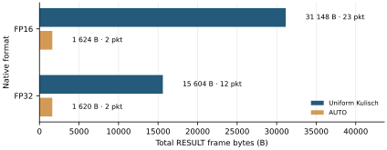
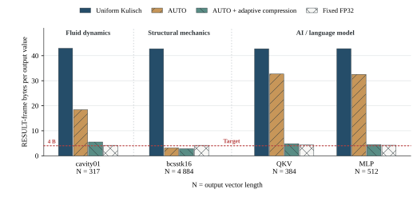

# 4.2 Traffic

Exact accumulation can require a wider result than the input format. AUTO groups
consecutive values by the narrowest supported format that preserves each exact
sum. The evaluation first measures this implemented format selection, then
estimates the additional benefit of compressing the remaining Kulisch groups.

## Native AUTO output

Two Reduce cases fill one DATA packet per rank under the 1500-byte MTU: 726 FP16
or 363 FP32 elements. One result needs Kulisch; all others keep a native format.
The baseline sends every result in uniform 320-bit Kulisch representation.

AUTO saves **29,524 RESULT-frame bytes (94.8%)** in the FP16 case and **13,984
bytes (89.6%)** in the FP32 case. These are deliberately constructed cases with
only one value requiring Kulisch.

<figure id="fig-native-auto" class="results-figure" markdown="span">

{ loading=lazy }

<figcaption>One result requires Kulisch. Each rank sends one 1512-byte DATA frame
in either case. Counts include Ethernet and PRISM headers; FCS, preamble, and
inter-frame gap are excluded.</figcaption>
</figure>

## Superaccumulator compression

A serialized Kulisch value currently occupies **41 bytes**: 40 bytes for the
320-bit superaccumulator and one status byte. Many accumulator bytes can be
zero, so the software study extends AUTO with a choice of lossless encodings
for each NumberGroup. The workload comparison jointly optimizes group boundaries,
formats, codecs and packet boundaries to minimize total frame bytes. Native
bit patterns can also be compressed without changing their numeric values.

For Kulisch, the proposed descriptor keeps `format = KULISCH` and separates
`encoding = RAW | RANGE | INDEX | MASK` from the value count.

| Encoding | What is sent | Metadata scope |
| --- | --- | --- |
| RAW | The full accumulator and status. | Per value. |
| RANGE | Byte containing the sign bit and `rs` (*range size*, span length in bytes), first occupied byte position, then all bytes through the last occupied position, including internal zeros. | Two metadata bytes per value. |
| INDEX | Byte containing the sign bit and `ps` (*positions size*, number of nonzero byte positions), then their position/content pairs. | One metadata byte per value and one position per nonzero byte. |
| MASK | A 40-bit mask of positions used by any value in the group, followed by those byte positions for every value. | One shared mask per group. |

The study reconstructs every finite value exactly. Native compression operates
on the native word, including sign and exponent bits, so it needs no separate
sign bitmap. RAW remains available. The software optimizer includes group
descriptors, padding and frame headers in its objective.

For example, four ranks contribute 1, 2⁻²⁴, 0, and 0 at each of 726 positions.
The nonzero inputs are FP16, but the exact sum is halfway between adjacent FP32
values. Only two accumulator bytes are active. The solution uses two MASK
groups, reducing traffic from uniform Kulisch's **31,048 bytes in 21 frames to 1,676 bytes in two
frames**. Fixed FP32 would use 3,024 bytes and round every sum to 1.

## Workload comparison

The study emulates two matrix–vector products using SuiteSparse
[`cavity01`](https://sparse.tamu.edu/DRIVCAV/cavity01) and
[`bcsstk16`](https://sparse.tamu.edu/HB/bcsstk16), plus QKV and MLP projections
from [Pythia-14M](https://huggingface.co/EleutherAI/pythia-14m). It generates four
FP32 partial sums per output and reduces them exactly. Local products and sums
are rounded to FP32. `cavity01` uses its official input vector; `bcsstk16` uses
an all-ones vector. Vectors longer than 4096 elements are split into operations.

The four bars compare uniform Kulisch, **AUTO**, **AUTO + adaptive compression**
and fixed FP32. AUTO selects formats and groups without compression; its
compressed counterpart also permits lossless compression of native values.
Both AUTO cases jointly optimize group and packet boundaries.

<figure id="fig-workload-compression" class="results-figure" markdown="span">

{ loading=lazy }

<figcaption>Software estimates. N is the number of scalar values in the output
vector. Each bar is total RESULT-frame bytes divided by N, including overheads.
The red dotted target is 4 FP32 payload bytes per value, excluding overheads.
Fixed FP32 can lose precision.</figcaption>
</figure>

| Workload | Output values | AUTO, bytes/value | AUTO + compression, bytes/value |
| --- | ---: | ---: | ---: |
| Fluid dynamics — cavity01 | 317 | 18.40 | 5.51 |
| Structural mechanics — bcsstk16 | 4,884 | 3.15 | 2.82 |
| Language model — QKV | 384 | 32.70 | 4.82 |
| Language model — MLP | 512 | 32.53 | 4.45 |

The compressed QKV and MLP solutions remain entirely Kulisch, using RANGE and MASK.
Native-format compression saves another 24 bytes for `bcsstk16`, without
further reductions in the other cases.

Only 39 of the 4,884 `bcsstk16` outputs require Kulisch, so native AUTO already
accounts for most of its saving. In the two language-model projections, most
outputs need Kulisch and accumulator compression has a larger effect. Fixed
FP32 uses 4.31 and 4.23 bytes/value there, at the cost of exactness.

Across these four vectors, AUTO + adaptive compression saves **87.2–93.4%** of
RESULT-frame bytes relative to uniform Kulisch.

These are software estimates from one emulated vector per case. They establish
traffic potential for these inputs; application-level communication, training
convergence, and execution time need [separate studies](../5-future-works/applications.md).

??? info "Evidence sources"

    Native AUTO traffic comes from the `one_wide` Kulisch runs in
    `experiments/02-experiment-numbergroup-single/results/evaluation-cycle-exact.csv`.
    Optimized AUTO and compression totals come from
    `experiments/04-experiment-exact-accumulator-compression/joint_results.json`;
    fixed Kulisch and FP32 baselines remain in `results.json` in that directory.
    `JOINT_OPTIMIZER.md` specifies the byte objective, codec set and optimality proof.
    The workload graph is copied unchanged from the thesis.
