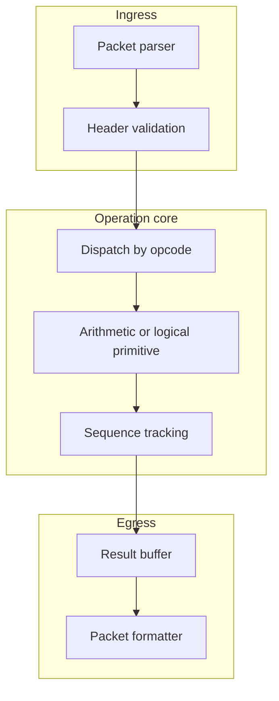

# 3. Architecture

Mini-Sharp is organized around a narrow datapath that recognizes collective
operation packets, applies a primitive operation, and forwards or buffers the
result according to the packet state.

## Conceptual components

## Design questions

- Which collective primitives are useful enough to justify hardware support?
- How much packet metadata must be carried to keep ordering and completion
  rules explicit?
- Where should buffering happen when multiple ranks target the same collective?
- What evidence is needed to compare host-side collectives against in-network
  assistance?

The detailed protocol and pipeline notes live in the next two pages.
