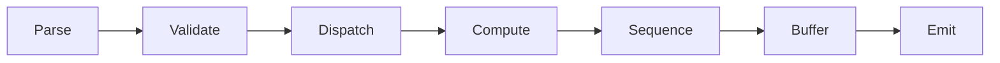

# 3.2 Pipeline

The pipeline should make the lifetime of each packet explicit: parse, validate,
dispatch, compute, sequence, buffer, and emit.

## Working model

## Buffering strategy

The buffering design needs to answer three thesis-level questions:

- How much state is required per active collective?
- What happens when fragments arrive out of order?
- How does the datapath apply backpressure without hiding correctness bugs?

## Throughput and latency notes

The thesis should separate structural latency from load-dependent latency:

$$
L_{total} = L_{pipeline} + L_{queueing} + L_{serialization}
$$

This distinction keeps performance claims tied to measurable terms rather than
one aggregate number.

## Rendering smoke tests

The documentation stack must preserve both diagrams and thesis equations. The
pipeline diagram above is rendered by Mermaid, while the latency expression is
rendered by MathJax from LaTeX syntax.

Inline math works as well: \(L_{pipeline}\) is the fixed number of pipeline
stages, and \(L_{queueing}\) depends on traffic and buffering pressure.
