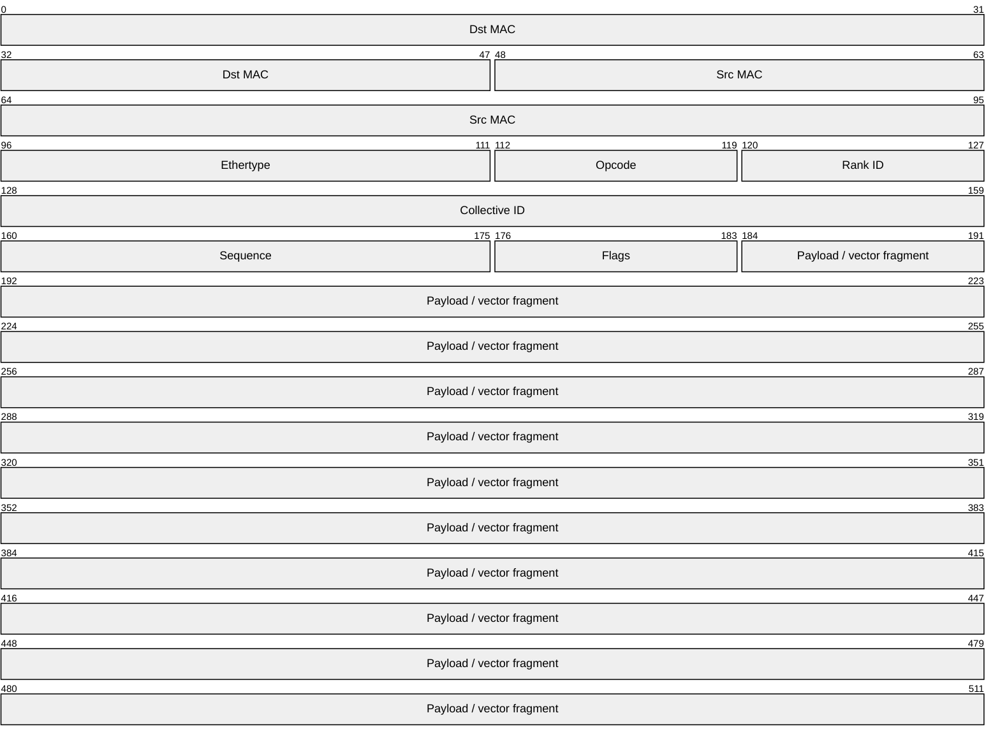

# 3.1 Protocol

The Mini-Sharp protocol sketch captures the packet fields needed to identify a
collective operation, associate fragments with a rank and collective instance,
and carry a payload through the datapath.

## Packet layout

## Field intent

| Field | Purpose |
| --- | --- |
| `Opcode` | Selects the primitive collective operation. |
| `Rank ID` | Identifies the participant that produced the fragment. |
| `Collective ID` | Separates independent collective instances. |
| `Sequence` | Orders fragments within a collective stream. |
| `Flags` | Carries control bits such as first, last, valid, or error. |
| `Payload` | Holds the data fragment consumed by the operation unit. |

!!! warning "Open specification work"

    The final bit allocation must be checked against the RTL parser and any
    traffic generator used in experiments. This page should become the canonical
    source once those interfaces stabilize.

## Referencing this protocol

Other pages can link here when they discuss packet handling, buffering, or
test vectors. Future translations should preserve field names unless the RTL
itself adopts localized naming, which is unlikely.
