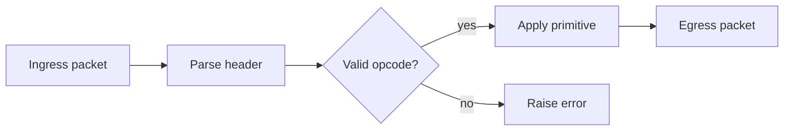
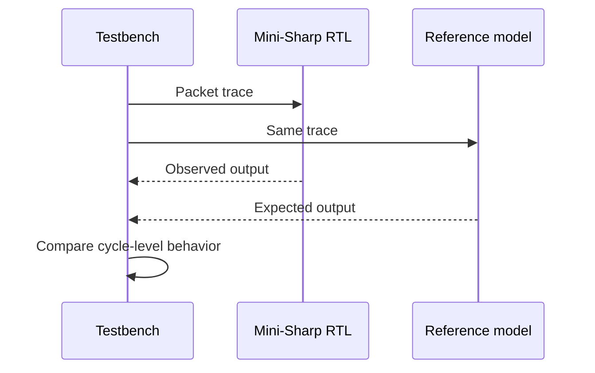

# 2.1 Writing Examples

This page is a small style reference for writing the thesis pages. Copy the
patterns you like into real chapters, then replace the sample text with measured
evidence or stable design notes.

## Admonitions

!!! note "Use notes for reading context"

    A note is useful when the reader needs orientation, but the text is not a
    formal requirement or experimental result.

!!! warning "Use warnings for unstable claims"

    Mark packet formats, addresses, or metrics as unstable until they are backed
    by RTL, tests, or synthesis output.

## Mermaid diagrams





## LaTeX equations

Inline math is good for short symbols such as \(N_{ranks}\), \(L_{pipeline}\),
or \(B_{buffer}\). Display math works better for definitions:

$$
L_{total} = L_{pipeline} + L_{queueing} + L_{serialization}
$$

When reporting speedup, keep the baseline explicit:

$$
S = \frac{T_{host\ collective}}{T_{mini\ sharp}}
$$

## Tabs

=== "Design invariant"

    A packet with an unsupported opcode must not update collective state.

=== "Test case"

    Replay one valid packet before and after the unsupported packet, then check
    that the valid packet sequence is unchanged.

=== "Result"

    Promote this tab into the Results chapter only after the command, trace, and
    expected output are committed.

## Tables

| Claim type | Good evidence | Page destination |
| --- | --- | --- |
| Interface shape | Port table and reset behavior | Architecture |
| Correctness | Deterministic regression trace | Results |
| Performance | Reproducible latency table | Results |
| Open idea | Unverified design alternative | Future Works |

## Code blocks

Use the language name immediately after the opening fence. Prefer
`systemverilog`, `python`, `c`, and `cpp` for thesis pages.

```systemverilog title="valid-ready handshake"
always_ff @(posedge clk) begin
  if (rst) begin
    valid_o <= 1'b0; // (1)
  end else if (ready_i) begin
    valid_o <= valid_i; // (2)
  end
end
```

1. Reset behavior should be stated for every public module.
2. Handshake updates should be tied to `ready_i` so backpressure is explicit.

=== "SystemVerilog"

    ```systemverilog
    typedef enum logic [1:0] {
      MS_IDLE,
      MS_PARSE,
      MS_REDUCE,
      MS_EMIT
    } ms_state_t;

    always_ff @(posedge clk) begin
      if (rst) begin
        state_q <= MS_IDLE;
      end else begin
        state_q <= state_d;
      end
    end
    ```

=== "Python"

    ```python
    def expected_sum(payload_words: list[int]) -> int:
        total = 0
        for word in payload_words:
            total += word
        return total
    ```

=== "C"

    ```c
    uint32_t minis_next(uint32_t state, uint32_t word) {
        return state + word;
    }
    ```

=== "C++"

    ```cpp
    std::uint32_t reduce_sum(std::span<const std::uint32_t> words) {
        return std::accumulate(words.begin(), words.end(), 0u);
    }
    ```

## Tasks and keyboard hints

- [x] Add the page to `mkdocs.yml`.
- [x] Build with `mkdocs build --strict`.
- [ ] Replace sample text with thesis evidence.

Use ++ctrl+s++ to save a page, then let `mkdocs serve` reload the preview.

## Glossary links and abbreviations

Write acronyms normally, for example RTL, FPGA, AXI, DUT, or PCAP. The glossary
tooltip comes from `includes/abbreviations.md`, which MkDocs appends to every
page during the build.

When you want a clickable explanation, link to the glossary entry:

```markdown
The parser is described at RTL and verified against the DUT.
See [RTL](../6-glossary/index.example.md#rtl) and
[DUT](../6-glossary/index.example.md#dut) in the glossary.
```

Rendered example: the parser is described at RTL and verified against the DUT.
See [RTL](../6-glossary/index.example.md#rtl) and
[DUT](../6-glossary/index.example.md#dut) in the glossary.

## Footnotes

Mini-Sharp is written as an RTL-first thesis artifact.[^rtl]

[^rtl]: Keep footnotes short. If the note becomes a paragraph, it probably
    belongs in the main text or in the bibliography workflow.
